# 사용자 행동 페르소나와 쿠폰 반응: 분석 결과 및 시뮬레이터 가정

## 0. 프로젝트 목표와 현재 구현 상태

`AGENTS.md`의 최종 목표는 행동 페르소나, 개입 반응, 세션 내 선택과 세션 간
확률적 지연을 결합한 사용자 모델을 만들고, 오프라인 데이터 생성 및 온라인
에이전트 평가에 사용하는 것이다. 아래 상태는 기존 코드·보고서의 범위를
나타낸다. 구조 정리가 연구 목표의 신규 구현이나 실험 재현을 뜻하지는 않는다.

| 목표 | 현재 결과·구현 | 남은 검증·구현 |
|---|---|---|
| 1. Electronics·Cosmetics 페르소나 군집 | Cosmetics Shop 5개월 원본으로 masked-GRU K=4 재학습, §2 | Electronics와의 통합 유형 및 미래 예측 타당성 미확정 |
| 2. Tianchi CATE·uplift 가설 | 쿠폰 수령 전후·집단 간 관측 비교, §5–6 | 처치 식별·교란·overlap 검증 및 인과 CATE 미완료 |
| 3. 네 canonical type 분포 | 잠재결과 주변확률을 가정한 범위 계산, §7 | 실제 개인 유형과 페르소나별 결합 분포 미식별 |
| 4. 동일 사용자 세션 간격 | 비활동·재관측·군집별 간격 분석, §4·8 | 세션 정의 차이, 검열 및 미래정보 누출 고려 필요 |
| 5. 예측 특징 선정 | 이력·시차·시간 특징 및 그래프 특징 추출 코드 | 최종 통합 특징과 목표 1–4에 근거한 선택 미확정 |
| 6. 종료 포함 행동 효용 | `models/`의 MaxEnt IRL, `simulate/latent_session_model.py`의 END 보상 | 짧은 horizon과 행동 가용성·종료 보정 한계 |
| 7. 종료 후 다음 세션 지연 샘플링 | `LatentSessionUser.finish_session()`의 이산 위험 기반 샘플러 | 30일 밖의 정확한 지연과 장기 rollout 미검증 |
| 8. 이질적 그룹의 MaxEnt IRL | Cosmetics 4개 persona prior와 대표 사용자 80명의 MAP 보상계수, §2 | 장기 전이 보상·외부 일반화 및 uplift 결합 미완료 |
| 9. 그룹별 효용 계수 | sum-to-zero로 식별한 5행동 × 12특징 계수, §2 | 강한 shrinkage가 선택돼 개인 이질성의 표본 근거가 약함 |
| 10. uplift 항 및 0효과 재현 | 보조 uplift·조건부 오퍼 실험과 가상 coupling 함수 | Tianchi 인과 항을 행동·간격에 연결한 통합식 및 양쪽 재현 검증 없음 |
| 11. 세션 후 잠재상태 갱신과 지연 이질성 | 세션 요약·직전 간격 갱신 및 확률적 위험모형 | 초기 GMM latent는 고정; 세션마다 갱신되는 잠재요인 미구현 |
| 12. 유형 분포와 GMM 샘플러 | 군집·사용자 표현 GMM 및 계수 샘플링 파일럿 | 최종 유형 분포·파라미터 생성모형 미확정 |
| 13. 오프라인 생성·온라인 시뮬레이터 | 세션 사용자 객체와 주간 쿠폰 정책 환경, §10 | 일별 집계 환경을 세션 시각 모형과 완전히 통합하지 않음 |
| 14. 에이전트별 관측 특징 | 과거 7·30일 행동, persona, lifecycle, 쿠폰 이력의 19특징 계약, §10 | 실제 운영 로그의 feature availability 검증 필요 |
| 15. 논문 기반 과제 목적 | 구매 +1,000, 실제 쿠폰 발송 -100의 장기 순이익, §10 | 비용·마진 민감도 및 외부 타당성 미검증 |
| 16. Lin-UCB·Lin-TS·TS·UCB·PPO·SAC | 공통 seed 평가 실행 완료, §10 | 단일 학습 seed이며 hyperparameter sweep·통계적 순위 검정 미수행 |

구현 파일의 기준 경로는 `src/`이다. 현재 실행 위치와 구조는
[README](README.md), [스크립트 목록](scripts/README.md)에 정리한다.
부록의 이전 저장소 구조·호환성 설명은 당시 기록이며 현재 경로에 적용되지 않는다.

## 1. 요약 및 범위

Electronics와 Cosmetics의 행동 시퀀스에서는 조회 중심, 장바구니 활용, 장바구니·구매 혼합 등 여러 **기술적 행동 패턴**이 관찰됐다. 이러한 차이를 시뮬레이터의 사용자 이질성으로 표현할 수 있다. 하지만 현재 결과는 서로 독립적이고 상호 배타적인 페르소나가 실재한다는 검증이나, 각 페르소나의 쿠폰 효과를 추정한 결과가 아니다.

이 문서는 다음 세 가지를 구분한다.

1. **관측**: 원본 행동 로그 또는 기존 집계에서 직접 계산한 기술 통계.
2. **모델링 가정**: 시뮬레이션을 위해 선택하는 분기·잠재변수·효과 지속 형태. 참값으로 검증되지 않았다.
3. **미식별**: 개별 사용자의 반사실적 구매, 페르소나별 쿠폰 uplift와 canonical type 분포 등 현재 자료로 확인할 수 없는 값.

Electronics·Cosmetics를 행동 분석 대상으로 사용하고, 쿠폰의 관측적 참고 자료로 Tianchi O2O를 별도로 사용한다. 사용자를 서로 연결하지 않았으며 이 세 데이터 간 페르소나와 반응을 학습해 결합한 것은 아니다. 관측 부재를 실제 비활동으로 처리하는 것은 향후 시뮬레이터의 단순화 가정이지 원자료의 완전성이 입증됐다는 뜻이 아니다.

## 2. 행동 시퀀스 기반 페르소나

### 현재 기준: Cosmetics Shop 4개 페르소나

2026-10-24 실행에서는 Kaggle의 Cosmetics Shop 형식과 일치하는 2019-10부터
2020-02까지 5개 CSV만 사용했다. 전체 20,692,840행에서 `user_id mod 100 = 0`인
고정 약 1% 표본 216,093행을 읽고, 최대 12,000명의 앞 64개 행동·세션 경계
토큰으로 48차원 masked bidirectional-GRU 표현을 다시 학습했다. 상품·가격·쿠폰은
인코더에 넣지 않았다. K-means의 운영 군집 수는 연구 설계에 따라 4로 고정했고,
학습 및 보류 silhouette은 각각 0.474와 0.472였다.

| Persona | 사용자 | 관측 행동 구성 | 관측 요약과 작업 라벨 |
|---|---:|---|---|
| P0 | 432 | view 28.3%, cart 34.7%, remove 17.6%, purchase 19.3% | 구매 기록 사용자 100%인 **구매 혼합형** |
| P1 | 9,061 | view 89.9%, cart 6.1%, remove 2.5%, purchase 1.6% | 행동 중앙값 2개의 **짧은 조회형** |
| P2 | 541 | view 37.2%, cart 29.1%, remove 26.4%, purchase 7.3% | 평균 20.9세션·행동 중앙값 118개의 **장기 장바구니 수정형** |
| P3 | 1,966 | view 39.4%, cart 40.6%, remove 16.2%, purchase 3.8% | 행동 중앙값 7개의 **장바구니 중심형** |

라벨은 행동 구성을 설명하는 작업명이며 심리적 속성이나 인과 유형이 아니다.
후속 baseline에서는 P1을 생애상태가 섞인 관측군으로 보고, 성숙 행동형인
P0·P2·P3의 centroid에 가장 가까우면서 2세션 이상인 사용자 20명씩, 총 60명을
대표 표본으로 고정했다. 사용자 ID와 48차원 임베딩은
`artifacts/cosmetics-shop-persona-maxent-irl/representative_users.parquet`에 있어
후속 실행에서 GRU를 다시 계산할 필요가 없다.

### Persona-conditioned MaxEnt IRL

다음 행동을 `view`, `cart`, `remove`, `purchase`, 추론된 `end` 중 하나로 두고,
결정 직전에 관측 가능한 상태만 사용했다. 상태 특징은 절편, 세션 내 위치,
세션 경과시간, 직전 이벤트 간격, 세션 내 네 행동의 과거 횟수, 직전 행동
one-hot이다. 비음수 연속량에는 `log1p`를 적용한 뒤 대표 사용자를 제외한
표본의 평균과 표준편차로 정규화했다. `end`는 로그에 직접 존재하지 않으므로
마지막 이벤트 이후 30분이 전체 관측 창 안에 있고 그 전에 다음 세션이 시작하지
않을 때만 추가했다. 이 30분은 관측 가능성 판정에만 사용하며 reward feature에는
넣지 않는다.

효용은 `r_u(s,a)=theta[u,a]^T phi(s)`이고 temperature는 1로 고정했다. softmax는
모든 행동 계수에 공통값을 더해도 동일하므로 view를 임의 기준으로 고정하지
않고, 각 특징에서 다섯 행동 계수의 합이 0이 되도록 식별했다. 먼저 대표 60명을
제외하고 persona prior를 추정했다. 각 대표 사용자는 초기 60%에서 prior 중심의
MAP 계수를 학습하고, 다음 20%를 합쳐 persona별 shrinkage 강도를 선택한 뒤,
마지막 20%를 한 번만 평가했다. 세 성숙 persona 모두 후보 중 가장 강한 50을 선택했다.

| Persona | 후기 결정 수 | 개인 MAP NLL | Prior NLL | 개인 MAP 정확도 | Prior 정확도 | 개인 MAP 행동비율 RMSE | Prior RMSE |
|---|---:|---:|---:|---:|---:|---:|---:|
| P0 | 109 | 0.894 | 0.892 | 0.631 | 0.625 | 0.085 | 0.079 |
| P2 | 541 | 0.813 | 0.815 | 0.706 | 0.697 | 0.062 | 0.057 |
| P3 | 54 | 0.897 | 0.893 | 0.620 | 0.595 | 0.147 | 0.145 |
| 전체 사용자 평균 | 704 | 0.868 | 0.867 | 0.652 | 0.639 | 0.098 | 0.094 |

개인 MAP은 정확도를 0.639에서 0.652로 높였지만 NLL과 행동비율 RMSE는 prior보다
소폭 나빴다. 전체 224,921개 결정 중 보수적으로 추론된 END는
26,813개다. 따라서 20명의 centroid 근접 표본만으로는 강한
개인별 보상 이질성이 보류 구간에서 지지되지 않는다. 현재 개인 계수는 독립적인
개인 효용의 정밀 추정치가 아니라 **persona prior에 강하게 수축된 계수**로
사용해야 한다. 60명 × 5행동 × 12특징의 3,600개 계수는
`artifacts/cosmetics-shop-persona-maxent-irl/user_coefficients.parquet`, 개인별
평가는 `user_fit_metrics.csv`, persona prior는 `persona_priors.json`에 저장했다.

합이 0인 식별 제약 때문에 중복되는 `end` 행을 제외한 48개 자유계수를 사용자별
벡터로 만들고 대각 GMM의 성분 수를 1–6으로 탐색했다. 학습 표본에서 유효 사용자
5명 미만인 성분을 금지한 뒤 BIC가 가장 낮은 모형은 3성분이었다. 4–6성분은
singleton 성분이 생겨 제외했다. 세 성분은 각각 P2·P3·P0와 정확히 대응했다.
대표 표본은 persona별 20명으로 균형 추출했으므로 raw GMM weight 1/3을 사용하지
않고 전체 성숙 사용자 비율로 사후 보정했다.

| GMM 성분 | 대응 persona | 시뮬레이터 혼합비 | 계수 분산 중앙값 |
|---|---|---:|---:|
| 0 | P2 | 18.41% | 0.001242 |
| 1 | P3 | 66.89% | 0.000094 |
| 2 | P0 | 14.70% | 0.000325 |

성분별 평균·분산은 `coefficient_gmm_parameters.csv`, 사용자 posterior는
`coefficient_gmm_memberships.csv`, K 탐색은 `coefficient_gmm_grid.csv`, 실행용
정규화 값과 혼합모형은 `coefficient_gmm.json`에 저장했다. 이 분산은 centroid
근접 표본과 강한 MAP 수축 이후의 **조건부 잔여 이질성**이며 전체 모집단 분산의
불편추정량으로 해석하지 않는다.

이 구현은 상태조건부 최대인과엔트로피 선택모형이며 장기 상태전이의 occupancy를
맞추는 유한-horizon trajectory IRL은 아니다. 보상은 관측 선택을 설명하지만
인과적 효용을 식별하지 않는다. Cosmetics에는 쿠폰 처치가 없으므로 canonical
type을 여기서 추정하거나 계수에 임의로 넣지 않았다. canonical type과 uplift는
별도의 처치 자료에서 학습해 이 baseline에 추가해야 하며, 0 uplift일 때 현재
정책을 재현하는지를 검증해야 한다.

### 2차 persona reward 비교

개인화 전에 persona reward 자체의 표현력을 확인하기 위해 표준화된 11개 비절편
특징에 각 제곱항 11개와 서로 다른 특징의 2변수 교차항 55개를 추가했다. 따라서
선형식은 12특징, 2차식은 78특징이다. 3변수 곱과 절편의 제곱·교차는 사용하지
않았다. 이상치가 제곱되며 최적화를 지배하지 않도록 2차항을 만들 때만 표준화된
기본 특징을 `[-5,5]`로 절단하고, 파생항을 prior 학습 표본에서 다시 표준화했다.

대표 사용자별 중간 20%에서 persona별 정규화 강도를 선택한 후 마지막 20%에서
선형·2차식을 비교했다. 안정적으로 수렴한 후보는 `0.001, 0.01, 0.1`이고 모든
2차 persona가 하한 `0.001`을 선택했다. 이는 탐색 범위 안의 선택이지 내부
최적점이라는 뜻은 아니다.

| Persona | 선형 NLL | 2차 NLL | 선형 정확도 | 2차 정확도 | 선형 행동비율 RMSE | 2차 RMSE |
|---|---:|---:|---:|---:|---:|---:|
| P0 | 0.859 | 0.779 | 0.642 | 0.651 | 0.0439 | 0.0399 |
| P1 | 0.071 | 0.037 | 0.976 | 1.000 | 0.0128 | 0.0066 |
| P2 | 0.773 | 0.728 | 0.715 | 0.719 | 0.0192 | 0.0185 |
| P3 | 0.889 | 0.857 | 0.593 | 0.611 | 0.1128 | 0.1036 |
| Persona 단순 평균 | 0.648 | 0.600 | 0.732 | 0.745 | 0.0472 | 0.0422 |

결정 수로 가중한 NLL도 `0.754 → 0.706`, 정확도는 `0.710 → 0.717`로 개선됐다.
따라서 2차 reward는 네 persona 모두에서 선형 reward보다 일관되게 나았고, 현재
persona utility의 기본 사양으로 채택할 근거가 있다. 다만 이는 보류 행동의 예측
적합도 개선이지 제곱항·교차항의 인과효과를 의미하지 않는다. 계수는
`artifacts/cosmetics-shop-persona-quadratic-irl/persona_reward_priors.json`,
persona별 비교값은 `persona_reward_comparison.csv`에 저장했다.

### Persona별 세션 간격 규칙

2차 persona reward가 `end`를 선택하면 다음 세션까지의 시간은 별도 이산시간
hazard에서 샘플링한다. 구간은 `0–1h`, `1–6h`, `6–24h`, `1–3d`, `3–7d`,
`7–14d`, `14–30d`다. 각 구간에서 복귀 여부를 순서대로 Bernoulli 추출하고,
선택된 구간 안에서는 계산 편의를 위해 균등분포로 정확한 시간을 뽑는다. 어느
구간에서도 복귀하지 않으면 영구 이탈이 아니라 **30일 이내 미복귀**로 기록한다.

세션 종료 시점에 이미 관측된 `view/cart/remove/purchase` 횟수, 세션 지속시간,
전체 행동 수, 직전 세션 간격과 직전 간격 존재 여부를 사용한다. 기본 모형은 여기에
모든 사용자에게 동일한 평균 delay magnitude를 지속 상태로 제공한다. 미래 세션
정보는 기본 모형의 특징에 포함하지 않고, 관측 종료일까지의 우측 검열을
person-period likelihood에 반영했다. 대표 사용자 80명은 hazard 학습과
상태조건부/시간-bin 모형 선택에서 제외하고 최종 평가에만 사용했다.

첫 관측 세션에는 직전 세션 간격이 없으므로 이를 0으로 놓지 않고, 대표 사용자를
제외한 학습 표본에서 관측된 `0–720시간` 간격의 산술평균인 **51.33시간**을 초기
magnitude로 사용한다. `has_previous_gap=0`은 그대로 유지해 평균으로 초기화된
값과 실제로 관측된 51.33시간을 구분한다. 시뮬레이터에서는 첫 세션 이후 샘플링한
간격을 사용자 상태에 저장하고, 다음 세션부터 그 저장값을 사용한다.

추가로 각 사용자의 **전체 관측 기간(미래 포함)**에서 평균 세션 간격을 계산해 모든
세션에 고정 latent magnitude로 제공하는 oracle ablation을 수행했다. 동적인 직전
간격과 고정된 개인 평균을 동시에 사용하므로 HMM의 사용자 잠재상태와 유사하지만,
시간에 따라 전이하는 상태를 별도로 추정한 것은 아니다. 간격이 하나 이상 관측된
5,250명에게 개인값을 계산했고, 나머지는 51.33시간으로 대체했다. 이 oracle 값은
시뮬레이터 구조의 정보가치를 측정하기 위한 상한이며 실시간 예측 결과로 해석하면
안 된다.

장기 복귀·이탈을 제외하고 `1시간·6시간·24시간·3일·7일` 복귀만으로 모형 선택과
평가를 다시 수행했다. 평가 행 수로 가중한 Brier는 공통 magnitude `0.21156`에서
개인 oracle `0.20033`으로 **5.31% 감소**했다. 첫 세션만의 단순 평균은
`0.24771`에서 `0.21972`로 11.30% 감소했다.

| 복귀 horizon | 평가 세션 | 공통 magnitude Brier | 개인 oracle Brier | 상대 개선 |
|---:|---:|---:|---:|---:|
| 1시간 | 384 | 0.16470 | 0.15552 | 5.58% |
| 6시간 | 383 | 0.20808 | 0.19467 | 6.45% |
| 24시간 | 382 | 0.23022 | 0.21675 | 5.85% |
| 3일 | 378 | 0.23334 | 0.22109 | 5.25% |
| 7일 | 363 | 0.22249 | 0.21482 | 3.45% |

| Persona | 평가 행 | 공통 magnitude Brier | 개인 oracle Brier | 상대 개선 |
|---:|---:|---:|---:|---:|
| P0 | 250 | 0.16068 | 0.15094 | 6.06% |
| P1 | 379 | 0.21479 | 0.20364 | 5.19% |
| P2 | 1,014 | 0.21783 | 0.20972 | 3.72% |
| P3 | 247 | 0.23235 | 0.20669 | 11.04% |

모든 단기 horizon과 모든 persona에서 개선되어 개인별 평균 delay는 단기 복귀를
설명하는 일관된 latent factor로 볼 수 있다. 효과는 6시간에서 가장 크고 7일로
갈수록 줄어든다. 현재 기본 시뮬레이터는 공통 magnitude를 사용하고, 개인
magnitude를 안다고 가정하는 시나리오에서는 `session_gap_user_oracle_priors.csv`
값을 모든 세션에 지속적으로 주입할 수 있다.

### Gap-token MaxEnt user choice와 lifecycle state

연속 delay는 `0–1h`, `1–6h`, `6–24h`, `1–3d`, `3–7d`, `7–14d`, `14–30d`,
`NO_RETURN_30D`의 여덟 토큰으로 바꿨다. 30일 미복귀는 영구 이탈이 아니라
720시간을 완전히 관측한 우측 검열 인식 결과다. 선택모형은 먼저 30일 내
복귀 여부를 고르고, 복귀한 경우에만 일곱 gap token 중 하나를 고르는 nested
MaxEnt/MNL 구조다.

출생 시 고정되는 home persona와 변하는 lifecycle을 분리한다. 성숙 home persona는
P0·P2·P3이고 모집단 비율은 각각 14.70%, 18.41%, 66.89%다. 기존 P1은 더 이상
시뮬레이터 persona로 사용하지 않는다. P1은 짧은 조회가 대부분인 관측 군집이어서
신규 진입, 미성숙 행동, 이탈 진행과 단일 방문이 섞여 있었기 때문이다.

Cosmetics에는 가입일이 없으므로 `NEW`는 실제 신규 가입자가 아니라 관측창 첫 등장이다.
좌측 절단을 줄이기 위해 로그 시작 30일 뒤부터 종료 60일 전 사이에 처음 등장하고
6세션 이상인 425명만 lifecycle 변화 분석에 사용했다. 첫 2세션, 3–4세션, 마지막
2세션을 각각 초기·중기·후기로 두었다. 전체 P0·P2·P3 사용자의 행동 구성, 세션당
이벤트, 행동 포함 세션율과 gap으로 다항 분류기를 학습했고 사용자 단위 5-fold
정확도는 80.81%였다. 짧은 2세션 window의 평균 confidence는 0.64–0.66이므로 아래
상태는 확정 라벨이 아니라 행동형 투영이다.

초기 행동은 view 72.95%, cart 19.51%, remove 5.25%, purchase 2.29%였고 행동 수
중앙값은 4회였다. 초기 투영은 P3 66.6%, P2 25.6%, P0 7.8%였으며 초기에서 후기
행동형이 바뀐 사용자는 46.6%였다. 따라서 모든 신규 사용자를 하나의 고정
조회 persona로 두기보다 `NEW` 이후 P0·P2·P3 중 하나로 전환시키는 구조가 타당하다.

종료 후 30일을 완전히 관측한 미복귀자는 268명이었다. 이 중 마지막 세션에 구매가
없는 247명은 `CHURNING`, 구매가 있는 21명은 `PURCHASE_EXIT_CANDIDATE`로 분리했다.
나머지 157명은 관측 종료 전 30일 이내에 마지막 세션이 있어 `RIGHT_CENSORED`이며
활성 사용자로 간주하지 않았다.

| 종료 상태 | 구간 | view | cart | remove | purchase | 이벤트 중앙값 | gap 중앙값 |
|---|---|---:|---:|---:|---:|---:|---:|
| CHURNING | 초기 | 79.3% | 15.5% | 3.6% | 1.6% | 3 | 0.24h |
| CHURNING | 중기 | 82.0% | 11.1% | 5.2% | 1.7% | 2 | 1.27h |
| CHURNING | 후기 | 83.7% | 9.8% | 5.9% | 0.5% | 2 | 11.20h |
| PURCHASE_EXIT_CANDIDATE | 초기 | 61.8% | 30.1% | 7.4% | 0.7% | 8 | 0.21h |
| PURCHASE_EXIT_CANDIDATE | 중기 | 60.2% | 30.0% | 8.7% | 1.1% | 5 | 6.17h |
| PURCHASE_EXIT_CANDIDATE | 후기 | 23.7% | 19.1% | 21.0% | 36.2% | 15 | 6.59h |

일반 이탈은 조회 집중, 행동 수 감소, gap 증가가 함께 나타난다. 구매 후 미복귀자는
초기·중기에 주로 P3형 탐색을 보이다가 후기에는 85.7%가 P0형으로 전환됐다. 다만
분류기가 구매를 사용하므로 이 P0 전환은 독립적인 검증이 아니다. `MISSION_EXIT`은
출생 시 고정 비율로 부여하지 않고, 구매가 satiation을 높인 뒤 학습된 continuation
utility가 `NO_RETURN_30D`를 선택했을 때 발생하는 결과 상태로 정의한다. 과거 4.50%
proxy는 비교용 진단값일 뿐 현재 시뮬레이터 입력으로 사용하지 않는다.

무쿠폰 상태공간은 `NEW`, `P0`, `P2`, `P3`, `CHURNING`, `MISSION_EXIT`, `EXIT`이다.
`NEW`는 home persona만 샘플링하며, 구매 없는 30일 미복귀는 `CHURNING`, 구매 후
미복귀는 `MISSION_EXIT`로 이동한다. `CHURNING`에서 복귀하면 원래 home persona로,
구매 없이 다시 미복귀하면 `EXIT`로 이동한다. `MISSION_EXIT`과 `EXIT`는 무쿠폰
기준 흡수상태다. 재현 산출물은 `artifacts/cosmetics-lifecycle/`에 저장했다.

### Electronics 교차검증과 lifecycle·구매 패턴 확정

Cosmetics 전용 분석의 상태 규칙을 Electronics에 그대로 적용했다. 두 로그 모두 가입일이
없으므로 `NEW`는 최초 관측 두 세션의 proxy로 한정했다. 최초 관측이 로그 시작 30일 뒤,
종료 60일 전이며 6세션 이상인 사용자를 초기 2세션·중기 2세션·후기 2세션으로 나눴다.
30일 추적이 완전한 최종 세션 중 구매가 없으면 `DISSATISFIED_CHURNING`, 구매가 있으면
`SATIATED_EXIT_CANDIDATE`로 정의했다. 후자는 만족을 직접 관측한 라벨이 아니라
시뮬레이터에서 포만 이탈로 해석하기 위한 구매-후-미복귀 proxy다.

Cosmetics 425명은 불만족 이탈 247명, 만족 이탈 후보 21명, 우측 검열 157명이었다.
Electronics 128명은 각각 101명, 7명, 20명이었다. 불만족 이탈군의 초기→중기→후기
직전 gap 중앙값은 Cosmetics에서 `0.24→1.27→11.20시간`, Electronics에서
`17.15→28.89→40.89시간`으로 모두 증가했다. 같은 구간의 view 비중은 각각
`81.0→84.6→87.4%`, `89.3→89.6→94.7%`로 높아지고 이벤트 중앙값은 `3→2→2`,
`4→3→2`로 감소했다. 따라서 절대 시간척도는 다르지만 방문 간격 증가, 조회 집중,
행동량 감소라는 이탈 방향은 공통이다.

만족 이탈 후보는 후기 구매 비중이 Cosmetics 46.8%, Electronics 20.5%였고, 불만족
이탈군은 각각 0.6%, 2.4%였다. 이 차이로 두 종료 모드를 운영상 분리할 수 있다. 다만
표본이 21명과 7명뿐이므로 만족 이탈의 모집단 비율을 정밀 추정한 결과로 사용하지 않는다.

교차검증 군집은 기존 simulator의 P0/P2/P3와 동일한 이름을 쓰지 않는다. 기존 P0는
구매 혼합형인데 새 K=4의 C0는 저구매형이므로 이름을 재사용하면 의미가 충돌한다.
공통 행동 프로파일의 최근접 대응 `C0↔E1`, `C2↔E0/E2`, `C3↔E3`을 각각
S0·S1·S2로 두었다. Cosmetics C1은 독립적인 Electronics 대응군이 없어
`UNRESOLVED`로 제외했다. 공통 프로파일별 구매 세션률은 다음과 같다.

| Shared profile | Cosmetics | Electronics | 공통 순위 |
|---|---:|---:|---|
| S0 | 0.60% | 2.21% | 최저 |
| S1 | 9.81% | 20.52% | 최고 |
| S2 | 6.54% | 7.40% | 중간 |

S1의 30일 미복귀 중 만족 이탈 후보 비중은 Cosmetics 16.6%, Electronics 26.0%였고,
S0는 0.5%, 1.5%였다. 즉 구매 행동뿐 아니라 구매 후 종료 분기도 행동 프로파일에
조건부로 두는 것이 타당하다. S2는 두 도메인 모두 구매율이 중간이지만 Electronics
표본이 42명, lifecycle cohort가 11명뿐이므로 종료상태 분포는 고정하지 않는다.

실제 simulator home persona는 기존 Cosmetics P0/P2/P3를 유지한다. 이들의 구매 세션률은
각각 7.47%, 4.19%, 4.30%이고 구매 이벤트 비중은 13.03%, 5.50%, 4.93%다. 따라서
P0의 구매 혼합형, P2의 장기 검토형, P3의 장바구니 중심형이라는 기존 reward 계수의
의미를 보존한다.

여기에 희소 장기 구매자 `P_LT`를 P2의 latent subtype으로 추가했다. 운영상 정의는
10세션 이상, 구매 세션 3회 이상, 관측 span 30일 이상이다. Cosmetics에서는
10,672명 중 70명(0.656%), Electronics에서는 10,688명 중 7명(0.066%)이 만족했다.
Cosmetics 70명 중 51명이 기존 P2였으므로 P2 조건부 subtype으로 둔다. P2 내부에서
`P_LT`의 구매 logit은 +0.568, 30일 미복귀 logit은 -0.539였다. 이는 전체 이력을 사용한
사후 calibration label이며 온라인에서 직접 관측되는 persona가 아니다.

각 LT 사용자의 30일 결과를 판정할 수 있는 세션을 시간순 3등분해 이탈 진행 신호를
확인했다. `view-led churning`은 최종 비구매 세션 뒤 30일 미복귀, 후기 조회 비중
10%p 이상 증가, 후기 세션당 행동량 감소를 모두 만족하는 대리상태다.

| Dataset | LT | 비구매 30일 미복귀 | 조회 +10%p | 행동량 감소 | 두 조건 동시 |
|---|---:|---:|---:|---:|---:|
| Cosmetics | 70 | 7 | 4/7 | 6/7 | 4/7 |
| Electronics | 7 | 2 | 1/2 | 1/2 | 1/2 |

Cosmetics 비구매 미복귀자 중 구매 비중 감소와 과거 세션 간격 2배 증가는 각각
3/7이었다. 조회 중심 변화는 존재하지만 모든 LT 이탈자에게 나타나지 않았고, 단독
전조로는 특이도가 부족하다. 따라서 생성기의 `DISSATISFIED_CHURNING` 판정은 조회비중
하나가 아니라 행동량 수축과 30일 미복귀를 함께 사용한다. Electronics는 LT가 7명뿐인
존재성 확인 결과다. 상세 산출물은 `long_term_stage_changes.csv`,
`long_term_churn_signals.csv`, 그림은 `img/persona/long_term_churn_progression.png`다.

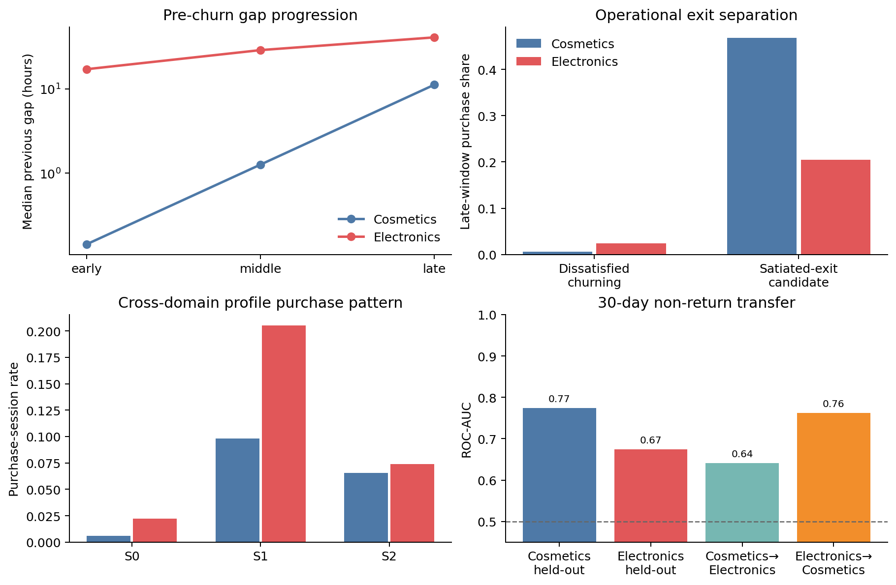

최종 무쿠폰 상태공간은 `NEW`, `HOME_PERSONA(P0/P2/P3, P_LT subtype)`,
`DISSATISFIED_CHURNING`, `SATIATED_EXIT`, `EXIT`로 고정한다. home persona는 출생 시 한
번 샘플링하고 재활성화 시 복원한다. 세션 종료 시 공통 11개 과거정보 feature로 30일
미복귀를 먼저 선택한 뒤, 현재 세션 구매가 있으면 `SATIATED_EXIT`, 없으면
`DISSATISFIED_CHURNING`으로 분기한다. 현재 실행기의 `MISSION_EXIT`은
`SATIATED_EXIT`의 호환 별칭으로 남긴다.

공통 transition head는 현재 세션의 순서·행동량·view/cart/purchase 비중·지속시간,
직전 gap·gap acceleration과 S1/S2 indicator를 사용했다. 사용자 단위 보류 ROC-AUC는
Cosmetics 0.774, Electronics 0.674였다. Cosmetics→Electronics 전이는 0.641,
Electronics→Cosmetics 전이는 0.762였다. 방향성은 양쪽에서 재현됐지만 절대 이탈률과
시간척도는 도메인별로 달라 공통 slope와 persona 효과만 공유하고 baseline calibration은
도메인별로 유지해야 한다. 이는 예측적 lifecycle 구조이며 인과효과가 아니다.

관측 intercept를 생성기에 그대로 넣지 않고 simulator moment로 재보정했다. 독립 seed
10,000명 rollout에서 30일 미복귀율은 목표 26.243% 대비 26.325%(오차 0.082%p),
미복귀 중 만족 이탈 비중은 목표 4.915% 대비 5.007%였다. `P_LT`는 82명(0.82%)이
샘플링됐고 구매 세션률 5.23%, 30일 미복귀율 4.37%로 일반 사용자 3.20%, 27.24%와
구분됐다.

재현 산출물은 `artifacts/cross-domain-lifecycle/`의 `lifecycle_model.json`,
`stage_profiles.csv`, `persona_purchase_profiles.csv`, `persona_terminal_profiles.csv`,
`long_term_buyer_profiles.csv`, `rollout_summary.json` 및 `return_decisions.parquet`에 저장했다.

### Lifecycle-conditioned immediate MaxEnt IRL

사용자 계수 자체를 세션마다 random walk시키지 않는다. 출생 시 home persona에
조건부인 GMM에서 사용자별 기본 계수 `theta_u`를 한 번 샘플링해 고정하고, 과거
세션만으로 재귀 갱신되는 연속 상태가 행동별 reward offset을 바꾼다.

`r_u(a_t)=theta_u[a_t]^T phi_t + beta_p[a_t]^T z_t + nu_p[a_t] I(NEW)`

`z_t`는 engagement, friction, satiation, inactivity momentum, gap acceleration,
habit strength의 여섯 값이다. P0/P2/P3의 상태 memory는 gap validation에서 선택한
0.5/0.9/0.9를 사용한다. 따라서 기본 취향은 고정되지만 유효 reward는 상태가
누적되면서 점진적으로 변하고, `NEW`에서만 별도 이산 offset이 적용된다. 현재
행동의 미래 Q-value는 계산하지 않는 즉시 reward 기반 MaxEnt/MNL이다.

| Persona | 기본 NLL | Lifecycle NLL | 기본 정확도 | Lifecycle 정확도 | 기본 mix RMSE | Lifecycle mix RMSE |
|---|---:|---:|---:|---:|---:|---:|
| P0 | 0.859 | **0.847** | 64.2% | 64.2% | 0.0439 | **0.0432** |
| P2 | 0.773 | **0.748** | 71.5% | **72.5%** | 0.0192 | **0.0178** |
| P3 | 0.889 | **0.828** | 59.3% | **64.8%** | 0.1128 | **0.1020** |
| 평균 | 0.840 | **0.808** | 65.0% | **67.2%** | — | — |

행동 IRL과 전이는 분리했다. 행동은 위의 즉시 reward softmax로 선택하고, 세션 종료
후에는 기존 nested gap MaxEnt가 `NO_RETURN_30D`와 일곱 복귀 토큰을 선택한다.
구매가 발생하면 satiation이 갱신되며, 그 뒤 `NO_RETURN_30D`가 선택된 경우에만
`MISSION_EXIT`로 이동한다. 실행 모형과 평가는 `lifecycle_irl_model.json`,
`lifecycle_irl_metrics.csv`, `lifecycle_irl_summary.json`에 저장했다.

### 무쿠폰 end-to-end rollout 검증

개인별 기본 reward 계수는 home persona에 조건부인 3성분 GMM에서 한 번 뽑아
고정하고, lifecycle action IRL과 gap-token 모형을 연결해 10,000명(45,522세션)을
관측 문맥 재사용 없이 생성했다. 세션 내부 이벤트 간격은 행동모형 학습 scaler의
기하평균에 맞춘 지수분포 근사이며, 30분에서 절단했다.

| 지표 | 관측/보류 집계 | 생성 | 차이 |
|---|---:|---:|---:|
| view 비율 | 44.21% | 36.65% | -7.56%p |
| cart 비율 | 28.33% | 35.48% | +7.15%p |
| remove 비율 | 20.57% | 18.73% | -1.84%p |
| purchase 비율 | 6.89% | 9.13% | +2.24%p |
| 구매 세션 비율 | 4.23% | 3.94% | -0.29%p |
| 30일 비복귀율 | 26.24% | 21.91% | -4.33%p |
| 비복귀 중 구매 후 종료 비중 | 4.92% | 8.22% | +3.31%p |

행동비율 RMSE는 0.0540이다. 최대 100행동에서 강제 종료된 세션은 0.057%, 최대
50세션에 도달해 절단된 사용자는 0.26%였다. 사전 기준(action RMSE 0.10 이하,
비복귀율·구매 후 종료 비중 오차 5%p 이하, 두 절단율 1% 이하)을 모두 통과했다.
따라서 **uplift가 없는 baseline 생성기는 구현·통합 검증 완료**로 고정한다. 다만
이는 집계 적합성 기준이며 개인 trajectory의 동일 재현이나 인과적 utility 식별을
뜻하지 않는다. 특히 view를 과소, cart와 purchase를 과대 생성하는 잔여 오차는
uplift 학습 전에 baseline 오차로 보존해 처치효과와 혼동하지 않아야 한다.

실행 결과는 `no_uplift_rollout_summary.json`, 세션 표본은
`no_uplift_rollout_sessions.parquet`, 전이와 gap 분포는 각각
`no_uplift_rollout_transitions.csv`, `no_uplift_rollout_gap_mix.csv`에 저장했다.

### Tianchi 기반 uplift extension

무쿠폰 baseline 계수와 lifecycle 전이는 고정한 채 쿠폰 수령 이력에서 계산되는
purchase 및 return logit offset만 추가했다. P0/P2/P3는 Tianchi의 purchase-path,
deep-consideration, cart-revision proxy에 각각 대응시켰다. 각 proxy의 관측
`p0,p1`을 주변분포로 두고 최대엔트로피 독립 coupling을 택해 sure thing,
persuadable, sleeping dog, lost cause의 persona별 목표 분포를 만들었다. 기존
48차원 GRU latent를 표준화한 뒤 하나의 `49×4` 행렬과 softmax로 개인별 확률을
계산한다. 행렬은 persona별 평균 확률이 목표 분포를 맞추도록 weak supervision으로
학습했으며 `L1=0.001`, `L2=0.01`을 적용했다. 사용자 분리 held-out 분포 RMSE는
0.0096, 전체 fit RMSE는 0.0019다. Synthetic user는 persona별 full-covariance
Gaussian에서 latent를 먼저 뽑고 그 확률로 type을 한 번 샘플링해 고정한다. 이는
사용자별 반사실 유형의 추정값이 아니라 시뮬레이터 가정이다.

Persuadable에는 양의 offset, sleeping dog에는 음의 offset을 주며 나머지 두
유형의 처치 offset은 0이다. 반복 수령은 `sqrt(sum(decayed exposure))`로 합쳐
한계효과가 감소하고, 개별 수령 효과는 6주 안에서 단조 감소해 35일째 0이 된다.
공통값 4는 초기값으로만 사용했다. 별도 seed의 6,000명 rollout에서 persona별
Tianchi 14일 구매 차이를 simulated-moment target으로 두고 multiplicative update와
early stopping으로 P0/P2/P3 strength `8.536/3.811/3.508`을 학습했다.

독립 seed의 10,000명 validation에서 모집단 가중 14일 구매 차이는 Tianchi proxy
목표 +12.62%p, 생성 +12.55%p(오차 0.07%p)였다. persona별 최대 오차는
0.98%p였다. 구매 세션률은 3.94%에서 15.55%, 30일 비복귀율은 21.91%에서
18.65%로 변했다. `strength=0` 또는 수령
이력이 없으면 offset이 정확히 0이므로 기존 baseline을 그대로 재현한다. 모델은
`artifacts/tianchi-uplift-model/model.json`, 검증은 `rollout_summary.json`에 저장했다.
이 수치는 Tianchi의 인과효과 주장이 아니라 합성환경의 calibration target이다.

#### 공통 행동 프로파일을 통한 Tianchi 쿠폰 대리군 매칭

기존 Tianchi proxy 이름을 P0/P2/P3에 직접 대응시키지 않고, 수령 전 행동만으로
교차 도메인 프로파일을 먼저 거쳤다. 2016년 5월 15일 이전 28일의 click·purchase가
2건 이상인 사용자의 13개 공통 행동특징을 Cosmetics·Electronics 기준으로 robust
scaling한 뒤 Cosmetics (K=4) 중앙값에 정렬해 C0/C2/C3을 각각 S0/S1/S2로 변환했다.
대응이 불명확한 C1은 제외했다.
이후 각 S 안에서 과거 구매 여부를 정확히 맞추고 14개 사전변수로 추정한
성향점수의 logit 거리 0.2 표준편차 안에서 쿠폰 수령자와 비수령자를 1:1 비복원
매칭했다. 결과변수는 이후 1--14일 구매 기록이다.

| 공통 프로파일 | 수령자/매칭쌍 | 비수령 대리군 | 수령군 | 관측 차이 (95% CI) | 매칭 후 최대 절대 SMD |
|---|---:|---:|---:|---:|---:|
| S0 | 9 / 7 | 14.29% | 0.00% | -14.29%p (-42.29, 13.71) | 0.000 |
| S1 | 109 / 109 | 11.93% | 22.02% | +10.09%p (-0.11, 20.29) | 0.135 |
| S2 | 165 / 165 | 17.58% | 26.67% | +9.09%p (1.04, 17.14) | 0.084 |

S0는 수령자가 9명뿐이므로 효과 방향을 사용할 수 없다. S1과 S2에서는 약
9--10%p의 양의 관측 차이가 남았지만, 같은 매칭쌍에서 후속 쿠폰 수령 차이도
각각 +16.51%p와 +18.79%p였다. 따라서 이 값은 단일 수령의 순수 인과효과가 아니라
지속적인 타기팅을 포함한 **쿠폰 반응 calibration proxy**다.

기존 Cosmetics persona와 S의 겹침을 운송가중치로 사용했다. P0는
S0/S1/S2=`1.20/86.57/12.23%`, P2는 S2=100%, P3는
S1/S2=`94.93/5.07%`였다. 이에 따른 14일 구매 대리차이는 P0 +9.68%p,
P2 +9.09%p, P3 +10.04%p다. P0와 P3가 모두 주로 S1을 통과하므로 현재 공통 관측변수로는
두 persona의 쿠폰 민감도를 구분할 수 없다. 재현 산출물과 코호트는
`artifacts/tianchi-persona-coupon-matching/`, 그림은
`img/uplift/tianchi_persona_coupon_matching.png`에 저장했다.

matched 주변확률을 보존하는 최대엔트로피 독립 결합과 5,000회 pair bootstrap으로
canonical 대리비율을 다시 계산했다. 괄호는 고정된 매칭과 운반 가중치에 조건부인
95% 구간이다.

| Persona | Sure thing | Persuadable | Sleeping dog | Lost cause |
|---|---:|---:|---:|---:|
| P0 | 2.82 (1.54–4.43) | 19.50 (13.69–26.02) | 9.82 (5.86–14.39) | 67.85 (60.62–74.82) |
| P2 | 4.69 (2.79–7.07) | 21.98 (16.61–27.48) | 12.89 (8.92–17.19) | 60.44 (53.13–68.17) |
| P3 | 2.72 (1.33–4.43) | 19.54 (13.26–26.77) | 9.50 (5.14–14.26) | 68.25 (60.46–76.12) |
| P_LT | 10.49 (6.93–14.42) | 23.86 (17.88–30.02) | 20.05 (14.68–25.98) | 45.60 (38.18–53.70) |

P_LT는 P2 값을 복사하지 않고 아래의 P_LT 내부 131쌍에서 직접 계산했다. 산출물은
`artifacts/tianchi-canonical-proxies/`에 저장했다.

#### Tianchi 장기 구매자와 구매 후 장기 미복귀 대리군

Tianchi에는 세션 경계가 없어 활동일을 세션 대리변수로 사용했다. P_LT는
`활동일 ≥10`, `구매일 ≥3`, `최초--최종 행동 span ≥30일`로 정의했다. 이 세 조건은
반복 활동, 반복 구매, 장기관측을 동시에 요구해 일회성 구매자를 제외하면서 기존
Cosmetics P_LT의 운영 정의를 날짜 단위 로그로 옮긴 것이다. 기준일 이전에 이 조건을
만족한 12,980명 중 2016-05-15 쿠폰 수령자는 131명이었다. P_LT 내부에서 사전
활동일·구매일·구매수·이벤트수·span·구매일 비중·과거 수령수를 이용해 1:1
성향점수 매칭한 결과는 다음과 같다.

| 지표 | 비수령 대리군 | 수령군 | 차이 (95% CI) |
|---|---:|---:|---:|
| 1--14일 구매 | 30.53% | 34.35% | +3.82%p (-6.87, +14.50) |
| 1--14일 추가 수령 | 30.53% | 35.88% | +5.34%p (-6.35, +17.04) |

구매 차이는 방향만 양수이고 불확실성이 크므로 인과적인 P_LT 쿠폰계수로 해석하지
않는다. 무쿠폰 행동 reward는 소표본 때문에 P2 prior를 유지하지만, canonical
분포는 이 P_LT 직접 매칭값으로 보정한다.

P_LT의 14일 구매 주변확률은 (p_0=30.53\%, p_1=34.35\%)다. 이를 보존하는
최대엔트로피 독립 결합의 합성 canonical 비율은 sure thing 10.49%, persuadable
23.86%, sleeping dog 20.05%, lost cause 45.60%다. 그러나 Fréchet 구간은 각각
`0--30.53%`, `3.82--34.35%`, `0--30.53%`, `35.11--65.65%`로 넓다. 따라서
이 값은 실제 구성비의 추정치가 아니라 simulator point assumption이다.

종료상태 분석에서는 최종 행동일을 제외한 과거만으로 P_LT 조건을 다시 적용했다.
이는 최종 구매로 장기 구매자와 만족 이탈을 동시에 정의하는 순환을 막는다. 이렇게
사전에 확립된 장기 구매자는 21,836명이었고, 관측 종료까지 30일 이상 남아 종료상태를
판정할 수 있는 사용자는 2,388명이었다. 최종일 구매 후 30일 미복귀인
`SATIATED_EXIT_CANDIDATE`는 799명(33.46%), 비구매 후 미복귀는 1,589명(66.54%)이었다.
전체 30일 추적 가능 사용자의 구매 후 미복귀 비중은 40.69%여서 P_LT가 이 종료모드에
더 집중된 것은 아니다. 만족 이탈 후보의 최종 구매 32.42%에는 `Coupon_id`가 있었고,
18.52%는 최종 행동 뒤 쿠폰을 다시 받았지만 click·purchase로 복귀하지 않았다.
이는 구매 후 장기 미복귀의 존재를 보여주는 기술통계이지 만족도, 영구 이탈 또는
쿠폰 유발 이탈의 증거가 아니다. 결과는 `artifacts/tianchi-long-term-lifecycle/`,
그림은 `img/uplift/tianchi_long_term_lifecycle.png`에 저장했다.
종료 대리군은 구매와 미복귀라는 사후 결과로 정의되므로 canonical type 비율을
추가로 적합하지 않는다. 그렇게 하면 post-treatment selection이 된다.

페르소나를 제거하고 이탈 직전 세 세션을 합치면 직전 gap 중앙값은
`0.22h → 0.89h → 5.69h`로 증가했다. 30일 내 복귀 경로는
`0.11h → 0.15h → 0.23h`였다. 반면 조회-only 비율은 두 경로 모두 약 72–76%로
유사했다. 따라서 공통 CHURNING 신호는 조회 행동 자체보다 방문 간격의 증가다.
조회-only 이탈은 P1에서 두드러지지만, P0는 구매 후 포만, P2는 삭제·마찰,
P3는 장바구니 미전환이라는 서로 다른 이탈 직전 행동을 보였다.

| 30일 미복귀 모형 | Brier | NLL | ROC-AUC | Average precision |
|---|---:|---:|---:|---:|
| Persona-only | 0.1893 | 0.5677 | 0.500 | 0.262 |
| Persona별 현재 세션 상태 | **0.1818** | **0.5458** | **0.691** | **0.478** |

최근 두 세션의 원시 상태를 직접 추가한 sequence churn head도 비교했으나 최종
사용자에서 과적합됐다. 따라서 직전 3개 세션은 전조 가설을 만드는 EDA에는 쓰되,
최종 churn utility에는 persona별로 규제한 현재 engagement·friction·satiation·
직전 gap만 사용한다. 규제 강도는 학습 사용자 내부 validation에서 선택했다.

누적 상태는 이탈 여부보다 복귀 시점 선택에 유용했다. 복귀자 조건부 timing NLL은
persona-only `1.9771`에서 누적 상태 상호작용 `1.8425`로 6.81% 감소했다. 이에
최종 시뮬레이터는 현재 세션의 engagement·friction·satiation·직전 gap으로
`P_k → CHURNING`을 선택하고, 복귀할 경우 누적 internal state로 gap token을
선택한다. 이탈률은 실제 26.24% 대비 24.71%로 약간 낮게 예측됐다.

이는 관측 로그를 합리화하는 contextual maximum-entropy reward이지 식별된 인과
utility가 아니다. 재현 산출물은 `gap_token_irl_model.json`,
`gap_token_irl_metrics.csv`, `pre_churn_trajectory.csv`,
`lifecycle_state_profiles.csv`, `lifecycle_state_transitions.csv`에 저장했다.

실행 가능한 계수·정규화 값은
`artifacts/cosmetics-shop-persona-quadratic-irl/session_gap_model.json`, 보류 평가는
`session_gap_metrics.csv`에 저장했다. `sample_persona_gap()`은 세션 요약과 persona를
받아 위 규칙대로 시간을 반환하며 `None`은 30일 초과를 뜻한다. 이 모델은 관측적
복귀 패턴이며 구매나 쿠폰의 인과적 효과를 나타내지 않는다.

### 방법

기존 양방향 GRU 인코더는 행동 토큰을 마스킹하고 복원하도록 학습한 **BERT-like** 모델이다. BERT 모델 자체는 아니다. 사용자 행동과 세션 경계의 앞 최대 64개 토큰으로 데이터셋별 48차원 임베딩을 만들었다. 상품 ID, 가격, 휴식 시간 및 쿠폰은 인코더 입력이 아니다. 각 데이터셋에서 기존 임베딩을 재사용해 K=3~6, K-means·대각 GMM·이웃 그래프 Ward를 비교했다. 아래 그래프는 **K-means K=6의 보류 사용자 입력 prefix**에 대한 예시다.

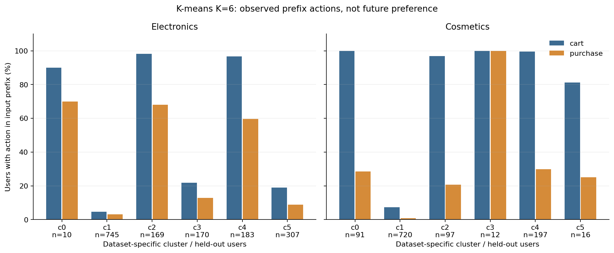

각 막대의 분모는 해당 군집 사용자 수다. 장바구니와 구매는 각각 해당 이벤트를 한 번 이상 기록한 사용자 비율이라 중복될 수 있다. 군집 결정과 행동 요약에 같은 prefix를 사용했으므로 미래 구매력 검증이 아니다. 데이터셋 간 c 번호는 대응하지 않으며 작은 군집도 그림에 인원과 함께 표시했다.

### 시뮬레이터용 기술적 패턴 후보

| 후보 | 관측된 사례 | 사용자 행동의 모델링 방향 — 가정 |
|---|---|---|
| 짧은 조회 중심 | Electronics c1: 745명, 이벤트 조회 96.3%, 구매 기록 사용자 3.1% | 짧은 조회 시퀀스와 세션 종료를 허용한다. |
| 반복 조회 중심 | Electronics c5: 307명, 행동 중앙값 6개, 이벤트 조회 94.2% | 조회를 반복할 수 있지만 결국 구매·장바구니도 확률적으로 가능하게 둔다. |
| 장바구니·구매 혼합 | Electronics c2: 169명, 장바구니 경험 98.2%, 구매 경험 68.0% | 조회·장바구니·구매를 모두 허용하고 행동 이력에 따라 분기한다. |
| 장바구니 후 조회 혼합 | Electronics c4: 183명, 장바구니 경험 96.7%, 구매 경험 59.6% | 장바구니 이후 추가 조회 또는 구매를 허용한다. |
| 반복 장바구니 | Cosmetics c0: 91명, 장바구니 경험 100%, 구매 경험 28.6% | 장바구니를 여러 번 조작한 뒤 세션을 끝낼 수 있다. |
| 긴 조회·장바구니·삭제 이력 | Cosmetics c2: 97명, 행동 중앙값 59개, 삭제 경험 84.5% | 긴 탐색과 삭제를 포함하되 64토큰 절단의 영향을 고려한다. |
| 조회·장바구니 혼합 | Cosmetics c4: 197명, 장바구니 경험 99.5%, 삭제 경험 58.4%, 구매 경험 29.9% | 조회·장바구니·삭제와 구매를 모두 허용한다. |

이 일곱 항목은 예시로 선택한 **데이터셋별 패턴**이다. 각 데이터셋의 K=6 군집은 그 데이터셋 내부에서는 서로 배타적이지만, 위 설명들 자체가 통합된 7개 상호배타적 유형이라는 뜻은 아니다. 7개 모두가 양쪽 데이터셋에서 검증된 것도 아니다. 유형별 행동 분기를 위처럼 정의하는 것은 합리적인 시뮬레이션 설계 후보이지만, 분기 확률까지 정당화되지는 않는다. 구매 경험은 해당 prefix의 관측치이지 미래 구매 성향이나 가격 민감도가 아니다. Cosmetics의 삭제는 Electronics에서 미측정이며 0으로 취급하면 안 된다.

초기화만 달리한 K=6 분할의 ARI는 Electronics 0.999, Cosmetics 1.000이었다. 인코더·표본·시간을 바꾼 안정성은 아니다. 별도의 과거 K-sweep에서는 재표본화 검사를 했지만 동일 인코더에 조건부인 탐색적 검사였고 이번 K=6 군집과 식별자가 다를 수 있다. 자료: [두 데이터셋 페르소나 요약](artifacts/two-dataset-gru-clusters/PERSONA_SUMMARY.md), [상세 K-sweep](artifacts/two-dataset-gru-clusters/REPORT.md), [조건부 안정성 감사](#archive-persona-stability-audit).

## 3. 초기와 이후 행동의 차이

Electronics의 기존 K=3 체크포인트를 사용해 첫 두 세션과 세 번째·네 번째 세션을 각각 독립된 입력으로 분류했다. 전체 관측 기록에 4세션 이상인 보류 표본 351명 중 166명(47.3%)의 라벨이 달랐다.


행은 1–2번째 세션, 열은 3–4번째 세션의 라벨이고 숫자는 사용자 수다. 이 K=3 라벨은 위 K=6 예시와 다르다. 짧은 구간을 기존 prefix에 학습된 인코더와 중심점에 넣었기 때문에 입력 분포가 다를 수 있다. 라벨 변화는 행동 종류나 고정된 선호의 변화와 동의어가 아니다. 4세션 이상인 사용자만 포함했으므로 전체 신규 이용자를 대표하지 않으며 Cosmetics는 체크포인트가 없어 분석하지 못했다.

**모델링 가정:** 사용자의 행동 상태는 매 세션 고정되지 않고 변할 수 있다. 다만 위 교차표를 전체 모집단의 상태 전이 확률로 바로 사용하지 않는다. 초기 구간만으로 후속 행동을 얼마나 예측할 수 있는지 별도 시간 분리 평가가 필요하다. 상세: [초기·후기 분석](#archive-persona-early-late).

## 4. 후기 비활동 전 세션

세 번째 관측 세션 이후 30일 관찰이 가능한 사용자만 포함한다. 그 기간에 다음 세션이 기록되지 않은 경우를 **30일 비활동**, 기록된 경우를 **재관측**으로 정의한다. 셋째 관측 세션은 생애 후반 또는 마지막 세션이라고 보장되지 않는다.

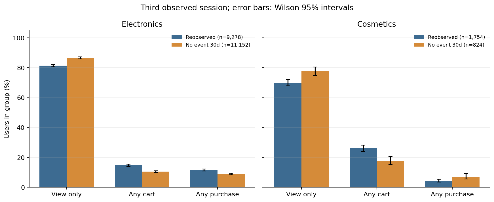

두 데이터셋에서 비활동군의 직전 세션은 조회만 기록된 비율이 더 높았다: Electronics 86.7% 대 81.4%, Cosmetics 77.8% 대 70.1%. 반면 Cosmetics의 직전 구매 기록은 비활동군 7.2%, 재관측군 4.3%였다. 두 번째와 세 번째 세션이 모두 조회만인 비율도 각각 Electronics 74.5% 대 67.5%, Cosmetics 69.3% 대 58.8%였다. 막대의 95% Wilson 구간은 개별 비율의 표본 불확실성만 나타내며 집단 차이의 인과적 불확실성이나 로깅 편향을 반영하지 않는다.

**모델링 가정:** 세션 종료 후 다음 세션까지의 간격은 현재 행동 상태와 사용자별 차이에 따라 샘플링할 수 있고, 구매 후 긴 간격도 허용한다. 다만 이 그림의 역방향 통계 `P(직전 행동 | 이후 비활동)`를 곧바로 `P(이후 비활동 | 직전 행동)`으로 사용하지 않는다. 관측된 기록 없음은 영구 이탈이나 완전한 비활동이 아니다. Cosmetics는 ID modulo 100의 약 1% 표본이며 관측 종료는 마지막 이벤트로 근사했다. 상세: [비활동 분석](#archive-coupon-reactivation-and-late-patterns).

## 5. 쿠폰 수령과 이후 재활동의 관측적 비교

Tianchi 온라인 로그에서 기준일 2016-05-15의 44~15일 전에 클릭 또는 구매가 있었고, 직전 14일에는 두 행동이 기록되지 않은 사람을 골랐다. 기준일 쿠폰 수령 기록 유무와 이후 7일 내 클릭 또는 구매 기록을 비교했다. 기준일은 결과에서 제외했다.

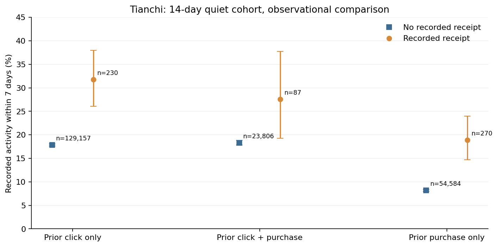

예를 들어 과거 클릭만 기록된 사람은 수령 기록군 230명 중 31.7%, 비수령 기록군 129,157명 중 17.8%에서 7일 내 활동이 기록됐다. 28일 기준은 각각 52.2%와 46.9%다. 오차막대는 각 비율에 대한 Wilson 95% 구간이다. 다른 군도 그림의 인원과 동일한 방식으로 계산했다.

**인과적 복귀 효과가 아니다.** 수령이 무작위로 할당됐다는 근거가 없고 수령 자체가 사용자의 활동일 수 있다. 비수령 기록이 비발송을 증명하지 않으며 이후 재수령과 개인별 누락·교란이 있다. 사전 클릭·구매군은 Electronics·Cosmetics의 GRU 페르소나가 아닌 별도 대리군이다. 따라서 이 차이를 어느 페르소나의 쿠폰 uplift나 복귀 증가 확률로 직접 옮기지 않는다.

## 6. 쿠폰 수령과 주별 행동 기록

다른 코호트에서는 기준일 이전 14일에 클릭·구매 기록이 있던 사람을 선택하고 이후 각 주에 구매가 적어도 한 번 기록된 비율을 집계했다. 이 코호트는 앞 절의 14일 비활동군과 다르다. 주별 비율의 분모는 각 기준일 수령 여부·과거 행동군의 전체 인원이다.

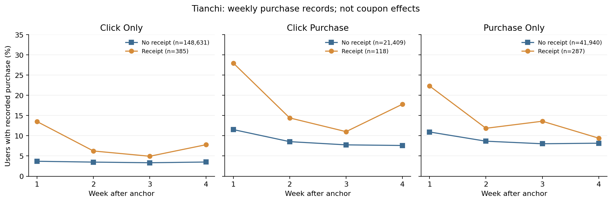

첫 주에 높은 비율이 기록된 사례가 있으나, 수령군의 주별 수치는 단조 감소하지 않는다. 예를 들어 클릭만 수령군은 13.5%, 6.2%, 4.9%, 7.8%다. 반복 쿠폰 수령과 선택 차이가 있어 선 사이의 차이는 효과 지속 기간이 아니다. 6주 집계의 추가 쿠폰 관측 범위에도 제한이 있다. 상세: [4주 분석](#archive-uplift-sequence-long-term-pilot), [6주 분석과 관측 범위](#archive-coupon-persistence-by-behavior).

**모델링 가정:** 쿠폰 영향이 시간이 지나며 단조 감소하는 함수를 시나리오로 시험할 수 있다. 예를 들어 `g(Δt)=exp(-λΔt)`, `λ≥0`으로 두면 감소가 보장된다. 이 함수와 `λ`는 데이터에서 인과적으로 식별하거나 추정한 결과가 아니며, 0효과·느린 감소·빠른 감소 및 음의 효과 같은 대안을 함께 비교해야 한다. 반복 쿠폰의 효과 누적 방식도 별도 가정이 필요하다.

## 7. Canonical response type과 사용자별 분기

일정 기간의 이진 결과에서 잠재결과 `(Y(0), Y(1))`을 정의하면 sure thing `(1,1)`, persuadable `(0,1)`, sleeping dog `(1,0)`, lost cause `(0,0)`으로 구분할 수 있다. 한 사람에게 두 결과를 동시에 관측할 수 없어 개별 유형은 식별되지 않는다. 실제 무작위 실험에서 각 처치군의 주변 결과 확률을 알더라도 잠재결과의 결합 분포는 추가 가정 없이 일반적으로 확정되지 않는다.

기존 [canonical 범위 분석](#archive-canonical-type-bounds-pilot)은 Tianchi·Starbucks의 관측 구매율을 잠재결과 주변 확률로 **가정해서** 조합한 조건부 시나리오다. 인과 경계 또는 GRU 페르소나별 구성비를 추정한 것이 아니다. 각 범위의 끝값을 독립적으로 선택해 네 유형의 한 분포로 합치면 안 된다.

시뮬레이터에서는 행동 페르소나와 canonical type을 **서로 다른 잠재변수**로 둔 뒤, 가능한 여러 결합 분포를 가정하여 민감도 분석하는 방향이 가능하다. 특정 페르소나가 반드시 persuadable이라는 식의 매핑이나 분포 값은 자료에서 뒷받침되지 않는다. canonical type은 명시된 개입·결과·시간 창에 의존하며, 시퀀스 전체에서 영구적인 개인 속성이라고 가정하려면 추가 가정이 필요하다.

## 8. 페르소나별 세션 간격 추가 분석

기존 K=6 군집을 사후적으로 재구성하고 두 번째 관측 세션부터 다음 세션까지의 간격을 살펴봤다. 짧은 공백과 긴 공백이 함께 보이며, 사용자에 따라 30일 안에 다음 세션이 기록되지 않기도 한다. 구매·장바구니가 기록된 세션도 나누어 살펴봤다.

기존 군집 입력에는 두 번째 세션 이후의 행동이 포함될 수 있으므로 **미래정보 누출이 있는 사후 기술 분석**이다. 분포를 예측용 시뮬레이터에 바로 넣거나 구매의 인과적 충격으로 해석해서는 안 된다. 세션 ID가 바뀌면 30분 미만에도 세션이 나뉘며 쿠폰 기록은 두 행동 데이터에 없다. 전체 조건·결과·그래프와 후속 검증은 [페르소나별 세션 간격 분석](#archive-persona-session-delays)을 참고한다.

같은 군집 내부의 prefix 행동량, 사용자별 구매·장바구니 구성, 세션 행동량 및 재관측 간격 분포는 [페르소나 내부 이질성 분석](#archive-persona-heterogeneity)에 별도로 정리했다. 이는 관측된 주요 행동 차원의 탐색이며 상품 선호나 개입 반응 등 모든 잠재 이질성을 측정한 것은 아니다.

## 9. 시뮬레이터 분기안: 무엇이 정해졌고 무엇이 미정인가

초기 2세션 기반 GMM latent, 유한 horizon MaxEnt IRL, 종료 후 재방문 위험모형을 결합한 파일럿은 [잠재 세션 IRL 보고서](#archive-latent-session-irl-pilot)를 참고한다. 보류 평가에서 세션 길이 보정이 미흡하고 개입 효과는 식별되지 않아, 아래 분기안을 모두 달성하거나 최종 모델로 확정한 것은 아니다.

1. **사용자 초기화:** 데이터셋별 행동 패턴을 참고해 잠재 행동 유형과 초기 상태를 샘플링한다. 통합 유형의 비중과 정의는 아직 정하지 않았다.
2. **세션 내 행동:** 현재 상태·최근 이력과 행동 유형을 입력으로 조회, 장바구니, 구매, 가능한 경우 삭제, 세션 종료를 확률적으로 선택한다. 후보 패턴은 위 2절에 있으나 조건부 확률은 아직 검증하지 않았다.
3. **세션 사이:** 종료 이후 다음 방문까지의 간격을 조건부로 샘플링한다. 30일 이상 비관측을 허용하되 관측 창 밖에서는 우측 검열을 별도로 처리한다. 무관측을 현실 이탈로 단정하지 않는다.
4. **쿠폰 개입:** 행동 상태와 별도로 쿠폰 정책과 가상의 반응 유형을 정의한다. 0효과 및 양·음의 반응을 포함하는 여러 시나리오를 사용한다. 가상의 단조 감소나 복귀 효과는 설정값이지 관측된 인과효과가 아니다.
5. **검증:** 데이터셋별 사용자·시간 분리로 행동 분포, 세션 길이, 다음 방문 간격, 구매·장바구니 빈도 등을 검증한다. 쿠폰 반사실의 타당성은 별도의 개입 데이터나 명시적 가정과 민감도 분석 없이는 검증할 수 없다.

현재 본 문서는 설계와 기존 실험 결과의 정리이며, 위 전체 분기 모델을 구현·보정하거나 페르소나별 인과 효과를 확인했다는 뜻이 아니다. 이전 NTS-NOTEARS·IRL 실험은 현재 페르소나별 쿠폰 반응의 식별 근거로 사용하지 않는다.

## 10. 주간 쿠폰 정책 벤치마크

정책이 매시간 쿠폰 발송 여부를 고르면 현재 누적효과식을 이용한 과도한 발송이
가능하므로, 사용자별 **7일에 1회 의사결정**으로 고정했다. 주간 첫날 선택 후
7일 동안 agent action 없이 환경만 진행하고, 구매·재방문과 쿠폰비를 합산해
직전 선택의 feedback으로 반환한다. 이는 보편적인 업계 표준값이라는 뜻은 아니다. Braze의 공식
decisioning 문서는 주 3회와 quiet hours를 설정하는 예를 제시하지만, 별도의 push
가이드는 월 1–4회가 app open에 적합했다고 보고한다. Google FCM도 동일 메시지의
과도한 반복 발송을 피하라고 안내한다. 채널을 특정하지 않은 쿠폰이므로 이 중
보수적인 주 1회를 재현 가능한 운영 가정으로 채택했다.
[Braze Decisioning Studio 설정](https://www.braze.com/docs/user_guide/brazeai/decisioning_studio/decisioning_studio_go/setup),
[Braze Push Notifications Guide](https://marketing-assets.braze.com/production/hero/Push-Notifications-Guide.pdf),
[Firebase 반복 메시지 제한 안내](https://firebase.google.com/docs/cloud-messaging/throttling-and-quotas).

환경은 하루 중 행동을 일별 Bernoulli session·purchase로 집계한다. 기준 확률은
Tianchi persona proxy의 7일 재방문율과 14일 구매율을 일별 hazard로 변환하고,
기존 canonical type별 감쇠 coupon logit offset을 더한다. 이는 관측 Tianchi 차이를
이식한 시뮬레이션 가정이지 식별된 인과 환경이나 기존 세션 IRL의 정확한 시간별
rollout이 아니다. canonical type·그 확률·미래 결과는 정책에서 숨겼다.

관측 상태는 persona one-hot, NEW/MATURE/CHURNING, episode 진행률과 요일,
마지막 세션·구매 이후 경과일, 최근 7일·30일 세션/구매/쿠폰 빈도, 감쇠된 쿠폰
노출량, 현재 발송 가능 여부의 19개 과거정보 특징이다. 목적함수는 할인하지 않은

\[
R=1000\,N_{purchase}-100\,N_{coupon\ sent}
\]

이다. Offline pretraining은 사용하지 않았다. 1,000명의 synthetic user를 각각
13주(91일) online learning하고 100·500·1,000명 시점의 누적 순이익, 실제 쿠폰비와
숨은 canonical type을 아는 oracle 대비 opportunity cost를 기록했다. 학습 종료 후
별도 5,000명을 각각 52주(364일) 동안 frozen policy로 평가했다. PPO와 discrete
SAC의 학습에만 일별 `gamma=0.99`를 사용했다. 신경망 학습은 MPS, 단일 상태
추론은 CPU 복제 actor를 사용했다. SAC는 batch 512로 8 step마다 갱신했다.

| 정책 | 3개월 학습 평균 순이익 | 학습 쿠폰비 | Oracle 대비 learning cost | 1년 Test 순이익 | Test 구매 | Test 쿠폰 |
|---|---:|---:|---:|---:|---:|---:|
| UCB | 7,187.50 | 1,285,500 | 1,098,500 | 27,692.00 | 32.892 | 52.000 |
| TS | 7,109.80 | 1,283,200 | 1,176,200 | 27,692.00 | 32.892 | 52.000 |
| LinUCB | 6,733.90 | **345,100** | 1,552,100 | 28,959.04 | 30.760 | 18.006 |
| LinTS | 6,729.40 | 392,600 | 1,556,600 | 29,398.14 | 31.361 | 19.633 |
| PPO | 6,021.50 | 938,500 | 2,264,500 | 27,692.00 | 32.892 | 52.000 |
| Discrete SAC | **7,470.30** | 596,700 | **815,700** | **30,893.46** | 32.984 | 20.901 |
| Never coupon (test) | — | — | — | 3,353.40 | 3.353 | 0.000 |
| Max allowed (test) | — | — | — | 27,692.00 | 32.892 | 52.000 |

7일 누적 feedback으로 바꾸자 TS는 미발송으로 붕괴하지 않고 UCB와 동일한 최대
발송 정책으로 수렴했다. 이전 당일 reward 실험의 TS 부진은 지연효과 귀속 오류의
영향이 컸다는 진단과 부합한다. 최종 test에서 SAC는 최대 발송보다 구매가 소폭
많으면서 쿠폰을 52회 대신 평균 20.901회 사용해 가장 높은 순이익을 냈다.
LinUCB·LinTS는 쿠폰비를 더 줄였지만 구매 기회를 일부 잃었다. PPO는 최대 발송으로
수렴했다. 계산시간은 현재 Mac에서 UCB·TS 각 1.4초, LinUCB 3.0초, LinTS 6.4초,
PPO 3.5초, SAC 12.4초였으며 하드웨어 종속 참고값이다.

`learning cost`는 oracle 누적 순이익에서 실제 online 누적 순이익을 뺀 값이며
쿠폰비를 이미 포함한 순이익 차이다. 따라서 표의 쿠폰비와 합산하지 않는다.
canonical oracle은 실제 배포 가능한 정책이 아니라 simulator 내부 상한선이다.
이 실행에서 UCB·TS·PPO는 상한까지 발송하는 극단 정책으로 수렴했다.
이는 SAC의 현실 우월성을 입증하지 않는다. 특히 최대 발송만으로 구매가 크게
증가하는 결과는 반복 쿠폰 offset이 강하다는 민감도 경고다. 다중 학습 seed,
비용·구매가치 sweep, 실제 처치 로그 기반 외부 평가 전에는 알고리즘 순위를
논문 결론으로 사용하지 않는다. 전체 및 persona별 결과는
`artifacts/agent-benchmark/summary.json`에 저장했다.

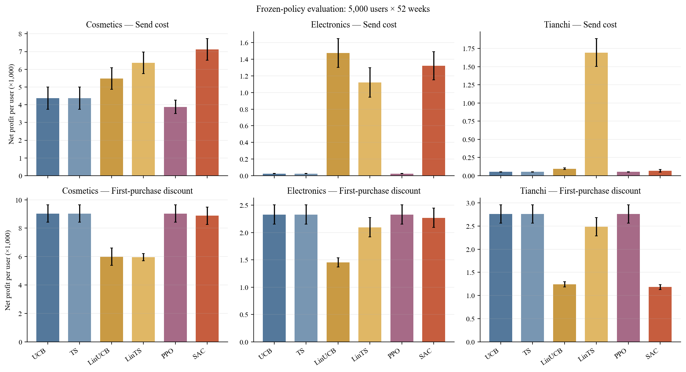

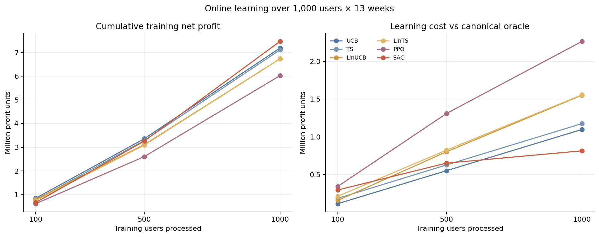

모든 agent는 같은 학습·평가 사용자 seed와 사용자별 common random numbers를
사용한다. 따라서 같은 사용자의 잠재 결과 난수 아래 정책만 달라지는 비교다.
단, 현재 그림은 하나의 전역 seed 실행만 나타내며 여러 seed 사이의 불확실성을
표현하지 않는다. 첫 그림의 오차막대는 5,000명 사용자 평균 순이익의 표준오차다.

재현:

```bash
PYTHONPATH=src PYTORCH_ENABLE_MPS_FALLBACK=1 \
python -m scripts.run_agent_benchmark --train-users 1000 --test-users 5000 \
  --train-weeks 13 --test-weeks 52
```

## 11. 데이터·재현·한계

- Electronics의 전체 이력 기준 반복 세션 조건은 사후 선택이며 군집 보류 표본은 전체 인구를 대표하지 않는다. 원자료 세션 결측과 중복이 남아 있다. Cosmetics는 사용자 ID 규칙에 의한 표본이다.
- 본 보고서의 비활동 분석, 쿠폰 재활동 분석과 군집 분석은 서로 다른 모집단·기간·세션 정의를 사용한다. 퍼센트와 인원을 합산하거나 동일 페르소나로 연결할 수 없다.
- 그림은 [plot_analysis_summary.py](scripts/plot_analysis_summary.py)가 기존 JSON 결과를 읽어 생성한다. 실행: `python -m scripts.plot_analysis_summary`. 그림 내부의 영어 라벨은 폰트 환경 의존성을 줄이기 위한 것이다.
- 원본 데이터와 모델의 논문 사용·재배포 허가는 별도로 확인해야 한다. 이 보고서는 원본 데이터를 배포하지 않는다.

## 12. 구매 묶음과 feature selection 파일럿

### 선행 자료와 적용 범위

- [Cosmetics 원 제공자 설명](https://www.kaggle.com/datasets/mkechinov/ecommerce-events-history-in-cosmetics-Shop)은 한 세션의 여러 구매 이벤트가 하나의 주문에 속할 수 있다고 설명한다. 따라서 동시각 구매 행을 무조건 삭제하거나 별도 순서의 선택으로 확정하지 않는다. 다만 이것만으로 특정 이벤트 묶음의 실제 순서나 단위 수량이 확인되는 것은 아니다.
- [Topaloglu 등, 2024](https://www.mdpi.com/0718-1876/19/4/138)은 같은 Cosmetics 로그를 프로세스 마이닝에 사용하며 같은 케이스의 연속 구매를 함께 처리했다. 이 연구의 구매 이후 케이스 절단은 목적이 다르므로 우리의 세션 내 다음 행동 모델에 그대로 적용하지 않는다.
- [Roychowdhury 등, OPAM, 2021](https://arxiv.org/abs/2102.01625)은 동일 Cosmetics 데이터의 구매 예측을 위해 세션별 행동 수와 조회·장바구니 상품 및 브랜드 수 등을 선택했다. 논문의 Electronics는 현재 프로젝트의 Electronics가 아니라 다른 multi-category 데이터에서 추출된 것이므로 동일한 결과로 옮기지 않는다. 논문의 완성된 세션 집계는 현재 모델에서 decision 시점 이전에 관측된 prefix 집계로만 변환한다.

### 구현 및 주의사항

`analysis.feature_selection`은 동시각·동일 세션·동일 행동을 한 묶음으로 두고, 구매 묶음 뒤에 `previous_purchase_batch_size`와 `session_purchase_event_count`를 제공한다. 크기는 원본 **이벤트 행 수**이며 구매 수량이나 서로 다른 상품 수를 보증하지 않는다. 묶음 내부 상품·가격의 순서는 알 수 없어 단일 상품 속성은 결측으로 취급한다. 서로 다른 행동이나 세션이 섞인 동시각은 순서가 불확실하여 시퀀스를 끊고 이력 절단 플래그를 둔다. 이 처리는 제공자의 세션 단위 주문 설명 전체를 복원한 것이 아니라 보수적인 동시각 묶음 규칙이다.

선행연구를 참고해 조회·장바구니의 이전 이벤트 수, 고유 상품·카테고리 수, 기록된 상품 가격의 합·평균을 후보에 넣는다. 브랜드 다양성은 후보에서 제외한다. 이들은 과거에 관측한 이벤트의 집계이지 현재 장바구니 재고나 실제 결제 금액이 아니다. 첫 이벤트는 세션 진입 관측으로 두고 그 다음 행동부터 예측한다. 종료는 30분 뒤까지 관찰 가능한 경우에만 추정하며 실제 로그아웃이 아니다. 데이터셋별 사용자 해시 약 1% 표본, 사용자 분리와 시간 분리, L1 multinomial logit의 검증 C 선택, 사용자 bootstrap 5회 및 검증 집합 permutation 중요도를 사용했다.

추가 후보는 이미 관측된 최근 두 행동의 조합, 직전 두 이벤트 간 시간, 직전 상품과 카테고리의 과거 등장 횟수·재등장 간격, 직전 두 카테고리의 변경 여부, 관측된 장바구니 추가·제거 이벤트 수 차이, 직전 가격과 세션 내 이전 조회 가격 평균의 비율이다. 장바구니 이벤트 차이는 실제 잔여 상품 수가 아니다. 브랜드 전환은 제외한다. 연속형 비음수 후보는 구매 대 비구매 단변량 로짓에서 선형·log1p·포화 지수 변환을 비교하고 검증 log-loss가 가장 낮은 표현을 다항 L1에 제공한다. 변환 및 L1 강도에 같은 검증 집합을 사용하므로 선택 결과가 낙관적일 수 있으며 최종 테스트는 별도다. 순수한 한계 인과효과나 최적의 함수 형태로 해석하지 않는다. NTS에는 세션별 고유 상품·카테고리 수 및 관측 가격 평균을 추가하되 이전과 같이 세션 간 탐색 구조만 추정한다.

직전 상품의 과거 조회·구매 횟수 및 현재 세션에서 이미 관측된 구매와 조회의 평균 가격 차이도 포함한다. 동시 구매 묶음의 상품·가격이 불명확한 경우 결측으로 남긴다. 단기·장기 관심 차이는 아직 정의·검증하지 않았다.

Electronics의 약 1% 사용자 표본 실험에서는 학습·검증·시험 결정 수가 2,992·154·540이고 검증 구매는 5건이다. 다항 L1의 시험 정확도는 0.589, 학습 집합 최빈 행동을 항상 예측하는 기준은 0.491이다. 구매만의 정확도가 아니라 세션 종료를 포함한 전체 행동 정확도다. 검증 permutation 순위에 세션 내 위치와 직전 상품의 과거 조회 수가 포함되었지만, 구매가 적고 사용자 bootstrap 5회 중 1회가 최대 반복에 도달했으므로 feature 안정성을 주장하지 않는다. NTS의 학습 세션 쌍은 302개이며 이전 세션 cart·purchase에서 다음 세션 purchase로 향하는 후보 간선이 나왔다. 이는 비정기 세션 요약에 대한 탐색 결과이며 현재 행동에 대한 인과적 parent-set이 아니다. 상세 수치와 변환은 `artifacts/feature-selection-sequence-v3-20261023/electronics.json`에 기록한다.

NTS는 공식 모델의 다중 독립 세션 윈도 적응으로, 모든 동시 간선을 금지한 뒤 이전 관측 세션 요약에서 다음 세션 요약으로 향하는 lag-1만 조사했다. 불규칙한 간격, 숨은 교란, 세션 요약의 구조적 제약이 있으며 공식 옵티마이저의 종료 상태와 bootstrap 그래프 안정성은 확인하지 못했다. 그러므로 이는 **다음 행동의 검증된 인과 parent-set이 아니며**, L1과 동일한 목표도 아니다. 쿠폰 처치·uplift는 이 실험에서 식별하지 않았다. 자세한 결과는 `artifacts/feature-selection-literature-20261023/`의 데이터셋별 JSON을 참조한다. IRL 학습과 feature의 최종 확정은 하지 않았다.

## 부록: 기존 실험과 운영 기록

아래는 기존 연구 문서의 원문을 통합한 과거 기록이다. 현재 결론과 구현 상태는 위 요약을 우선하며, 각 실험의 가정과 한계를 함께 읽는다. 종료된 실험 스크립트는 정리했으므로 이 부록의 예전 실행 명령은 현재 동작하지 않을 수 있다.

<a id="archive-amexpert-campaign-uplift-audit"></a>

### AMEXPERT_CAMPAIGN_UPLIFT_AUDIT

# AmExpert 캠페인 패널 및 uplift 진단 (탐색적)

## 질문과 데이터

PLOS ONE의 [AmExpert 분석](https://journals.plos.org/plosone/article?id=10.1371/journal.pone.0278937)처럼 캠페인 경계로 기간을 나누고 이전 이력을 만들었을 때, 관측 자료에서 처리·비처리 비교와 시계열 인과 그래프를 만들 수 있는지 확인한다. 입력은 로컬 AmExpert CSV이며 원본 및 고객 단위 파생 데이터의 재배포 권한은 확인되지 않았다. 여기의 재구성은 논문 전처리 전체의 복제가 아니다.

## 재현 및 품질 점검

- 거래 관측 범위는 2012-01-02~2013-07-03, 고객 1,582명이다. 캠페인 시작일 및 종료일 다음 날을 경계로 나누면 33개 구간이고, 첫 구간을 이전 이력으로 제외하면 32 × 1,582 = 50,624행이다. 논문의 요약 수치와 맞지만 행 수의 일치는 동일한 패널이나 처리 정의의 증거가 아니다.
- 32구간 중 train 쿠폰 기록이 있는 고객·구간은 15,327개(30.28%)다. 캠페인 유효기간 중 기록이 존재한다는 뜻이지 실제 열람이나 정확한 최초 제공 시각이 확인됐다는 뜻은 아니다. 미기록은 원칙적으로 비처리가 아닌 **미확인**으로 보관한다.
- train의 캠페인 18개와 test의 캠페인 10개는 서로 겹치지 않는다. test 캠페인은 거래 관측 이후 시작해 이 패널에 관측된 test 제공 기록은 없다. test에는 redemption 정답도 없다.
- train에서 고객·캠페인·쿠폰 조합 기준 중복 추가 행 12개, test에서 10개가 있다. train 중복 조합의 redemption 값은 일치한다. train 양성은 원본 행 기준 729개이며, 해당 조합을 중복 제거하면 717개다. 중복을 오류라고 단정하지 않는다.
- 마지막 구간의 캠페인 종료일은 거래 관측 종료일보다 늦어 잘렸다. 구간 길이는 다르며 첫 구간은 223일이다. 실제 제공 시각, 미관측 거래와 간섭 가능성도 확인되지 않았다.

## 가정 민감도 실험

명시적으로 `--assume-missing-unassigned`를 준 경우에만 미기록을 미제공으로 간주하여 추정한다. 초기 이력 구간 및 잘린 마지막 구간을 제외해 31 × 1,582 = 49,042행이다. 고객 단위 5-fold cross-fitting, 이전 구간 구매·거래·기록된 제공 여부, 기간과 길이를 이용한 propensity 및 outcome 모델로 AIPW를 계산했다. 검증은 시간 순서 holdout이 아니다.

- 추정 propensity 0.05~0.95인 관측치는 17,284개(35.24%; 기록 있음 4,926, 미기록 12,358)로 전체의 일부에 불과하다.
- 해당 부분집단의 일평균 지출 차이 AIPW 진단치는 74.13, 고객 단위 cluster-only 표준오차는 8.55다. 공통 달력 충격, 가정·모델 불확실성을 반영하지 않으므로 결과 파일의 근사 구간을 인과 효과의 신뢰구간으로 인용해서는 안 된다. 원자료의 가격 단위를 별도 확인하기 전 통화 단위를 부여하지 않는다.
- 처리 기록의 부재가 실제 비제공인지 불명이고, 연속된 구간의 쿠폰은 신규 할당이 아닌 이전 쿠폰의 지속일 수 있다. 중첩 쿠폰도 한 처리로 합쳐져 있다. 숨은 교란·간섭·측정오류, 처리 버전, 제한적 overlap 때문에 이 수치는 **검증된 인과 uplift가 아니다**. trimming은 추정 대상도 바꾼다.

## DAG와 prior knowledge에 대한 결론

NTS-NOTEARS 입력에는 사용자별 시간 순서를 지키는 처치 이전 이력만 넣고, 구간별 길이·계절·캠페인 맥락을 반영해야 한다. 시차가 있는 과거→미래 방향을 허용하되 미래→과거는 금지하고, 제공 시각보다 후에 측정된 구매·redeem을 현재 처치의 원인으로 넣지 않는다. 실제 시각이 확인되지 않은 동시 구간 변수의 방향은 도메인 지식에 의존한다는 점을 명시한다. 불규칙 구간을 한 시차로 동일시하지 말고 고정 시간 bin 등 별도 민감도 분석이 필요하다.

처리 여부 및 교란 통제가 검증되지 않았으므로 이 데이터만으로 uplift 방향을 확정하거나 발견된 부모 집합을 인과적 Markov boundary로 단정하지 않는다. 사용자 분할 bootstrap, 시기별 holdout, edge 안정성·threshold·시차·기간 정의와 prior 강도의 민감도를 비교하고, 별도의 실험·신뢰 가능한 처치 기록이 있다면 그 효과를 외부 검증에 쓴다. 관측자료 추정치로 간선 방향을 강제로 결정하지 않는다.

[ECA](https://proceedings.mlr.press/v258/chen25g.html)는 불완전하거나 잘못된 간선 prior를 부드러운 제약으로 사용하는 접근이다. [RoaDs](https://ojs.aaai.org/index.php/AAAI/article/download/41001/44962)는 불완전한 prior를 다루는 별도 접근이다. 두 방법 모두 원 논문의 설정과 NTS-NOTEARS의 시간 지연 구조가 그대로 같다고 볼 수 없으며 이 프로젝트에서 실행·비교하지 않았다. 적용하려면 시간 확장 그래프, 제약 충돌, 비선형 혼합 변수와 불규칙 간격을 검토한 별도 구현과 재현이 필요하다. 이들 방법 자체가 미기록 처치 또는 숨은 교란을 해결하지는 않는다.

## 재실행

```bash
PYTHONPATH=src python -m analysis.eda audit --amexpert '/Users/kimdaewon/Desktop/캡스톤디자인/data/raw/kaggle/amexpert'
PYTHONPATH=src OPENBLAS_NUM_THREADS=1 OMP_NUM_THREADS=1 python scripts/explore_amexpert_uplift.py --assume-missing-unassigned
PYTHONPATH=src pytest -q
```

결과는 `artifacts/amexpert-campaign-audit/`에 저장된다. `local_customer_periods.csv.gz`는 고객 단위 파생 데이터이므로 공개 배포 전 별도 권리 검토가 필요하다. 이번 점검은 기존 IRL reward나 simulator 구조를 변경하지 않았다.

<a id="archive-amexpert-conditional-irl"></a>

### AMEXPERT_CONDITIONAL_IRL

# AmExpert 개입 조건부 구매 trajectory IRL 파일럿

## 모델 정의

사용자 행동은 `transactions > 0`으로 구성한 구매/비구매이며, `coupon_discount`는 행동 정의에 쓰지 않는다. 별도 입력 `z_t`는 같은 주의 기록된 활성 쿠폰 오퍼가 1개 이상인지 나타낸다. `z_t=0`은 **기록 없음**이지 실제 미제공이라고 확인된 것이 아니다. 기존 패널의 쿠폰 캠페인 유효기간을 이용한 근사치이며, 실제 발송·구매 순서는 확인되지 않는다.

사용자 상태는 직전 주 구매 여부 `s_t`, 구매 행동 `a_t`와 오퍼 기록 `z_t`를 구분한다. 구매 reward는 `a_t * (w0 + w1*s_t + w2*z_t + w3*s_t*z_t)`이며, 비구매 reward는 0이다. 학습 데이터의 오퍼 기록 전이를 `P(z_{t+1}|z_t)`로 추정하고, `s_{t+1}=a_t`인 유한 horizon의 maximum causal entropy soft Bellman recursion으로 관측 구매 trajectory likelihood를 최대화한다. 계획에서 미래 오퍼는 주어진 동일 분포 전이로 처리하고 사용자 구매에 반응하지 않는다는 단순화가 있다. 이는 오퍼가 실제 무작위라는 뜻이 아니다.

0~51주의 구매·오퍼 기록으로 masked GRU를 학습하고 임베딩을 GMM으로 군집화한다. 각 그룹의 선형 reward 계수를 먼저 추정하고, 각 사용자 계수는 자기 그룹의 계수로 shrinkage하여 추정한다. 사용자 계수들의 그룹별 평균·공분산과 그룹 비율로 Gaussian mixture를 구성하여 새 계수를 샘플링할 수 있다. 다항 선택의 특수한 경우인 binary logit 정책이며 별도 아이템 선택 집합은 없다.

기존 NTS-NOTEARS 결과에서 `transactions`의 **lag > 0 부모는 없다**. 동시점 `unique_items -> transactions`는 같은 주의 결과일 수 있으므로 결정 전 feature로 사용하지 않는다. 따라서 IRL feature인 직전 구매와 오퍼는 명시적 설계 가정이며 NTS에서 발견된 parent-set이라고 주장할 수 없다. 추가 feature가 발견되더라도 현 IRL state/reward에는 자동 주입되지 않으며, 이 파일럿은 DAG 기반 IRL이라는 주장을 뒷받침하지 않는다.

## 시간 분할과 평가

IRL 학습 에피소드는 주 1~12, 13~24, 25~36, 37~48이며 오퍼 전이는 0~48주로 추정한다. GRU 그룹은 0~51주를 사용한다. 52~64주는 검증이 아니라 **보정 적합**에 사용한다: 전체 사용자 공통 구매 intercept와 오퍼 기록 계수 offset을 해당 구간의 구매 log loss로 학습한다. 이 검증 수치는 보정에 대한 in-sample 결과다. 65~77주는 보정에 사용하지 않은 테스트다. 동일 사용자에 대한 미래 예측이며 새 사용자 generalization을 뜻하지 않는다.

시드 2026, 4그룹, 20 epoch에서 테스트:

| 측정 | 결과 |
|---|---:|
| 관측 구매율 | 68.06% |
| teacher-forced 사용자 예측 평균 | 69.30% |
| 관측 오퍼 스케줄 replay 사용자별 rollout 평균 (100회) | 69.29% |
| 사용자별 teacher-forced log loss | 0.5924 |
| 학습 구매율 상수 기준 log loss | 0.6526 |
| 오퍼 미기록: 관측 / 예측 구매율 | 60.88% / 62.68% |
| 오퍼 기록: 관측 / 예측 구매율 | 74.97% / 75.66% |

100회 rollout 표준편차는 Monte Carlo 변동만 나타내며 추정의 신뢰구간이 아니다. 관측 테스트 오퍼 스케줄을 replay하므로 개입 정책의 결과를 검증한 실험이 아니다. 합성 계수 rollout도 관측 테스트의 초기 구매 상태·오퍼 스케줄을 사용한다. 평균 구매율과 정답 이력 조건부 예측이 맞는다고 장기 trajectory 분포가 검증된 것은 아니다.

학습 구간 오퍼 기록 비율은 5.85%, 보정 구간 47.56%, 테스트 50.97%로 분포 차이가 크다. 보정 전 테스트 예측의 log loss는 0.6567, rollout 구매율은 50.49%였다. 보정이 시기별 차이를 흡수할 수 있으나, 이 관측 차이의 원인을 쿠폰 효과라고 해석할 수는 없다. 시간·사용자 교란, 캠페인 중첩, 측정과 selection을 별도로 다뤄야 한다.

이전 그룹·비선형 실험은 구매를 쿠폰 할인 사용 여부에 따라 세 범주로 나눴고, 현시점 오퍼를 외생 개입으로 명시하지 않았다. 기존 결과를 이 파일럿의 causal uplift나 개입 정책 비교에 사용하지 않는다. 이전 파일을 삭제하지는 않았다.

## 재실행 및 안전한 사용

```bash
PYTHONPATH=src OPENBLAS_NUM_THREADS=1 OMP_NUM_THREADS=1 python scripts/run_conditional_trajectory_irl.py
PYTHONPATH=src pytest -q
```

`artifacts/amexpert-conditional-trajectory-irl/summary.json`은 요약이고 `local_model.npz`에는 사용자 ID·계수와 파생 시퀀스가 들어 있다. 데이터 권리가 확인되기 전 외부 재배포하지 않는다. NTS 새 학습, 실험 처치로서 인과 식별, HeartSteps·Complete Journey 적용, 여러 시드·새 사용자 검증, RL/GRU4Rec 비교는 아직 수행하지 않았다.

<a id="archive-amexpert-group-trajectory-irl"></a>

### AMEXPERT_GROUP_TRAJECTORY_IRL

# Masked GRU → GMM → group trajectory MaxEnt IRL pilot

## Procedure

We use the same 1,582 existing users and 78 complete weekly bins as the earlier
pilot, with weeks 0–51 as training, 52–64 validation, 65–77 test. The graph is
the earlier NTS-NOTEARS fit using only weeks 0–51 and 100 sampled customers.
Graph-selected input sources are active offers and quantity; past transactions
are an explicit control and coupon discount is added as a label-related feature.
The graph does not constrain the subsequent IRL transition model.

A bidirectional GRU consumes four log1p-standardized weekly features. Randomly
mask 15% of individual values and predict them with a linear reconstruction
head, trained for 20 epochs. Group embeddings are mean-pooled hidden states on
unmasked *training* weeks only, standardized and fit to a four-component GMM.
This is a GRU masked autoencoder inspired by masked reconstruction, not BERT or
a transformer. Four groups are an unvalidated pilot choice. Training masked MSE
fell from 0.948 to 0.384; this is not an independent reconstruction test.

IRL actions are weekly purchase-status proxies (no purchase / purchase without
coupon discount / purchase with recorded coupon discount). A finite-state MDP
uses the **previous** week's category as state and deterministically transitions
to the current category. Each group has a 3-by-3 state/action reward table. The
entropy-regularized finite-horizon soft Bellman recursion produces a time-dependent
policy with terminal value zero; fit rewards by regularized likelihood of
demonstrated full 13-week trajectories. This is maximum causal entropy trajectory
IRL in a very small specified MDP, not the earlier one-step contextual model.
The reward at (0,0) is anchored to zero and L2 regularization selects one
representative among observationally non-identifiable rewards. Horizon and entropy
scale are fixed, not validated. The four training episodes are weeks 1–13, 14–26,
27–39, and 39–51; week 39 appears twice, and episodes within a user are dependent.

The GMM labels are learned from training weeks and fixed for validation and test;
test rollout uses the observed week-64 category as initial state. A separate pooled
trajectory reward is fit to the same demonstrations for comparison. No validation
data was used to select groups, hyperparameters, horizon, or regularization.

## Results

GMM group sizes: 258, 149, 460, 715. Group-model validation log loss: 0.8152.
On the test period (teacher forced, observed previous action):

| Metric | Group trajectory IRL | Pooled trajectory IRL |
|---|---:|---:|
| Log loss ↓ | 0.8344 | 0.8506 |
| Brier ↓ | 0.5094 | 0.5157 |
| Accuracy | 0.6206 | 0.6206 |

On 10 full test-horizon rollouts, actual vs generated outcome proportions were
0.319 vs 0.410 (no purchase), 0.596 vs 0.528 (purchase without recorded coupon
discount), and 0.085 vs 0.062 (purchase with recorded coupon discount). Actual vs
generated switch rate was 0.408 vs 0.349 and P(purchase | prior purchase) was
0.775 vs 0.762. Average per-user action-rate absolute errors were 0.238, 0.223,
and 0.079. The model **does not yet reproduce all behavior accurately**; it over-
predicts no purchase and produces too few switches. The earlier one-step personalized
model achieved test log loss 0.8191 on the same time split; models use different
state information and personalization, so this is not an isolated ablation of IRL.

Full group-wise distributions and metrics are in the local `summary.json`; reward
tables, embeddings, memberships, fitted GRU and rollouts are saved locally. They
are linked to customers and must not be redistributed without rights/privacy review.

## Limits and reproduction

One group-level reward is fitted per group, not individual trajectory rewards.
Previous-action state alone excludes quantity and offer dynamics; there is no action
availability mask, and a coupon-discount outcome may be simulated even when no
coupon was actually offered. This is observational behavioral reconstruction,
not item recommendation choice or causal intervention evaluation. Customer
coverage, shared calendar effects, train-test distribution shift, group stability,
cold start and reward identification remain unresolved. No GMM model-selection,
independent masked reconstruction test, or confidence intervals were performed.

```
PYTHONPATH=src OPENBLAS_NUM_THREADS=1 OMP_NUM_THREADS=1 MKL_NUM_THREADS=1 \
  python scripts/run_group_trajectory_irl.py
```

It requires the prepared local panel and training-only NTS graph. Next: compare
seeds/group counts, expand the finite MDP with NTS-selected lagged features and
realistic learned transitions, constrain available offers, evaluate chronological
holdouts, and extend to individual hierarchical trajectory rewards. No policy
effect claims without intervention evidence.

<a id="archive-amexpert-nonlinear-trajectory-irl"></a>

### AMEXPERT_NONLINEAR_TRAJECTORY_IRL

# Nonlinear trajectory reward and greedy sensitivity

## What changed

The previous group trajectory experiment used a full 3×3 reward table for
previous behavior and current behavior; despite being linear in one-hot features,
that table already had an independent parameter for every state–action pair.
The earlier rollout sampled from the soft policy; it was not greedy. Simply
replacing that table with an MLP on the same discrete input cannot add meaningful
expressivity to the table.

Here the state is expanded to 12 combinations of previous action (3), previous
quantity above the training-period median positive quantity of 20 (2), and whether
previous active offers are positive (2). Quantity and active offers are related to
lagged NTS feature candidates; previous action is an explicit behavioral control.
Both utility specifications use the exact same four GRU/GMM user groups, data
splits, state space, common pooled transition model, horizon 13, entropy scale 1,
regularization strength 1 and single random seed:

- Linear: action-specific affine function of the state indicators.
- Nonlinear: 5 → 12 → 3 fully connected tanh MLP for state-dependent reward.

Both use finite-horizon maximum causal entropy IRL with stochastic transitions.
Rewards are anchored by subtracting a **single global reference reward**; subtracting
a different no-purchase reward for every state is not in general a harmless
normalization in a dynamic MDP, because it changes state-dependent future values.
One global anchor and L2 regularization still do not identify true utility uniquely.
The pooled observational transition matrix is estimated only on weeks 1–50,
with add-0.5 smoothing and the known constraint that the next state's previous
behavior is the chosen category. This is not an intervention-identified transition.

Training 13-week episodes start at weeks 1, 14, 27 and 39 (week 39 overlaps).
Validation is 52–64 and held-out test 65–77. Groups and NTS features use only the
training period. Validation results are reported, not used to tune the fixed
hyperparameters. Teacher-forced metrics use actual preceding state; rollout starts
at the observed test initial state and then generates transitions.

## Results

| Metric | Linear | Neural MLP |
|---|---:|---:|
| Training log loss ↓ | 0.7372 | 0.7364 |
| Validation log loss ↓ | 0.8205 | 0.8336 |
| Test log loss ↓ | 0.8356 | 0.8518 |
| Test Brier ↓ | 0.5089 | 0.5162 |
| Test accuracy | 0.6204 | 0.6185 |

The MLP slightly improves training fit but worsens validation and test likelihood;
this fixed setup does not show better out-of-sample prediction. It has 111
parameters per group versus 18 for the linear model; equal parameter-penalty
strength does not mean equal effective regularization. One seed, grouping and
architecture do not establish whether any nonlinear utility can help.

| 13-week rollout statistic | Observed | Linear sampled | Neural sampled | Neural greedy |
|---|---:|---:|---:|---:|
| No purchase | 0.319 | 0.364 | 0.338 | 0.269 |
| Purchase, no recorded coupon discount | 0.596 | 0.546 | 0.549 | 0.731 |
| Purchase, recorded coupon discount | 0.085 | 0.090 | 0.113 | 0.0006 |
| Action switching | 0.408 | 0.375 | 0.387 | 0.0006 |
| P(purchase after purchase) | 0.775 | 0.780 | 0.789 | 1.000 |

Ten sampled trajectories per user were used. The neural model comes closer on
some aggregate statistics but overpredicts coupon-discount outcomes, and per-user
rate MAE remains substantial (0.217, 0.217, 0.104). Greedy uses argmax of the same
policy but samples transitions, producing almost no changes and practically no
coupon-discount outcomes. This demonstrates greedy can damage diversity in this
model; it does not explain the earlier sampled rollout's mismatch. Differences
also reflect finite state representation, pooled transition misspecification,
time shift, incomplete observation and user heterogeneity.

## Economic interpretation and limitations

The softmax of the soft Q-values can be interpreted as a conditional random-utility
logit with extreme-value shocks under the appropriate assumptions (Train,
[Discrete Choice Methods with Simulation](https://eml.berkeley.edu/books/choice2.html)).
Nonlinearity in systematic utility does not remove conditional logit's IIA
restriction. Group membership permits modeled heterogeneity, but this implementation
is not a validated mixed-logit estimation. The observational weekly labels are
not observed alternative sets, and coupon discount is not necessarily an available
choice or redemption. There is no item-specific price or income and no proven
monotonicity, diminishing returns, willingness-to-pay or welfare interpretation.
The unconstrained network can violate economic shape restrictions, and IRL reward
values are not identified monetary utilities.

The practical decision on this experiment is to keep both versions, using the
linear model as a predictive reference and the MLP as a trajectory-fidelity
sensitivity, not claim a winner on every metric. Next: compare multiple random
seeds and validation-selected regularization, test flexible but economically
constrained price/discount response if those choice-set data become available,
validate transition distributions and coupon availability, and add user-level
hierarchical preferences. Do not use fitted transitions for counterfactual policy
evaluation without identifying assumptions or experimental validation.

```
PYTHONPATH=src OPENBLAS_NUM_THREADS=1 OMP_NUM_THREADS=1 MKL_NUM_THREADS=1 \
  python scripts/compare_nonlinear_trajectory_irl.py
```

Output files are local customer-linked derivatives, not approved for redistribution.

<a id="archive-amexpert-nts-plan"></a>

### AMEXPERT_NTS_PLAN

# AmExpert 2019 → NTS-NOTEARS study plan

## Suitability

AmExpert is a relational longitudinal retail dataset, not a ready-made multivariate time series.
It contains dated transactions from January 2012 through July 2013, coupon/customer assignments,
18 partially overlapping labeled campaigns, campaign windows, item metadata and customer
demographics. A published causal-ML application reports 1–208 coupon types per campaign and 0–37
coupons per customer/campaign.

This is materially better than the one-row Starbucks uplift table for a sequential simulator. It
still does not document randomized coupon assignment, so `coupon offered → purchase/redemption`
must not be presented as an identified causal effect without adjustment assumptions.

## Data access and rights

The original source is the Analytics Vidhya/American Express competition. No explicit dataset
reuse or redistribution license was found in the accessible official materials. Public GitHub
mirrors exist but are not authoritative and commonly have no license. Obtain the archive through
the original competition/account, keep it under `data/raw/`, and publish code plus aggregate
results—not raw or transformed rows—unless written permission is obtained.

## Panel contract

`prepare_amexpert.py` creates one dense weekly sequence per customer. Dynamic variables are:

1. transaction count;
2. quantity;
3. spend;
4. non-coupon discount;
5. coupon discount;
6. unique items;
7. unique categories;
8. coupon offers starting that week;
9. unique coupons starting that week;
10. active offers from overlapping campaigns;
11. reported redemptions placed at campaign end week.

Demographics remain static context for GMM/cohort analysis and are not repeated as degenerate time
series columns. Exact coupon send and redemption timestamps are absent; campaign start/end are
explicit proxy times and must be reported as such.

## NTS-NOTEARS design

Use the official Apache-2.0 implementation pinned to commit
`e1ba34b784f9eec3d2139904589d2fd1ed4ea7ad`. Start with weekly lags 1–4 and compare against lags
1–2 as a sensitivity analysis. NTS-NOTEARS learns both lagged and instantaneous nonlinear edges.

Required prior constraints:

- forbid all edges from future to past by construction;
- forbid current transaction outcomes → current `offers_started` because assignment is fixed at
  campaign start;
- allow previous behavior → future offers because targeting is observational;
- do not force offer → redemption/purchase edges;
- keep overlapping campaign intensity as an observed policy variable.

The official implementation accepts one continuous `n × d` series. Naively concatenating customer
panels creates false transitions from the last week of one customer to the first week of another.
The paper implementation must therefore train from separate lag windows per customer or fit
prespecified cohorts separately. The saved NPZ contains concatenated values plus offsets so a
multi-sequence loader can construct windows without crossing boundaries. `nts_adapter.py` performs
that conversion and returns each window's customer-sequence index for grouped splitting and
customer bootstrap. This is an input contract for a multi-sequence patch; it must not be flattened
back into a single time series before calling the official model.

## Evidence standard

The real-data DAG is a hypothesis graph, not known truth. Report:

- edge stability across user bootstrap samples, lag orders and weekly/daily aggregation;
- contemporaneous DAG acyclicity and edge-selection frequency;
- held-out predictive likelihood;
- comparison with DYNOTEARS and PCMCI+;
- synthetic known-DAG recovery before interpreting AmExpert edges;
- sensitivity to campaign overlap, assignment propensity and unobserved targeting.

Only edges stable across resamples and baselines should enter the synthetic generator. Intervene in
the generated SCM to validate policies; do not claim that observational AmExpert alone identifies
the corresponding real-world intervention effect.

<a id="archive-amexpert-temporal-features"></a>

### AMEXPERT_TEMPORAL_FEATURES

# AmExpert 시간·역할 분리 feature 명세

> **주의: 이 문서는 v1의 보존 기록이며 사용 중지.** 개인별 오퍼 기록 시점 누출과 비구매 0 가정 문제를 수정한 [v2 명세](#archive-amexpert-temporal-features-v2)를 사용한다.

이 산출물은 NTS-NOTEARS나 IRL 학습 결과가 아니라 이들에 사용하기 위한 **후보 feature 패널**이다. 기존 산출물을 덮어쓰지 않는다. 행 단위는 `customer_id × 완전히 관측된 월요일~일요일 주`이며 `week_end_exclusive`는 다음 월요일이다.

## 변수와 역할

| 역할 | 변수 | 정의와 조건 |
|---|---|---|
| 과거 상태 후보 | `prev_purchase`, `prev_transaction_rows`, `prev_spend`, `prev_quantity`, `prev_coupon_discount`, `prev_other_discount`, `prev_unique_items` | 동일 고객의 직전 주 관측 결과. 현재 주 결과를 당겨 쓰지 않음 |
| 이력 가용성 | `history_available` | 첫 주는 false이고 위의 과거 변수는 null이다. 첫 주 이력을 0으로 만들어내지 않는다 |
| 개입 기록 대리 | `preweek_active_offer_record_count` | `train.csv`에 기록된 고객·캠페인·쿠폰 중 캠페인 시작일이 주 시작일보다 앞서고 종료일이 주 시작일 이상인 조합 수. 중복 키는 1개로 센다 |
| 개입 기록 상태 | `preweek_offer_record_status` | 기록이 있으면 `prior_start_active_record`, 없으면 `no_record_exposure_unknown`. 양쪽 모두 실제 전달 시각을 확인했다는 의미는 아니다 |
| 해당 주 시작 기록 | `within_week_campaign_start_record_count` | 해당 주 시작한 캠페인의 기록 수. **주 시작 시점에는 미래일 수 있으므로 결정 전 feature가 아니며**, 주간 처치와 구매의 선후를 단정하는 용도로 쓰지 않는다 |
| 사용자 행동 | `purchase` | 해당 주 거래 행이 있으면 1, 없으면 0. 관측기간 전체에서 거래파일이 완전하다는 가정 아래의 관측 구매·비구매 대리 |
| 구매 후 관측 결과 | `transaction_rows`, `quantity`, `spend`, `other_discount`, `coupon_discount`, `unique_items` | 해당 주 거래의 행 수·수량/가격 합·할인 부호 반전 합·서로 다른 품목 수. 같은 주 구매 결정을 예측하는 사전 상태로 사용하지 않는다 |

역할별 분리는 인과성이 확인되었다는 뜻이 아니다. 특히 거래와 가격·할인·품목 수의 같은 주 관계는 거래 생성 방식상 구조적 관련이 있으므로, 이를 구매의 선행 원인으로 읽지 않는다. `redemption_status`는 정확한 redemption 시점이 확인되지 않아 제외했다. 할인 결과를 다음 주 이력에 쓰는 것과 같은 주 결정 전 원인으로 쓰는 것은 다르다.

## 중요한 데이터 가정

- 쿠폰 기록만으로 실제 고객 전달 여부와 전달 시점을 검증할 수 없다. 캠페인이 주 시작 전 시작된 기록만 남겨도 **기록의 실제 도착이 주 시작 전이었다고 보장하지 않는다**. 외생 처치라고 단정하지 않고, 민감도 분석 및 추가 근거가 필요하다.
- `train.csv` 기록만 읽으며 `test.csv`에서 온 오퍼는 포함하지 않는다. 미기록 상태에는 이 문제를 포함한 불확실성이 남는다. 기록 수 0은 관측된 기록의 개수일 뿐, 처치 0이 아니다. 원자료 `redemption_status`는 feature에 결합하지 않는다.
- 전체 거래 관측 시작·종료 사이의 모든 가구·주는 관측됐다고 가정하고 거래 미기록을 구매 0으로 표시한다. 이 가정은 파일 자체로 완전히 검증되지 않았으며 누락 거래 또는 이탈이 있다면 결과가 편향된다.
- 전체 고객에 동일 관측기간을 적용하므로 고객별 가입·관측 시작·이탈 시점은 보장되지 않는다. 첫 완전 주의 직전 이력은 미확인 null이다. 외곽 불완전 주의 거래는 보고서에 별도로 센다.
- campaign start/end는 포용적인 날짜로 처리한다. 주 중 시작된 캠페인과 주 중 종료되는 캠페인에 대한 연속 노출이나 구매 시점의 적용 여부를 보장하지 않는다. 실제 offer를 스케줄대로 replay하거나 무작위 처리로 취급해서는 안 된다.
- 단일 컬럼/lag/type에 기반한 변수 분리는 temporal leakage를 줄이기 위한 입력 명세일 뿐이며, 숨은 교란·선택 편향·인과 방향을 해결하지 않는다. NTS에서는 이에 맞는 그래프 제약과 결측 처리를 별도로 구현하고 검증해야 한다. 현재 NTS 학습기는 null을 안전하게 처리하는 인터페이스가 없으므로 이 패널을 무턱대고 넣지 않는다.

## 실행

```bash
PYTHONPATH=src python scripts/prepare_amexpert_temporal_features.py --data '/Users/kimdaewon/Desktop/캡스톤디자인/data/raw/kaggle/amexpert'
PYTHONPATH=src pytest -q
```

`artifacts/amexpert-temporal-features/feature_report.json`에 집계와 역할 정의, `local_customer_week_features.csv.gz`에 로컬 고객별 패널을 저장한다. 데이터 권리가 확인되기 전에는 개별 고객 단위 원본 또는 파생 파일을 외부에 배포하지 않는다.

<a id="archive-amexpert-temporal-features-v2"></a>

### AMEXPERT_TEMPORAL_FEATURES_V2

# AmExpert 주간 feature 명세 v2

고객 × 완전한 월요일~일요일 주 단위의 탐색·감사용 패널이다. 인과 DAG, NTS-NOTEARS 입력 또는 처치 효과 데이터가 아니다. v1 산출물은 보존하되 고객별 오퍼 시점에 관한 미래정보가 섞일 수 있어 분석에 사용하지 않는다.

| 역할 | 변수 | 정의 |
|---|---|---|
| 식별자 및 시간 | `customer_id`, `week_start`, `week_end_exclusive` | 고객 ID, 주 시작일과 다음 주 시작일 |
| 과거 상태 후보 | `prev_purchase`, `prev_transaction_rows`, `prev_spend`, `prev_quantity`, `prev_coupon_discount`, `prev_other_discount`, `prev_unique_items` | 해당 고객 직전 주 관측 결과. 기록이 없으면 미확인 null |
| 이력 유무 | `history_available` | 패널에 직전 주 행이 존재하면 true. 실제 관측 완전성을 뜻하지 않음 |
| 개입 | 없음 | 개인별 발송·열람·배정 시점이 확인되지 않아 어떤 주에도 고객별 개입을 배정하지 않음 |
| 행동 | `purchase` | 거래 기록이 있으면 1, 없으면 미확인 null. 비구매 0을 확인할 근거는 없음 |
| 구매 후 결과 | `transaction_rows`, `quantity`, `spend`, `other_discount`, `coupon_discount`, `unique_items` | 거래 행 수, 수량·가격 합, 할인 부호 반전 합, 고유 품목 수. 거래 기록이 없는 주는 null |

## 중요한 제한

- `train.csv` 고객별 쿠폰 기록과 캠페인 날짜는 무결성 및 중복 집계에만 사용한다. 고객별 배정 시각을 알 수 없으므로 해당 기록을 고객-주 행에 결합하지 않는다.
- `purchase` 결측은 관측된 비구매와 미관측을 구분할 근거가 없다는 뜻이다. 따라서 이 패널로 비구매 확률, 행동 선택 확률, uplift 또는 개입 효과를 바로 식별할 수 없다.
- 고객 목록은 전체 기간에 거래가 한 번 이상 존재한 고객을 기준으로 한다. 연구 목적의 사후 선택이며 매주 관측 대상이었는지를 증명하지 않는다. 거래 없는 고객과 고객별 가입·이탈 정보도 알 수 없다.
- `purchase`는 거래 행 존재 여부와 결정적으로 연결된다. 직전 주 변수도 원래 결과 열의 lag 복제다. 이들을 NTS-NOTEARS에 전부 독립 노드로 투입하지 않는다. 노드·시차 선택, 동시점 순서 제약, 결측 처리 및 데이터 적합성을 별도로 설계해야 한다.
- 캠페인·거래 시각, 숨은 교란, 선택 편향은 해결되지 않았다. `redemption_status`도 정확한 발생 시점을 몰라 제외한다. feature 역할은 인과 방향의 증거가 아니다.
- 개별 고객 단위 데이터의 권리가 확인되기 전까지 원본 또는 파생 패널을 외부에 배포하지 않는다.

## 실행

```bash
PYTHONPATH=src python scripts/prepare_amexpert_temporal_features.py --data '/Users/kimdaewon/Desktop/캡스톤디자인/data/raw/kaggle/amexpert'
PYTHONPATH=src pytest -q
```

결과는 `artifacts/amexpert-temporal-features-v2/`에 저장된다. v1 결과는 자동 수정하거나 삭제하지 않는다.

<a id="archive-amexpert-user-sim-pilot"></a>

### AMEXPERT_USER_SIM_PILOT

# AmExpert NTS → user-wise MaxEnt choice pilot

## Setup

1,582 customer sequences have 78 complete observed weeks. Split each user chronologically:
weeks 0–51 training, 52–64 validation, 65–77 test. Lag features at the first usable training
week come only from earlier weeks. NTS-NOTEARS is refit solely on the first 52 weeks, sampling
100 customers with seed 2026 and dropping the almost-duplicate `unique_coupons_started`.
It converged to h=3.88e-9, with 17 edges and an acyclic thresholded same-week graph. The
caller must ensure a supplied graph was fit within the training period; the simulation script
does not verify graph provenance automatically.

The three mutually exclusive **observed weekly outcome proxies** are no transaction, purchase
with no recorded coupon discount, and purchase with recorded coupon discount. They are not
observed recommendation choices, and coupon discount is not a confirmed redemption. Zero-filled
weeks also assume observation coverage and can reflect customer inactivity or missingness.

States include lagged parents selected by the training-only graph for relevant outcome/offer
nodes, plus explicitly designated lag-1 transaction and active-offer control variables. In this
run the four inputs are lag-1 active offers, lag-1 quantity, lag-1 transactions, and lag-2
quantity. No same-week outcomes are used as decision state.

Each customer's linear reward vector is optimized separately through a joint objective with
L2 shrinkage toward pooled coefficients. The outside-option reward is zero to fix the additive
reference; the pooled model supplies the prior. A multinomial softmax produces a one-step
maximum-entropy conditional policy. This is contextual one-step MaxEnt IRL / regularized
choice imitation, **not** multi-step trajectory MaxEnt IRL or uniquely identified true reward.
Penalty is selected from 2, 10, 50 and temperature calibrated on validation, then final held-out
metrics use only test weeks. The fitted model is not refit on validation.

The 13-week rollout starts from observed history, then feeds back simulated outcome vectors
resampled from action-matched training weeks (same user when possible, otherwise pooled).
Previously recorded offer-count schedules are replayed, not intervened on. This approximate
resampling preserves some within-week relationships but is not an identified NTS structural
transition model and cannot establish a counterfactual policy effect. Ten simulations are
generated using fixed seeds and stored locally.

## Held-out results

| One-step model | Log loss ↓ | Brier ↓ | Accuracy | Macro F1 |
|---|---:|---:|---:|---:|
| User-specific | 0.8191 | 0.4988 | 0.6121 | 0.4414 |
| Pooled | 0.8430 | 0.5116 | 0.6071 | 0.3962 |
| Smoothed user frequency | 0.8385 | 0.5166 | 0.5936 | 0.4434 |

Macro F1 is marginally better for the frequency baseline: personalization is not uniformly
superior across metrics. The validation-selected shrinkage is 10; normalized utility
temperature is 0.934 and normalized entropy is 0.730 on validation.

| Outcome | Observed | Generated (10 rollouts) | Per-user rate MAE |
|---|---:|---:|---:|
| No purchase | 0.319 | 0.362 | 0.200 |
| Purchase, no coupon discount | 0.596 | 0.547 | 0.195 |
| Purchase, recorded coupon discount | 0.085 | 0.090 | 0.084 |

Observed vs generated successive-week action switch rates are 0.408 vs 0.463; probability of
purchase following purchase is 0.775 vs 0.718. The generated trajectories are only partially
similar, and 13-week per-user rates are themselves noisy. The time split is within existing
customers, so this is not cold-start evaluation. The single-seed graph and this single holdout
do not establish robustness.

The per-user reward arrays and generated trajectories inherit data rights and privacy concerns;
they remain local, and neither the underlying dataset nor derivatives should be redistributed
without a rights review. Follow-up: compare no-graph and alternative-state ablations, more
temporal splits, better user-specific transition models, explicit observed item choice sets,
GMM for genuinely new synthetic users, and intervention/overlap validation before RL policy
comparison. References: [MaxEnt IRL](https://www.cs.cmu.edu/~bziebart/publications/maximum-entropy-inverse-reinforcement-learning.html),
[reward identifiability](https://proceedings.mlr.press/v139/kim21c.html).

<a id="archive-backend-ts-features-v2"></a>

### BACKEND_TS_FEATURES_V2

# Backend-TS v2: feature와 실험 명세

GPT-5.6 Sol high에게 feature 설계를 의뢰한 결과를 바탕으로 구현했다. 주간 episode는 서로 다른 시점의 이력과 label을 별도 배열로 보관한다. 자료 제공자의 [생성 코드](https://github.com/nannullna/ts4uplift/blob/main/dataset/utils.py)와 [전처리 노트북](https://github.com/nannullna/ts4uplift/blob/main/preprocess/preprocess_time_series.ipynb)의 기준 시각을 이용하며, 기준 전 이벤트만 사용한다.

## Feature schema

| 역할 | 필드 | 정의 |
|---|---|---|
| 사전 이력 | `history[N,168,5]` | 기준 전 7일, 1시간 bin의 `LOGIN`, `GET`, `POST`, `PUT`, `DELETE` 기록 수 `log1p` |
| grid mask | `history_grid_mask[N,168,5]` | 고정 grid 존재 여부. 전부 true이며 서비스의 실제 관측 완전성이나 사용자 활동 여부를 뜻하지 않음 |
| 개입 | `treatment[N]` | episode 단위 실제 push 시점(1) 또는 일주일 전 pseudo-control(0). 시간별 값이 아님 |
| 결과 | `outcome_y3[N]` | 기준 이후 `[0,3시간)` 로그인 여부 |
| 라벨 mask | `endpoint_mask[N,2]` | 공개된 T/Y 라벨의 존재 여부. 원자료에서 전부 true |
| metadata | `episode_labels.csv` | user, campaign, index, history 시작, 결과 window 끝, pair/episode ID, split 등. 모델 node가 아님 |

0 로그는 기록이 없었다는 뜻일 뿐 서비스 전체 활동 부재나 로그 수집 완전성을 증명하지 않는다. 기준 후 raw login 원자료는 archive에 없어 Y3를 독립 검증할 수 없다. 공식 코드에서 T/Y의 관측 방식과 7일 전 pseudo-control을 확인했다. 제공된 episode는 사전 7일 내 로그인 사용자를 대상으로 선택되므로 전체 사용자 집단이 아니다. 실제 push 열람·기기 및 숨은 교란은 관측되지 않는다.

## User-disjoint 분리

6월 테스트 사용자 전체를 4–5월 train/validation에서 제외한다. 773 episode가 제외되고 train 2,024 / validation 540 / test 821 episode다. 각 분할 고객 수는 각각 1,506 / 387 / 632명이다. 세 집합 간 고객 교집합은 0이다. 동일 사용자의 paired episodes는 같은 집합에 둔다. 6월의 사용자별 중복 episode는 유지했으므로 원 논문의 test pair 처리와 동일한 실험은 아니다. 원래의 warm-user temporal test와 다른 모집단이다.

기존 패널의 동일 고객·캠페인 1,011쌍에서 control Y3가 treated 이력의 첫 3시간에 그대로 포함됐다. 이것은 cross-split leakage 위험의 실제 예시이며, 같은 고객의 다른 시점 결과들이 counterfactual 쌍이라는 뜻은 아니다. 고객 분할은 분할 간 누출을 막지만 train 내 통계적 의존성을 제거하지 않으므로 재표본추출은 고객 단위로 한다.

## NTS와 prediction

현재 NTS는 시간별 이력 노드만 입력한다. T/Y를 시간별 0으로 채우거나 반복하지 않는다. T/Y에 대한 endpoint-aware masked causal model은 아직 구현하지 않았으므로 처치 및 결과를 포함한 DAG를 얻은 것이 아니다. 이전 시간 bin → 이후 시간 bin edge는 후보 패턴이고 인과적으로 식별된 edge가 아니다. 1시간 내 동시점 방향은 알 수 없어 `--forbid-instantaneous`를 사용했다. 이로 인한 acyclicity 만족은 사전 제약의 결과지 인과 정확도 증거가 아니다.

1-lag, 임계값 0.3, 고객 150명 복원추출을 5회만 시행한 탐색에서 POST(t−1)→GET(t)와 POST(t−1)→POST(t)는 5/5회, GET(t−1)→GET(t)와 GET(t−1)→POST(t)는 4/5회, POST(t−1)→LOGIN(t)는 3/5회였다. 표본 고객 수가 전체 훈련 고객보다 작고 실행마다 초기화 seed도 함께 바뀌었다. 5회는 안정성 판정에 부족하며 표본·초기화·threshold 효과가 섞여 있다. edge norm은 비음수 강도로 방향의 부호나 인과효과 크기가 아니다. [요약 결과](artifacts/backend-ts-bootstrap/summary.json).

비교용으로 prehistory 합계와 T로 Y3를 예측하는 logistic baseline을 만들었다. 학습에서만 scaler를 학습하며 0/1 T를 유지한다. 훈련과 test 사용자가 다른 시간 test에서 AUC는 약 0.878, log loss는 약 0.280이다. 이는 예측 진단일 뿐 uplift나 인과 효과가 아니다. 원본 시점별 차이, pseudo-control 및 선택 편향이 남는다.

훈련 데이터에 대해서만 고객 묶음 5-fold out-of-fold propensity 진단을 실시했다. 선택된 이력 요약에 따른 propensity AUC는 약 0.585, `[0.05,0.95]` 밖 비율은 약 0.05%다. 이것은 미관측 교란이 없다는 증거나 충분한 causal positivity를 증명하지 않는다. IPW ESS는 episode 단위 가중치에 대한 통계이고 고객 상관을 반영한 ESS는 아니다.

## 실행

```bash
PYTHONPATH=src python scripts/prepare_backend_ts.py --archive data/raw/backend-ts/backend-ts_v0.1.zip
PYTHONPATH=src python scripts/audit_backend_episode_splits.py
PYTHONPATH=src python scripts/prepare_backend_ts_v2.py
PYTHONPATH=src python scripts/run_backend_outcome_baseline.py
PYTHONPATH=src python scripts/audit_backend_overlap.py
PYTHONPATH=src pytest -q
```

`artifacts/backend-ts-features-v2/`의 데이터는 개인 단위의 로컬 파생 자료다. 논문에 공유하기 전 데이터 이용조건과 [공식 저장소 안내](https://github.com/nannullna/ts4uplift#disclaimer)를 검토한다.

<a id="archive-canonical-type-bounds-pilot"></a>

### CANONICAL_TYPE_BOUNDS_PILOT

# 행동군별 canonical response type: 가정 기반 탐색

## 유형 정의

동일 시점·동일 후속 관찰 기간에서 이진 결과 Y(0), Y(1)을 정의한다. 0은 개입 없음, 1은 개입 있음이다.

| 유형 | Y(0), Y(1) | 설명 |
|---|---|---|
| Sure thing | 1, 1 | 개입 여부와 관계없이 구매 |
| Persuadable | 0, 1 | 개입했을 때만 구매 |
| Sleeping dog | 1, 0 | 개입하지 않았을 때만 구매 |
| Lost cause | 0, 0 | 개입 여부와 관계없이 구매하지 않음 |

한 사용자는 두 결과 중 하나만 관측된다. 개별 유형을 할당하지 않는다. 무작위 실험으로 조건부 주변 분포를 알아도 결합 분포의 자유도가 남는다. [Tian & Pearl (2000)](https://escholarship.org/uc/item/44s6x4c7).

## 계산 조건과 한계

각 행동군에서 관측 비처치·처치 구매율을 각각 p0, p1이라고 놓고, **그 두 값이 실제 동일 대상 집단의 잠재결과 주변 확률이라고 가정할 때만** 가능한 결합 분포 범위를 계산한다. s=P(Y0=1,Y1=1)이면 max(0,p0+p1-1) ≤ s ≤ min(p0,p1), 나머지는 (p1-s,p0-s,1-p0-p1+s)다. 네 범위의 끝점을 제각각 동시에 선택해서는 안 되며 모두 같은 s로 결합해야 한다. 범위는 표본 불확실성을 포함한 신뢰구간이 아니다.

교환가능성, positivity, 일관성, 관측 완전성 등이 확인되지 않았다. 아래 범위는 **관측 구매율을 잠재결과 확률로 치환한 조건부 시나리오**로, 실제 모집단의 인과적 경계라고 주장할 수 없다. 잠재결과 정의의 개입 버전도 명확해야 한다. 특히 Starbucks 할인과 BOGO를 합친 처치는 특정 오퍼의 효과가 아니며, 하나의 비교 가능한 혼합 정책이라는 추가 가정이 필요하다. 이전·이후 오퍼 이력도 통제하지 않았다. 단일 사용자가 동일 시간 창에서 네 유형 중 무엇인지 확인한 결과도 아니다.

## Tianchi online-only behavioral personas

`ccf_online_stage1_train.csv`만으로 동일한 masked-GRU→K-sweep→centroid 대표군
파이프라인을 다시 학습했다. 원시 사용자 행동 `Action=0` click, `Action=1`
purchase, `Action=2` coupon receive를 모두 포함한다. 시각이 날짜까지만 제공되므로
하루를 click/purchase/receive의 일곱 비어 있지 않은 조합 중 하나로 변환했으며,
동일일 내부 순서는 추정하지 않았다. 사용자 ID modulo 50 표본에서 12,000명을
사용했고 두 날짜 이상 관측된 8,000명을 군집 적합에 사용했다.

독립 GRU 초기화에서 자동 silhouette 선택은 \(K=8\)과 \(K=6\)으로 달랐다.
\(K=6\)의 cross-run ARI는 0.767, silhouette는 0.592와 0.574였고, 고정 \(K=6\)
재학습의 held-out silhouette는 0.598과 0.597이었다. \(K=7,8\)은 첫 실행의
silhouette는 높지만 두 번째 실행에서 약 0.53으로 낮아져 운영 군집 수를 \(K=6\)으로
고정했다.

| 군집 | 사용자 | 원시 action 구성: click / purchase / receive | 요약 |
|---|---:|---:|---|
| C0 | 6,647 | 96.3 / 2.6 / 1.1% | 클릭 지배 |
| C1 | 2,501 | 4.2 / 78.4 / 17.4% | 구매 지배, 쿠폰 수령 동반 |
| C2 | 714 | 70.3 / 25.0 / 4.8% | 클릭·구매 혼합 |
| C3 | 784 | 76.6 / 19.3 / 4.1% | 반복 탐색·구매 혼합 |
| C4 | 828 | 54.9 / 9.1 / 36.0% | 쿠폰 수령 민감형 |
| C5 | 526 | 81.0 / 11.5 / 7.5% | 탐색 중심, 간헐적 수령·구매 |

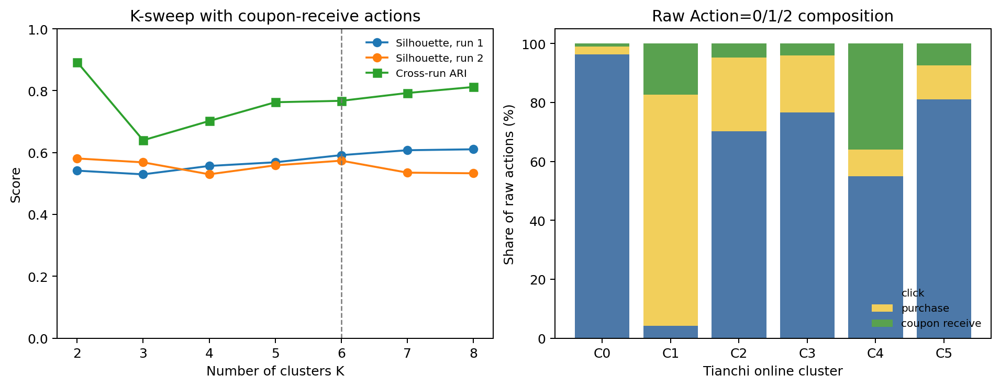

각 \(K=6\) centroid와 표준화된 48차원 GRU 공간에서 Euclidean distance가 가장
작은 반복 사용자 20명을 선택했다. 아래 histogram은 파생 user-day 비중이 아니라
각 대표 사용자의 원시 `Action=0/1/2` 발생 횟수다. 점선은 20명의 중앙값이다.

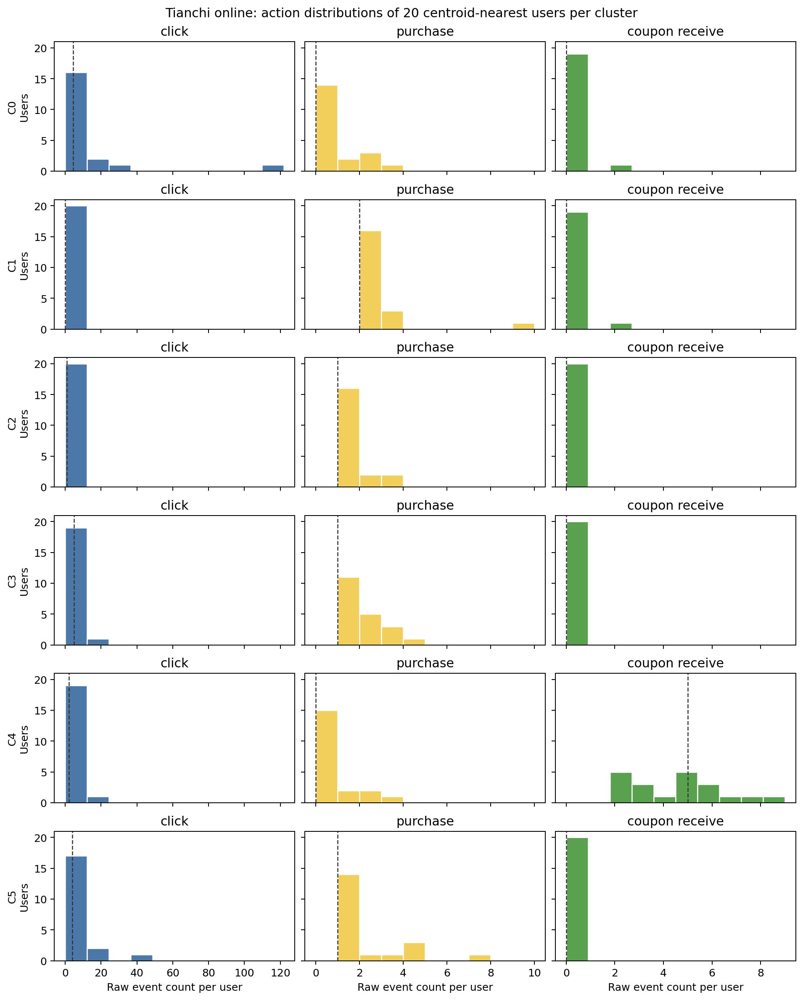

| 군집 | 대표군 평균 click | 평균 purchase | 평균 receive | 대표군 해석 |
|---|---:|---:|---:|---|
| C0 | 13.55 | 0.55 | 0.10 | 조회 중심 |
| C1 | 0.35 | 2.55 | 0.10 | 구매 중심 |
| C2 | 1.30 | 1.30 | 0.00 | 저활동 비수령 혼합형 |
| C3 | 5.70 | 1.70 | 0.00 | 비수령 클릭·구매형 |
| C4 | 4.45 | 0.45 | 4.50 | 쿠폰 수령 중심 |
| C5 | 6.80 | 1.90 | 0.00 | 비수령 탐색·구매형 |

Cosmetics는 쿠폰 상태가 관측되지 않은 기본 행동 자료이며 시뮬레이터에서 무쿠폰
baseline으로 두는 것은 명시적 모델링 가정이다. Tianchi는 동일 표현·군집 파이프라인에
쿠폰 수령 행동을 추가한 독립 환경이다. 두 데이터셋의 cluster ID를 동일 persona로
간주하지 않는다. Tianchi에는 장바구니·삭제·정확한 세션·동일일 순서가 없기 때문이다.
또한 `Action=2` 부재는 기록상 비수령일 뿐 offer·eligibility의 부재가 아니다.

결과는 `artifacts/tianchi-online-personas/clusters.json`, 대표 사용자 매핑은
`centroid_representatives.parquet`, 원시 행동 군집 요약은
`raw_action_cluster_summary.json`, 독립 실행 안정성은 `cross_encoder_stability.json`에
저장했다.

## Legacy: Tianchi coupon-anchor users matched to Cosmetics persona proxies

다음 분석은 이전의 cross-dataset proxy 설계를 감사 목적으로 보존한 것이다.
Tianchi-native 군집이 확인됐으므로 이후 모델의 기본 persona로 사용하지 않는다.

Cosmetics is the primary source for the four behavioral personas. Tianchi O2O is used only to find coupon-receipt users with similar **observable pre-receipt behavior** for later uplift analysis. The datasets cannot support a literal cross-dataset persona transfer: Tianchi records click, purchase, and coupon receipt, but has no cart, removal, product sequence, or session boundary.

For each user with a first coupon receipt in May 2016, the 14 days before the receipt define the proxy features. The receipt day is excluded. P1 requires 1 pre-period action and no purchase; P2 requires purchase and total activity at or above the 95th percentile; P3 requires no purchase and total activity at or above the 75th percentile; P4 requires purchase below the P2 depth threshold. The total-action thresholds are 1 (25th percentile), 5 (75th), and 19 (95th). These are disjoint **Tianchi proxy cohorts**, not recovered Cosmetics labels.

| Cosmetics reference | Tianchi observable proxy | Users | Median pre click / purchase / active days | Post-receipt 14d any activity | Post-receipt 14d purchase |
|---|---|---:|---|---:|---:|
| P1 short observation | 1 low-depth pre action, no purchase | 4,137 | 1 / 0 / 1 | 50.7% | 15.2% |
| P2 deep consideration | purchase + very high pre depth | 567 | 25 / 3 / 4 | 81.1% | 37.0% |
| P3 cart revision | click-heavy, no pre purchase | 3,692 | 9 / 0 / 3 | 76.3% | 20.6% |
| P4 purchase path | purchase, but not P2-level depth | 9,646 | 0 / 1 / 1 | 41.9% | 28.0% |

55,254 May coupon-anchor users had no compatible pre-receipt proxy under these strict rules, mainly because no click/purchase record was observed in the preceding 14 days. They remain unassigned rather than being treated as P1. The post-receipt figures are descriptive conditional rates, not uplift or CATE: coupon receipt is selected, later offers and unobserved exposure remain possible, and the O2O log can omit behavior.

The complete candidate user table, including anchor date, pre/post counts, and the proxy label, is local at `artifacts/tianchi-persona-proxies/tianchi_coupon_anchor_persona_proxies.parquet`; the compact result is in `artifacts/tianchi-persona-proxies/summary.json`. Reproduce with:

```bash
PYTHONPATH=src python -m analysis.uplift.observed persona-proxies
```

## Tianchi O2O

기준일은 2016-05-15, 사전·사후 창은 기준일을 제외한 각각 14일이다. 모집단은 **사전 창에 온라인 클릭 또는 구매가 기록된 사용자**로, 사후 결과로 대상을 선정하지 않았다. 세 행동군은 이 창의 클릭/구매 기록에 따라 정의했다. 처치=기준일 온라인 쿠폰 수령 Action=2 기록, 비처치=해당일 수령 기록 없음, 결과=사후 온라인 구매 Action=1 기록 여부다. 실제 발송·노출 또는 무작위 배정 여부는 알 수 없고, 후속 쿠폰도 허용한다. 선택 편향·미관측·시기 및 과거 프로모션·쿠폰 형태의 혼합이 남는다. 사전 클릭/구매가 없었던 사용자는 분석 대상 밖이다. 수령일은 발송일이 아닌 사용자 행동일 수 있다.

| 사전 행동군 | 기록상 비수령 구매율 (건수/인원) | 수령 구매율 (건수/인원) | 관측 차이 (%p) |
|---|---:|---:|---:|
| 클릭만 | 6.7% (9,947/148,631) | 17.1% (66/385) | +10.5 |
| 클릭+구매 | 17.7% (3,795/21,409) | 34.7% (41/118) | +17.0 |
| 구매만 | 17.6% (7,379/41,940) | 29.6% (85/287) | +12.0 |

| 사전 행동군 | Sure thing 범위 | Persuadable 범위 | Sleeping dog 범위 | Lost cause 범위 |
|---|---:|---:|---:|---:|
| 클릭만 | 0–6.7% | 10.5–17.1% | 0–6.7% | 76.2–82.9% |
| 클릭+구매 | 0–17.7% | 17.0–34.7% | 0–17.7% | 47.5–65.3% |
| 구매만 | 0–17.6% | 12.0–29.6% | 0–17.6% | 52.8–70.4% |

이는 표본 관측률의 기계적 조합이다. 특히 수령군이 118~385명으로 작고 수령은 자기선택일 수 있다. 관측 차이와 비율 범위는 인과효과나 실제 페르소나의 검증된 구성비가 아니다.

## Starbucks Capstone

시뮬레이션 이벤트에서 168시간에 할인 또는 BOGO를 받은 집단과 어떤 오퍼도 받지 않은 집단을 비교하고, 정보성 오퍼 수신자는 제외했다. 사전 거래수 0/1/2+는 기존 조회·장바구니 기반 GRU 페르소나가 아닌 구매 빈도 대리군이다. 0<t<168 시간과 168<t<336 시간의 거래만 사용해 동시 기록과 경계 시각 거래를 제외했다. 오퍼 할당 메커니즘, 과거 오퍼와 혼합 처치 버전은 미검증이다.

| 사전 거래 | 비수신 구매율 (건수/인원) | 할인/BOGO 수신 구매율 (건수/인원) | 관측 차이 (%p) |
|---|---:|---:|---:|
| 0회 | 51.3% (764/1,488) | 66.1% (2,318/3,507) | +14.8 |
| 1회 | 67.5% (818/1,212) | 82.6% (2,286/2,767) | +15.1 |
| 2회 이상 | 70.4% (1,149/1,631) | 87.9% (3,393/3,859) | +17.5 |

| 사전 거래 | Sure thing 범위 | Persuadable 범위 | Sleeping dog 범위 | Lost cause 범위 |
|---|---:|---:|---:|---:|
| 0회 | 17.4–51.3% | 14.8–48.7% | 0–33.9% | 0–33.9% |
| 1회 | 50.1–67.5% | 15.1–32.5% | 0–17.4% | 0–17.4% |
| 2회 이상 | 58.4–70.4% | 17.5–29.6% | 0–12.1% | 0–12.1% |

## 후속 조치

일단 기존 GRU 페르소나별 canonical 분포를 추정한 것은 아니다. 해당 인코더 입력과 호환되는 이벤트·개입 로그를 확보하고 개입 전 prefix만으로 군집을 부여해야 한다. 동시에 무작위 배정 또는 사전 공변량의 교란·overlap 검증을 통해 주변 잠재결과 분포를 추정해야 한다. 결합 분포는 추가 가정 없이는 미식별이므로, 시뮬레이터에서는 가능한 s를 바꾼 복수 시나리오로 민감도 분석을 해야 한다. Sleeping dog=0 같은 단조성 가정은 증명된 사실이 아니다.

실행: `/opt/anaconda3/bin/python -m analysis.uplift.canonical`. 원시 구매율과 네 유형 경계는 `artifacts/canonical-type-bounds/summary.json`, 모집단은 해당 폴더의 CSV다. 경계 계산의 두 단위 테스트를 통과했다. 라이선스는 별도 확인이 필요하다.

<a id="archive-common-behavior-trajectory-irl"></a>

### COMMON_BEHAVIOR_TRAJECTORY_IRL

# Common behavioral trajectory IRL pilot

## Scope

Three dataset-specific K=6 partitions use the previously fitted masked-GRU
representations and KMeans. Retain clusters with at least 50 held-out repeat users
and minimum held-out cluster stability Jaccard >=0.8 in the prior five-run audit.
This threshold was chosen post hoc and uses the test cohort; it is exploratory,
not unbiased selection or proof of stable natural populations. K=6 is a practical
pilot, not a claim that six clusters are optimal. Cluster IDs and semantics are
dataset-specific. User memberships are inferred from a whole input prefix and
therefore can contain the very events used for modeling or evaluation.

For each user, take the existing first 64 tokens and split at inferred session
ends or at any event outside the common vocabulary (including Cosmetics removal).
Within each resulting segment, make nonoverlapping blocks of four events, yielding
three transitions per block; discard remaining shorter fragments. Unknown events
are not mapped to zero or artificially joined across a boundary. Only observed
view, cart and purchase are modeled; the model is conditional on such blocks,
does not model session end, removal, gaps, item choices or action availability.

State = previous action; action = next event; next state = current action. Shared
reward features are one-hot indicators for the nine state/action transitions;
the `view_to_view` coefficient is anchored to zero, leaving eight coefficients.
The same horizon=3, temperature=1, L2 penalty=1 and fitted transition model are
used for all clusters. Existing `fit_trajectory_reward` uses entropy-regularized
finite-horizon Bellman recursion and minimizes full-trajectory negative log
likelihood plus L2. Reward gauge, scale/temperature and shaping ambiguities remain;
the fixed anchor and penalty select one numerical representative, not the true
psychological reward. This is population/cluster-level behavioral IRL under a
highly simplified MDP, not individual IRL, causal inference or uplift.

## Run and representativeness

Each dataset is split into disjoint training and held-out users as in the earlier
clustering experiment. Fit per-cluster rewards from training users only. A fixed
prefix and three-transition-window selection discards many people: the input group
labels use full prefixes and selection uses the full observed record's repeat-session
criterion. The post-hoc group stability filter also used held-out data. Thus the
reported held-out log loss is **descriptive only**, not prospective generalization;
neither test memberships nor its selection are independent of the scored events.
Comparisons across logging systems and data sets should not be interpreted as true
differences in intrinsic user preferences.

| Dataset | Fitted cluster vectors | Window-bearing training users, by cluster | Trajectory windows, by cluster |
|---|---:|---|---|
| Electronics | 5 | 377, 227, 508, 91, 334 | 575, 416, 1,025, 134, 610 |
| Retailrocket | 5 | 105, 171, 235, 231, 577 | 141, 177, 532, 397, 1,327 |
| Cosmetics | 3 | 351, 275, 216 | 2,860, 1,170, 1,000 |

For example, Electronics c3 has 91/3,092 eligible training users with a usable
window; Retailrocket c0 has 105/3,410. Estimates for those clusters characterize
this small selected subset, not all group members. Cosmetics segments split at
remove events; therefore missing removal in other datasets is not treated as a
measured zero, but conditioning and selection differ across sources. Duplicate
events, timestamp ties and differing measurement processes also remain unresolved.

Five cluster-internal user bootstraps sample only users with at least one window,
and refit the whole reward vector. Their coefficient standard deviation is a
rough model/sampling uncertainty diagnostic; five replicates are far too few for
confidence intervals. It is **not** the distribution of individual utility
coefficients. Some states may rarely occur; coefficients there can be driven by
regularization. A user or session-level hierarchical reward model and uncertainty
checks would be needed before fitting a GMM intended to represent heterogeneous
people. The 13 cluster vectors alone are neither individual samples nor a sound
basis for an eight-persona GMM; no GMM is fitted in this pilot.

## Outputs and reproduction

`artifacts/common-behavior-irl/{source}.json` contains fitted coefficient vectors,
reward matrices, window/user counts, diagnostics, descriptive likelihoods, and
five bootstrap fits. `cluster_coefficients.csv` is a GMM-input *schema* with one
row per dataset-specific cluster and separate bootstrap standard deviations. It
is not a user-level coefficient dataset. The bootstrap rows must not be treated as
independent people. User-linked memberships in the upstream pipeline are local;
data, derived model and export rights have not been verified.

```
for dataset in electronics retailrocket cosmetics; do
  PYTHONPATH='src:/Users/kimdaewon/Desktop/캡스톤디자인' \
    OPENBLAS_NUM_THREADS=1 OMP_NUM_THREADS=1 /opt/anaconda3/bin/python \
    scripts/run_common_behavior_irl.py "$dataset"
done
PYTHONPATH=src /opt/anaconda3/bin/python scripts/summarize_common_behavior_irl.py
```

Requires the separate capstone data and existing K6/stability outputs. Further
work: prospective prefix-to-suffix evaluation and pooled baseline; explicit
handling of censoring, termination and heterogeneous logging; more bootstrap
replicates and regularization sensitivity; sufficiently informative user-level or
hierarchical IRL before drawing a GMM over user reward vectors.

<a id="archive-coupon-persistence-by-behavior"></a>

### COUPON_PERSISTENCE_BY_BEHAVIOR

# 사전 행동군별 쿠폰 수령 후 6주 행동 기록

## 해석 범위

Tianchi O2O 온라인 데이터에서 2016-05-15 당일 쿠폰 수령 기록이 있는 사람과 없는 사람을 비교한다. 대상은 기준일 전 14일에 클릭 또는 온라인 구매가 기록된 사용자다. 사전 클릭만, 클릭·구매, 구매만 세 그룹은 기존 Electronics·Cosmetics GRU 페르소나를 직접 적용한 것이 아닌 **대리 행동군**이다. 기준일은 제외하고 1–7일, 8–14일, 15–21일, 22–28일, 29–35일, 36–42일을 나눈다. 같은 날 사건 순서는 사용하지 않는다. 주별 비율은 해당 주에 1번 이상 기록된 사람을 각 그룹 전체로 나눈 것이다.

사용자별 최종 기록 시점이나 6주 중 구매한 주 수는 **구매 기록의 분포**이지 쿠폰 효과가 지속된 기간이 아니다. 수령은 무작위가 아니고, 비수령 기록은 비발송 확인이 아니며, 미래의 추가 쿠폰·선택 편향·시간 효과·기록 누락이 남는다. 실제 구매가 없거나 이탈했다고 결론내리지 않는다. 특히 원본의 Action=2 Date_received는 2016-06-15까지만 확인된다. 따라서 기준일 이후 5주차는 일부 날짜의 쿠폰만 기록되고, 6주차 추가 쿠폰 수령은 관측할 수 없다. 클릭·구매는 데이터에서 2016-06-26까지 기록이 존재하나 개인별 완전성은 확인되지 않았다. 6주 이후는 관찰하지 않았고 마지막 주에도 기록이 있는 사람은 향후 행동이 미관측이다.

## 주별 구매 기록 비율

| 사전 행동군 | 기준일 수령 기록 | 사용자 | 1주 | 2주 | 3주 | 4주 | 5주 | 6주 |
|---|---|---:|---:|---:|---:|---:|---:|---:|
| 클릭만 | 있음 | 385 | 13.5% | 6.2% | 4.9% | 7.8% | 11.4% | 4.4% |
| 클릭만 | 없음 | 148,631 | 3.7% | 3.5% | 3.3% | 3.5% | 4.2% | 3.1% |
| 클릭·구매 | 있음 | 118 | 28.0% | 14.4% | 11.0% | 17.8% | 14.4% | 9.3% |
| 클릭·구매 | 없음 | 21,409 | 11.5% | 8.5% | 7.7% | 7.6% | 8.6% | 6.5% |
| 구매만 | 있음 | 287 | 22.3% | 11.8% | 13.6% | 9.4% | 15.0% | 9.8% |
| 구매만 | 없음 | 41,940 | 10.9% | 8.7% | 8.0% | 8.2% | 8.9% | 6.7% |

첫 주가 상대적으로 높고 마지막 주에 낮은 관측 경향이 있으나, 주별 변화가 단조롭지는 않다. 달력 시점과 재개입의 차이, 그룹의 비동질성·기록 누락 가능성을 고려하면 ‘6주 지속된 쿠폰 효과’라고 해석할 수 없다. 세 수령군은 118–385명뿐이며, 여러 주와 군집을 비교한 탐색 결과라 통계적 불확실성도 크다.

## 수령군의 구매가 기록된 주 수 분포

동일 사용자가 6주 중 구매가 1회 이상 기록된 **서로 다른 주의 개수**다. 예: 1주차와 6주차에만 구매하면 2주이며 연속 기간이 아니다.

| 사전 행동군 | 전체 | 0주 | 1주 | 2주 | 3주 이상 |
|---|---:|---:|---:|---:|---:|
| 클릭만 | 385 | 259 (67.3%) | 81 (21.0%) | 35 (9.1%) | 10 (2.6%) |
| 클릭·구매 | 118 | 63 (53.4%) | 24 (20.3%) | 14 (11.9%) | 17 (14.4%) |
| 구매만 | 287 | 130 (45.3%) | 99 (34.5%) | 43 (15.0%) | 15 (5.2%) |

예를 들어 클릭만 수령군에서 첫 주에 구매가 기록된 52명 중 28명은 2~6주 중 적어도 한 주에 다시 구매가 기록됐다. 첫 주 기록으로 선별한 사후 하위집단의 기술 통계이므로 반사실적 효과의 지속률이 아니다. 미수령 기록군에서 같은 조건은 5,488명 중 1,862명이지만 집단이 비교 가능하다고 확인되지 않아 인과 비교에 쓸 수 없다.

## 주별 클릭 기록 비율

| 사전 행동군 | 기준일 수령 기록 | 1주 | 2주 | 3주 | 4주 | 5주 | 6주 |
|---|---|---:|---:|---:|---:|---:|---:|
| 클릭만 | 있음 | 44.4% | 37.1% | 36.1% | 43.4% | 38.4% | 38.4% |
| 클릭만 | 없음 | 32.5% | 30.2% | 28.5% | 28.3% | 30.6% | 27.7% |
| 클릭·구매 | 있음 | 45.8% | 37.3% | 30.5% | 37.3% | 46.6% | 33.9% |
| 클릭·구매 | 없음 | 36.2% | 31.8% | 30.6% | 30.4% | 32.0% | 29.5% |
| 구매만 | 있음 | 5.6% | 3.8% | 2.1% | 15.0% | 14.3% | 10.5% |
| 구매만 | 없음 | 4.2% | 3.7% | 3.6% | 8.3% | 9.1% | 8.0% |

## 파일과 재현

`/opt/anaconda3/bin/python -m analysis.uplift.canonical`로 사전 행동군을 만든 뒤 `/opt/anaconda3/bin/python -m analysis.uplift.observed persistence`를 실행한다. `artifacts/coupon-persistence/summary.json`에 각 행동과 군집의 주별 건수, 첫 기록 주, 마지막 기록 주, 기록된 주 수 분포가 들어 있다. 경계·간격·주 수 계산 단위 테스트 1개를 통과했다. 마지막 기록 주는 이후 미관측을 반영한 survival 추정치가 아니며, 라이선스와 행동 로깅의 완전성도 확인되지 않았다.

<a id="archive-coupon-persona-pattern-pilot"></a>

### COUPON_PERSONA_PATTERN_PILOT

# 쿠폰 관련 행동 전후 패턴 탐색: 3개 데이터셋

## 목적과 데이터

Electronics·Cosmetics의 기존 masked-GRU 군집은 조회·장바구니·구매 토큰에 대한 데이터셋별 군집이다. 이번에는 쿠폰 기록이 있는 다른 데이터셋에서 비슷한 관측 행동이 어떻게 바뀌는지 살핀다. 사용자 ID, 인코더, 행동 정의가 다르므로 기존 GRU 군집을 이식하거나 동일 페르소나라 판단하지 않는다.

* Tianchi O2O: [Kaggle 배포본](https://www.kaggle.com/datasets/nordforestade/coupon-usage-data-for-o2o), [Tianchi 원 배포처](https://tianchi.aliyun.com/dataset/59). 온라인 클릭·구매·쿠폰 수령을 분석했다. 미러의 MIT 표기는 원본 권리 확인이 아니다.
* Starbucks Capstone: 기존 로컬 데이터, 시뮬레이션된 오퍼·거래 기록. 조회·장바구니 로그는 없다.
* The Complete Journey: [completejourney R 패키지 배포본](https://github.com/bradleyboehmke/completejourney), 2017년 가구별 구매·쿠폰 사용 기록. 조회·장바구니 로그는 없다.
* X5 미러도 확보했으나 구매 이력 파일이 없어 이번 비교에서 제외했다. [원 대회](https://ods.ai/competitions/x5-retailhero-uplift-modeling/data)에는 별도 구매 이력이 명시된다.

## Tianchi 분석 설계

온라인 Action=2 쿠폰 수령 중 2016년 5월 사용자별 첫 수령 날짜를 기준으로, 이전 14일과 이후 14일의 온라인 Action=0 클릭과 Action=1 구매를 센다. 기준일은 기록 내 순서를 알 수 없어 양쪽에서 제외한다. 선택된 날의 다중 쿠폰은 사용자·날짜 수준으로 한 번만 앵커링한다. 수령 시각은 발송이나 노출이 아니라 수령이고 배정은 무작위라고 확인되지 않았다. 이후 14일 내 추가 쿠폰 수령자는 17,770/73,296명이다. 이들의 반응은 단일 쿠폰으로 분리할 수 없다.

| 사전 14일의 기록 | 사용자 | 사후 클릭만 | 사후 클릭+구매 | 사후 구매만 | 사후 둘 다 기록 없음 |
|---|---:|---:|---:|---:|---:|
| 클릭만 | 12,305 | 5,528 | 1,581 | 491 | 4,705 |
| 클릭+구매 | 3,165 | 1,191 | 681 | 228 | 1,065 |
| 구매만 | 7,048 | 405 | 228 | 1,770 | 4,645 |
| 둘 다 기록 없음 | 50,778 | 5,233 | 1,504 | 6,160 | 37,881 |

예를 들어 클릭만 기록된 12,305명 중 사후 구매가 1회 이상 기록된 사용자는 2,072명(16.8%)이다. 사후 클릭만 44.9%, 둘 다 기록 없음 38.2%다. 클릭+구매군 중 사후 구매 기록은 909명(28.7%)이며, 1,065명(33.6%)은 사후 두 행동 모두 기록되지 않았다. 각 결과는 기간 내 해당 이벤트가 1회 이상 기록되었는지로 분류한 것이지, 클릭 뒤 구매 순서나 전환율이 아니다.

사전 14일에 클릭·구매 둘 다 기록되지 않은 사람은 50,778명(69.3%)이다. 원 데이터 기록 범위와 불완전성 때문에 이를 실제 비활동이나 신규 사용자로 해석하지 않는다. 사후 기록 없음 역시 이탈을 의미하지 않는다. 첫 쿠폰이 아니라 5월 중 첫 수령을 사용하므로 이전 수령도 가능하다.

## 구매 이력만 비교 가능한 데이터

Starbucks에서 168시간 시점에 할인·BOGO를 받은 10,133명에 대해 전후 약 7일의 거래 횟수로 구분했다. 같은 시각 거래와 외곽 경계는 제외했다. 사전 구매 0회인 3,507명 중 사후 구매 기록은 2,318명(66.1%), 사전 1회인 2,767명 중 2,286명(82.6%), 사전 2회 이상인 3,859명 중 3,393명(87.9%)이었다. 기존에 오퍼를 이미 받았던 경우가 많고, 합성 로그다.

Complete Journey에서 쿠폰 사용일 전후 14일의 장보기 횟수를 비교했다. 사용일을 제외하고 완전한 창을 확보한 404가구 중 사전 0회는 22가구, 1회 55가구, 2회 이상 327가구다. 이들은 모두 쿠폰을 **사용한** 가구이므로 쿠폰 수령에 대한 전후 반응이나 전체 고객의 uplift가 아니다. 사전 구매수 0/1/2+별 사후 구매 가구는 각각 17/22, 49/55, 311/327이었다. 0회 집단은 특히 작다.

## 주의사항과 검증

행동 분류는 과거 창에 기반하지만, 낮거나 높은 사전값에 따라 나누면 평균 회귀와 기준값 효과가 생긴다. 관측된 차이는 쿠폰 때문이라고 식별할 수 없으며, no-offer 대조군 비교와 배정 메커니즘 확인이 필요하다. 사후 구매에 쿠폰 적용 여부가 따로 밝혀진 것도 아니다. 쿠폰 반응 예측 또는 기존 페르소나와 직접 매칭을 검증한 결과가 아니다. 동일 날짜의 이벤트 순서는 알 수 없다. 할인 효과, 고객 심리, 개인별 canonical uplift type으로 확대 해석하지 않는다.

스크립트는 사용자별 쌍을 저장하며 중복 앵커 및 인원 합계를 확인한다. 네 사전 집단 각각 한 사용자의 클릭·구매 4개 건수를 원본 파일에서 독립적으로 재집계해 일치시켰다. 전체 결과의 외부 감사나 부트스트랩, 시간·사용자 holdout 검증은 수행하지 않았다. 원본 및 파생 데이터의 논문 이용과 재배포 조건은 각 권리자 조건을 확인해야 한다.

실행: `/opt/anaconda3/bin/python -m analysis.uplift.observed persona`. 숫자와 사용자별 쌍은 `artifacts/coupon_persona_patterns/`에 저장된다. Starbucks와 Complete Journey 입력 쌍은 `-m analysis.uplift.observed paired` 및 `scripts/coupon_journey_extract.R`로 생성된다.

<a id="archive-coupon-reactivation-and-late-patterns"></a>

### COUPON_REACTIVATION_AND_LATE_PATTERNS

# 쿠폰 수령 이후 재활동 및 후기 행동 탐색

## 요약

- Tianchi O2O 온라인 로그에서 일정 기간 클릭·구매가 기록되지 않았던 이용자 중, 기준일 쿠폰 수령 기록이 있는 쪽의 이후 클릭·구매 기록 비율이 대체로 높다. 하지만 이는 쿠폰의 인과적 복귀 효과가 아니다. 수령 행위 자체가 이용자의 활동일 수 있고, 집단 구성과 이후 쿠폰 노출도 다르다.
- Electronics와 Cosmetics 모두에서 세 번째 관측 세션 이후 30일 무활동군은 해당 세션이 조회만으로 구성된 비율이 비교군보다 높다. Cosmetics에서는 구매 후 30일 무활동도 상대적으로 자주 나타나므로 단일한 이탈 과정으로 일반화할 수 없다.
- 효과가 시간에 따라 단조 감소한다는 것은 이번 결과에서 확인된 사실이 아니라 추후 시뮬레이터에 적용할 수 있는 가정이다.

## 쿠폰 수령 후 재활동: Tianchi O2O 온라인 로그

2016-05-15를 기준일로, 그 44~15일 전 클릭 또는 구매가 있었고 직전 14일간 클릭·구매가 없었던 이용자를 선정했다. 기준일에 쿠폰 수령(Action=2)이 기록된 군과 기록되지 않은 군을 비교하고, 기준일 다음 날부터 7일·28일 동안 첫 클릭 또는 구매를 재활동으로 정의했다. 기준일의 활동은 결과에서 제외했다. 쿠폰 수령은 조용한 기간 중에도 가능하다.

| 과거 활동 유형 | 기준일 수령 기록 | 인원 | 7일 재활동 | 28일 재활동 | 28일 구매 |
|---|---|---:|---:|---:|---:|
| 클릭만 | 있음 | 230 | 31.7% | 52.2% | 20.9% |
| 클릭만 | 없음 | 129,157 | 17.8% | 46.9% | 9.0% |
| 클릭·구매 | 있음 | 87 | 27.6% | 49.4% | 24.1% |
| 클릭·구매 | 없음 | 23,806 | 18.3% | 48.5% | 16.0% |
| 구매만 | 있음 | 270 | 18.9% | 44.8% | 37.0% |
| 구매만 | 없음 | 54,584 | 8.2% | 29.1% | 20.9% |

수령군은 작고 무작위 배정이 확인되지 않았다. 클릭만 수령군의 7일 재활동률 Wilson 95% 구간은 약 26.1–38.0%다. 예컨대 클릭·구매 수령군의 42.5%, 비교군의 10.1%가 이후 28일에 또 수령 기록이 있어 기준일 쿠폰만의 효과를 분리할 수 없다. 기록되지 않은 쿠폰 발송·방문·오프라인 활동은 관찰되지 않으며, 실제 사용자의 이탈 및 복귀를 확정할 수 없다. 이 과거 활동 유형은 기존 GRU 페르소나와 같지 않다.

## Electronics와 Cosmetics: 세 번째 관측 세션 이후

관측 세션이 세 개 이상인 사용자 중 세 번째 세션 종료 뒤 30일 관찰이 가능한 사람만 포함한다. 이후 30일 내 다음 세션이 기록되지 않은 군을 비활동군, 기록된 군을 재관측군이라고 부른다. 세션 유형은 구매 관측을 우선하고, 구매 없이 장바구니/삭제가 있으면 장바구니군, 나머지는 조회군으로 정의한다. 같은 세션의 다양한 행동은 서로 겹칠 수 있다. 셋째 관측 세션이 생애 후기 또는 최종 세션인 것은 아니다.

| 데이터 | 군 | 인원 | 셋째 세션 조회만 | 구매 관측 | 장바구니 관측 |
|---|---|---:|---:|---:|---:|
| Electronics | 30일 비활동 | 11,152 | 86.7% | 8.9% | 10.5% |
| Electronics | 30일 내 재관측 | 9,278 | 81.4% | 11.5% | 14.7% |
| Cosmetics | 30일 비활동 | 824 | 77.8% | 7.2% | 17.8% |
| Cosmetics | 30일 내 재관측 | 1,754 | 70.1% | 4.3% | 26.1% |

두 번째→세 번째 세션 모두 조회만인 비율은 Electronics 비활동군 74.5%(8,305/11,152), 재관측군 67.5%(6,260/9,278), Cosmetics 비활동군 69.3%(571/824), 재관측군 58.8%(1,032/1,754)다. 그러나 이는 미리 동일하게 선별된 그룹 내의 기술 통계일 뿐, 조회가 이탈을 유발한다는 의미가 아니다. 두 데이터 모두 세 번째 세션 이벤트 수 중앙값은 양 군 모두 1개다.

Electronics는 관찰 가능 20,430명, 검열 5,434명이다. Cosmetics는 user_id % 100 == 0인 약 1% 사용자 표본으로, 관찰 가능 2,578명, 검열 660명이다. 관찰 종료는 마지막 기록 시각으로 근사했으므로 로그 완전성은 확인되지 않았다. Electronics의 remove 행동은 측정하지 않는다. 이 결과로 방문 간격이 점차 늘거나 개인별 실제 이탈이 발생했다고 단정할 수 없다.

## 재현 자료

- `-m analysis.uplift.observed reactivation`, `artifacts/coupon-reactivation/summary.json`
- `-m analysis.eda late-session`, `artifacts/late-inactivity/electronics.json`, `artifacts/late-inactivity/cosmetics.json`

<a id="archive-dataset-shortlist"></a>

### DATASET_SHORTLIST

# Dataset shortlist and intervention audit

| Rank | Dataset | License | Longitudinal user ID | Logged action | Outcome | Paper role |
|---:|---|---|---:|---|---|---|
| 1 | [Criteo Uplift v2.1](https://huggingface.co/datasets/criteo/criteo-uplift) | CC BY-NC-SA 4.0 | No | Randomized ad treatment | Visit, conversion, exposure | Primary intervention calibration/validation. |
| 2 | [UCI Online Retail](https://archive.ics.uci.edu/dataset/352/online+retail) | CC BY 4.0 | Yes | No randomized action | Timestamped purchases/cancellations | Behavioral trajectory, GMM and IRL calibration only. |
| 3 | [Udacity Starbucks promotion exercise](https://github.com/udacity/DSND_Term2/tree/master/portfolio_exercises/Experiments) | Ambiguous: MIT file + README CC BY-NC-ND 4.0; dataset grant unverified | No | Promotion Yes/No | Purchase | One-step non-commercial calibration; never redistribute rows; assignment mechanism not documented in checked notebook. |
| 4 | [Starbucks app customer rewards](https://www.kaggle.com/datasets/blacktile/starbucks-app-customer-reward-program-data) | **Unclear:** Kaggle says “Other” but supplies no license text | Yes | Offer received/type/time | View, completion, transaction amount | Development smoke only; exclude from KSC headline experiments unless written permission is obtained. |
| 5 | [RetailRocket recommender events](https://www.kaggle.com/datasets/retailrocket/ecommerce-dataset) | Check before use | Yes | No recommendation exposure | View, cart, transaction | Optional time-series robustness source. |
| 6 | [Customer support tickets](https://www.kaggle.com/datasets/suraj520/customer-support-ticket-dataset) | Check before use | Weak | Priority/channel/response | Resolution time, satisfaction | Ticket schema prototype only. |

The project prototype starts with Starbucks because it contains a timestamped, user-level action
and subsequent outcomes in one compact download. It must not be the legal or causal foundation of
the KSC paper: public download does not replace an explicit license, and a logged action is not
automatically a `do()` intervention. The paper design therefore uses Criteo for randomized effects
and UCI Online Retail for longitudinal behavior, while synthetic known-truth experiments join the
two roles. Raw data is never redistributed with this repository.

## Discovery choice

- Current implementation: lagged user-day panel + nonlinear NOTEARS-MLP, with temporal tiers that
  prohibit current outcomes from causing past state or current actions.
- BOSS in the existing literature is primarily a static permutation search. TS-BOSS is a very
  recent time-series extension, so it is recorded as an experimental follow-up rather than made a
  required dependency.
- For nonlinear dynamic discovery, NTS-NOTEARS is the closest direct model upgrade. This first
  version uses lag expansion plus NOTEARS-MLP because gCastle is already installable and testable.
- If verified interventional assignments become available, replace the evidence overlay with a
  joint interventional learner such as IGSP/GIES or an interventional differentiable method.

<a id="archive-data-policy"></a>

### DATA_POLICY

# Data-use policy for the KSC submission

This is an engineering record, not legal advice.

## Approved paper sources

1. **Criteo Uplift v2.1** is published by the verified Criteo organization under
   **CC BY-NC-SA 4.0**. It contains 13.9M randomized-control-trial rows with 12 anonymized
   pre-treatment features, treatment, visit, conversion and exposure. Cite the dataset and
   Diemert et al., *A Large Scale Benchmark for Individual Treatment Effect Prediction and
   Uplift Modeling*. Do not commit or redistribute the raw file. Mark any distributed adapted
   dataset with the same license and attribution; keep use non-commercial.
2. **UCI Online Retail** is published under **CC BY 4.0**. Cite the UCI DOI/source and the
   associated publication. It supplies customer/time purchase trajectories, not randomized
   interventions.

## Starbucks status

The Kaggle API reports `licenseName: Other (specified in description)`. The description says the
mock data was made available by Starbucks to Udacity scholars for projects, but it contains no
actual grant covering research publication, adaptation or redistribution. Therefore:

- local exploratory analysis is retained;
- no raw rows are committed or attached to a paper artifact;
- no headline KSC result depends on this copy;
- promotion to a paper dataset requires written permission or a source with explicit terms.

### Official Udacity promotion exercise

The separate `DSND_Term2/portfolio_exercises/Experiments/data` source contains `training.csv` and
`Test.csv` with Promotion, purchase and V1–V7. The repository root LICENSE is MIT, while its README
states CC BY-NC-ND 4.0 for the educational work and links to Udacity terms. Neither statement has
been verified as a dataset-specific redistribution grant from Starbucks. The project therefore
downloads pinned files locally, records checksums/source commit, publishes no original or modified
rows, and uses the data only for non-commercial academic model calibration. The checked official
notebook describes a Starbucks take-home promotion exercise but does not explicitly document
random assignment; do not call it an RCT without a separate authoritative source.

## Required wording

Do not call observational offer logs interventions. Use `logged action` unless random assignment
or another identification design is documented. Report causal estimates only for the randomized
Criteo arm or synthetic known-truth experiments; label Online Retail/Starbucks results as
behavioral calibration or associational discovery.

<a id="archive-eight-cross-dataset-persona-candidates"></a>

### EIGHT_CROSS_DATASET_PERSONA_CANDIDATES

# 세 eCommerce 데이터셋의 행동 페르소나: 통합 8개 후보

## 목표와 방법

각 데이터셋을 K=8로 고정하거나 군집 번호를 일대일 매칭하지 않는다.
Electronics, Retailrocket, Cosmetics 각각에서 K=2~8로 얻은 군집의
held-out 사용자 입력 prefix 프로필을 검토하고, 표현상의 유사점과 차이를
기준으로 아래 8개 **기술적 패턴 후보**를 수작업으로 구성했다. 아래의
군집은 해당 패턴을 설명하기 위한 대표 사례이지, 모든 군집을 빠짐없이
분류한 결과가 아니다. 데이터 기반으로 정확히 8개 자연 집단이 확인됐다는
의미가 아니다. 실제 사용자에 대한 상호배타적 8개 할당 및 검증은 아직 없다.

집계는 각 데이터셋별 별도 masked GRU 임베딩 및 KMeans, 고객 분리 holdout의
반복 세션 사용자, 첫 최대 64개 토큰을 기준으로 한다. K별 같은 사용자가
반복 등장하므로 대표 사례의 인원을 더하면 안 된다. 구매 경험률은 prefix
내 구매 이벤트가 적어도 하나인 사용자의 비율이며, Retailrocket은
transaction을 구매 이벤트로 취급한다. 각 예시의 전체 구성과 세션 표본의
한계는 `THREE_ECOMMERCE_PERSONA_SWEEP.md`와 원본 JSON을 참고한다.

## 후보 8개와 대표 근거

| 번호 | 패턴 후보 | 관측 근거: 데이터셋 / K / 군집 | 한계 |
|---|---|---|---|
| 1 | 짧은 조회 중심 | Electronics K=6 c3: 747명, 이벤트 중 조회 96.1%, 토큰 중앙값 4. Retailrocket K=6 c0: 860명, 조회 99.6%, 중앙값 4. | 짧은 관측 이력이 고객의 관심 부족이나 신규 고객임을 뜻하지 않는다. |
| 2 | 상대적으로 긴 조회 중심 | Retailrocket K=6 c5: 191명, 조회 이벤트 96.8%, 토큰 중앙값 13, 장바구니 경험 14.7%. | 사용자 관측 기간과 기록량의 차이가 길이에 영향을 준다. 유형 1·3과 경계가 겹친다. |
| 3 | 조회 중심 + 간헐적 장바구니 | Electronics K=4 c1: 357명, 조회 이벤트 90.3%, 장바구니 경험 28.9%, 구매 경험 16.2%. | 구매율과 장바구니율은 군집 내 평균이며 모든 사용자가 그렇다는 뜻이 아니다. |
| 4 | 장바구니 활발 + 상대적으로 낮은 구매 경험 | Retailrocket K=6 c3: 97명, 장바구니 경험 100%, 구매 경험 35.1%; Cosmetics K=6 c2: 74명, 각각 100%, 13.5%. | 데이터셋별 관측 및 이벤트 정의가 달라 두 구매율을 직접 비교해 원인을 해석하면 안 된다. |
| 5 | 장바구니 추가·삭제 활발 | Cosmetics K=4 c0: 219명, 장바구니 경험 100%, 삭제 경험 68.0%; K=6 c2: 74명, 각각 100%, 62.2%. | Cosmetics에서만 삭제가 기록된다. 유형 4·7과 겹치며 가격 민감성은 알 수 없다. |
| 6 | 장바구니·구매 활발 | Electronics K=6 c0/c4: 각각 183/168명, 장바구니 경험 96.7%/98.2%, 구매 경험 59.6%/67.9%. | 관측 구간에서의 구매 경험이지 충성도나 장기 구매 성향의 검증이 아니다. |
| 7 | 장바구니 관리 + 구매 관측 | Cosmetics K=6 c5: 63명, 구매 경험 100%, 삭제 경험 74.6%. | 5번과 행동이 겹친다. 구매 이력이 분류 입력에 있으므로 미래 구매 예측 결과가 아니다. |
| 8 | 장바구니 없이 구매 기록 | Electronics K=7 c5: 3명, 장바구니 경험 0%, 구매 경험 100%. | **매우 작은 후보**다. 로그 누락이나 직접 구매 등 원인은 확인되지 않았다. |

유형 1~7도 모두 세 데이터셋에서 독립적으로 관측된 것이 아니다. 특히
5·7은 Cosmetics만 근거로 한다. 유형 8은 세 명짜리 예시이므로 향후
표본·시간 분할을 바꿔 재검증하기 전에는 안정적인 집단이라고 보기 어렵다.
K-sweep 결과에서 서로 다른 K의 군집은 서로 겹치는 동일 사용자들로
구성될 수 있고, 위 후보들 역시 서로 중첩될 수 있다. 사용자별 하나의
페르소나가 필요하면, 입력 가능한 과거 정보와 관측 가능성을 명시한 규칙
또는 별도 모델을 설계해 train에서 고정하고 holdout으로 검증해야 한다.

관측 토큰에는 추정 세션 종료가 포함되고 이벤트 순서 동률, 중복 및 앞 64개
토큰 절단이 남는다. 전체 이력 세션 수를 사용한 표본 층화는 온라인 분류가
아니다. 실제 상품 노출·개입 반응은 관측되지 않았고, 이상 유형은 uplift,
할인 민감도, 원인, 심리 상태가 아니다. 각 데이터셋 및 파생물의 배포권은
미확인이다.

<a id="archive-electronics-inactivity"></a>

### ELECTRONICS_INACTIVITY

# Electronics 후속 비활동 탐색

## 질문과 정의

기존 GRU 표본이 아닌 Electronics 원본에 대해 기존 `load_events` 전처리를
적용하고, 적어도 두 세션이 관측된 모든 사용자를 대상으로 한다. 기준 시점은
두 번째 관측 세션의 마지막 이벤트다. 그 시점부터 30일 이내에 세 번째 세션이
시작되지 않은 경우를 **30일 비활동**으로 정의한다. 세 번째 세션 시작이
기준 시점과 같은 타임스탬프여도 재방문으로 취급한다. 이는 영구 이탈이
아니며 기록에서 재방문이 관측되지 않았다는 뜻이다.

30일이 끝나는 시점이 데이터 전체의 마지막 기록 시점인 2021-02-28
23:59:09 UTC를 넘는 사용자는 우측 검열로 제외한다. 이 cutoff는 로그의
마지막 시각일 뿐 그 이전 모든 사용자에 대해 관측이 완전하다는 보장은
없다. 세션은 원본 session ID 변경 또는 30분 초과 간격을 이용해 추정하며,
첫 두 관측 세션은 실제 첫 방문이나 가입 직후를 의미하지 않는다. 165개
session ID 누락 행은 기존 전처리에서 제외됐고 중복 행 655개는 남아 있다.
고객 ID 연결 및 채널별 로그 완전성은 검증되지 않았다.

## 30일 분석

| 항목 | 사용자 |
|---|---:|
| 두 세션 이상 관측 | 67,517 |
| 30일 추적 가능 | 54,103 |
| 30일 추적 불가로 검열 | 13,414 |
| 30일 내 세 번째 세션 미관측 | 33,828 (62.5% of 54,103) |
| 30일 내 세 번째 세션 관측 | 20,275 (37.5% of 54,103) |
| 30일 내 미관측 후 데이터 종료 전 재방문 | 830 (33,828 중 2.5%) |

마지막 행을 제외한 나머지의 영구 이탈 여부는 알 수 없다. 재방문을 관측할
수 있는 추가 기간은 사용자마다 다르다. 30일 비활동 추적 가능 사용자 중
첫 두 세션의 이벤트별 상태를 아래와 같이 분류한다. 한 세션에 구매가 있으면
`구매 관측`, 구매는 없고 장바구니가 있으면 `장바구니만`, 둘 다 없으면
`조회만`이다. 구매·장바구니 분류에는 조회 이벤트도 포함될 수 있다.

| 첫 세션 → 두 번째 세션 | 사용자 | 30일 비활동 사용자 | 비활동 비율 |
|---|---:|---:|---:|
| 조회만 → 조회만 | 41,924 | 27,243 | 65.0% |
| 조회만 → 장바구니만 | 2,954 | 1,572 | 53.2% |
| 조회만 → 구매 관측 | 3,002 | 1,636 | 54.5% |
| 장바구니만 → 조회만 | 1,733 | 917 | 52.9% |
| 구매 관측 → 조회만 | 1,603 | 915 | 57.1% |
| 구매 관측 → 구매 관측 | 1,070 | 584 | 54.6% |

전체 9가지 조합의 수치는 `summary.json`에 있다. 비활동자 33,828명 중
두 번째 세션이 조회만인 사용자는 29,075명(86.0%)이었으나, 이는 마지막
세션이 조회였다는 사실이 비활동을 **초래한다는 뜻이 아니다**. 재방문자
20,275명 중에서도 16,185명(79.8%)의 두 번째 세션이 조회만이었다.
양 그룹에서 첫·두 번째 세션의 이벤트 수 중앙값은 모두 각각 1개였다.

관측 결과는 조회만 행동한 사용자에게 비활동이 많다는 기술적 연관성을
보여준다. 어떤 사용자가 이미 이탈을 결심했는지, 관측되지 않은 다른
플랫폼에서 구매했는지, 사용자가 신규인지, 조회가 이탈을 유발했는지는
알 수 없다. 본 분석은 구매·장바구니에 대한 행동 규칙과 날짜 범위에
따라 달라지며, 예측 모델 검증이 아니다.

## 추가 점검

14일 기준은 추적 가능 61,493명 중 39,411명(64.1%), 60일 기준은 추적
가능 40,462명 중 25,315명(62.6%)이 비활동이었다. **각 기간마다 충분한
관측이 가능한 사용자가 달라지므로 이 수치를 같은 집단의 기간별 누적
확률처럼 비교하면 안 된다.** 30일 비활동률은 세션 기준월별로 2020년
9월 58.7%, 10월 64.8%, 11월 64.5%, 12월 62.3%, 2021년 1월 59.1%로
달랐다. 기간별 사용자 구성·서비스 및 측정 변화는 통제되지 않았다.

## 재현

```
PYTHONPATH='src:/Users/kimdaewon/Desktop/캡스톤디자인' OPENBLAS_NUM_THREADS=1 OMP_NUM_THREADS=1 \
  /opt/anaconda3/bin/python src/analysis/analyze_electronics_inactivity.py
```

집계와 모든 세션 조합은 `artifacts/electronics-inactivity/summary.json`에
있으며 사용자별 ID는 출력하지 않는다. 원본 및 파생 데이터의 공개 배포권은
미확인이다. 기간별 세션 정의, 동일 사용자 ID의 품질, 기간 기반 holdout과
사전 이력을 사용한 재방문 예측은 추가 검증이 필요하다.

<a id="archive-electronics-persona-k-sweep"></a>

### ELECTRONICS_PERSONA_K_SWEEP

# Electronics behavioral persona K sweep

Exploratory K=2–8 sweep using the previously trained seed-42 masked GRU and
standardized embeddings; no K is selected by silhouette. Each KMeans model
uses the 6,396 training users with at least two full-history sessions. The
profiles below use 1,604 held-out users meeting the same eligibility condition,
and are based on the first 64 input tokens, not future behavior. KMeans uses
seed 42 and 10 restarts; a seed-43 fit gives a limited initialization check.
The sampled users were stratified by full-history session count; neither cluster
counts nor shares describe the underlying population. See
`ELECTRONICS_PERSONA_PILOT.md` for source and preprocessing limitations.

| K | Held-out groups: size and rough description | Seed 42/43 ARI |
|---|---|---:|
| 2 | 1,226 view-dominant; 378 cart/purchase-active | 1.000 |
| 3 | 897 view-dominant; 528 mixed; 179 cart/purchase-active | 0.980 |
| 4 | 904 view-dominant; 519 mixed; 175 cart/purchase-active; 6 long-view-heavy with carts | 1.000 |
| 5 | 904 very view-dominant; 281 mostly view; 238 and 175 cart/purchase-active; 6 long-view-heavy | 1.000 |
| 6 | 903 very view-dominant; 281 mostly view; 235 and 174 cart/purchase-active; groups of 6 and 5 | 1.000 |
| 7 | 760 very view-dominant; 277 mostly view; 180 more engaged browsing; 202 and 174 cart/purchase-active; groups of 6 and 5 | 0.999 |
| 8 | 760 very view-dominant; 277 mostly view; 180 more engaged browsing; 202 mixed cart/purchase; 119 purchase-heavy; 55 cart-heavy; groups of 6 and 5 | 1.000 |

At K=8, the purchase-heavy group has 95.0% observed buyers, and the cart-heavy
group has 100% cart users and 7.3% observed buyers within the input prefix.
Their names describe those inputs rather than loyalty or price sensitivity.
The tiny groups have 41 and 5 training users and 6 and 5 held-out users;
interpretation is fragile. High ARI tests only two KMeans seeds on a single fixed
encoder/sample and does not establish robustness across encoders, samples or time.
The same input both defines and describes the groups, so this is not predictive
validation. Inferred session-end tokens, tied timestamps, retained duplicates,
full-history session eligibility and missing promotion/choice data remain limits.

## K=8 example: descriptive user patterns

The following is an exploration of one granular setting, not a claim that K=8 is
optimal. Immediate transitions count only pairs present in the input prefix;
an inferred session-end token counts as a possible next token. A token at the end
of a truncated prefix is excluded from the transition denominator. Percentages are
event-weighted and cannot be interpreted as the chance an individual ultimately
buys. Some cart-transition denominators are small.

| Cluster | Test users | Candidate description | View → next cart (n) | Cart → next purchase (n) | Buyer share |
|---|---:|---|---:|---:|---:|
| 0 | 760 | view-dominant | 0.9% (2,569) | 45.8% (24) | 1.1% |
| 1 | 55 | cart-heavy, few observed purchases | 36.9% (290) | 2.8% (108) | 7.3% |
| 2 | 277 | mostly views, occasional cart | 2.7% (2,176) | 21.3% (61) | 6.5% |
| 4 | 119 | purchase-heavy | 35.4% (625) | 53.4% (234) | 95.0% |
| 5 | 202 | cart/purchase-active | 26.1% (1,167) | 42.2% (313) | 63.9% |
| 7 | 180 | browsing with some cart activity | 4.6% (1,100) | 33.3% (54) | 7.8% |
| 3 | 6 | long-prefix, view-heavy | 4.6% (261) | 30.8% (13) | 66.7% |
| 6 | 5 | purchase-heavy small group | 8.7% (23) | 100.0% (2) | 100.0% |

Clusters 3 and 6 are too small for reliable behavioral conclusions; cluster 3's
median input length hits the 64-token cap. The name “cart-heavy” does not establish
hesitation, price sensitivity or any reason for non-purchase. Cluster IDs are
specific to this K and fit and cannot be compared by ID across K.

Detailed per-K counts, event shares and user-level buyer/cart rates are in
`artifacts/electronics-personas/k_sweep.json`; user assignments for all K are in
`k_sweep_memberships.parquet`. One-session user assignments are extrapolations,
not included in the profiles. All assignments contain user IDs; do not redistribute
without a rights/privacy review. Dataset and model redistribution rights remain
unverified.

Reproduce after the pilot in `ELECTRONICS_PERSONA_PILOT.md`:

```
PYTHONPATH='/Users/kimdaewon/Desktop/캡스톤디자인' OPENBLAS_NUM_THREADS=1 OMP_NUM_THREADS=1 \
  /opt/anaconda3/bin/python src/analysis/sweep_electronics_personas.py
```

<a id="archive-electronics-persona-pilot"></a>

### ELECTRONICS_PERSONA_PILOT

# Electronics masked-GRU behavioral persona pilot

This is a descriptive exploratory pilot, not uplift, price sensitivity or causal inference.
Source: the existing capstone project's local copy of the Kaggle Electronics Store
events dataset, https://www.kaggle.com/datasets/mkechinov/ecommerce-events-history-in-electronics-store.
The separate capstone implementation is reused as-is; no source data are copied here.

## Method

Using the capstone preprocessing, missing session identifiers are dropped; session
boundaries are inferred from the source session ID and 30-minute inactivity gaps.
From the first 64 tokens of each user, events are view/cart/purchase and inferred
session end. 12,000 users are sampled in equal strata of one, two, and three or more
sessions, using the full observed history to construct strata. This is not a population
sample and depends on future activity for eligibility; it is not an online experiment.
80/20 user-disjoint splitting precedes model fitting. A bidirectional GRU predicts
randomly masked tokens, a training-fitted standard scaler transforms 48-dimensional
embeddings, and KMeans is fit on training users with at least two observed sessions.
The candidate k is 3–7, chosen by training silhouette subject to a minimum cluster size.
Test silhouettes use only held-out repeat users. The representation is bidirectional
within its input prefix; only information available before a decision may be used
for a prospective simulator. The existing pilot is not a prospective validation.

## Results, seed 42

885,129 raw rows; 165 rows missing session IDs were excluded, 655 exact duplicates
were counted but retained, and 214 source session IDs occur across users. The
sort is stable for tied timestamps but within-timestamp causal ordering is unknown.
Training/test are 9,600/2,400 users; 8,000 sampled users have at least two sessions.
Three clusters selected, test masked-token NLL 0.2683 and repeat-user silhouette
0.4433. Masked NLL is not compared against a baseline in this run; silhouette is
not evidence of cluster stability, generation quality, or genuine customer types.

The following summarizes the first 64 input tokens for 1,604 held-out repeat users;
event shares weight events, while buyer/cart shares weight users. A purchase here
means at least one observed purchase in that input prefix. Cluster numbers are
arbitrary, and sample proportions do not estimate population prevalence.

| Cluster | Users | View/cart/purchase event shares | Buyer share | Cart user share | Descriptive label |
|---|---:|---|---:|---:|---|
| 0 | 528 | 84.4 / 9.4 / 6.2% | 29.7% | 51.3% | browsing with some cart/purchase |
| 1 | 179 | 64.3 / 20.8 / 14.9% | 67.0% | 96.6% | cart/purchase-active |
| 2 | 897 | 97.9 / 1.0 / 1.1% | 2.0% | 2.2% | view-dominant |

Profiles use the same input prefix used to assign clusters, so they describe how
groups differ, not an independent prediction of future behavior. People with one
session are excluded from these profiles. Different seeds, k=2, temporal holdouts,
and stability, prefix-to-future evaluation, uncertainty, and simulation fidelity
remain to be tested. Data collection and purchase observability limits remain unknown.
No observed offer exposure or untreated outcome is established. Dataset license,
redistribution, model artifact and customer-identifier rights need separate review.

## Reproduction

```
PYTHONPATH='/Users/kimdaewon/Desktop/캡스톤디자인' OPENBLAS_NUM_THREADS=1 OMP_NUM_THREADS=1 \
  /opt/anaconda3/bin/python src/analysis/run_electronics_personas.py
```

This requires the separate local capstone project, its dataset and dependencies.
`artifacts/electronics-personas/electronics_personas.*` contains the original
model/assignments and `electronics_embeddings.parquet` the embeddings;
`profiles.json` adds the held-out input-prefix summaries. First-run `personas.*`
files predate a filename collision fix and should not be used. Artifacts contain
user identifiers and should not be published without rights/privacy review.

<a id="archive-experiment-2026-10-20"></a>

### EXPERIMENT_2026-10-20

# AmExpert NTS-NOTEARS pilot — 2026-10-20

## Data and leakage correction

Source: local AmExpert competition CSVs, read from the existing capstone directory. Raw data
rights remain unverified; do not redistribute raw or row-level derivatives.

The prior `amexpert-panel` extended the panel to December 2013 using unassigned campaign metadata
despite transactions ending on 2013-07-03. This incorrectly imputed unobserved weeks as zero. The
old `amexpert-nts-smoke` result is invalid for interpretation. The revised panel retains only full
weeks inside the global transaction range: 2012-01-02 through 2013-06-30 (78 weeks), 1,582
customers and 123,396 customer-weeks. The final partial week excludes 6,377 transaction rows and
346 reported redemptions; 383 redemption reports remain. This is an important sensitivity issue,
not evidence those redemptions did not occur. Coupon start/end weeks remain proxies, and the
absence of an assignment in the training labels is not proven to mean absence of exposure.

The two features `offers_started` and `unique_coupons_started` are equal in 99.9903% of panel
rows, and in 4,210 of 4,222 rows (99.72%) with nonzero offers. Their direction is therefore
effectively unidentifiable. Genuinely missing exposure,
customer entry/exit, unobserved confounding, aggregation and nonstationarity remain concerns.

## Converged pilot

`artifacts/amexpert-nts-observed-100`: 100 customers sampled without replacement (seed 2026),
7,600 lag windows, lag 2, 4 hidden units, lambda1 0.03, lambda2 0.01, threshold 0.15, max 12
outer iterations. Ten iterations reached h=3.8874e-9; the thresholded contemporaneous graph is
acyclic. It contains 15 edges. Same-week purchase counts/spend and coupon bookkeeping variables
dominate; there are no pre-decision parent candidates for transactions or spend and no selected
edges for redemption. No edge is interpreted as a confirmed real-world causal effect.

## Synthetic known-DAG sanity check

`scripts/benchmark_nts_synthetic.py` simulates 50 independent 50-step series with three variables
and three lag-1 edges, including one nonlinear relationship. Seeds 42, 43 and 44 each converged
and recovered 3/3 true edges with 0 false positives (precision/recall/F1 all 1.0). This is a small,
easy sanity check, not an estimate of performance on AmExpert or a broad simulation benchmark.

## Customer-subsample stability

Three independent seeded samples of 100 customers (without replacement within each sample) all
converged and their thresholded instantaneous graphs were acyclic. Seeds 2026, 2027 and 2028
selected 15, 16 and 19 edges respectively; 28 distinct edges appeared in total, of which 6 appeared
in all three runs, 10 in two, and 12 in one. This is a small subsampling diagnostic, not a full
bootstrap confidence interval. The six common edges include two lagged coupon-count edges and
four instantaneous edges. Several are linked to bookkeeping definitions or same-week aggregates,
so stability alone does not establish causal direction or a useful decision-state feature.

Removing `unique_coupons_started` on the same seed-2026 customer sample also converged
(h=3.6915e-9). After removing edges incident to that variable from the original graph, the two
edge sets have 10 common edges out of a union of 20 (Jaccard 0.50). Removing a variable also
changes model dimensionality and random initialization, so this comparison does not isolate the
feature-removal effect from initialization; it is a sensitivity warning rather than a causal test.

## Remaining checks

Held-out temporal prediction, identified interventions, simultaneous-edge robustness to
aggregation, repeated duplicate-feature/initialization sensitivity, missing exposure, richer synthetic DAGs and
IRL/GMM/RL evaluation are not yet established.
Do not use a single fitted graph as ground truth or a completed policy-evaluation simulator.

<a id="archive-history-feature-maxent-irl"></a>

### HISTORY_FEATURE_MAXENT_IRL

# History-feature trajectory MaxEnt IRL: exploratory pilot

## Literature and design

GRU4Rec models the sequence within a session; BERT4Rec learns masked sequence
representations; TiSASRec additionally models inter-event time. These papers do
not prescribe this pilot's hand-crafted features or validate its learned rewards.
They motivate preserving short-term and longer-term histories and, eventually, time.
See [GRU4Rec](https://arxiv.org/abs/1511.06939),
[BERT4Rec](https://arxiv.org/abs/1904.06690), and
[TiSASRec](https://jiachengli1995.github.io/files/wsdm20.pdf).
This pilot uses the globally normalized trajectory distribution of
[MaxEnt IRL](https://www.cs.cmu.edu/~bziebart/publications/maximum-entropy-inverse-reinforcement-learning.html).

## Exact feature definition

At each decision, use only the actions before that decision:

| State | Definition |
| --- | --- |
| intercept | constant 1 |
| session_views | views already observed in the current session |
| session_carts | cart events already observed in the current session |
| session_purchases | purchase events already observed in the current session |
| previous_sessions | completed earlier observed sessions |
| previous_purchases | purchases observed in earlier sessions |

Transform counts with `log1p(count)/log(65)`. Reward is linear in these states
interacted with each of the cart and purchase actions; view has reward zero as
the reference. Thus there are 12 fitted coefficients per dataset. Candidate
three-action trajectories update current-session counts deterministically;
completed-session counts remain fixed within a window. Exact enumeration of
the 27 possible trajectories yields their normalization and the conditional
trajectory likelihood. L2 penalty is 1, temperature is fixed at 1.

The counts are summaries, not a GRU embedding, product choice, an inferred
causal DAG, or a complete user representation. Inter-event time and recency,
item identity/diversity, prices, cart inventory and session termination are
not modeled: the loader drops item IDs, Retailrocket price is not directly
available, and their counterfactual transition dynamics are not specified.
These omissions are not statements that the original data never contains them.
The same applies to Cosmetics' remove-from-cart event: it breaks windows, and
is not imputed as absent in other datasets.

## Data selection and validation

Reuse the earlier 12k-user sample and disjoint user split, but do not use
the earlier GRU cluster assignment. The sample is stratified based on the
number of sessions in a user's full observation history, so this is a
retrospectively selected population, not a prospective or representative cohort.
Use the first 64 observed events and nonoverlapping complete three-event blocks
within each session. Inferred session boundaries and unmodeled events split
blocks; shorter fragments are discarded. Tied timestamps preserve raw input
order, which may not be the actual behavior order. All three actions are
assumed available at every step; this ignores exposures and cart constraints.
We condition on a block of exactly three observed common events and do not
estimate the probability of having such a block.

| Dataset | Train users/windows | Test users/windows | Test trajectory NLL per action | Constant action-frequency baseline |
| --- | ---: | ---: | ---: | ---: |
| Electronics | 2,758 / 5,975 | 674 / 1,610 | 0.6570 | 0.7172 |
| Retailrocket | 2,298 / 5,628 | 591 / 1,435 | 0.2623 | 0.2953 |
| Cosmetics | 3,077 / 14,182 | 792 / 3,870 | 0.6114 | 0.8989 |

The baseline is a fixed independent-action distribution estimated from training
windows with one pseudo-count per action. Lower NLL is better; this is a weak
baseline, not a comparison to behavior cloning, transition-only IRL or GRU4Rec.
Three-step trajectory likelihoods are directly comparable to its product of
independent per-action probabilities. Window selection, logged-event semantics,
session boundaries, missing actions and censoring differ across datasets; do
not rank their underlying shoppers using these numbers.

First-action observed vs predicted shares for view/cart/purchase are
Electronics 88.6/7.4/4.0% vs 75.9/15.4/8.7%; Retailrocket 96.2/3.4/0.3%
vs 92.9/5.8/1.4%; Cosmetics 52.5/41.2/6.3% vs 44.0/49.2/6.8%. First action
is not similarly distributed to later actions because blocks start at selected
session positions. The time-homogeneous reward and restricted features do not
calibrate the resulting first-action marginal adequately.

## Interpretation and reproduction

The estimates are dataset-level behavioral parameters under an assumed MDP,
not user-level coefficients, causal effects, identified human utilities or
evidence for any uplift type. Reward shaping/scale and action availability are
not identified by observational demonstrations. The three datasets contain
different populations and logging processes. No GMM, GRU persona conditioning,
user-level IRL, full-session rollout, confidence intervals, or temporal holdout
is implemented. A realistic simulator needs model(s) for session termination,
return gaps, exposure/item availability and source-specific missing actions.

Results: `artifacts/history-trajectory-irl/{dataset}.json` (aggregate only).
Run from the project root, with the existing capstone data and persona user
sample files installed locally:

```sh
PYTHONPATH='.:src:/Users/kimdaewon/Desktop/캡스톤디자인' \
OPENBLAS_NUM_THREADS=1 OMP_NUM_THREADS=1 /opt/anaconda3/bin/python \
-m analysis.irl.history fit electronics retailrocket cosmetics
```

<a id="archive-l1-history-irl"></a>

### L1_HISTORY_IRL

# L1-regularized quadratic history IRL

No extra logarithm is applied. The original state is `z=log1p(count)/log(65)`;
the existing basis includes 1, each `z`, its square and pairwise interactions.
For each of cart and purchase there are 21 parameters; view is the reference.
We add an L1 penalty on all 42 parameters, including both intercepts, while
keeping the previous L2 penalty and temperature 1. The objective is summed
trajectory negative log-likelihood + `1*sum(abs(theta)) + 0.5*sum(theta^2)`.
The exact nonsmooth L1 objective is optimized by positive/negative coefficient
splitting and bound-constrained L-BFGS-B; L1 and L2 are fixed at 1, not tuned.

| Dataset | Existing L2-only test NLL/action | L1+L2 test NLL/action | L1+L2 coefficients at zero (of 42) |
| --- | ---: | ---: | ---: |
| Electronics | 0.5961 | 0.5981 | 15 |
| Retailrocket | 0.2570 | 0.2584 | 19 |
| Cosmetics | 0.5986 | 0.5987 | 5 |

Zero means absolute value below 1e-8. Both methods use the same observed user
split and complete 3-event windows. The test data has been used in previous
exploratory model comparisons, so it is not an untouched final evaluation.
The small test-NLL increases compare only this fixed penalty setting; they do not
establish that all L1 strengths are worse or that nonzero terms are causally
relevant. L1 sparsity is sensitive to feature scales and collinearity, and the
model is dataset-level rather than user-specific. Trajectory termination,
exposure, action availability, return and product choice are not modeled.

Aggregate results: `artifacts/l1-history-irl/{dataset}.json`. Reproduce from
the project root, using the existing local data and quadratic comparison output:

```sh
PYTHONPATH='.:src:/Users/kimdaewon/Desktop/캡스톤디자인' \
OPENBLAS_NUM_THREADS=1 OMP_NUM_THREADS=1 /opt/anaconda3/bin/python \
-m analysis.irl.history l1 electronics retailrocket cosmetics
```

<a id="archive-l1-only-history-irl"></a>

### L1_ONLY_HISTORY_IRL

# Quadratic reward with L1 only

Same five log-scaled history counts, their squares and pairwise interactions as
the quadratic pilot. No extra logarithms and no new lagged-action variables.
The objective is summed three-action-trajectory NLL + `1 * sum(abs(theta))`;
L2 strength is zero, temperature is one. The L1 term covers all 42 coefficients
including intercepts. Positive/negative splitting with bound-constrained L-BFGS-B
is used. Compare the existing L2-only model on the same user and window split:

| Dataset | L2-only test NLL/action | L1-only test NLL/action | Zero coefficients / 42 | Largest absolute coefficient |
| --- | ---: | ---: | ---: | ---: |
| Electronics | 0.5961 | 0.5791 | 14 | 51.0 |
| Retailrocket | 0.2570 | 0.2514 | 21 | 22.3 |
| Cosmetics | 0.5986 | 0.5935 | 7 | 33.9 |

The optimizer reports convergence; this is not evidence of coefficient stability.
The same repeatedly inspected test split, fixed penalty and lack of uncertainty
estimation make the comparison exploratory. Penalty size depends on the summed
objective and feature scales; zero weights are not causal evidence. All results
remain pooled within a dataset and conditional on complete three-event windows.
The state aggregates prior events rather than representing their precise order;
log scaling is an analyst-chosen magnitude transformation, not a replacement for
lags, and the raw source counts are not supplied log-scaled.

Results: `artifacts/l1-only-history-irl/{dataset}.json`. Reproduce with:

```sh
PYTHONPATH='.:src:/Users/kimdaewon/Desktop/캡스톤디자인' \
OPENBLAS_NUM_THREADS=1 OMP_NUM_THREADS=1 /opt/anaconda3/bin/python \
-m analysis.irl.history l1 --l1-only electronics retailrocket cosmetics
```

<a id="archive-latent-session-irl-pilot"></a>

### LATENT_SESSION_IRL_PILOT

# 잠재 사용자 특성·MaxEnt 세션 IRL·재방문 간격: 파일럿

## 결과와 범위

Electronics와 Cosmetics 각각에서 첫 두 관측 세션만으로 사용자 행동 요약의 GMM posterior를 만들고, 다음 세션의 짧은 행동 시퀀스와 세션 종료를 유한 horizon MaxEnt IRL로 학습했다. 세션 종료 후에는 두 세션 요약과 직전 세션 행동으로 다음 세션까지의 이산 시간 위험을 계산하는 실행 가능한 사용자 모델을 추가했다.

**이 모형은 아직 전체 사용자 시뮬레이터나 쿠폰 인과 모형이 아니다.** 다음 세션이 30일 내 기록됐고 길이가 1~3개 이벤트인 경우로 IRL 학습·평가를 제한한다. 3번째 이벤트 이후 종료는 강제된다. Cosmetics의 보류 짧은 세션 38개에서 1이벤트 세션 실제 비중 84.2%, 모형 예상 비중 70.9%로 보정 부족도 확인됐다. 세션 종료는 30분 timeout으로 추정한 것이고 실제 로그아웃이 아니다.

## 1. 데이터, 시간 및 잠재 특성

사용자별 관측 이벤트를 30분 공백 기준으로 세션화한다. Electronics 이벤트는 사용자 해시 10% 표본, Cosmetics는 ID modulo 100 표본을 사용한다. 원본 세션 ID를 세션 경계로 사용하지 않으므로 기존 K=6 페르소나 분석과 세션이 다르다. 행위는 Electronics의 view/cart/purchase, Cosmetics의 view/cart/purchase/remove다. 이벤트 순서는 타임스탬프 동률일 때 입력 순서를 따른다.

두 번째 세션 종료를 기준 시점으로 한다. 첫 두 세션의 행동 수·총 이벤트 수와 첫 세션 후 공백을 이용하며, 이후 세션이나 재방문 결과는 입력하지 않는다. 사용자 해시로 학습/테스트 사용자를 분리하고, 학습 기준 시점은 시간 cutoff 이전, 테스트 기준 시점은 cutoff 이후로 제한한다. 양쪽 모두 30일 후속 관측 가능 조건을 둔다. 이미 두 번 관측된 사람만 포함하므로 신규 사용자 전체를 대표하지 않는다. 시간 cutoff는 Electronics 2021-01-12 UTC, Cosmetics 2020-01-15 UTC다.

학습 사용자만으로 표준화기와 대각 공분산 GMM 3개 성분을 추정한다. 사용자 잠재 상태 `z`는 첫 두 세션 요약을 입력했을 때 첫 두 성분의 posterior 확률이며, 나머지 한 성분은 기준 성분이다. 기존 GRU K=6 페르소나와 동일하지 않고, 세션 내내 고정된 행동 요약 잠재 표현이지 개인별 IRL reward나 canonical type이 아니다. 3개 성분은 파일럿의 설정값이며 최적성·견고성을 검증하지 않았다.

## 2. 유한 horizon MaxEnt IRL과 다항 로짓 선택

허용된 세션 경로는 1~3개의 기록 행동 이후 `END`이며, 후보 경로를 전부 열거한다. `END`는 timeout으로 추정한 세션 종료다. 세 번째 이벤트에서는 종료가 강제되며 4번째 이상의 행동을 허용하지 않는다. 따라서 길이가 4 이상인 실제 세션은 제거한다. view를 기준 reward 0으로 두고 나머지 행동과 END에 대해:

\[
r_\theta(s,a,z)=\theta_a^\top[1,\ t/3,\ \mathbf 1(a_{t-1}=\mathrm{purchase}),\ z_1,z_2].
\]

`t`는 현재 세션 내 이전 행동 개수이고, 모든 state 변수는 선택 이전의 것이다. END에도 같은 특징 정의를 적용한다. 초기에는 이전 구매 지표가 0이다. L1 계수 0.1, 온도 1을 사용한다. 학습 목적은 관측 경로 feature와 선택 가능한 전체 경로의 reward 합의 log-partition을 비교하는 MaxEnt trajectory log likelihood다. 동역학은 행동 이력의 결정적 갱신이며 세션 당 horizon이 제한된다. 일반적인 확률적 환경의 완전한 maximum causal entropy IRL을 검증한 것은 아니다. [Ziebart 등의 MaxEnt IRL](https://www.cs.cmu.edu/~bziebart/publications/maximum-entropy-inverse-reinforcement-learning.pdf), [maximum causal entropy](https://www.cs.cmu.edu/~bziebart/publications/maximum-causal-entropy.html)를 참고했다.

경로 확률은 `P(τ|z) ∝ exp(Σ rθ)`이다. 실제 각 단계 선택은 현재 prefix와 일치하는 경로의 확률 질량을 합해 조건화한다. 이는 가능한 미래의 soft value를 포함한 `softmax(Q)` 선택으로, 일반적으로 즉시 `softmax(r)`과 다르다. 구현은 완전 경로를 샘플링하는 방식이지만 동일한 조건부 다항 선택분포다. 시퀀스에 원래 없던 장바구니·상품 노출 제약은 모델링하지 않았다.

이 reward는 가정한 모델 내 행동을 재현하는 파라미터이지 사람의 참된 효용, 복지, 인과효과 또는 개별 사용자별 reward가 아니다. view 기준 및 온도 고정은 reward의 모든 식별 문제를 해결하지 못한다. 긴 세션을 제외한 조건부 샘플에만 맞춘다.

## 3. 세션 종료 후 상태와 방문 간격

세션 단위로 이전 공백과 이번 세션의 view/cart/purchase/remove 수, 이벤트 수, 고정 GMM posterior를 사용한다. 행동 수는 20개에서 clipping 후 20으로 나누고, 이전 공백은 720시간에서 clipping 후 720으로 나눈다. 종료 직후 해당 세션 요약을 갱신하고, 다음 방문의 위험을 예측한다. 사용자의 별도 만족도 값이나 장기적 선호 변화는 추정하지 않았다.

조건부 위험 `h_j=P(T∈[b_j,b_{j+1}) | T≥b_j,x,z)`에 bin 지시자와 상태를 넣어 로지스틱 회귀를 학습한다. 시간 구간은 0, 1, 6, 24, 72, 168, 336, 720시간이다. 각 구간의 전체 후속 기간이 행정 cutoff 안에 있을 때만 그 구간의 학습 행을 사용한다. 모형은 미관측을 영구 이탈로 처리하지 않는다. 생존 기반 예측 접근의 일반적 배경은 [discrete-time survival 모델 논문](https://bmcmedresmethodol.biomedcentral.com/counter/pdf/10.1186/s12874-022-01679-6)을 참고했다.

생성 시 각 구간의 위험을 순차적으로 샘플링하고, 선택된 구간 안에서는 **균일한 시각을 가정**한다. 모든 구간에서 방문이 없으면 `None`을 반환해 `>30일 또는 관측 밖`으로 표시한다. 30일을 넘는 정확한 시각이나 영구 이탈을 생성하지 않는다. 짧은 IRL 세션 출력이 위험모형의 전체 세션 학습 분포와 다를 수 있다.

## 4. 사용자·시간 분리 보류 평가

| 항목 | Electronics | Cosmetics |
|---|---:|---:|
| 30일 추적 가능한 학습 / 테스트 기준 사용자 | 1,741 / 116 | 1,833 / 96 |
| IRL 학습 / 테스트 짧은 다음 세션 | 497 / 34 | 573 / 38 |
| 다음 세션이 30일 내 관측된 전체 학습 / 테스트 사용자 | 558 / 41 | 899 / 54 |
| IRL 보류 NLL / 결정(END 포함) | 0.540 | 0.397 |
| 동일 IRL에서 latent 제외 NLL / 결정 | 0.571 | 0.401 |
| 30일 재관측률 실제 / 예측 | 35.3% / 33.3% | 56.2% / 48.1% |
| 30일 Brier: 상태+latent / 시간 bin 기준선 | 0.215 / 0.230 | 0.232 / 0.251 |

NLL의 비교 기준은 같은 후보 경로·같은 특징 구조에서 잠재 특징만 제거한 모형이다. Brier 기준선은 시간 bin만을 사용한다. 모두 낮을수록 좋지만 한 번의 분할, 작은 보류 IRL 표본과 선택된 짧은 세션에서 얻은 수치다. latent 자체의 통계적 유의성, 전체 사용자 일반화, 평균 효과 또는 인과 개선을 보장하지 않는다. Cosmetics는 보류 30일 재관측률을 8.1%p 낮게 예측했다.

Electronics 길이 1/2/3 실제 비중은 73.5/8.8/17.6%, 모형은 70.3/19.4/10.2%다. Cosmetics 실제는 84.2/10.5/5.3%, 모형은 70.9/20.5/8.6%다. 세션 길이의 불일치는 현재 모델을 채택·고정하기에 충분하지 않다는 근거다. 세션 내 상태를 자유롭게 굴리는 장기 rollout이나 여러 seed의 분포 적합도는 평가하지 않았다.

## 5. 쿠폰 canonical type과 인과 범위

각 데이터의 로그에는 쿠폰의 발송·노출·무작위 배정이 없으므로 latent posterior에서 sure thing, persuadable, sleeping dog, lost cause의 개인별 유형이나 집단 분포를 추정하지 않았다. 개인의 잠재결과 두 개는 동시에 관측되지 않으며 무작위 실험의 주변 확률만으로도 결합 분포가 일반적으로 미식별이다. 참고: [Tian–Pearl의 잠재결과 결합 확률 경계](https://escholarship.org/uc/item/44s6x4c7).

`coupon_outcomes(p0, p1, u)`는 오직 **가상 민감도 시나리오**다. 동일 `u`를 두 처치 결과에 쓰는 coupling을 가정한다. `p1 ≥ p0`이면 단조성을 강제하고 sleeping dog가 불가능하다. `p1 < p0`이면 반대로 persuasion이 없다. 이는 네 가지 유형이 함께 존재하는 일반 모형이 아니며, 결합 분포를 식별한 결과도 아니다. 이 함수는 쿠폰의 시간에 따른 효과나 행동·간격에 연결되어 있지 않다. 관측자료에서 `p0,p1`을 추정했다고 주장하지 않는다.

사용자의 요청에서 언급한 인과추론 관점은 처치/결과 분리, 시간 순서, 사용자·시간 분리와 잠재결과 식별 한계로 반영했다. 이것들이 교란을 제거하는 인과추정 기법이나 무작위 개입 검증을 대신하지는 않는다. 데이터의 한계로 실제 쿠폰 효과, 인과적 이질성, 관측 사용자별 canonical type을 추정하지 않았다.

## 6. 산출물·재현

- 모델: `src/simulate/latent_session_model.py`, 학습: `scripts/run_latent_session_pilot.py`.
- 결과: `artifacts/latent-session-pilot/{electronics,cosmetics}.json` 및 로컬 직렬화 모델 `.joblib`. 직렬화 파일은 로컬에서만 사용하고 신뢰할 수 없는 pickle/joblib를 열지 않는다. 원본·모델의 재배포 권리는 별도 확인해야 한다.
- `LatentSessionUser(model, prefix, rng)`는 두 세션 요약에서 posterior를 만들고 `sample_session()`, `finish_session(events)`로 세션 및 30일 내 간격을 샘플링한다. prefix 컬럼과 스케일은 직렬화 모델의 `prefix_cols` 및 코드의 `session_return.sessions` 정의를 따른다. 시간대·표본 등의 입력 정의를 맞추어야 한다.
- 실행: `PYTHONPATH='.:src:/Users/kimdaewon/Desktop/캡스톤디자인' OPENBLAS_NUM_THREADS=1 OMP_NUM_THREADS=1 /opt/anaconda3/bin/python scripts/run_latent_session_pilot.py electronics cosmetics`.

다음 필요한 검증은 완전한 세션 horizon/검열 모델, 액션 가용성, latent 차원·초기화·표본 민감도, 사용자·시간 분리 반복 평가 및 긴 시퀀스 rollout이다. 개입 효과를 위해서는 별도 쿠폰 발송·수령·반응 로그와 명시적인 식별 가정 및 overlap 점검이 필요하다.

<a id="archive-legacy-pipelines"></a>

### LEGACY_PIPELINES

# eCommerce-Sim

## Role-separated AmExpert features

The separate preprocessing pilot in `scripts/prepare_amexpert_temporal_features.py` builds
pre-week history, offer-record proxies, binary purchase behavior, and post-decision outcomes.
It preserves unknown offer exposure and first-week missing history; these are not validated causal
interventions. See [AMEXPERT_TEMPORAL_FEATURES_V2](#archive-amexpert-temporal-features-v2).
This feature panel is not yet an input-ready NTS-NOTEARS archive; graph constraints and missing-data
handling must be implemented and validated first.

## Corrected AmExpert conditional trajectory pilot

`scripts/run_conditional_trajectory_irl.py` separates the user's binary purchase action from the
current-week recorded-offer proxy. The older `run_group_trajectory_irl.py` and
`compare_nonlinear_trajectory_irl.py` categorize coupon-discount usage as part of the action and
do **not** implement the requested current-intervention-conditional model; their results are legacy
behavioral pilots, not intervention effects. See
[AMEXPERT_CONDITIONAL_IRL](#archive-amexpert-conditional-irl).

```bash
PYTHONPATH=src OPENBLAS_NUM_THREADS=1 OMP_NUM_THREADS=1 python scripts/run_conditional_trajectory_irl.py
```

This pilot conditions on an offer *record* rather than a verified randomized or pre-purchase
intervention. Missing records do not establish no exposure; its outputs are not causal uplift.

An intervention-aware e-commerce synthetic panel generator. It turns timestamped user actions into
a lagged panel, learns a nonlinear DAG, adds conservative intervention evidence, learns user
segments with a Gaussian mixture, estimates one-step maximum-entropy IRL reward features, and
rolls out a fitted structural transition model.

## Included development data

The compact [Starbucks rewards dataset](https://www.kaggle.com/datasets/blacktile/starbucks-app-customer-reward-program-data)
has been downloaded to `data/raw/starbucks/` for local smoke tests. Its Kaggle metadata does not
contain a clear reuse license, so it is **not approved as a headline KSC paper dataset**. Raw data
is ignored by git. The paper plan uses licensed Criteo Uplift v2.1 for randomized intervention
validation and CC BY 4.0 UCI Online Retail for behavioral trajectories. See
[DATA_POLICY](#archive-data-policy) and
[DATASET_SHORTLIST](#archive-dataset-shortlist).

## Run

```bash
python -m pip install -e .
python -m cli run \
  --data data/raw/starbucks \
  --output artifacts/starbucks-run \
  --max-users 2000 \
  --max-rows 5000 \
  --max-iter 10
```

Fast wiring check:

```bash
python -m cli run --method correlation-smoke --max-users 200 --max-rows 1000 \
  --synthetic-users 50 --periods 14 --output artifacts/smoke
pytest -q
```

Official Udacity promotion-response calibration:

```bash
python scripts/get_starbucks_uplift.py --acknowledge-license-uncertainty
python -m cli uplift \
  --data data/raw/starbucks_uplift \
  --output artifacts/starbucks-uplift \
  --synthetic-rows 100000
```

The downloader pins the Udacity source commit, SHA-256, byte size, row count and schema. It also
writes `source_manifest.json`. Synthetic outputs contain no original rows; row-level model
representations remain local-only derived artifacts and must not be redistributed without a rights
review. This module is a one-step promotion contextual bandit; it does not create multi-step
recommendation dynamics.

Outputs:

- `causal_dag.json`: lag-aware DAG and action/outcome evidence
- `user_features.csv`: GMM responsibilities and IRL reward representation by user
- `synthetic_panel.csv`: generated trajectories under sampled actions
- `summary.json`: run size and identification warning

The uplift path writes `uplift_metrics.json`, `test_user_representations.csv`, randomized-policy
synthetic data and targeted-policy synthetic data.

## AmExpert sequential path

Place the six user-obtained AmExpert CSV files in a local directory and run:

```bash
PYTHONPATH=src python scripts/prepare_amexpert.py \
  --data data/raw/amexpert \
  --output artifacts/amexpert-panel
```

This validates the relational archive and builds weekly customer sequences plus explicit offsets,
so lag windows never cross user boundaries. See
[AMEXPERT_NTS_PLAN](#archive-amexpert-nts-plan) for the NTS-NOTEARS design,
identification limits and required baselines.

Only complete weeks within the transaction observation period are retained; partial boundary
weeks and unobserved later campaign dates are not treated as zero purchases. The local pilot and
its data-quality limitations are recorded in [EXPERIMENT_2026-10-20](#archive-experiment-2026-10-20).

The `ecommerce_sim.nts_adapter` loader converts that NPZ into `[window, feature, lag+target]`
arrays and preserves a customer-sequence index for grouped validation and bootstrap stability.

Fetch the official Apache-2.0 implementation at the pinned paper-code commit, then fit the
multi-sequence adaptation:

```bash
python scripts/get_nts_notears.py
PYTHONPATH=src python scripts/run_nts_notears.py --max-lag 2
```

The runner applies the official CNN and bounded L-BFGS-B components to independent customer
windows, rather than concatenating customers into a false continuous series. Its default prior
forbids same-week transaction outcomes from pointing into campaign-start assignment variables.
The resulting `nts_dag.json` records edge lags, weights, constraints and acyclicity history.
When `--max-sequences` is set, customers are sampled without replacement using `--seed`.
Use `--drop-features` for sensitivity analyses of redundant variables.

Extract temporal Markov-boundary hypotheses and a leakage-safe state feature set:

```bash
PYTHONPATH=src python scripts/extract_causal_features.py
```

The full boundary is retained for analysis, while the default state set only admits lagged
parents and explicitly pre-decision contemporaneous variables. Children and spouses are not
silently fed into IRL because they can be measured after the decision.
The feature extractor refuses graphs that did not satisfy both the optimization convergence
criterion and a discrete acyclicity check.

`CalibratedMultinomialLogit` provides the downstream economic choice layer. It fixes centered
utility variance to one before bounded temperature estimation, avoiding the unidentified
utility-scale/temperature tradeoff. Diagnostics expose normalized choice entropy and mean top-1
probability so generated behavior can be checked for both near-random and near-deterministic collapse.

### AmExpert user-specific choice pilot

The local end-to-end pilot uses a training-only NTS graph, per-user regularized one-step
contextual MaxEnt rewards, validation-calibrated multinomial logit, and a held-out rollout.
Full details, results, split and caveats: [AMEXPERT_USER_SIM_PILOT](#archive-amexpert-user-sim-pilot).

```bash
PYTHONPATH=src python scripts/prepare_amexpert_train_sequences.py
PYTHONPATH=src OPENBLAS_NUM_THREADS=1 OMP_NUM_THREADS=1 python scripts/run_nts_notears.py \
  --sequences artifacts/amexpert-train-only/customer_sequences.npz --max-lag 2 \
  --hidden 4 --lambda1 0.03 --lambda2 0.01 --threshold 0.15 --max-iter 12 \
  --max-sequences 100 --drop-features unique_coupons_started --seed 2026 \
  --output artifacts/amexpert-nts-train-2026
PYTHONPATH=src OPENBLAS_NUM_THREADS=1 OMP_NUM_THREADS=1 python scripts/run_amexpert_user_sim.py
```

The output arrays are local user-linked representations and simulated sequences; do not
redistribute them until the competition data and derivative rights are checked. Only weekly
purchase-status proxies are modeled: no observed recommendation choice sets are available.

For the masked GRU + GMM + group trajectory MaxEnt IRL pilot, run
`PYTHONPATH=src OPENBLAS_NUM_THREADS=1 OMP_NUM_THREADS=1 python scripts/run_group_trajectory_irl.py`.
See [AMEXPERT_GROUP_TRAJECTORY_IRL](#archive-amexpert-group-trajectory-irl)
for its small finite-state MDP, test results, and limitations.

For the expanded-state linear-versus-neural trajectory reward and greedy sensitivity,
see [AMEXPERT_NONLINEAR_TRAJECTORY_IRL](#archive-amexpert-nonlinear-trajectory-irl).

## Interpretation boundary

The Starbucks log records offers but the Kaggle card does not establish randomized assignment or
a clear reuse license.
The DAG is a hypothesis generator, not an identified causal truth. The IRL component is explicitly
one-step contextual MaxEnt IRL; long-horizon reward recovery requires transition-rich trajectories,
policy support/overlap checks, and preferably randomized or otherwise identified interventions.

<a id="archive-persona-early-late"></a>

### PERSONA_EARLY_LATE

# 초기와 중기 행동: 학습된 masked-GRU의 탐색적 비교

## 설계

기존 캡스톤 프로젝트의 Electronics·Retailrocket 각 masked-GRU 체크포인트,
훈련된 scaler와 3개 중심점을 재사용했다. 체크포인트로 전체 표본의 기존
prefix 라벨을 다시 계산해 저장된 라벨과 일치함을 확인했다. 별도 학습은
하지 않았다. 사용자는 기존 encoder 학습에서 제외된 holdout만 선택했고,
전체 관측 기록에서 4세션 이상인 사용자로 제한했다. 기존 표본은 세션 수별
층화되어 있으며 이후 4세션 도달을 조건으로 하기 때문에 전체 사용자나
초기 시점 전체 신규 고객을 대표하지 않는다.

첫 두 세션을 초기, 세 번째와 네 번째 세션을 다음 구간으로 하여 서로
겹치지 않는 이벤트를 각각 최대 64토큰 입력으로 변환했다. 추가로 첫 네
세션을 앞 64토큰까지 합친 누적 입력도 분류했다. 세션 종료는 기록된 명시적
행동이 아니라 기존 세션화 규칙에 의해 추정된다. 센터는 원래 첫 64토큰
전체 prefix에 학습됐으므로 짧은 두 세션 구간에 대한 분류는 분포 밖일 수
있으며 두 시점의 라벨은 인과적 상태 전환이나 실제 선호 변화의 증거가 아니다.

## 초기→다음 두 세션의 분류

행은 초기 cluster, 열은 나중 cluster다. 번호는 각 데이터셋 고유이며 서로
대응하지 않는다. 라벨 변화는 인식된 window representation의 변화다.

Electronics: 평가 사용자 351명, 변화 166명(47.3%).

| 초기 / 다음 | 0 | 1 | 2 |
|---|---:|---:|---:|
| 0 | 49 | 15 | 58 |
| 1 | 14 | 18 | 17 |
| 2 | 47 | 15 | 118 |

Retailrocket: 평가 사용자 398명, 변화 159명(39.9%).

| 초기 / 다음 | 0 | 1 | 2 |
|---|---:|---:|---:|
| 0 | 169 | 6 | 52 |
| 1 | 12 | 9 | 16 |
| 2 | 62 | 11 | 61 |

초기→4세션 누적 prefix 분류 변화는 각각 25.1%, 31.7%였다. 첫 두 세션이
토큰 한도에 차지 않아 누적 입력에 세 번째 세션 이후가 적어도 일부 들어간
비율은 각각 100.0%, 99.7%다. 적어도 일부라는 뜻이지 네 세션 전체가
포함됐다는 뜻은 아니다. 나중 두 세션 독립 입력과 누적 입력은 다른
질문이며 변화율을 직접 동일한 지표로 비교하면 안 된다.

## 초기 행동의 사례: 나중 라벨을 알고 난 뒤의 기술

* Electronics에서 초기 c2 → 이후 c1인 15명의 초기 구간은 장바구니 경험
  0%, 구매 경험 0%, 이벤트 조회 비율 100%였다. 다음 구간에서는 각각
  100%, 80%, 52%였다. 반대 방향 c1 → c2는 17명이었고 초기 장바구니
  경험 94.1%, 다음 구간 0%였다.
* Retailrocket에서 초기 c0 → 이후 c1인 6명은 초기 장바구니·구매 경험이
  모두 0%였으며, 다음 구간에는 각각 83.3%였다. 표본이 매우 작다.
* Retailrocket c2 → c0인 62명은 양쪽 구간이 모두 조회 이벤트 100%였는데도
  모델 라벨이 바뀌었다. 따라서 분류 변화 전체를 행동 종류 변화 또는
  사용자 성향 변화로 해석할 수 없다.

이 집계는 **나중 라벨로 사용자를 먼저 골라 초기 행동을 되돌아본 것**이다.
초기 정보만으로 미래 라벨을 얼마나 예측하는지는 측정하지 않았다.
구매·장바구니 경험률은 각 사용자가 그 구간에 해당 이벤트를 한 번 이상
기록한 비율이며, 조회 비율은 이벤트 가중이다. 나중 구간을 보고 나서
생긴 그룹을 원인·결과에 대한 예측 변수로 사용하지 않는다. 시퀀스의
세션 길이나 이벤트 개수 차이도 라벨을 바꿀 수 있다.

Cosmetics는 기존 cross-dataset 실험에 사용된 encoder 체크포인트가 저장되지
않아 이번 분석에서 제외했다. 저장된 embeddings만으로 새로운 초기·후기
구간을 동일 encoder에 통과시킬 수 없다. 이미 보고된 7개 행동 후보나 K=6
IRL 군집과 이번 K=3 checkpoint의 라벨은 같은 것이 아니다.

## 재현

```
PYTHONPATH='src:/Users/kimdaewon/Desktop/캡스톤디자인' OPENBLAS_NUM_THREADS=1 OMP_NUM_THREADS=1 \
  /opt/anaconda3/bin/python -m analysis.persona.behavior dynamics electronics
```

`artifacts/persona-evolution/{source}.json`에는 전체 전이표와 경로별 관측
행동 요약이 들어 있다. 사용자별 ID는 산출물에 저장하지 않았다. 체크포인트,
원본 데이터와 그 파생물의 공개 배포 권리는 검토되지 않았다.
다음 검증은 초기 두 세션만으로 나중 행동을 예측하는 사용자 분리·시간
분리 평가, 세션화·window 크기·encoder seed 변화에 대한 민감도 분석이다.

<a id="archive-persona-heterogeneity"></a>

### PERSONA_HETEROGENEITY

# 페르소나 내부 이질성: 행동·세션·재관측 간격

## 요약

Electronics와 Cosmetics의 기존 행동 군집 내부에는 **관측된 행동량, 장바구니·구매 행동 비중, 세션 길이, 다음 세션까지의 간격**이 서로 다른 사용자가 섞여 있다. 따라서 시뮬레이터에서 군집마다 하나의 고정 행동률이나 고정 세션 간격만 주는 것은 관측된 다양성을 표현하기에 부족할 수 있다.

다만 이것은 관측 가능한 차원의 탐색적 기술 결과다. 사용자 성향의 안정적인 개인차와 관측 기간·세션 분리·64토큰 절단·표본 선정 효과를 분리한 것은 아니다. 특히 재관측 간격 분석은 기존 페르소나 분류에 결과 이후 행동이 들어갈 수 있으므로 **미래정보 누출이 있는 사후 분석**이다. 페르소나별 방문 확률을 검증한 결과나 인과 효과로 사용하지 않는다.

## 1. 데이터와 단위

- 기존 데이터셋별 양방향 masked-GRU 임베딩과 K-means K=6을 재구성했다. K=6은 이질성을 조사하기 위한 기존 분할이며 최적 K라는 뜻은 아니다. Electronics와 Cosmetics의 같은 c 번호는 대응하지 않는다.
- 기존 보류 사용자 중 전체 이력에 2세션 이상인 사람: Electronics **1,584명**, Cosmetics **1,133명**. 후자는 `user_id % 100 == 0` 선행 표본이다. 두 표본 모두 전체 사용자 대표 표본이 아니다.
- prefix는 사용자별 앞 최대 64개 토큰이며 행동 토큰과 세션 경계 토큰을 포함한다. 아래 행동량·행동 비중은 경계 토큰을 제외한 행동 이벤트를 사용한다. 인코더 입력과 프로필 계산에 같은 prefix를 사용하므로 독립 검증이 아니다.
- 두 번째 세션 통계는 관측 세션 전체를 쓰며 prefix와 별개다. 세션은 사용자별 원본 session ID가 바뀌거나 이전 이벤트와 30분 초과 공백이 생기면 분리한다. 세션 종료는 마지막 기록 이벤트이며 실제 로그아웃이 아니다.
- 30일 간격 통계는 두 번째 세션 뒤 30일의 관찰 범위가 확보된 Electronics **1,299명**, Cosmetics **915명**이다. 추적 가능한 인원만 분모로 사용하며 나머지는 관찰 종료 시점 때문에 제외했다. 기록이 없다는 것은 실제 미방문이나 영구 이탈의 증명이 아니다.
- 기존 그룹별 인원과 prefix 내 각 행동 경험률을 재계산해 원래 K=6 결과와 일치하는지 확인했다. 단순 집계이며 재표본 신뢰구간이나 유의성 검정을 수행하지 않았다.

## 2. 전체 페르소나별 요약

prefix 행동량의 세 숫자는 사용자별 25·50·75백분위수다. 구매·장바구니 경험은 prefix에서 해당 이벤트가 한 번 이상 기록된 사용자 비율이다. 30일 재관측률은 30일 추적 가능 사용자만의 비율이다.

| 데이터·군집 | prefix 사용자 수 | prefix 행동량 Q1 / 중앙값 / Q3 | 장바구니 경험 | 구매 경험 | 30일 추적 가능 인원 | 30일 내 재관측 |
|---|---:|---:|---:|---:|---:|---:|
| Electronics c0 | 10 | 40.25 / 53.5 / 56.25 | 90.0% | 70.0% | 8 | 100.0% |
| Electronics c1 | 745 | 2 / 2 / 3 | 4.6% | 3.1% | 626 | 39.9% |
| Electronics c2 | 169 | 4 / 7 / 13 | 98.2% | 68.0% | 132 | 53.0% |
| Electronics c3 | 170 | 3 / 4 / 8 | 21.8% | 12.9% | 139 | 56.1% |
| Electronics c4 | 183 | 5 / 6 / 10 | 96.7% | 59.6% | 138 | 61.6% |
| Electronics c5 | 307 | 4 / 6 / 9 | 18.9% | 8.8% | 256 | 55.5% |
| Cosmetics c0 | 91 | 9.5 / 24 / 42 | 100.0% | 28.6% | 75 | 64.0% |
| Cosmetics c1 | 720 | 2 / 3 / 6 | 7.4% | 0.8% | 564 | 43.6% |
| Cosmetics c2 | 97 | 54 / 59 / 61 | 96.9% | 20.6% | 90 | 94.4% |
| Cosmetics c3 | 12 | 58 / 59.5 / 61.25 | 100.0% | 100.0% | 8 | 75.0% |
| Cosmetics c4 | 197 | 9 / 19 / 34 | 99.5% | 29.9% | 163 | 62.6% |
| Cosmetics c5 | 16 | 33.75 / 57.5 / 62 | 81.2% | 25.0% | 15 | 80.0% |

Electronics c0과 Cosmetics c3·c5는 매우 작아 비율이 불안정하다. Cosmetics c2의 97명 전원, Electronics c0의 10명 전원은 prefix가 64토큰 한도에 도달했다. 따라서 행동량의 실제 상단 분포가 그 범위 밖까지 얼마나 이어지는지 알 수 없다. 표의 군집 특성은 기존 [페르소나 요약](artifacts/two-dataset-gru-clusters/PERSONA_SUMMARY.md)을 참고한다.

## 3. 행동량과 세션 길이


상자는 Q1~Q3, 선은 중앙값, 수염은 matplotlib 기본 1.5 IQR 규칙이다. 극단값 점은 가독성을 위해 표시하지 않았으며, 축은 로그 스케일이다. 분포 폭은 개인차에 더해 관측량 및 절단의 영향을 받는다. 세션 행동량은 해당 세션에서 관측된 이벤트 건수이지 체류 시간이나 만족도가 아니다.

예를 들어 Electronics c2의 prefix 행동량은 Q1 4개, 중앙값 7개, Q3 13개다. Cosmetics c0은 각각 9.5개, 24개, 42개다. 같은 Cosmetics c0의 두 번째 세션 행동량도 Q1 1개, 중앙값 2개, Q3 6개였다. 군집 단일 중앙값만으로 사용자의 모든 시퀀스 길이를 설명할 수 없다.

두 번째 세션의 기록된 첫 이벤트부터 마지막 이벤트까지의 시간 분포도 JSON에 별도 기록했다. 이벤트가 하나뿐인 세션은 0분이므로 실제 사용 시간이 0이라는 뜻이 아니고 로그 기반 체류 시간의 하한에 가깝다. 전체 데이터에 이 단일 세션 시점의 시간 길이를 일반화하지 않는다.

## 4. 사용자별 행동 구성

각 사용자의 prefix에서 장바구니 또는 구매 이벤트 수를 그 사용자의 prefix **전체 행동 이벤트 수**로 나누어 구간화했다. 막대는 각 구간에 속한 사용자의 비율이다. 이벤트 자체의 비율과 사용자별 비율은 분모가 다르다. 장바구니와 구매 그림은 별도로 계산했으므로 두 막대의 구간을 서로 더하면 안 된다.

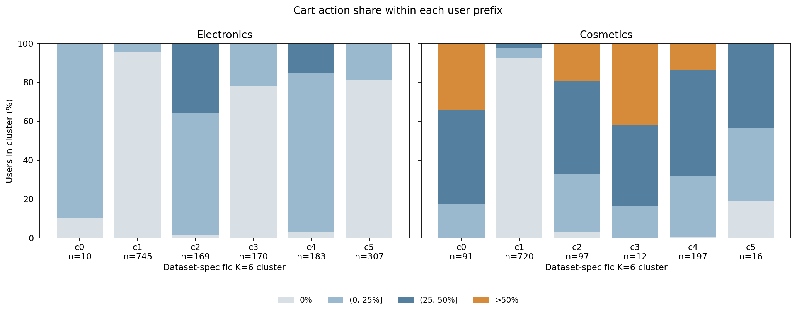

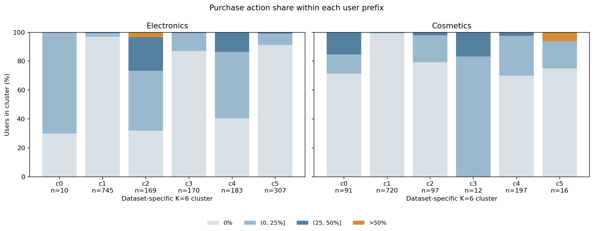

Cosmetics c0의 경우 91명 모두 장바구니 행동이 적어도 하나 있었지만, 장바구니가 행동의 25% 이하는 16명, 25% 초과~50% 이하는 44명, 50% 초과는 31명으로 나뉜다. 같은 c0에서 구매가 기록되지 않은 사람은 65명, 기록된 사람은 26명이다. 즉 `장바구니 중심`이라는 요약은 같은 군집의 구매 경험이 같다는 뜻이 아니다.

Electronics c2에서는 169명 중 구매 미기록 54명, 구매 비율 0% 초과~25% 이하 70명, 25% 초과~50% 이하 39명, 50% 초과 6명이다. 이 비율은 prefix 내 행동 구성이지 다음 구매 확률이나 상품별 전환율이 아니다. 삭제 이벤트는 Cosmetics에서만 측정됐으므로 Electronics에 대해 0%라고 가정하지 않는다. 사용자별 삭제 존재 건수는 JSON에 기록했다.

## 5. 다음 세션까지의 간격

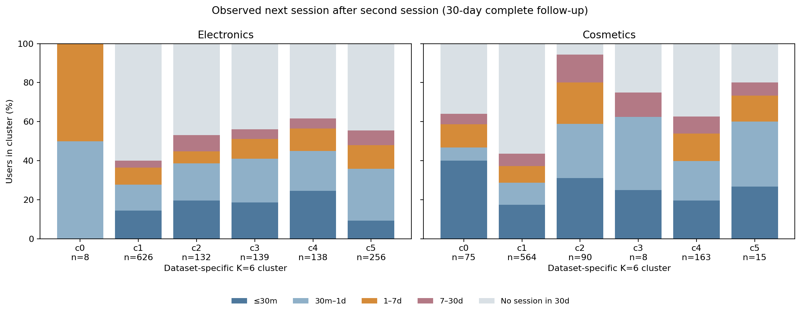

두 번째 세션의 마지막 기록 이후 다음 세션 첫 기록까지를 재고 `≤30분`, `30분 초과~1일`, `1~7일`, `7~30일`, `30일 내 미관측`으로 나눴다. 경계는 앞 구간의 오른쪽 끝을 포함한다. 각 막대의 분모는 **30일을 관찰할 수 있는 해당 군집 사용자**이고, 미관측을 한 범주로 명시했다. 30일이 지난 다음 세션 또는 기록 종료 뒤 실제 행동은 알 수 없다.

Electronics c5에서는 256명 중 24명이 30분 내, 68명이 그 이후 1일 내, 31명이 1~7일, 19명이 7~30일에 재관측됐고, 114명은 30일 내 미관측이었다. Cosmetics c4에서도 163명 중 32·33·23·14·61명으로 각 범주가 모두 나타났다.

동일 군집에서도 빠른 기록과 긴 공백이 함께 존재하지만 30분 내 재관측은 원본 세션 ID 변경에 따른 인위적 분할일 수 있다. 또한 기존 페르소나가 이후 행동을 포함할 수 있으므로 이 그림을 사전 페르소나별 재방문 예측이나 세션 분포의 검증 결과로 쓰지 않는다. 같은 조건에서 시나리오별 상세 비교는 [세션 간격 분석](#archive-persona-session-delays)에 있다.

## 6. 시뮬레이터의 해석과 아직 알 수 없는 것

현재 결과를 근거로 설정할 수 있는 것은 **군집 내부에도 분포를 둔다는 설계 가설**까지다. 예를 들어 행동량·행동 선택·다음 세션 간격의 파라미터에 사용자 단위 차이를 추가할 수 있다. 그러나 각 분포는 서로 독립이라고 확인되지 않았고, 분포 모양·공분산·GMM 컴포넌트 수·개인별 파라미터를 위 그림만으로 식별한 것은 아니다. 관측 기간과 64토큰 한도를 반영하지 않은 채 이 수치를 바로 샘플러에 넣지 않는다.

여기서 다루지 못한 이질성에는 상품 및 가격 선호, 실제 휴식·오프라인 활동, 만족도, 쿠폰 노출과 개입에 대한 반사실적 반응이 포함된다. 두 데이터셋 간 사용자 ID도 연결되지 않는다. 따라서 '모든 잠재적 이질성'을 측정했다는 의미가 아니라, **현 보류 표본과 행동 로그에서 재현 가능한 주요 이질성**을 정리한 것이다.

후속 검증에서는 기준 시점 이전 prefix로만 페르소나를 만들고 시간·사용자 분리된 미래 행동을 측정해야 한다. 세션 ID 기반과 30분 timeout 기반 세션화를 비교하고, 관찰 종료를 처리하는 생존 분석을 검증해야 한다. 쿠폰이나 다른 충격의 개인차는 처치와 노출 시점이 확인되는 별도 데이터와 식별 가정이 필요하다.

## 7. 재현

```
PYTHONPATH='.:src:/Users/kimdaewon/Desktop/캡스톤디자인' \
OPENBLAS_NUM_THREADS=1 OMP_NUM_THREADS=1 \
/opt/anaconda3/bin/python -m analysis.persona.behavior heterogeneity
```

재현에는 로컬 원본과 저장된 임베딩, 기존 K=6 결과 및 직전 간격 분석 JSON이 필요하다. 데이터셋별 집계는 `artifacts/persona-heterogeneity/{electronics,cosmetics}.json`, 그래프는 `img/heterogeneity/`에 있다. 결과 JSON에는 개인 ID를 저장하지 않는다. 원본 및 파생 데이터의 논문 이용·재배포 조건은 별도 확인이 필요하다.

<a id="archive-persona-session-delays"></a>

### PERSONA_SESSION_DELAYS

# 페르소나별 세션 간격과 세션 내 행동의 관측적 분석

## 결론 및 핵심 경고

기존 K=6 행동 군집을 사후적으로 붙여 두 번째 관측 세션 이후의 간격을 살펴보면, 30분 이내의 매우 짧은 간격부터 수일 이상에 걸친 간격까지 함께 관찰된다. 30일 내 다음 세션이 기록되지 않는 사용자도 상당하다. 다만 이 값들을 **시뮬레이터의 페르소나별 다음 방문 분포로 그대로 사용해서는 안 된다.**

기존 군집은 처음 최대 64개 토큰을 보고 결정되므로 두 번째 세션 뒤 행동이 군집 입력에 포함될 수 있다. 전체 기록에서 2세션 이상인 사용자를 사후 선별한 점도 있다. 따라서 시간적 미래정보 누출과 선택 편향이 있으며, 군집별 차이는 예측·인과 효과로 사용할 수 없다. 여기서는 분포 형태를 점검하기 위한 사후 기술 통계로만 제시한다.

## 분석 정의

- Electronics와 Cosmetics별 기존 masked-GRU 임베딩, 사용자 분할, K-means K=6을 재구성했다. 보류 사용자별 각 군집 인원은 기존 집계와 일치한다.
- 사용자의 두 번째 관측 세션 마지막 이벤트부터 세 번째 관측 세션의 첫 이벤트까지가 간격이다. 한 사용자당 한 번 측정한다. 첫 세션→두 번째 세션 간격도 같은 방식으로 측정한다.
- 두 번째 세션 이후 30일 전체를 기록 가능한 사용자만 분석한다. Electronics 1,584명 중 1,299명, Cosmetics 1,133명 중 915명이다. 나머지 285명과 218명은 관찰기간 부족으로 제외했다. 마지막 이벤트 시각을 데이터 관찰 종료로 근사하며 실제 로깅 완전성은 미확인이다.
- 세션은 이전 이벤트와 30분 초과 공백이 있거나 원본 session ID가 바뀌면 분리한다. 따라서 **30분 미만 간격도 존재하며**, 특히 ID 변경으로 나뉜 세션이 독립적인 실제 방문인지는 알 수 없다. 종료 시각은 마지막 이벤트이며, 별도 로그아웃이나 30분 timeout 종료 시점이 아니다. 기존 `session-return-evaluation`의 시간 정의와 다르다.
- 30일 재관측률의 분모는 해당 군의 30일 추적 가능 사용자 전체다. 간격 사분위수는 **30일 안에 재관측된 사용자만**의 값이다. 재관측되지 않은 사람을 30일이나 무한대 간격으로 넣지 않았다.

## 데이터셋별 페르소나 분포

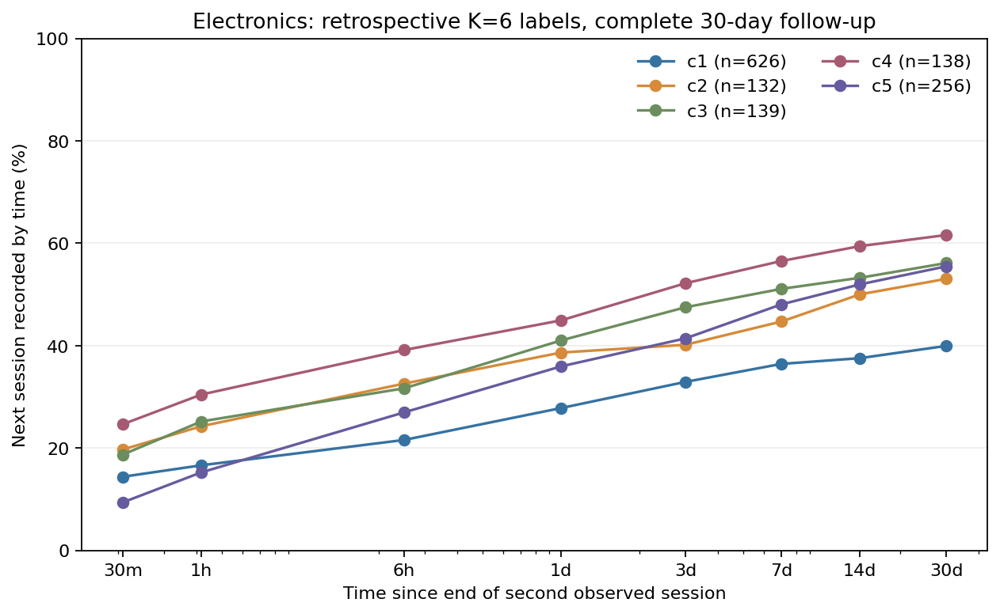


곡선은 30분, 1시간, 6시간, 1·3·7·14·30일의 누적 재관측 비율을 연결한 것이다. 중간 시점의 정확한 분포, 이탈률 또는 쿠폰 효과를 나타내지 않는다. 군집당 관측 가능 인원이 30명 미만이면 그래프에서는 제외하되 아래 표에 남겼다. 축은 로그 시간 축이다.

| 데이터·군집 | 기존 기술적 특징 | 30일 추적 가능 인원 | 30분 내 다음 세션 | 7일 내 | 30일 내 | 30일 내 재관측자의 간격 중앙값 |
|---|---|---:|---:|---:|---:|---:|
| Electronics c0 | 소수의 긴 이력 | 8 | 0.0% | 100.0% | 100.0% | 18.3시간 |
| Electronics c1 | 짧은 조회 중심 | 626 | 14.4% | 36.4% | 39.9% | 3.4시간 |
| Electronics c2 | 장바구니·구매 혼합 | 132 | 19.7% | 44.7% | 53.0% | 1.7시간 |
| Electronics c3 | 조회 중심 혼합 | 139 | 18.7% | 51.1% | 56.1% | 1.8시간 |
| Electronics c4 | 장바구니·구매 혼합 | 138 | 24.6% | 56.5% | 61.6% | 1.6시간 |
| Electronics c5 | 반복 조회 중심 | 256 | 9.4% | 48.0% | 55.5% | 7.6시간 |
| Cosmetics c0 | 반복 장바구니 | 75 | 40.0% | 58.7% | 64.0% | 0.08시간 |
| Cosmetics c1 | 짧은 조회 중심 | 564 | 17.4% | 37.2% | 43.6% | 3.7시간 |
| Cosmetics c2 | 긴 조회·장바구니·삭제 | 90 | 31.1% | 80.0% | 94.4% | 11.5시간 |
| Cosmetics c3 | 소수의 구매 관측 | 8 | 25.0% | 62.5% | 75.0% | 2.1시간 |
| Cosmetics c4 | 조회·장바구니 혼합 | 163 | 19.6% | 54.0% | 62.6% | 3.9시간 |
| Cosmetics c5 | 소수의 혼합 이력 | 15 | 26.7% | 73.3% | 80.0% | 1.2시간 |

예를 들어 Electronics c5의 30일 내 재관측자 142명에서 간격의 25·50·75백분위수는 각각 0.87·7.61·72.76시간이다. 하지만 256명 중 114명은 30일 내 재관측되지 않았다. 반환자 중앙값만으로 전체 사용자의 방문 간격을 대표하면 안 된다. Cosmetics c0의 짧은 0.08시간 중앙값은 별도 실제 방문이라기보다 세션 ID 경계에 민감할 수 있다. 서로 다른 데이터셋의 c 번호는 동일 유형이 아니며 표본 구성도 달라 수치를 직접 정렬하면 안 된다.

## 세션 행동별 시나리오: 충격이 아니라 관측적 조건

두 번째 세션에 구매가 있으면 `purchase`, 구매 없이 장바구니 추가 또는 삭제가 있으면 `cart_or_remove_no_purchase`, 나머지 조회만 있으면 `view_only`로 분리했다. 시나리오별 30일 재관측 비율은 다음과 같다. 점 옆 숫자는 각 조건의 사용자 수이고, 군집·조건별 인원이 20명 미만인 점은 표시하지 않았다.

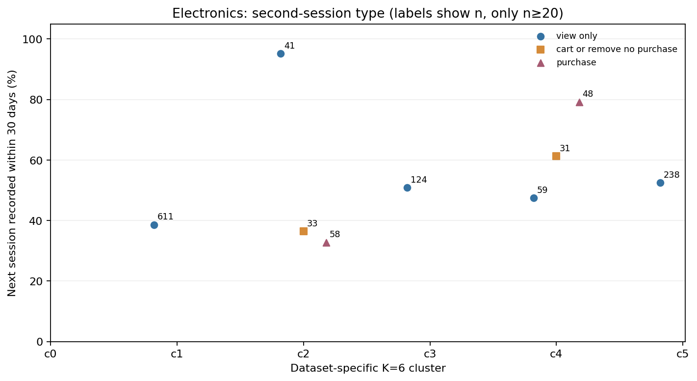

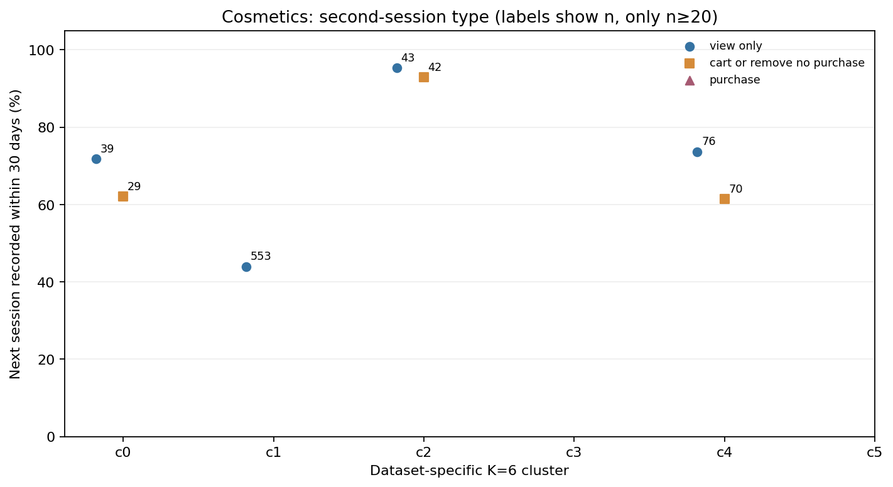

| 데이터·군집 | 조회만 | 장바구니/삭제, 구매 없음 | 구매 기록 |
|---|---:|---:|---:|
| Electronics c2 | 39/41 (95.1%) | 12/33 (36.4%) | 19/58 (32.8%) |
| Electronics c4 | 28/59 (47.5%) | 19/31 (61.3%) | 38/48 (79.2%) |
| Cosmetics c0 | 28/39 (71.8%) | 18/29 (62.1%) | 표본 20명 미만 |
| Cosmetics c2 | 41/43 (95.3%) | 39/42 (92.9%) | 표본 20명 미만 |
| Cosmetics c4 | 56/76 (73.7%) | 43/70 (61.4%) | 표본 20명 미만 |

다른 군집·시나리오의 전체 건수와 분위수는 JSON에 남겼다. 이 수치들은 가령 구매가 방문을 늦추거나 당긴다는 **충격의 효과가 아니다**. 군집에 이후 행동이 반영되고, 각 세션 행동을 선택한 사용자 집단이 서로 다르며, 표본이 작고 조건부 선택이 있다. 특히 Electronics c2의 큰 차이를 효과 방향으로 해석하거나 그대로 시뮬레이터에 주입하지 않는다.

참고로 동일 사용자의 첫→두 번째 간격과 두 번째→세 번째 간격을 비교하는 계산도 저장했다. 예를 들어 Electronics c5·조회만에서 30일 내 다음 세션이 기록된 125명은 첫 간격 중앙값 6.9시간, 다음 간격 중앙값 11.1시간이었다. 두 번째 간격이 더 긴 사람은 65/125명이다. **다음 세션이 기록된 사람만 선택한 값**이므로 전체 c5의 간격 증가율은 아니며, 중앙값 차이는 사용자별 변화량의 중앙값도 아니다.

## 쿠폰 충격에 관하여

Electronics·Cosmetics에는 이 분석에 사용할 쿠폰 배정·수령 기록이 없어, 이들 페르소나에서 쿠폰 전후의 세션 간격 변화는 측정할 수 없다. 별도 Tianchi 분석은 조용한 14일 후 쿠폰 수령 기록 유무와 7·28일 내 클릭/구매 기록을 비교하지만, 여기의 GRU 페르소나나 동일한 세션 경계와 연결되지 않는다. 자발적 수령 가능성·추가 쿠폰·기록 누락도 남는다. [쿠폰·재활동 분석](#archive-coupon-reactivation-and-late-patterns)의 차이는 쿠폰 개입이 간격을 단축했다는 증거가 아니다.

## 시뮬레이터 설계에 적용할 수 있는 것과 없는 것

- **가능한 가설:** 짧은 공백과 긴 공백, 30일 관측 창을 넘어가는 사례를 표현하는 유연한 간격 분포를 시험한다. 세션 ID 변경만으로 생긴 짧은 간격은 별도 세션화 민감도 분석에서 확인한다.
- **아직 불가:** 위 군집별 곡선을 미래 행동 예측 분포로 그대로 사용하거나, 구매·쿠폰의 간격 변화 계수와 페르소나별 인과효과로 확정하는 것.
- **필요한 검증:** 세션 기준 시점까지의 prefix만으로 페르소나를 만들고 이후에 할당된 holdout 사용자·시간에서 평가한다. 30분 timeout 단독과 session ID 혼합 규칙을 비교하고, 30일을 넘어가는 우측 검열을 다루는 생존/위험 모형 및 장기 예측을 검증한다. 개입 충격에는 시점·발송·노출·대조군이 있는 데이터가 별도로 필요하다.

## 재현

```
PYTHONPATH='.:src:/Users/kimdaewon/Desktop/캡스톤디자인' \
OPENBLAS_NUM_THREADS=1 OMP_NUM_THREADS=1 \
/opt/anaconda3/bin/python -m analysis.persona.behavior delays electronics cosmetics
```

집계: `artifacts/persona-delays/electronics.json`, `artifacts/persona-delays/cosmetics.json`. 집계에는 사용자 ID를 저장하지 않는다. 로컬 원본·기존 임베딩이 필요하고 데이터 공개·재배포 권리는 별도 확인해야 한다.

<a id="archive-persona-stability-audit"></a>

### PERSONA_STABILITY_AUDIT

# Persona candidates: sample-perturbation stability audit

## Method and boundary

For each dataset and K=2–8, fit the previous full-training KMeans as the reference.
Five times, sample 80% of the same eligible training users without replacement,
refit KMeans with a different seed, assign the unchanged held-out users, and match
clusters by maximizing total Jaccard overlap on those users. Both train sampling
and KMeans initialization change together. Report the matched cluster's minimum
Jaccard over the five runs, and overall adjusted Rand index per run.

This test fixes the encoder, scaler, sampled cohort, train/test split, K and held-out
users. It tests conditional cluster robustness only; it does not test retraining
the encoder, temporal drift, another dataset, time leakage, sessionization, or the
truth of a semantic persona. The matching uses the held-out memberships as a
descriptive stability diagnostic, not downstream out-of-sample validation.

As an **exploratory screening rule chosen after seeing the output**, require at
least 50 held-out users and minimum matched Jaccard >=0.8. This is a pragmatic
filter, not a statistical confidence guarantee. Small-but-consistent groups are
excluded, as are groups with high overall ARI but low individual overlap. No
formal hypothesis testing or uncertainty interval was performed.

## Supported descriptive candidates

These examples pass that screening rule, but the labels are analyst-created and
can overlap. They are **seven working behavioral descriptions**, not seven
mutually exclusive, independently established personas. The eight-persona goal
remains unvalidated rather than being filled with a weak eighth group.

| Candidate | Representative cluster | Held-out users | Min Jaccard | Main prefix evidence |
|---|---|---:|---:|---|
| Short view-dominant | Electronics K6 c3; Retailrocket K6 c0 | 747; 860 | 1.000; 0.999 | view 96.1%; 99.6% of events; median tokens 4; 4 |
| Longer view-dominant, some carts | Retailrocket K6 c5 | 191 | 1.000 | view 96.8% of events, cart-user share 14.7%, median tokens 13 |
| Mixed view/cart/purchase | Electronics K5 c0 | 308 | 0.990 | view/cart/purchase 80.3/11.8/8.0% of events; buyer share 32.8% |
| Cart-active, some observed purchases | Retailrocket K6 c3 | 97 | 0.980 | cart-user share 100%, buyer share 35.1% |
| Cart/remove active, fewer observed buyers | Cosmetics K6 c2 | 74 | 0.946 | cart-user share 100%, remove-user share 62.2%, buyer share 13.5% |
| Cart/purchase active | Electronics K6 c4 | 168 | 0.994 | cart-user share 98.2%, buyer share 67.9% |
| Cart/remove/purchase active | Cosmetics K6 c5 | 63 | 1.000 | cart-user share 100%, remove-user share 74.6%, buyer share 100% |

The Electronics K7 c5 direct-purchase candidate has only three held-out users
and minimum Jaccard 0.0; it is excluded. Retailrocket K8 c7 has 68 users but
minimum Jaccard 0.0; it is also excluded. Cosmetics K6 c4 has 16 users and
minimum Jaccard 1.0, illustrating why cluster overlap alone does not establish
adequate support. Another Electronics K4 cluster has minimum Jaccard 0.51,
showing that results depend on K. Numbers compare users within each individual
dataset and must not be treated as cross-dataset aligned latent clusters.

All profile figures use first 64 tokens, including inferred session-end tokens;
the same input determines both cluster and description. "Buyer share" is presence
of a recorded purchase in that prefix, not future propensity. Selection by full
history and stratified sample sizes make percentages non-representative and
unsuitable as online evaluation. Cosmetics cart removal is not recorded in the
other two sources; missing measurement is not zero. No price sensitivity,
loyalty, uplift, causation, nor stable latent psychological type is established.

## Reproduce

First reproduce or retain the prior K sweep and local capstone embeddings. Then:

```
for dataset in electronics cosmetics; do
  OPENBLAS_NUM_THREADS=1 OMP_NUM_THREADS=1 /opt/anaconda3/bin/python \
    -m analysis.persona.cluster stability "$dataset"
done
```

The three `artifacts/three-ecommerce-personas/*_stability.json` files contain
all K and replicate scores, including rejected groups. Next meaningful checks:
independently retrain encoder across seeds, temporally separated cohorts and
prefix-to-future evaluation, and explicit merge rules with uncertainty before
claiming a fixed or mutually exclusive eight-persona taxonomy.

<a id="archive-quadratic-history-irl"></a>

### QUADRATIC_HISTORY_IRL

# Pairwise-quadratic history reward: exploratory comparison

The five prior-history counts and selection/windowing are identical to
`HISTORY_FEATURE_MAXENT_IRL.md`. For each state variable `z_i = log1p(count_i) /
log(65)`, create a feature basis consisting of one constant, the five `z_i`,
the five `z_i^2`, and the ten distinct `z_i*z_j` for `i < j`: 21 terms total.
There are no cubic or higher-order terms. For each possible cart/purchase action,
the reward has its own 21 coefficients; view is the zero-reward reference. Thus
the model is nonlinear in the log-scaled history, but linear in its 42
coefficients. The history counts update deterministically along hypothetical
three-event paths. Same training windows, user split, L2=1 and temperature=1
are used for the linear and quadratic models. No model uses future history.

| Dataset | Test windows | Linear test NLL/action | Quadratic test NLL/action | First-action view observed / linear / quadratic |
| --- | ---: | ---: | ---: | --- |
| Electronics | 1,610 | 0.6570 | 0.5961 | 88.6% / 75.9% / 79.8% |
| Retailrocket | 1,435 | 0.2623 | 0.2570 | 96.2% / 92.9% / 93.4% |
| Cosmetics | 3,870 | 0.6114 | 0.5986 | 52.5% / 44.0% / 45.9% |

Observed and predicted shares above are on the same conditional, complete
three-event test windows; they are not full-session or population rates.
Lower NLL is better. The quadratic model is better on this split but remains
miscalibrated on the first action. The test set informed this exploratory
comparison; it is not a final untouched evaluation for subsequent model
selection. The same absolute L2 penalty is used, but regularization has a
different effect with 42 rather than 12 parameters. No hyperparameter tuning,
confidence intervals, temporal split or uncertainty analysis was performed.

Models estimate a pooled dataset-level behavioral reward, not user-specific
utility or an intervention effect. Reward is not identified from behavior and
logging/exposure differences across datasets preclude straightforward causal
interpretation of coefficients. Action availability, product choice, session
end and return times remain unmodeled. Output files contain aggregate fitted
coefficients and evaluation only, at `artifacts/quadratic-history-irl/`.

Reproduce from the project root with local data:

```sh
PYTHONPATH='.:src:/Users/kimdaewon/Desktop/캡스톤디자인' \
OPENBLAS_NUM_THREADS=1 OMP_NUM_THREADS=1 /opt/anaconda3/bin/python \
-m analysis.irl.history quadratic electronics retailrocket cosmetics
```

<a id="archive-recent-lag-feature-design"></a>

### RECENT_LAG_FEATURE_DESIGN

# Recent-history feature engineering for planned MaxEnt IRL

## Literature basis

- [Li et al., Towards Learning Reward Functions from User Interactions](https://arxiv.org/abs/1708.04378):
  exploratory MaxEnt IRL using user situations; the study encodes categorical
  topic and object-order features with one-hot indicators, discretizes duration,
  and compares two groups. The museum task and its actions differ from ours.
- [SASRec](https://arxiv.org/abs/1808.09781): sequential recommendation using
  recent user actions for context; discusses last-action Markov models and
  longer RNN histories. It is not an IRL method and does not prescribe our basis.
- [GRU4Rec](https://arxiv.org/abs/1511.06939): models within-session behavior.
  Its item recommendation task is not identical to our action-type model.
- [MaxEnt IRL](https://www.cs.cmu.edu/~bziebart/publications/maximum-entropy-inverse-reinforcement-learning.html):
  globally normalized trajectory distribution under an assumed transition model.

The design below is our proposal inspired by these ideas, not a feature set
validated by those papers.

## Exact state and target

At the moment of choosing the **next logged action**, the most recent already
observed common action defines `lag0`; actions before it define lag1, lag2 and
lag3. For a history `view, cart, view`, the next-action features are
`lag0_view=1`, `lag1_cart=1`, `lag2_view=1`, and lag3 unavailable. The action
being predicted is never inserted into its own input. This convention is
deliberate: lag0 means current state, not the target action at the same index.
The action categories are view, cart and purchase; Retailrocket maps addtocart
and transaction to the last two. The time step is an event index, not an
equal-length calendar period.

For maximum lag `L=0,1,2,3`, use these state-basis terms:

- intercept and two mutually exclusive indicators for an incomplete history
  arising from session start or an unknown boundary (unsupported event/tie);
- for every lag `0..L`, three binary action indicators; all three are zero
  when that lag does not exist, not evidence of no activity;
- pairwise products of action indicators at two distinct lag positions, all
  nine action combinations per pair. No products involving three positions.

There are respectively 6, 18, 39 and 69 basis terms (including intercept and
boundary indicators). For future behavior IRL, interact the basis with candidate
cart and purchase action indicators, using view as a reward-reference action;
then the corresponding sizes are 12, 36, 78 and 138 coefficients. Categorical
main effects are linear in the basis; the pairwise terms give the quadratic
part. Because each lag is one-hot, squares duplicate main indicators and
within-lag products are identically zero, so neither is included.

No cumulative counts, log transform, item price, product ID, future timestamp,
GRU embedding, user identifier or cluster label is used. Session boundaries are
source/inference dependent. Drop every group of events sharing a timestamp in a
given user's session and reset recent context; do not invent order. Cosmetics
remove events are not shared actions: skip them and reset context. These rules
change the sample, particularly purchase-heavy baskets, and their potential
selection bias must be evaluated before use. All three actions are not necessarily
available at every state; item/cart availability remains unknown.

## Preliminary coverage audit

The same retrospectively stratified persona sample and user train/test split is
used; retain first 64 **events**, not the earlier 64 token positions. These are
all eligible per-event decisions, not the prior IRL's complete 3-event windows.
No IRL has been trained for the new features, and no trainable user-level data
is exported. Counts below are training decisions; `lag3 present` means four
prior common events since the most recent session or unknown boundary.

| Source | Train decisions | lag0 present | lag3 present | Tied events skipped | Unsupported events skipped |
| --- | ---: | ---: | ---: | ---: | ---: |
| Electronics | 44,291 | 19,240 | 5,338 | 506 | 0 |
| Retailrocket | 43,004 | 18,869 | 6,683 | 116 | 0 |
| Cosmetics | 68,038 | 39,384 | 19,958 | 9,721 | 5,598 |

Cosmetics' retained test targets contain only 14 purchases. Tied purchase events
may disproportionately be removed; this audit does not yet quantify removed
actions by type. Consequently its evaluation, especially rare-purchase fit,
could be very unstable and not representative. The absence of a lag is an
explicit boundary situation, not a row of artificial zero behavior.

## Next stage, not yet run

Construct trajectory windows using the same eligible data and user split for all
L=0..3; simulate candidate histories by shifting in candidate actions, never
using future observed actions. Fit pooled dataset-level MaxEnt trajectory IRL
at fixed temperature 1, fixed L1 and L2=0. Select lag on a validation-user split
using trajectory likelihood plus action/sequence calibration diagnostics, then
evaluate once on untouched test users; report coverage and bootstrap uncertainty.
For fairness do not score different cohorts or compare raw parameter magnitudes
without accounting for dimension. Decide tie/basket handling before finalizing.
Reward is not identified by observational data and does not establish causal
effects, personalized utility or uplift. This design does not model item
exposure, session termination, purchase feasibility, or long-term returns.

Implementation: `src/preprocessing/recent_history_features.py`; audited totals:
`artifacts/recent-feature-audit/{dataset}.json`. Reproduce from project root:

```sh
PYTHONPATH='.:src:/Users/kimdaewon/Desktop/캡스톤디자인' \
OPENBLAS_NUM_THREADS=1 OMP_NUM_THREADS=1 /opt/anaconda3/bin/python \
-m analysis.irl.history features electronics retailrocket cosmetics
```

<a id="archive-repository-layout"></a>

### REPOSITORY_LAYOUT

# 저장소 구조와 기능 보존 기준

이 저장소의 목표는 `AGENTS.md`의 16개 연구 항목이다. 이번 정리는 기존 분석과
모델의 계산을 유지하면서 코드의 역할, 실행 방법, 실험의 한계를 드러내는 작업이다.
새로운 쿠폰 효과 추정기나 RL 에이전트를 구현하는 작업은 포함하지 않는다.

## 코드의 역할

| 위치 | 책임 |
|---|---|
| `src/preprocessing/` | 원자료 검증, 시퀀스·시간·이력 특징 구성 |
| `src/analysis/` | 캠페인 감사, 인과 그래프 특징, 행동 변화·비활동·세션 간격 분석 |
| `src/models/` | 선택모형, MaxEnt IRL 변형, 그래프 학습, 임베딩 |
| `src/simulate/` | 사용자 상태, 세션·간격 샘플링, 합성 패널 생성 |
| `src/cli.py` | 기존 `ecommerce-sim` 및 `python -m cli` 명령 |
| `src/paths.py` | 저장소 및 외부 capstone 자료의 위치 |
| `scripts/` | 기존 파일명으로 실행하는 연구·전처리 진입점; [목록](scripts/README.md) 참고 |
| `tests/` | 합성 입력 기반 회귀 테스트; 원자료 없이 실행 가능 |
| `analysis.md` | 현재 연구 목표별 결과와 식별·검증 한계 |
| `analysis.md` | 실험별 상세 기록; 과거 결과와 최종 설계를 구분 |
| `img/` | 보고서에서 참조하는 그림 |
| `data/raw/` | Git에 포함하지 않는 원자료 |
| `artifacts/` | Git에 포함하지 않는 생성 패널·모델·실험 통계 |
| `paper/`, `output/pdf/` | 논문 원고와 기존 PDF |

이미 사용하는 `ecommerce_sim` 패키지와 `pyproject.toml`을 유지한다. 아직 없는
에이전트 구현이나 데이터 산출물을 위해 빈 패키지·폴더를 만들지는 않는다.

## 기능 보존

- 모델의 보상식, 최적화 설정, 난수 seed, 샘플링 및 데이터 검증은 유지한다.
- 기존 `해당 역할 패키지` import는 새 역할별 모듈과 같은 객체를 가리킨다.
  이전 모듈 경로로 저장된 Python 객체도 같은 클래스를 찾을 수 있게 한다.
- `scripts/*.py`의 파일명과 인자, CLI 하위 명령, 산출물 이름은 유지한다.
- 이전 개발자의 절대경로 대신 저장소를 기본 위치로 사용한다. 기존 별도 capstone
  자료를 사용하려면 `ECOMMERCE_CAPSTONE_ROOT`를 해당 디렉터리로 설정한다.
  외부 `src.irl`·`src.analysis` 코드가 필요한 실행에는 그 프로젝트도
  `PYTHONPATH`에 넣어야 한다. 외부 코드를 다른 구현으로 대체하지 않는다.
- 순수 집계 함수는 외부 프로젝트 없이 import할 수 있도록 외부 코드 import를
  실제 분석 실행 위치로 옮긴다.

실험 스크립트마다 대상 모집단·세션 정의·학습 조건이 달라, 이름이 비슷하다는
이유만으로 삭제하지 않는다. 기능 보존을 확인하는 테스트도 유지한다.

## 검증 범위

정리 전후 동일 환경의 pytest 결과, 기존 import와 새 import의 객체 동일성,
CLI 실행, 합성 패널 생성 및 설치 패키지 구성을 확인한다. 원자료·외부 capstone
코드·학습된 체크포인트가 없는 환경에서는 전체 실험 재실행과 수치 재현을
완료했다고 주장할 수 없다. 최종 검증 결과는 이 문서에 덧붙인다.

### 2026-10-23 검증 결과

- 동일 가상환경의 원본 복사본: 68 passed, 1 failed, 6 collection errors.
  수집 오류는 누락된 외부 capstone import였고, 실패는 gCastle import가
  전역 torch dtype을 바꾸어 생긴 LightGCN 테스트 간 간섭이었다.
- 정리 후 전체 테스트: **94 passed**. 기존 80개 테스트를 그대로 유지하고,
  모듈 경로·이전 pickle 클래스 참조·외부 자료 경로·import 부작용에 관한
  14개 검증을 추가했다. gCastle import 전후 dtype을 복원하여 클래스 접근과
  기존 진단 기능을 유지했다.
- 26개 모듈을 역할별로 이동했다. 원본의 221개 함수·클래스 정의를 AST로
  비교해 import 위치·경로를 제외한 계산 구조가 같음을 확인했다.
- 기존 Python 실행 파일 58개의 경로와 기존 테스트 파일의 내용을 유지했다.
  기존 직접 실행을 보존하고 조건부 IRL 스크립트의 `-m` 실행도 확인했다.
- `python -m cli --help`와 wheel 빌드가 성공했다.
  wheel 내부에 모든 패키지 모듈이 포함됐고, 소스 디렉터리와 분리한
  Python 프로세스에서도 wheel import와 이전 API 경로가 동작했다.
  Ruff의 F401/F811/F841 검사에서 소스·실행 스크립트·신규 테스트가 통과했다.
- pytest에 남은 4개 경고는 PyTorch sparse 검사 및 pandas API의 기존 경고다.
  원자료, 외부 capstone 코드 및 체크포인트가 없어 전체 학습·실험 수치 재현과
  R 추출기는 실행하지 않았다.

<a id="archive-sequential-data-audit"></a>

### SEQUENTIAL_DATA_AUDIT

# HeartSteps V1과 The Complete Journey: 데이터 준비·감사

## HeartSteps V1

공식 저장소 https://github.com/klasnja/HeartStepsV1 커밋 `3016391de426116bdef41880d72bc8cd4b9b2477`의 `suggestions.csv`를 로컬에서 점검했다. 저장소 라이선스는 CC BY 4.0이며, 논문에서는 저자들이 요청하는 Klasnja et al. (2019), https://doi.org/10.1093/abm/kay067 를 인용한다. 로컬 데이터는 `data/raw/heartsteps-v1`에 보관한다.

- 사용자 37명, 의사결정 8,274행, 사용자·결정 index 중복 0개. 1인당 175~309행(중앙값 215).
- 연결·가능·행동 기록이 있는 6,590행: 발송 3,915행, 미발송 2,675행. 전체 발송 여부 결측 735행; 불가능 상태인데 발송된 3행은 별도 점검이 필요하다.
- 위 6,590행 중 30분 후 Jawbone 걸음 수 결측은 789행이다. 센서 미측정은 0걸음으로 간주하지 않는다. 관측된 경우만으로 계산한 평균은 선택 편향 가능성이 있어 인과 효과로 사용하지 않는다.
- `is.randomized`는 무작위 배정 기회가 있었는지 나타내는 eligibility 지표로 해석하면 안 된다. 이 변수를 True로 필터링하면 발송 비교군이 대부분 사라진다. 공식 변수 설명 https://github.com/klasnja/HeartStepsV1/wiki/Documentation-for-suggestions.csv 및 당시 가공 설명 https://github.com/LisaGotzian/HeartSteps/blob/master/build_heartsteps_data.R 를 참고한다.
- 논문·공식 문서는 가능 시점에서 no suggestion / walking / anti-sedentary를 0.4/0.3/0.3으로 설명한다. 실제 전달·측정 문제 및 기록된 가용성 정의를 검토하기 전에는 이 확률을 모든 행의 확정 propensity로 취급하지 않는다.

의사결정 시점의 `jbsteps30pre` 등은 이전 상태 후보, `send`는 시스템의 intervention, `jbsteps30`은 이후 결과다. `response.*`와 이후 걸음 수를 발송 전 state에 넣으면 누출이다. 사용자는 시스템 알림을 선택한 것이 아니므로 무작위 `send`를 사용자의 전문가 행동으로 해석해 MaxEnt IRL에 넣으면 안 된다. 걸음 수는 개수이며 사용자의 명시적인 다항 선택 레이블이 아니다. 결측과 시점 간격을 보존해 별도 행동 정의를 정하고, 사용자·시간 분할 평가 및 무작위 개입 검증을 수행해야 한다.

## The Complete Journey

공식 https://www.dunnhumby.com/source-files/ 에서는 약 2년의 가구 구매 및 일부 가구 직접 마케팅 기록을 제공하고, 학술연구 사용을 제시한다. 다만 라이선스의 구체적인 수정·재배포 권한 및 배포 버전은 확인되지 않았다. 원본을 제3자 저장소에서 자동 취득하거나 재배포하지 않는다. 제공자의 안내에 따라 사용자가 원본 파일을 확보하면 `--journey` 옵션으로 로컬 검증을 실행할 수 있다.

감사 대상은 `transaction_data.csv`, `campaign_table.csv`, `campaign_desc.csv`의 거래, 가구·캠페인 기록, 캠페인 기간이다. 실제 파일이 없어 이번에는 실행하지 않았다. 비기록을 비접촉 대조군으로 간주하지 않으며, 캠페인 시작일은 실제 가구 접촉 시점으로 확인되지 않았다. redemption은 처치가 아니라 구매 이후 측정된 반응일 수 있고, 관측된 기록만으로 무작위 배정을 가정하지 않는다. 이용할 파일 버전과 허락 조건도 확인해야 한다.

## 재실행

```bash
PYTHONPATH=src python -m analysis.eda audit
PYTHONPATH=src python -m analysis.eda audit --journey /path/to/complete-journey
PYTHONPATH=src pytest -q
```

결과는 `artifacts/sequential-data-audit/`에 생성된다. 로컬 결정행 파일은 참가자 단위이므로 출처·개인정보·라이선스를 검토하고 무분별하게 공개하지 않는다. 이번 코드는 데이터 감사이며 NTS-NOTEARS, IRL, RL 실험은 수행하지 않았다. 기존 그룹 IRL 코드는 AmExpert의 78주·3개 행동과 특징에 고정되어 있어 두 데이터에 그대로 사용할 수 없다.

<a id="archive-sequential-uplift-pilots"></a>

### SEQUENTIAL_UPLIFT_PILOTS

# 시계열 uplift 후보: 전처리 및 NTS 탐색 실험

## Backend-TS

공식 저장소의 archive와 [공식 전처리 노트북](https://github.com/nannullna/ts4uplift/blob/main/preprocess/preprocess_time_series.ipynb)에 표시된 캠페인 기준 시각을 사용한다. 처리군은 실제 방송 기준, 대조군은 정확히 7일 이전의 pseudo-control이다. 이력은 기준 시각 직전 168시간의 로그인 및 HTTP method별 `log1p` 이벤트 수이며, 처치 및 3시간 로그인 결과는 별도 episode 테이블이다. 해당 시간에 관측된 로그가 0개라는 의미이지 시스템 전체 활동이 반드시 없었다는 보장은 아니다. 4–5월은 사용자 단위 해시로 train/validation을 나누고, 6월은 별도 시간 테스트다. 따라서 6월 테스트 사용자는 과거 train 사용자와 겹칠 수 있다. 생성 스크립트 `scripts/prepare_backend_ts.py`.

기존 다중 시퀀스 NTS 구현은 각 시점의 모든 노드를 완전 관측한 상태로 다루므로 시퀀스 전체의 미관측 T/Y를 0으로 대치해 학습하지 않았다. 대신 50개 훈련 episode의 이력에만 1-lag NTS를 시험했다. 이것은 **개입 그래프가 아니다**. 10회 반복 후 h=2.79e-8로 h_tol=1e-8에 미도달, 임계처리한 동시점 그래프는 DAG다. 작은 표본, 수렴 미달, 안정성 평가 부재로 선정 근거가 아니다. T/Y를 포함한 endpoint-aware masked loss 및 시간 제약은 미구현이다.

## KuaiRand

[공식 페이지](https://kuairand.com/)에 따르면 Pure는 일부 video만 포함한 불완전 시퀀스이므로 예비 동작 시험에만 쓴다. 1K는 완전한 사용자 시퀀스를 위한 버전이다. `is_rand`는 알림이 아니라 random video replacement 정책 여부이며 사용자 반응 `is_click`, `is_like`, `long_view`와 구분한다. 노출 단위 sequence는 동일 사용자 30분 이내 연속 관측 세션이며 동일 타임스탬프 중복은 모호해 제거한다. 사용자 해시 구분과 날짜 분리 모두 적용한다. 이 방식은 원 보고서에서 제안한 session 단위의 초기 실험이나, Pure의 누락 때문에 실제 인접 노출이 보장되지 않는다. 각 세션의 user ID를 결과에 저장해 추후 user-level bootstrap이 가능하다.

NTS는 동시점 feedback→policy를 금지하지만 다른 인과 제약, user-level bootstrap, hyperparameter validation, held-out forecast와 반사실/uplift 성능 평가는 아직 없다. 동시점 feedback들 간 순서도 확정되지 않았다. 학습된 edge는 검증된 인과효과가 아니다. 스크립트 `scripts/prepare_kuairand.py`.

Pure의 training session에서 random 비율은 약 88.9%로 전체 서비스의 정책 비율을 대표하지 않는다. 1,500개 세션·6,501개 window의 1-lag 시험은 h=4.42e-9로 수렴했으며 0.3 threshold에서 `is_rand(t-1) → is_rand(t)`, `is_rand(t) → long_view(t)`, `long_view(t) → is_click(t)` 세 edge가 남았다. `long_view`와 `is_click`은 일부 UI에서 시청시간을 공유해 계산상 중복될 수 있으므로 인과관계로 해석하지 않는다. 이진 변수를 0/1 그대로 두고 `is_click`을 제외해 다시 돌리면 threshold 0.3에서 edge는 0개다. 이는 scaling과 변수 선택을 동시에 바꾼 민감도 시험으로 어느 한 변경의 효과를 분리하지 못한다. 표본은 user 단위가 아닌 세션 단위 추출이고 제거된 동시시각 기록으로도 관측 간 누락이 생길 수 있다. 이 결과로 최종 그래프 또는 데이터셋을 선정하지 않는다.

1K 예비실험은 [제3자 미러](https://huggingface.co/datasets/numberbeat6/kuairand)의 두 로그를 사용했다. 표준 로그 SHA-256은 미러가 제공하는 값 `548daf771e54e2b73086cc8e7c6f56787d44421f5026c2100421810e47ae9dd4`와 일치하지만, 공식 archive와의 대조는 아직 못 했다. 4/22–5/08 표준 로그 6,657,061건 중 98.66%가 동일 고객·동일 타임스탬프 중복 그룹에 속해, 해당 행을 모두 제외하는 현 처리의 대표성에 심각한 문제가 있다. 1,500개 남은 train 세션의 예비 NTS(0/1 유지, click 제외, 1 lag, 0.3 threshold)는 edge 0개다. timestamp 동률을 안전하게 처리하는 단위의 재설계 및 표본 보존율 검증 전까지 1K 결과는 채택 판단에 사용할 수 없다.

## 다른 후보 및 선정 상태

ASSISTments 논문의 구 다운로드 주소는 404였고 현행 접근·약관 확인이 필요하다. PhysioNet과 Freddie Mac은 자격/이용조건 확인 없이 접근할 수 없다. 로컬 Complete Journey의 campaign 테이블은 고객별 실제 접촉 시각을 입증하지 않으므로 이를 개입 시각으로 가정해 학습하지 않는다. 아직 후보 간 동일한 실험이나 검증을 마치지 않아 채택 대상은 결정하지 않았다.

Backend-TS 공식 저장소는 CC BY-NC-SA 4.0과 별개로 사용 결과 공유 시 연락을 요청한다. 논문 공개 전 [공식 안내](https://github.com/nannullna/ts4uplift#disclaimer)를 확인한다. 각 원자료 및 파생 개인별 데이터는 공개 저장소에 포함하지 않는다.

<a id="archive-starbucks-uplift-pilot"></a>

### STARBUCKS_UPLIFT_PILOT

# Starbucks promotion-response pilot

## Frozen source

- Repository: `udacity/DSND_Term2`
- Commit: `6cc091fff66b8f441cbfeb5bb9e7ba70a7d74117`
- Training: 84,534 rows, SHA-256
  `4d48190fd0d6a65d3874fa9a9ac79d89007579716366c2cfe140ae999088aa4f`
- Test: 41,650 rows, SHA-256
  `f5607ca0b2f6a6580ee2085659387b45735e81b41cad97c756ba068fcc06a625`
- Schema: `ID`, `Promotion`, `purchase`, `V1`–`V7`

Raw files and row-level derivatives are local-only and excluded from version control. The
repository-level MIT/CC BY-NC-ND notices are not treated as a verified Starbucks
dataset-redistribution grant.

## First reproducible run

The response model is a logistic S-learner with treatment interactions. A six-component Gaussian
mixture models the anonymous user covariate distribution. The frozen test results are:

| Quantity | Result |
|---|---:|
| Training promotion share | 0.50115 |
| Test purchase rate, promotion | 0.01634 |
| Test purchase rate, control | 0.00675 |
| Raw test difference | +0.00959 |
| Constant-propensity IPW difference | +0.00945 |
| Mean model uplift | +0.00960 |
| Maximum absolute V1–V7 SMD in training | 0.01454 |
| DR value, top-30% policy | 0.01204 |
| DR value, all-control policy | 0.00674 |
| DR incremental policy value | +0.00530 |

The small covariate imbalance is consistent with a well-balanced experiment but does not prove
random assignment. Until an authoritative design source is cited, the paper must call this a
promotion experiment and state the exchangeability assumption behind IPW/DR interpretations.

## Simulator boundary

The calibrated generator implements

`X ~ fitted GMM` followed by empirical-support projection, `A ~ policy(X)`, and
`Y ~ Bernoulli(fitted P(purchase=1 | X,A))`.

This validates one-step promotion response and treatment heterogeneity. It does not identify item
preference, repeated user-state transitions or long-horizon reward. Those are separate synthetic
mechanisms to be evaluated against known ground truth before making an IRL or sequential
recommendation claim.

<a id="archive-three-dataset-inactivity"></a>

### THREE_DATASET_INACTIVITY

# 세 eCommerce 데이터의 관측상 비활동 비교

## 정의와 범위

각 데이터셋에서 두 번째 관측 세션 종료 후 30일 이내 세 번째 세션이
기록되지 않은 경우를 30일 비활동이라고 부른다. 최소 2세션 기록이 있고,
데이터별 마지막 이벤트 시각 이전에 30일을 충분히 관측할 수 있는 사용자만
분모에 둔다. 기록 종료 후는 우측 검열한다. 각 데이터셋의 마지막 이벤트는
행정적 cutoff일 뿐 지속적인 수집·식별 정확성을 보증하지 않는다. 데이터의
첫 두 관측 세션도 실제 첫 방문·가입 시점을 뜻하지 않는다.

Electronics와 Retailrocket은 로컬 원본 전처리된 전체 사용자, Cosmetics는
`user_id % 100 == 0` 사용자의 5개월 기록을 사용한다. Electronics와
Cosmetics는 원본 세션 ID 변경 또는 30분 초과 간격, Retailrocket은 30분
초과 간격으로 세션을 추정한다. Cosmetics에서는 사용자가 유효한 ID와
세션 ID를 갖지 않은 행이 표본 추출 이전에 제거된다. 서로 다른 사이트,
기간, 세션 정의와 모집단으로 인해 비율을 직접적인 성과 비교로 다루지 않는다.

## 30일 비활동

| 데이터 | 30일 추적 가능 사용자 | 30일 내 미관측 | 미관측 비율 | 30일 경과 후 데이터 종료 전 재방문 |
|---|---:|---:|---:|---:|
| Electronics | 54,103 | 33,828 | 62.5% | 830 |
| Retailrocket | 141,810 | 97,654 | 68.9% | 5,601 |
| Cosmetics 표본 | 4,604 | 2,104 | 45.7% | 223 |

검열로 제외된 사용자는 각각 13,414, 39,823, 1,131명이다. 나머지 미관측자의
영구 이탈 여부는 알 수 없고, 30일 이후 추가 관찰 기간은 사용자별로 다르다.
날짜별 최소 한 건의 이벤트가 없는 날짜는 Retailrocket 전체와 Cosmetics
표본에서 각각 0일이었으나, 이는 특정 사용자의 로그가 빠짐없이 수집됐음을
보여주지 않는다.

## 첫 두 세션의 행동과 연관성

세션에 구매 이벤트가 있으면 `구매`, 구매는 없고 장바구니·삭제가 있으면
`장바구니/삭제`, 그 외 조회만 있으면 `조회만`으로 분류한다. Cosmetics는
삭제 행동을 관측하므로 이를 조회만으로 취급하지 않는다. Electronics와
Retailrocket의 삭제는 기록되지 않으며 없는 것으로 단정할 수 없다.

| 데이터 | 첫 세션 → 두 번째 세션 | 사용자 | 30일 비활동 비율 |
|---|---|---:|---:|
| Electronics | 조회만 → 조회만 | 41,924 | 65.0% |
| Electronics | 조회만 → 장바구니, 구매 없음 | 2,954 | 53.2% |
| Electronics | 조회만 → 구매 | 3,002 | 54.5% |
| Retailrocket | 조회만 → 조회만 | 131,328 | 69.7% |
| Retailrocket | 조회만 → 장바구니, 구매 없음 | 2,816 | 56.4% |
| Retailrocket | 조회만 → 구매 | 1,357 | 62.2% |
| Cosmetics 표본 | 조회만 → 조회만 | 3,105 | 50.7% |
| Cosmetics 표본 | 조회만 → 장바구니/삭제, 구매 없음 | 342 | 35.7% |
| Cosmetics 표본 | 조회만 → 구매 | 53 | 64.2% |

세 데이터 모두 해당 표본에서 조회만→조회만 그룹의 비활동 비율이 조회만→
장바구니 그룹보다 높게 관찰됐다. Cosmetics 조회→구매 그룹은 53명으로
작고 반대로 더 높은 비율을 보인다. 이들은 다른 사용자의 관측 기록 간
기술적 연관성으로, 행동이 비활동을 유발했다는 근거가 아니다. 동일 사용자의
반사실, 가격, 개입, 외부 구매 및 고객 상태는 관측되지 않는다.

두 번째 세션이 조회만인 비율은 30일 비활동자 / 30일 내 재방문자 각각
Electronics 86.0% / 79.8%, Retailrocket 96.7% / 94.7%, Cosmetics 표본
82.8% / 73.3%였다. 조회만이 이탈의 유일한 특성은 아니다. 첫 두 세션의
이벤트 수 중앙값은 모든 데이터와 결과 그룹에서 각각 1개다. 짧은 관측,
동일 시각 이벤트, 중복 및 세션화 민감도가 해석에 중요하다.

14·60일 정의 및 모든 세션 조합, 기준월별 결과는 원본 JSON을 확인한다.
각 기간의 추적 가능한 사용자 집합이 달라 서로의 숫자를 같은 코호트의
기간별 확률처럼 해석하지 않는다. 예측 평가나 중재 효과 분석은 하지 않았다.

## 재현과 검증

```
for source in retailrocket cosmetics; do
  PYTHONPATH='src:/Users/kimdaewon/Desktop/캡스톤디자인' OPENBLAS_NUM_THREADS=1 OMP_NUM_THREADS=1 \
    /opt/anaconda3/bin/python src/analysis/analyze_other_inactivity.py "$source"
done
```

Electronics는 [별도 비활동 기록](#archive-electronics-inactivity)에 재현 명령과
검증이 있다. 추가 산출물은 `artifacts/other-inactivity/{source}.json`이며
사용자 ID를 담지 않는다. 원본 및 파생물의 배포 권리는 미확인이다.

<a id="archive-three-ecommerce-persona-sweep"></a>

### THREE_ECOMMERCE_PERSONA_SWEEP

# Three eCommerce datasets: behavioral persona K sweep

## Objective and method

Discover and describe behavioral patterns, not treatment response or causal types.
Electronics, Retailrocket and Cosmetics are fitted separately. For each source,
the sweep reuses its existing dataset-specific, 48-dimensional masked bidirectional
GRU embeddings from the capstone project's `masked_embedding_clusters.py`. No GRU
was retrained here; the saved embeddings and the source data are required.
The same workflow reconstructs the 12,000-user sample and checks exact user order,
then uses the original seed-42 random 80/20 user split and fits KMeans at K=2–8
only on training users with at least two observed sessions. It describes repeat
users in held-out data using their first 64 input tokens. K is not selected by
silhouette. Cluster numbers are arbitrary, not matched across K or datasets.

The 12,000-user sample is stratified by full-history session count, and Cosmetics
first filters user IDs divisible by 100. These are exploratory samples, not
population prevalence estimates. Repeat-user eligibility uses full history and
is not an online selection procedure. Profiles summarize the same prefix as used
to assign clusters, not future behavior. Each dataset has a separate embedding
space; cohort, time periods, event logging and sessions differ. The first 64
tokens include inferred session-end tokens, and ties have no known causal order.
An immediate transition includes a possible inferred session-end as next token;
prefix-final events have no next-token denominator.

## Source and data quality

| Data | Observed events | Dataset scope and caveats |
|---|---|---|
| Electronics | view, cart, purchase | 885,129 raw rows, 165 missing-session rows excluded, 655 exact duplicate rows retained, 214 session IDs shared across users; 2020-09-24 to 2021-02-28 UTC. |
| Retailrocket | view, add-to-cart, transaction | 2,756,101 raw rows; 460 exact duplicate rows retained; sessions inferred using 30-minute gaps; 2015-05-03 to 2015-09-18 UTC. |
| Cosmetics | view, cart, remove-from-cart, purchase | User-ID modulo 100 sample: 16,428 users and 216,093 events from five monthly files; rows with missing user or session dropped; their total number was not audited. |

Repeat-user training/test counts are 6,416/1,584 Electronics,
6,387/1,613 Retailrocket, and 4,602/1,133 Cosmetics. Other sampled users are
embedded but excluded from the cluster fit and held-out profiles. The 12,000
sample is not a random draw of all users. Session boundaries also depend on
dataset-specific IDs and/or the 30-minute rule, not observed true session ends.

## Illustrative K=6 profiles

This table deliberately combines similar descriptive patterns across clusters
within a source; it is not a claim of equivalent latent types across sources.
Purchase share counts users with at least one purchase (transaction for
Retailrocket) in the prefix. Input event shares are event-weighted.

| Source / cluster | Held-out users | View / cart / remove / purchase events | Users with purchase | Descriptive pattern |
|---|---:|---|---:|---|
| Electronics c3 | 747 | 96.1 / 2.1 / — / 1.7% | 3.3% | view-dominant |
| Electronics c0, c4 | 183, 168 | 66.8 / 19.8 / — / 13.4%; 62.5 / 20.4 / — / 17.1% | 59.6%, 67.9% | cart and purchase active |
| Retailrocket c0 | 860 | 99.6 / 0.2 / — / 0.1% | 0.5% | view-dominant |
| Retailrocket c3 | 97 | 74.5 / 20.7 / — / 4.8% | 35.1% | cart-active with some purchases |
| Cosmetics c0 | 586 | 92.6 / 5.4 / 1.3 / 0.6% | 0.7% | view-dominant |
| Cosmetics c2 | 74 | 31.0 / 46.8 / 17.2 / 4.9% | 13.5% | cart/remove active, fewer observed buyers |
| Cosmetics c5 | 63 | 25.9 / 40.3 / 15.7 / 18.0% | 100.0% | purchase-active with cart/remove events |

In the Cosmetics K=6 c2 group, 62.2% of the 74 users have a remove event;
in c5, 74.6% of the 63 users have one. These signals do not establish price
sensitivity or explain cart removals. Cosmetics c1 and c4 have median prefix
length 64, suggesting truncation is important for their interpretation.
One Cosmetics group of 16, one Electronics group of 10, and one Retailrocket
group of 10 are small at K=6. Full per-K profiles, transition numerators via
rates/denominators, and cluster sizes are in the JSON outputs.

KMeans seed-42/43 ARI evaluates initialization variation for fixed embeddings
only. It does not measure encoder-seed, sampling, temporal or dataset stability.
No next-event holdout, temporal validation, deployment simulation, statistical
uncertainty or intervention effect is established here. GRU masked reconstruction
is not a causal user policy. Rights to publish or redistribute datasets, derived
embeddings and user-linked assignments are not yet verified.

## Reproduction and artifacts

```
PYTHONPATH='/Users/kimdaewon/Desktop/캡스톤디자인' OPENBLAS_NUM_THREADS=1 OMP_NUM_THREADS=1 \
  /opt/anaconda3/bin/python -m analysis.persona.cluster sweep electronics cosmetics
```

Requires the capstone data and `data/models/{source}_masked_embedding_embeddings.parquet`.
Writes `artifacts/three-ecommerce-personas/{source}.json` and user-level
`{source}_memberships.parquet`; the latter contains user IDs and is not for
unreviewed redistribution. Source sample and trained representation may not be
available on other machines. These cross-dataset Electronics embeddings differ
from the earlier separate `electronics_masked_sequence_personas` pilot, so their
K results and cluster labels should not be mixed.

<a id="archive-ts-boss-2026-10-20"></a>

### TS_BOSS_2026-10-20

# TS-BOSS pilot (2026-10-20)

The authors' implementation at https://github.com/irenecastillo/TS-BOSS was used at
commit `34a4d81ec8be163bbe88a6ea7d1c9ad71bffed69` (MIT). Paper:
https://arxiv.org/abs/2603.05370. The adapter uses its pre-unrolled input path with
boundary-safe customer windows ordered oldest-to-current; `iid_data=True` is the
upstream input API, not a claim that overlapping windows are independent. It uses
the unmodified linear Gaussian BIC with pd=2. We explicitly set `verbose=False` to
avoid an upstream unset `self.verbose` attribute.

## AmExpert

Same 100-customer seeded samples, 7,600 overlapping windows, lag 2 and 11 features
as the earlier NTS pilot. MPDAG output is stored with endpoint types, not assumed to
be a unique ground-truth DAG. Adjacency ignores orientation for same-week edges;
lagged adjacency retains its time direction. NTS enforces some same-week prior
constraints; TS-BOSS has no such constraints here, so this is not a controlled
comparison of algorithm alone.

| Seed | TS-BOSS edges | NTS edges | Shared adjacency | Adjacency Jaccard | Shared directed |
|---|---:|---:|---:|---:|---:|
| 2026 | 70 | 15 | 13 | 0.181 | 8 |
| 2028 | 71 | 19 | 15 | 0.200 | 11 |

Both outputs had zero undirected MPDAG edges, as returned by the upstream converter;
this is conditional on its correctness and strong modeling assumptions, not proof
that the orientations are identified in this dataset. Seed 2027 failed Cholesky:
the two coupon-start features are exactly equal in this sampled panel. No jitter
or BIC modification was silently applied.

After dropping `unique_coupons_started`, seeds 2026/2027/2028 produced 67/75/70
edges, respectively: 32 directed edges common to all, 120 in their union. On seed
2026, the corresponding reduced-feature NTS result has 16 edges, 13 shared
adjacencies, Jaccard 0.186 and 7 shared directed edges. These are exploratory
subsamples, not confidence intervals. As noted in the prior experiment, offer and
purchase proxies, same-week aggregation, unobserved exposure and confounding,
nonstationarity, sparse outcomes, and deterministic bookkeeping limit interpretation.
Overlapping observations undermine the IID BIC penalty's standard justification.

## Known-DAG smoke test

Same small nonlinear synthetic panel as the NTS test, lag 1. Seeds 42 and 43 recover
3/3 true lagged edges with zero false positives; seed 44 recovers 3/3 plus one false
contemporaneous edge (`x0 -> x2`). This is not a broad benchmark or evidence of real
causal identification. It tests the integration on a small favorable example.

## Reproduction

```
git clone https://github.com/irenecastillo/TS-BOSS.git external/TS-BOSS
git -C external/TS-BOSS checkout 34a4d81ec8be163bbe88a6ea7d1c9ad71bffed69
PYTHONPATH=src OPENBLAS_NUM_THREADS=1 OMP_NUM_THREADS=1 python scripts/run_ts_boss.py \
  --max-sequences 100 --seed 2026 \
  --nts-result artifacts/amexpert-nts-observed-100/nts_dag.json \
  --output artifacts/amexpert-tsboss-2026
```

The customer NPZ and NTS output must first be generated locally; the underlying
competition data and row-level derivatives are not included for redistribution.
Next: independent-window or cluster-aware scoring sensitivity, temporal holdout,
additional synthetic structures, prior-constraint parity, and validation against
actual intervention data before using any graph for IRL or policy evaluation.

<a id="archive-ts-boss-lingam-2026-10-20"></a>

### TS_BOSS_LINGAM_2026-10-20

# TS-BOSS, NTS-NOTEARS and non-Gaussian orientation diagnostic

## Setup and limits

The same lag-2 customer-week panel and three 100-customer samples are used for both
methods. We exclude `unique_coupons_started` because it can be exactly collinear
with `offers_started`. TS-BOSS uses linear Gaussian BIC with no domain prior; the
nonlinear NTS-NOTEARS uses domain constraints, so model differences are not
isolated. A graph is a hypothesis, not an identified causal effect.

| Seed | NTS edges | TS-BOSS edges | Shared adjacency | Adjacency Jaccard | Shared directed edges |
|---|---:|---:|---:|---:|---:|
| 2026 | 16 | 67 | 13 | 0.186 | 7 |
| 2027 | 15 | 75 | 14 | 0.184 | 11 |
| 2028 | 17 | 70 | 15 | 0.208 | 11 |

All three NTS runs reached h < 1e-8, and the thresholded instantaneous graphs
were acyclic. A shared adjacency ignores direction within a week; a shared
directed edge requires matching orientation. The two method outputs are not a
head-to-head test of correctness; no held-out intervention ground truth is known.
For ongoing simulator development, use the sparse NTS graph only as a provisional
working hypothesis and retain TS-BOSS as a sensitivity comparison; do not claim
that NTS is established as more accurate. Its sparser graph and nonlinear model
are pragmatic considerations, not validation.

For direction sensitivity, first regress each standardized present-time variable
on all lag-1 and lag-2 variables by OLS using the TS-BOSS training customers. Fit
gcastle DirectLiNGAM (pwling) to the pooled resulting innovations. Reorient the
TS-BOSS contemporaneous skeleton according to its estimated global order; retain
lagged edges. This is not the official VARLiNGAM algorithm, nor constrained
LiNGAM fit on the TS-BOSS skeleton. The resulting graph is a sensitivity candidate,
not a validated or deployable DAG. No prior constraint was applied to LiNGAM.

The diagnostics use 200 disjoint customers, one random week per customer. The
training windows overlap, while held-out customers can share calendar shocks.
Normality tests and 199-permutation pairwise RBF-HSIC checks on held-out fitted
structural residuals are exploratory and uncorrected for multiple tests; a p-value
is not proof of independence. See JSON for standardized residual variance,
skewness, excess kurtosis, p-values and all hypothesis edges. Results depend on
lag regression, linearity, variable definitions, sampling, and fitted model.

| Seed | TS-BOSS instantaneous edges | Reversed by LiNGAM ordering | Normality p<0.05 | HSIC p<0.05 |
|---|---:|---:|---:|---:|
| 2026 | 19 | 12 | 10/10 | 43/45 |
| 2027 | 20 | 10 | 10/10 | 31/45 |
| 2028 | 20 | 4 | 10/10 | 35/45 |

These diagnostics suggest strong departures from Gaussian residuals, but also
substantial residual dependence, contrary to the independent-errors assumption.
The zero-inflated, discrete, mechanically coupled features further challenge the
continuous linear LiNGAM model. Large numbers of reorientations and dependence
mean non-Gaussianity alone does not justify accepting the inferred directions.
Estimated order sometimes places redemption before offer start; neither this
algorithmic order nor raw same-week aggregation establishes actual event timing.

References: original LiNGAM https://jmlr.csail.mit.edu/beta/papers/v7/shimizu06a.html;
time-series extension https://lingam.readthedocs.io/en/latest/tutorial/var.html;
TS-BOSS https://arxiv.org/abs/2603.05370. Equal noise-variance identification is a
distinct assumption, not established here: https://arxiv.org/abs/1205.2536.

## Reproduce direction diagnostic

```
PYTHONPATH=src OPENBLAS_NUM_THREADS=1 OMP_NUM_THREADS=1 python scripts/tsboss_lingam_diagnostic.py \
  --graph artifacts/amexpert-tsboss-no-duplicate-2026/tsboss_graph.json \
  --output artifacts/amexpert-tsboss-lingam-2026
```

The input panel is prepared locally; raw and row-level derivatives are not
redistributed. A next step is pre-specified temporal validation, diagnostics with
customer/calendar dependence accounted for, domain-constraint parity, and actual
intervention evidence. Do not use this graph as causal truth for RL/IRL.

## Tianchi-anchored cross-domain cluster alignment

세 데이터셋에서 masked-GRU 표현을 각각 독립적으로 학습했다. Cosmetics와
Electronics는 silhouette 최적 \(K=2\)보다 세부 행동 이질성을 보존하기 위해
\(K=4\)를 운영 해상도로 고정했다. 동일한 80/20 사용자 분할에서 얻은 결과는
다음과 같다.

| 데이터셋 | Train silhouette | Held-out silhouette | Seed ARI | 전체 군집 크기 |
|---|---:|---:|---:|---|
| Cosmetics | 0.498 | 0.487 | 0.987 | 9,272 / 86 / 2,078 / 564 |
| Electronics | 0.423 | 0.428 | 1.000 | 2,464 / 7,912 / 1,577 / 47 |

두 데이터셋 모두 seed 변화에 안정적이지만 작은 희귀 군집을 포함한다.
따라서 \(K=4\)는 silhouette 최적값이 아니라 compactness와 simulator 행동
이질성 사이의 운영적 절충이다. Tianchi \(K=6\) 군집을 두 \(K=4\) 군집계로
정렬했다. 정렬에는 세 도메인에서
공통으로 관측되는 탐색·구매 행동만 사용했다. 장바구니, 삭제, 쿠폰 수령은
도메인 고유 사건이므로 제외했다. 사용자별 공통 특징은 구매 비중, 활동량과
활동일 수, 일별 구매 비중, 활동일 간격, 최초·최종 활동일 구매 여부 및
탐색·구매 간 전이율이다. 전체 사용자를 합쳐 robust scaling한 뒤 각 군집의
중앙값 profile을 계산했다.

\[
S(T_i,D_j)=\exp\left[-\sqrt{\frac{1}{|F|}
\sum_{f\in F}\left(\widetilde m_{T_i,f}-\widetilde m_{D_j,f}\right)^2}\right],
\qquad D\in\{C,E\}.
\]

각 Tianchi 군집은 두 대상 도메인에서 \(S\)가 가장 큰 군집으로 독립 매핑했다.
1:1 대응을 강제하지 않았으므로 여러 Tianchi 군집이 같은 기본 행동군으로
합쳐질 수 있다. 부트스트랩 확률 \(B\)는 사용자 재표집 200회 중 동일 군집이
최근접으로 선택된 비율이다.

| Tianchi | Cosmetics \(S/B\) | Electronics \(S/B\) |
|---|---:|---:|
| T0 | C0 0.564 / 0.900 | E1 0.564 / 0.860 |
| T1 | C0 0.574 / 1.000 | E2 0.672 / 1.000 |
| T2 | C2 0.513 / 0.900 | E2 0.524 / 0.860 |
| T3 | C2 0.495 / 0.420 | E2 0.504 / 0.775 |
| T4 | C0 0.612 / 0.790 | E1 0.612 / 0.750 |
| T5 | C1 0.520 / 0.705 | E0 0.514 / 0.660 |

Tianchi의 6개 군집은 공통 행동 공간에서 Cosmetics와 Electronics 각각의
3개 군집으로 수축했다. 따라서 시뮬레이터에서는 쿠폰 조건이
없는 상태에서 Tianchi의 쿠폰 관련 세분화가 몇 개의 기본 행동군으로 합쳐지는
구조를 사용한다. Cosmetics와 Electronics에는 쿠폰 노출 변수가 없으므로
“쿠폰 없음”은 관측된 처치 상태가 아니라 모델링 baseline이다. 이 결과는
쿠폰이 군집 분화를 일으킨다는 인과 증거가 아니라, coupon-receipt 축을 제거한
공통 관측 공간에서 일부 Tianchi 군집이 구분되지 않는다는 관찰 결과다.
Cosmetics C3와 Electronics E3는 어느 Tianchi 군집의 최근접 대상도 아니었다.
T3→C2의 부트스트랩 대응 확률은 0.420이고 T5→E0의 최근접 margin은
0.001이므로 이 두 대응은 특히 불확실하다.

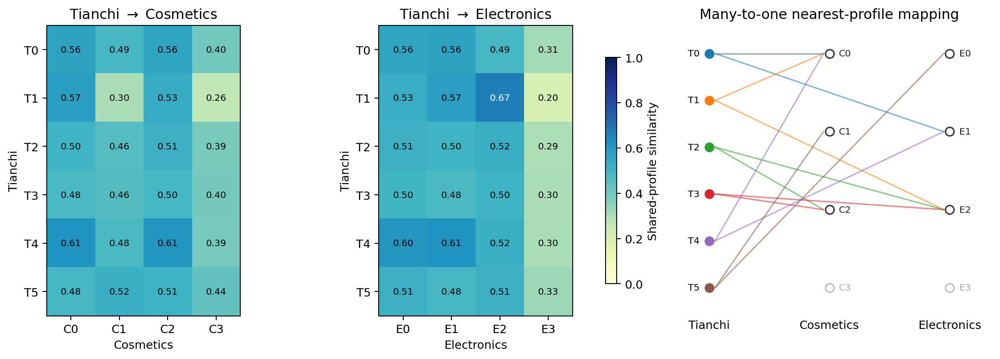

### Direct Cosmetics--Electronics \(K=4\) mapping

동일한 공통 특징과 유사도 정의로 Cosmetics와 Electronics를 직접 비교했다.
최근접 대응은 대칭일 필요가 없으므로 양방향을 별도로 계산했다.

| 방향 | 원본 | 최근접 대상 | \(S\) | Bootstrap |
|---|---|---|---:|---:|
| Cosmetics→Electronics | C0 | E1 | 1.000 | 1.000 |
| Cosmetics→Electronics | C1 | E3 | 0.564 | 0.790 |
| Cosmetics→Electronics | C2 | E0 | 0.960 | 0.865 |
| Cosmetics→Electronics | C3 | E3 | 0.644 | 1.000 |
| Electronics→Cosmetics | E0 | C2 | 0.960 | 1.000 |
| Electronics→Cosmetics | E1 | C0 | 1.000 | 1.000 |
| Electronics→Cosmetics | E2 | C2 | 0.657 | 1.000 |
| Electronics→Cosmetics | E3 | C3 | 0.644 | 0.960 |

C0–E1은 한 번 또는 소수의 조회가 지배적인 사용자의 공통 특징 중앙값이
동일해 \(S=1\)이 되었다. C2–E0의 유사도는 장바구니 조성이 아니라 이를
제외한 활동량·구매 이력 축에서 나온다.
C3–E3은 희귀한 장기 활동군에 대응한다. Cosmetics C1은 삭제 비중이 높은
희귀군이지만 Electronics에는 삭제 사건이 없어 독립 대응군이 없다. 이에 따라
C1은 E3을 선택하지만 E3의 역방향 최근접은 C3이다. 이 비대칭은 두 데이터셋의
행동 어휘 차이가 남긴 정보 손실을 보여준다.

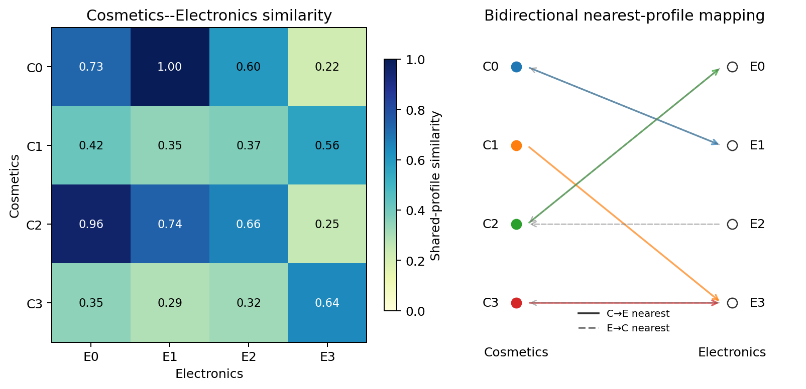

### Electronics-drop ablation

Cosmetics에만 존재하는 remove_from_cart 사건을 토큰화 전에 삭제하고
view/cart/purchase 세 행동만으로 masked-GRU를 처음부터 재학습했다. 이 변형을
electronics_drop으로 기록했다. 사용자 표본, 최대 시퀀스 길이, 학습 epoch와
\(K=4\) 설정은 유지했다. 변형 모형의 train·held-out silhouette는
0.445·0.431이고 seed ARI는 0.995였다. Electronics의 대응 값은
0.423·0.428과 1.000이다.

정렬에는 두 데이터셋에서 모두 관측되는 장바구니 비중, 구매 비중, 활동량,
세션 수와 간격, 구매·장바구니 경험, 최초·최종 행동 및 세션 내
view→cart, cart→purchase와 행동 지속률을 사용했다. 비교 척도가 ablation에
따라 변하지 않도록 robust scaler는 원본 Cosmetics와 Electronics에만 적합하고,
electronics_drop에는 고정된 변환을 out-of-sample로 적용했다.

| 변형 | 원천 군집 | Electronics 최근접 | \(S\) | Bootstrap |
|---|---|---|---:|---:|
| 원본 Cosmetics | C0 | E1 | 0.785 | 1.000 |
| 원본 Cosmetics | C1 | E2 | 0.234 | 1.000 |
| 원본 Cosmetics | C2 | E2 | 0.133 | 1.000 |
| 원본 Cosmetics | C3 | E2 | 0.187 | 1.000 |
| electronics_drop | D0 | E1 | 0.925 | 1.000 |
| electronics_drop | D1 | E2 | 0.388 | 0.860 |
| electronics_drop | D2 | E2 | 0.200 | 1.000 |
| electronics_drop | D3 | E2 | 0.240 | 1.000 |

일대일 제약 Hungarian 대응의 평균 유사도는 0.273에서 0.384로 0.112
상승했다. 최근접 유사도 역시 네 원천 군집 모두 증가했다. 그러나 원본에서는
C1·C2·C3, 제거 변형에서는 D1·D2·D3이 모두 E2로 대응한다. 두 경우 모두
정방향 일대일 대응이 아니며 상호 최근접 쌍도 두 개다.

electronics_drop과 Electronics만으로 scaler를 다시 적합하면 네 군집이 서로
다른 대상에 대응하는 결과가 나오지만, 이는 ablation이 평가 척도까지 바꾼
정규화 민감 결과이므로 채택하지 않았다. 고정 척도 결과는
remove_from_cart 미관측이 도메인 간 거리의 일부를 설명한다는 제한적 증거다.
활동량·구매율·세션 구조의 도메인 차이까지 제거되지는 않아, 미관측 삭제 사건
하나가 전체 군집 불일치의 원인이라고 결론낼 수 없다. 또한 사건 삭제는
Electronics 로깅 환경에서 Cosmetics 사용자가 보였을 반사실 행동을 복원하지
않는다.

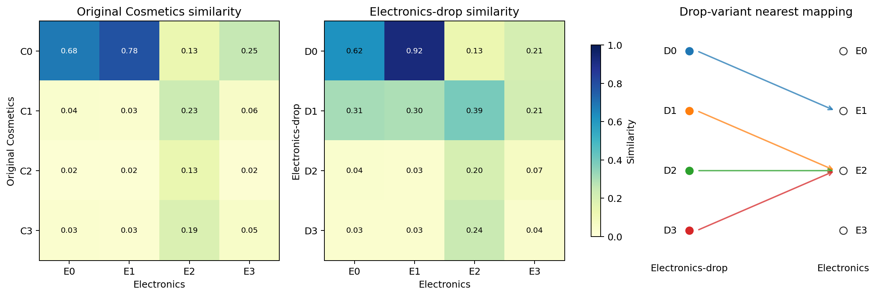

### Cosmetics-drop와 Electronics 공동 군집

독립적으로 학습한 두 임베딩을 사후 정렬하는 대신, Cosmetics의
remove_from_cart를 제거한 로그와 Electronics 로그를 합쳐 하나의
masked-GRU와 하나의 K-means를 학습했다. 행동 어휘는 view, cart, purchase로
동일하다. 사용자 ID 충돌은 도메인별 namespace로 방지했다. 각 도메인에서
4,140명씩 같은 수를 추출했고, K-means 학습과 보류 평가는 2세션 이상 사용자도
각각 423명과 109명씩 균형화했다. \(K=4\)는 비교 목적의 고정값이며 silhouette
최적값이 아니다. Train·held-out silhouette는 0.490·0.461이다.

| 공동 군집 | Cosmetics-drop \(P(J\mid D)\) | Electronics \(P(J\mid D)\) | 반복 세션 사용자 C / E | 행동 조성 유사도 |
|---|---:|---:|---:|---:|
| J0 | 62.7% | 72.9% | 1,730 / 388 | 0.986 |
| J1 | 6.2% | 7.3% | 172 / 39 | 0.868 |
| J2 | 24.0% | 19.2% | 662 / 102 | 0.811 |
| J3 | 7.1% | 0.6% | 196 / 3 | 표본 부족 |

도메인과 공동 군집의 NMI는 0.013이고, 도메인별 군집 분포의 total variation
distance는 0.114, Jensen--Shannon divergence는 0.020이다. J0--J2는 두
도메인에 30명 이상의 반복 세션 사용자가 존재하며 같은 공동 공간에서 직접
대응한다. J3은 Electronics 표본이 3명뿐이므로 공통 군집으로 채택하지 않는다.

따라서 공통 행동만 사용하면 두 도메인의 주된 세 행동 군집은 상당 부분
겹치지만 네 군집 전체가 일대일로 대응하지는 않는다. remove_from_cart의
미관측은 기존 거리의 일부를 설명하지만, 관측 기간·활동 깊이·구매율·로깅
구조 차이가 남는다. 변수 미관측 하나만으로 기존 불일치를 설명한다는 가설은
부분적으로만 지지된다.

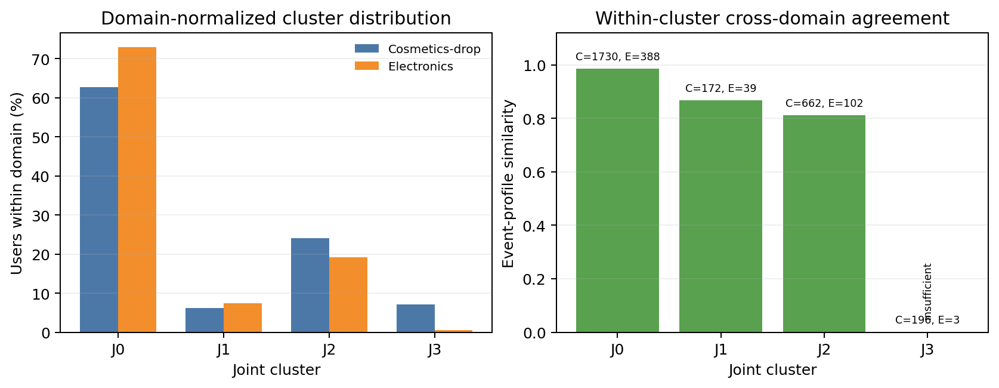

### Tianchi 최초 관측 쿠폰 수령 전후와 행동 군집 매칭

Cosmetics와 Electronics에는 쿠폰 수령 변수가 없으므로 해당 데이터셋 안에서
무수령→수령 전환을 직접 관측할 수 없다. 두 데이터셋은 무처치 대조군이 아니라
행동 참조군으로만 사용하고, 전환 분석은 Tianchi online 로그에서 수행했다.

온라인 로그 전체에서 사용자의 최초 **관측** 쿠폰 수령일이 2016년 5월인
33,003명을 찾았다. 수령 전 28일에 클릭 또는 구매 기록이 두 건 이상인
9,723명을 최종 매칭했다. 기준일은 같은 날 사건의 순서가 없으므로 제외하고,
수령 후 28일까지 관측했다. Tianchi click은 retail view에 대응시켰으며,
Tianchi에 없는 cart와 remove는 매칭 특징에서 제외했다. 관측창 차이를 줄이기
위해 기존 Cosmetics·Electronics K=4 사용자도 개인별 마지막 관측일 이전 28일로
잘랐다. 공통 특징은 구매비중, 총 행동·활동일·일평균 행동, 구매일 비중,
중앙 활동간격, 최초·최종일 구매 여부와 일간 행동 전이였다. 참조 두 데이터셋에
robust scaler를 적합한 뒤 Tianchi 사전 행동을 out-of-sample로 최근접 매칭했다.

| Cosmetics 매칭 | 사용자 | 비중 | 중앙 유사도 | 구매 사용자 수령 전→후 | 수령 후 무기록 | 28일 내 추가 수령 |
|---|---:|---:|---:|---:|---:|---:|
| C0 | 302 | 3.1% | 0.441 | 73.8%→32.8% | 44.7% | 29.5% |
| C1 | 5,101 | 52.5% | 0.455 | 45.0%→27.7% | 31.0% | 25.4% |
| C2 | 2,607 | 26.8% | 0.612 | 49.0%→25.6% | 45.6% | 23.6% |
| C3 | 1,713 | 17.6% | 0.526 | 46.8%→33.7% | 12.4% | 25.3% |

| Electronics 매칭 | 사용자 | 비중 | 중앙 유사도 | 구매 사용자 수령 전→후 | 수령 후 무기록 | 28일 내 추가 수령 |
|---|---:|---:|---:|---:|---:|---:|
| E0 | 1,475 | 15.2% | 0.540 | 2.9%→21.2% | 33.2% | 22.4% |
| E1 | 2,353 | 24.2% | 0.408 | 15.9%→21.5% | 32.4% | 23.3% |
| E2 | 3,017 | 31.0% | 0.463 | 100.0%→35.5% | 48.1% | 28.0% |
| E3 | 2,878 | 29.6% | 0.458 | 40.4%→30.2% | 14.5% | 24.5% |

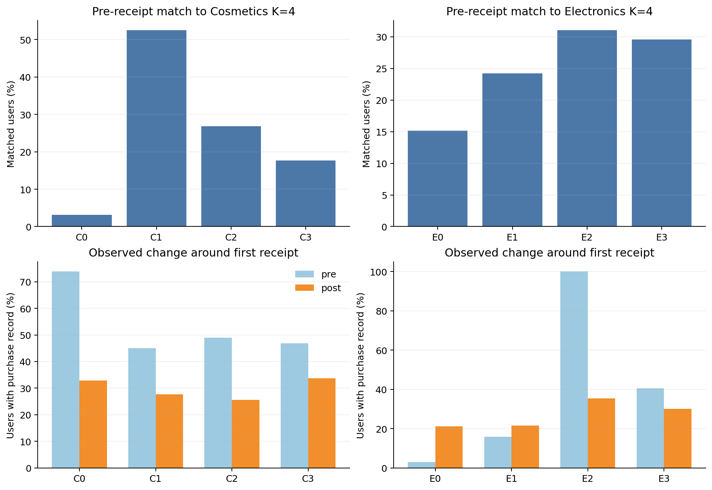

Electronics 기준 E0·E1은 수령 후 구매 기록 사용자 비율이 각각 +18.2%p,
+5.7%p 증가했다. 반면 사전 구매가 지배적인 E2는 −64.5%p, E3는 −10.3%p
감소했다. 28일 안에 추가 수령이 없는 7,291명에서도 방향은 각각 +14.2%p,
+3.4%p, −68.6%p, −12.7%p로 유지됐다. 전체 표본에서는 클릭 평균이
7.53회에서 5.93회, 구매 평균이 1.33회에서 0.78회, 구매 경험률이
47.3%에서 28.4%로 감소했고 32.1%는 수령 후 클릭·구매 기록이 없었다.

사전 Cosmetics C3 매칭자의 98.6%는 Electronics E3에도 매칭되어 장기
고관여형의 교차 참조가 가장 안정적이었다. C2의 49.0%는 E2에 대응했지만,
C0는 E1/E2로 거의 양분되고 C1은 네 Electronics 군집으로 분산됐다. 매칭
유사도와 최근접 margin도 전반적으로 낮아 cart가 없는 Tianchi에서 Cosmetics의
세부 장바구니 행동군을 복원하기는 어렵다.

이 전후 차이는 쿠폰의 인과효과가 아니다. 최초 관측 수령은 생애 최초 수령을
보장하지 않으며, 수령 자체가 최근 구매·활동에 의해 타기팅됐을 수 있다.
특히 E2의 큰 감소는 쿠폰의 부정적 효과보다 사전 구매를 조건으로 집단을
선택한 뒤 발생한 평균회귀와 관측창 차이로 해석하는 편이 타당하다. 따라서
시뮬레이터에는 E0·E1의 증가를 직접 uplift 계수로 복사하지 않고, 수령 전 행동에
따라 반응 시나리오의 prior가 달라질 수 있다는 정성적 근거로만 사용한다.

재현 명령은 PYTHONPATH=src python -m analysis.persona.cluster similarity이다.
사용자 공통 특징, 군집 중앙값, 전체 유사도 행렬과 부트스트랩 결과는
artifacts/cross-dataset-persona-similarity/에 저장한다.
Electronics-drop은 PYTHONPATH=src python -m analysis.persona.cluster
electronics-drop으로 재현하며 결과는 artifacts/electronics-drop-alignment/에
저장한다.
공동 군집은 PYTHONPATH=src python -m analysis.persona.sequence --source
retail_combined --input DATA_ROOT --cluster-count 4 --max-users 24000으로 학습하고,
PYTHONPATH=src python -m analysis.persona.cluster retail-combined으로 요약한다.
결과는 artifacts/retail-combined-personas/에 저장한다.
최초 수령 전후 매칭은 PYTHONPATH=src python -m analysis.uplift.observed
first-receipt-alignment으로 재현하며 결과는
artifacts/tianchi-first-receipt-alignment/에 저장한다.

<a id="archive-uplift-sequence-long-term-pilot"></a>

### UPLIFT_SEQUENCE_LONG_TERM_PILOT

# 쿠폰 조건부 행동 시퀀스와 4주 관측 변화: 탐색적 파일럿

## 목적과 핵심 한계

Tianchi O2O 온라인 로그로 과거 행동·쿠폰 수령을 입력해 다음 날의 행동 **기록**을 확률적으로 생성한다. 원본은 사용자가 쿠폰을 수령한 기록이지 무작위 발송 실험이 아니다. 클릭·구매 기록 없음도 실제 비활동을 보장하지 않는다. 따라서 이 모델은 uplift의 인과 효과, 쿠폰 발송 정책의 반사실, canonical type 또는 기존 GRU 페르소나를 추정하지 않는다. 모델 학습에 행동 이력도 필요하므로 uplift 값만으로 학습한 것은 아니다.

## Feature engineering과 모형

예측 대상 날짜 d의 과거 상태는 클릭·구매의 d-2 기록, d-8~d-2 및 d-15~d-2의 클릭·구매·쿠폰 수령일 수, 요일이다. 별도의 입력은 d-1 쿠폰 수령 기록이다. 예측 대상은 d의 (기록 없음, 클릭만, 구매만, 클릭·구매 모두) 4개 중 하나다. 같은 날짜 이벤트의 순서가 불명확하므로 d-1의 클릭·구매는 입력에서 제외한다. 라벨은 기록 존재 여부로, 건수나 같은 날의 순서를 모델링하지 않는다.

15,000명의 April 16–30 사전 활동 사용자만을 무작위 표본으로 삼고 사용자 단위로 분리했다. 학습은 11,983명·May 2–28, 평가는 3,017명·June 1–14다. 다항 로지스틱 확률모형을 사용했다. 모델은 사전 행동 이력으로 조건화하고 후속 쿠폰은 실제 관측 시퀀스를 재생한다. 후속 쿠폰은 실제 행동과 공동으로 발생했을 수 있으므로 이는 정책 개입의 counterfactual rollout이 아니다.

| 보류 사용자·기간 평가 | 결과 |
|---|---:|
| 다음 날 4개 결과 log loss | 0.21611 |
| 전역 빈도 기준 log loss | 0.23680 |
| 쿠폰 입력 없이 이력만 쓰는 모델 log loss | 0.21624 |
| 14일 클릭 기록 사용자 비율, 실제 / 1회 샘플 | 34.9% / 41.4% |
| 14일 구매 기록 사용자 비율, 실제 / 1회 샘플 | 9.1% / 8.8% |
| 14일 평균 클릭 기록일, 실제 / 1회 샘플 | 0.686 / 0.693 |
| 14일 평균 구매 기록일, 실제 / 1회 샘플 | 0.111 / 0.103 |

기록이 없는 클래스가 보류 user-day의 94.7%여서 평균 지표만으로 소수 사건의 적합도를 보장하지 않는다. test coupon lag1은 42,238행 중 218행이다. 쿠폰 변수를 제거했을 때 전체 log loss 차이는 작고, 인과 효과를 입증하지 않는다. 14일 롤아웃은 1번의 샘플이라 Monte Carlo 오차가 있다. 시퀀스의 클릭 사용자 비율은 과대 생성되어 더 개선해야 한다. 대조 모형은 동일 feature 중 쿠폰 3개만 제외한 모형이다.

## 4주 장기 관측 비교

별도 전수 분석: 2016-05-15 이전 14일에 클릭/구매 기록이 있는 사람을 사전 행동군으로 분류하고, 기준일 수령 기록 유무에 따라 이후 각 주(1–7일, 8–14일, 15–21일, 22–28일)의 구매 기록 여부를 비교했다. 기존 `canonical_type_bounds.py` 모집단을 사용한다. 기준일은 제외하며 각 주의 값은 서로 다른 주에 구매 기록이 있었는지의 사용자 비율이므로 합산하지 않는다.

| 사전 행동군 | 기준일 쿠폰 수령 기록 | 인원 | 1주 구매 기록 | 2주 | 3주 | 4주 |
|---|---|---:|---:|---:|---:|---:|
| 클릭만 | 없음 | 148,631 | 3.7% | 3.5% | 3.3% | 3.5% |
| 클릭만 | 있음 | 385 | 13.5% | 6.2% | 4.9% | 7.8% |
| 클릭·구매 | 없음 | 21,409 | 11.5% | 8.5% | 7.7% | 7.6% |
| 클릭·구매 | 있음 | 118 | 28.0% | 14.4% | 11.0% | 17.8% |
| 구매만 | 없음 | 41,940 | 10.9% | 8.7% | 8.0% | 8.2% |
| 구매만 | 있음 | 287 | 22.3% | 11.8% | 13.6% | 9.4% |

클릭만 집단의 기준일 수령자는 이후 1~4주에 추가 쿠폰 수령이 각 주 18.7%, 13.5%, 16.1%, 10.9% 기록됐고, 비교군은 2.2%, 2.2%, 2.7%, 2.3%였다. 이 수치는 추가 수령의 **주별** 비율이다. 수령군의 처음 차이가 이후 줄어드는 관측 패턴은 있으나 쿠폰 때문에 발생한 변화인지, 그 효과가 장기 지속되는지 판별할 수 없다. 추가 쿠폰, 선택 편향, 잠재 교란, 로그 미관측, 소수 수령 표본, 기간 효과가 남아 있다. 4주 초과는 확인하지 않았다.

## 재현 및 검증

`/opt/anaconda3/bin/python -m analysis.uplift.canonical`를 먼저 수행한 뒤 `-m analysis.uplift.observed long-term`, `-m analysis.uplift.sequence`를 실행한다. 요약 JSON과 피클 모델은 `artifacts/uplift-sequence-pilot/`에 저장된다. 결측/동일일 순서 및 인과 식별 제약은 위와 같다. 예측일 이후 행동을 feature에 넣지 않는 단위 테스트를 통과했다. bootstrap·여러 seed rollout·쿠폰 발송 정책 평가·기존 GRU 페르소나 전이는 수행하지 않았다.
