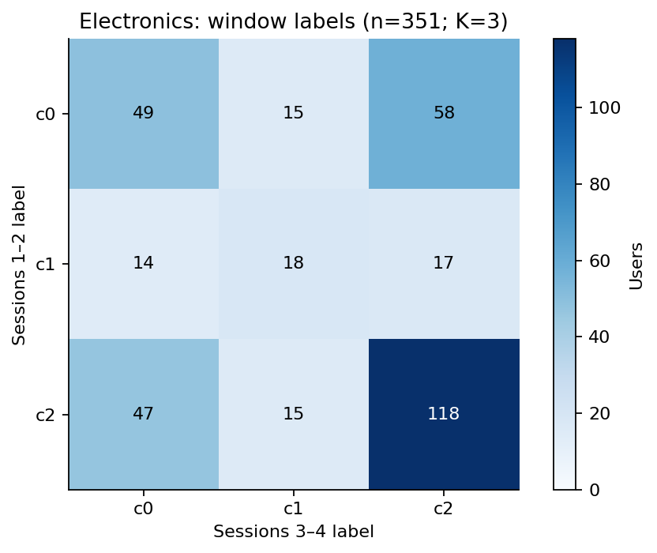

# 사용자 행동 페르소나와 쿠폰 반응: 분석 결과 및 시뮬레이터 가정

## 0. 프로젝트 목표와 현재 구현 상태

`AGENTS.md`의 최종 목표는 행동 페르소나, 개입 반응, 세션 내 선택과 세션 간
확률적 지연을 결합한 사용자 모델을 만들고, 오프라인 데이터 생성 및 온라인
에이전트 평가에 사용하는 것이다. 아래 상태는 기존 코드·보고서의 범위를
나타낸다. 구조 정리가 연구 목표의 신규 구현이나 실험 재현을 뜻하지는 않는다.

| 목표 | 현재 결과·구현 | 남은 검증·구현 |
|---|---|---|
| 1. Electronics·Cosmetics 페르소나 군집 | GRU 임베딩과 K-means·GMM·Ward 비교, §2 | 외부 인코더·임베딩 필요; 통합 유형과 미래 예측 타당성 미확정 |
| 2. Tianchi CATE·uplift 가설 | 쿠폰 수령 전후·집단 간 관측 비교, §5–6 | 처치 식별·교란·overlap 검증 및 인과 CATE 미완료 |
| 3. 네 canonical type 분포 | 잠재결과 주변확률을 가정한 범위 계산, §7 | 실제 개인 유형과 페르소나별 결합 분포 미식별 |
| 4. 동일 사용자 세션 간격 | 비활동·재관측·군집별 간격 분석, §4·8 | 세션 정의 차이, 검열 및 미래정보 누출 고려 필요 |
| 5. 예측 특징 선정 | 이력·시차·시간 특징 및 그래프 특징 추출 코드 | 최종 통합 특징과 목표 1–4에 근거한 선택 미확정 |
| 6. 종료 포함 행동 효용 | `models/`의 MaxEnt IRL, `simulate/latent_session_model.py`의 END 보상 | 짧은 horizon과 행동 가용성·종료 보정 한계 |
| 7. 종료 후 다음 세션 지연 샘플링 | `LatentSessionUser.finish_session()`의 이산 위험 기반 샘플러 | 30일 밖의 정확한 지연과 장기 rollout 미검증 |
| 8. 이질적 그룹의 MaxEnt IRL | 그룹별·조건부·이력 기반 trajectory IRL 파일럿 | 최종 persona 모형과 장기 보상 복원 검증 미완료 |
| 9. 그룹별 효용 계수 | 선형·비선형·조건부 IRL의 보상 계수 추정 코드 | 서로 다른 파일럿의 계수를 통합 사용자 효용으로 해석할 수 없음 |
| 10. uplift 항 및 0효과 재현 | 보조 uplift·조건부 오퍼 실험과 가상 coupling 함수 | Tianchi 인과 항을 행동·간격에 연결한 통합식 및 양쪽 재현 검증 없음 |
| 11. 세션 후 잠재상태 갱신과 지연 이질성 | 세션 요약·직전 간격 갱신 및 확률적 위험모형 | 초기 GMM latent는 고정; 세션마다 갱신되는 잠재요인 미구현 |
| 12. 유형 분포와 GMM 샘플러 | 군집·사용자 표현 GMM 및 계수 샘플링 파일럿 | 최종 유형 분포·파라미터 생성모형 미확정 |
| 13. 오프라인 생성·온라인 시뮬레이터 | 보조 패널 생성기와 상태를 가진 세션 사용자 객체 | 통합 온라인 환경·장기 상태 전이·정책 평가 인터페이스 미완료 |
| 14. 에이전트별 관측 특징 | 사전 정보·사후 결과 분리 및 누출 방지 특징 후보 | 에이전트별 최종 observation 계약 미정 |
| 15. 논문 기반 과제 목적 | 연구 계획·실험별 평가 지표 및 참고 문헌 | 통합 환경의 최종 정책 목적함수·벤치마크 미확정 |
| 16. Lin-UCB·Lin-TS·TS·UCB·PPO·SAC | 해당 에이전트 실행 체계 없음 | 여섯 에이전트와 공통 평가 실행기 구현 필요 |

구현 파일의 기준 경로는 `src/ecommerce_sim/`이다. 실행 위치와 구조는
[README](README.md), [스크립트 목록](scripts/README.md),
[구조·호환성 기준](research/REPOSITORY_LAYOUT.md)에 정리한다.

## 1. 요약 및 범위

Electronics와 Cosmetics의 행동 시퀀스에서는 조회 중심, 장바구니 활용, 장바구니·구매 혼합 등 여러 **기술적 행동 패턴**이 관찰됐다. 이러한 차이를 시뮬레이터의 사용자 이질성으로 표현할 수 있다. 하지만 현재 결과는 서로 독립적이고 상호 배타적인 페르소나가 실재한다는 검증이나, 각 페르소나의 쿠폰 효과를 추정한 결과가 아니다.

이 문서는 다음 세 가지를 구분한다.

1. **관측**: 원본 행동 로그 또는 기존 집계에서 직접 계산한 기술 통계.
2. **모델링 가정**: 시뮬레이션을 위해 선택하는 분기·잠재변수·효과 지속 형태. 참값으로 검증되지 않았다.
3. **미식별**: 개별 사용자의 반사실적 구매, 페르소나별 쿠폰 uplift와 canonical type 분포 등 현재 자료로 확인할 수 없는 값.

Electronics·Cosmetics를 행동 분석 대상으로 사용하고, 쿠폰의 관측적 참고 자료로 Tianchi O2O를 별도로 사용한다. 사용자를 서로 연결하지 않았으며 이 세 데이터 간 페르소나와 반응을 학습해 결합한 것은 아니다. 관측 부재를 실제 비활동으로 처리하는 것은 향후 시뮬레이터의 단순화 가정이지 원자료의 완전성이 입증됐다는 뜻이 아니다.

## 2. 행동 시퀀스 기반 페르소나

### 방법

기존 양방향 GRU 인코더는 행동 토큰을 마스킹하고 복원하도록 학습한 **BERT-like** 모델이다. BERT 모델 자체는 아니다. 사용자 행동과 세션 경계의 앞 최대 64개 토큰으로 데이터셋별 48차원 임베딩을 만들었다. 상품 ID, 가격, 휴식 시간 및 쿠폰은 인코더 입력이 아니다. 각 데이터셋에서 기존 임베딩을 재사용해 K=3~6, K-means·대각 GMM·이웃 그래프 Ward를 비교했다. 아래 그래프는 **K-means K=6의 보류 사용자 입력 prefix**에 대한 예시다.

각 막대의 분모는 해당 군집 사용자 수다. 장바구니와 구매는 각각 해당 이벤트를 한 번 이상 기록한 사용자 비율이라 중복될 수 있다. 군집 결정과 행동 요약에 같은 prefix를 사용했으므로 미래 구매력 검증이 아니다. 데이터셋 간 c 번호는 대응하지 않으며 작은 군집도 그림에 인원과 함께 표시했다.

### 시뮬레이터용 기술적 패턴 후보

| 후보 | 관측된 사례 | 사용자 행동의 모델링 방향 — 가정 |
|---|---|---|
| 짧은 조회 중심 | Electronics c1: 745명, 이벤트 조회 96.3%, 구매 기록 사용자 3.1% | 짧은 조회 시퀀스와 세션 종료를 허용한다. |
| 반복 조회 중심 | Electronics c5: 307명, 행동 중앙값 6개, 이벤트 조회 94.2% | 조회를 반복할 수 있지만 결국 구매·장바구니도 확률적으로 가능하게 둔다. |
| 장바구니·구매 혼합 | Electronics c2: 169명, 장바구니 경험 98.2%, 구매 경험 68.0% | 조회·장바구니·구매를 모두 허용하고 행동 이력에 따라 분기한다. |
| 장바구니 후 조회 혼합 | Electronics c4: 183명, 장바구니 경험 96.7%, 구매 경험 59.6% | 장바구니 이후 추가 조회 또는 구매를 허용한다. |
| 반복 장바구니 | Cosmetics c0: 91명, 장바구니 경험 100%, 구매 경험 28.6% | 장바구니를 여러 번 조작한 뒤 세션을 끝낼 수 있다. |
| 긴 조회·장바구니·삭제 이력 | Cosmetics c2: 97명, 행동 중앙값 59개, 삭제 경험 84.5% | 긴 탐색과 삭제를 포함하되 64토큰 절단의 영향을 고려한다. |
| 조회·장바구니 혼합 | Cosmetics c4: 197명, 장바구니 경험 99.5%, 삭제 경험 58.4%, 구매 경험 29.9% | 조회·장바구니·삭제와 구매를 모두 허용한다. |

이 일곱 항목은 예시로 선택한 **데이터셋별 패턴**이다. 각 데이터셋의 K=6 군집은 그 데이터셋 내부에서는 서로 배타적이지만, 위 설명들 자체가 통합된 7개 상호배타적 유형이라는 뜻은 아니다. 7개 모두가 양쪽 데이터셋에서 검증된 것도 아니다. 유형별 행동 분기를 위처럼 정의하는 것은 합리적인 시뮬레이션 설계 후보이지만, 분기 확률까지 정당화되지는 않는다. 구매 경험은 해당 prefix의 관측치이지 미래 구매 성향이나 가격 민감도가 아니다. Cosmetics의 삭제는 Electronics에서 미측정이며 0으로 취급하면 안 된다.

초기화만 달리한 K=6 분할의 ARI는 Electronics 0.999, Cosmetics 1.000이었다. 인코더·표본·시간을 바꾼 안정성은 아니다. 별도의 과거 K-sweep에서는 재표본화 검사를 했지만 동일 인코더에 조건부인 탐색적 검사였고 이번 K=6 군집과 식별자가 다를 수 있다. 자료: [두 데이터셋 페르소나 요약](artifacts/two-dataset-gru-clusters/PERSONA_SUMMARY.md), [상세 K-sweep](artifacts/two-dataset-gru-clusters/REPORT.md), [조건부 안정성 감사](research/PERSONA_STABILITY_AUDIT.md).

## 3. 초기와 이후 행동의 차이

Electronics의 기존 K=3 체크포인트를 사용해 첫 두 세션과 세 번째·네 번째 세션을 각각 독립된 입력으로 분류했다. 전체 관측 기록에 4세션 이상인 보류 표본 351명 중 166명(47.3%)의 라벨이 달랐다.

행은 1–2번째 세션, 열은 3–4번째 세션의 라벨이고 숫자는 사용자 수다. 이 K=3 라벨은 위 K=6 예시와 다르다. 짧은 구간을 기존 prefix에 학습된 인코더와 중심점에 넣었기 때문에 입력 분포가 다를 수 있다. 라벨 변화는 행동 종류나 고정된 선호의 변화와 동의어가 아니다. 4세션 이상인 사용자만 포함했으므로 전체 신규 이용자를 대표하지 않으며 Cosmetics는 체크포인트가 없어 분석하지 못했다.

**모델링 가정:** 사용자의 행동 상태는 매 세션 고정되지 않고 변할 수 있다. 다만 위 교차표를 전체 모집단의 상태 전이 확률로 바로 사용하지 않는다. 초기 구간만으로 후속 행동을 얼마나 예측할 수 있는지 별도 시간 분리 평가가 필요하다. 상세: [초기·후기 분석](research/PERSONA_EARLY_LATE.md).

## 4. 후기 비활동 전 세션

세 번째 관측 세션 이후 30일 관찰이 가능한 사용자만 포함한다. 그 기간에 다음 세션이 기록되지 않은 경우를 **30일 비활동**, 기록된 경우를 **재관측**으로 정의한다. 셋째 관측 세션은 생애 후반 또는 마지막 세션이라고 보장되지 않는다.

두 데이터셋에서 비활동군의 직전 세션은 조회만 기록된 비율이 더 높았다: Electronics 86.7% 대 81.4%, Cosmetics 77.8% 대 70.1%. 반면 Cosmetics의 직전 구매 기록은 비활동군 7.2%, 재관측군 4.3%였다. 두 번째와 세 번째 세션이 모두 조회만인 비율도 각각 Electronics 74.5% 대 67.5%, Cosmetics 69.3% 대 58.8%였다. 막대의 95% Wilson 구간은 개별 비율의 표본 불확실성만 나타내며 집단 차이의 인과적 불확실성이나 로깅 편향을 반영하지 않는다.

**모델링 가정:** 세션 종료 후 다음 세션까지의 간격은 현재 행동 상태와 사용자별 차이에 따라 샘플링할 수 있고, 구매 후 긴 간격도 허용한다. 다만 이 그림의 역방향 통계 `P(직전 행동 | 이후 비활동)`를 곧바로 `P(이후 비활동 | 직전 행동)`으로 사용하지 않는다. 관측된 기록 없음은 영구 이탈이나 완전한 비활동이 아니다. Cosmetics는 ID modulo 100의 약 1% 표본이며 관측 종료는 마지막 이벤트로 근사했다. 상세: [비활동 분석](research/COUPON_REACTIVATION_AND_LATE_PATTERNS.md).

## 5. 쿠폰 수령과 이후 재활동의 관측적 비교

Tianchi 온라인 로그에서 기준일 2016-05-15의 44~15일 전에 클릭 또는 구매가 있었고, 직전 14일에는 두 행동이 기록되지 않은 사람을 골랐다. 기준일 쿠폰 수령 기록 유무와 이후 7일 내 클릭 또는 구매 기록을 비교했다. 기준일은 결과에서 제외했다.

예를 들어 과거 클릭만 기록된 사람은 수령 기록군 230명 중 31.7%, 비수령 기록군 129,157명 중 17.8%에서 7일 내 활동이 기록됐다. 28일 기준은 각각 52.2%와 46.9%다. 오차막대는 각 비율에 대한 Wilson 95% 구간이다. 다른 군도 그림의 인원과 동일한 방식으로 계산했다.

**인과적 복귀 효과가 아니다.** 수령이 무작위로 할당됐다는 근거가 없고 수령 자체가 사용자의 활동일 수 있다. 비수령 기록이 비발송을 증명하지 않으며 이후 재수령과 개인별 누락·교란이 있다. 사전 클릭·구매군은 Electronics·Cosmetics의 GRU 페르소나가 아닌 별도 대리군이다. 따라서 이 차이를 어느 페르소나의 쿠폰 uplift나 복귀 증가 확률로 직접 옮기지 않는다.

## 6. 쿠폰 수령과 주별 행동 기록

다른 코호트에서는 기준일 이전 14일에 클릭·구매 기록이 있던 사람을 선택하고 이후 각 주에 구매가 적어도 한 번 기록된 비율을 집계했다. 이 코호트는 앞 절의 14일 비활동군과 다르다. 주별 비율의 분모는 각 기준일 수령 여부·과거 행동군의 전체 인원이다.

첫 주에 높은 비율이 기록된 사례가 있으나, 수령군의 주별 수치는 단조 감소하지 않는다. 예를 들어 클릭만 수령군은 13.5%, 6.2%, 4.9%, 7.8%다. 반복 쿠폰 수령과 선택 차이가 있어 선 사이의 차이는 효과 지속 기간이 아니다. 6주 집계의 추가 쿠폰 관측 범위에도 제한이 있다. 상세: [4주 분석](research/UPLIFT_SEQUENCE_LONG_TERM_PILOT.md), [6주 분석과 관측 범위](research/COUPON_PERSISTENCE_BY_BEHAVIOR.md).

**모델링 가정:** 쿠폰 영향이 시간이 지나며 단조 감소하는 함수를 시나리오로 시험할 수 있다. 예를 들어 `g(Δt)=exp(-λΔt)`, `λ≥0`으로 두면 감소가 보장된다. 이 함수와 `λ`는 데이터에서 인과적으로 식별하거나 추정한 결과가 아니며, 0효과·느린 감소·빠른 감소 및 음의 효과 같은 대안을 함께 비교해야 한다. 반복 쿠폰의 효과 누적 방식도 별도 가정이 필요하다.

## 7. Canonical response type과 사용자별 분기

일정 기간의 이진 결과에서 잠재결과 `(Y(0), Y(1))`을 정의하면 sure thing `(1,1)`, persuadable `(0,1)`, sleeping dog `(1,0)`, lost cause `(0,0)`으로 구분할 수 있다. 한 사람에게 두 결과를 동시에 관측할 수 없어 개별 유형은 식별되지 않는다. 실제 무작위 실험에서 각 처치군의 주변 결과 확률을 알더라도 잠재결과의 결합 분포는 추가 가정 없이 일반적으로 확정되지 않는다.

기존 [canonical 범위 분석](research/CANONICAL_TYPE_BOUNDS_PILOT.md)은 Tianchi·Starbucks의 관측 구매율을 잠재결과 주변 확률로 **가정해서** 조합한 조건부 시나리오다. 인과 경계 또는 GRU 페르소나별 구성비를 추정한 것이 아니다. 각 범위의 끝값을 독립적으로 선택해 네 유형의 한 분포로 합치면 안 된다.

시뮬레이터에서는 행동 페르소나와 canonical type을 **서로 다른 잠재변수**로 둔 뒤, 가능한 여러 결합 분포를 가정하여 민감도 분석하는 방향이 가능하다. 특정 페르소나가 반드시 persuadable이라는 식의 매핑이나 분포 값은 자료에서 뒷받침되지 않는다. canonical type은 명시된 개입·결과·시간 창에 의존하며, 시퀀스 전체에서 영구적인 개인 속성이라고 가정하려면 추가 가정이 필요하다.

## 8. 페르소나별 세션 간격 추가 분석

기존 K=6 군집을 사후적으로 재구성하고 두 번째 관측 세션부터 다음 세션까지의 간격을 살펴봤다. 짧은 공백과 긴 공백이 함께 보이며, 사용자에 따라 30일 안에 다음 세션이 기록되지 않기도 한다. 구매·장바구니가 기록된 세션도 나누어 살펴봤다.

기존 군집 입력에는 두 번째 세션 이후의 행동이 포함될 수 있으므로 **미래정보 누출이 있는 사후 기술 분석**이다. 분포를 예측용 시뮬레이터에 바로 넣거나 구매의 인과적 충격으로 해석해서는 안 된다. 세션 ID가 바뀌면 30분 미만에도 세션이 나뉘며 쿠폰 기록은 두 행동 데이터에 없다. 전체 조건·결과·그래프와 후속 검증은 [페르소나별 세션 간격 분석](research/PERSONA_SESSION_DELAYS.md)을 참고한다.

같은 군집 내부의 prefix 행동량, 사용자별 구매·장바구니 구성, 세션 행동량 및 재관측 간격 분포는 [페르소나 내부 이질성 분석](research/PERSONA_HETEROGENEITY.md)에 별도로 정리했다. 이는 관측된 주요 행동 차원의 탐색이며 상품 선호나 개입 반응 등 모든 잠재 이질성을 측정한 것은 아니다.

## 9. 시뮬레이터 분기안: 무엇이 정해졌고 무엇이 미정인가

초기 2세션 기반 GMM latent, 유한 horizon MaxEnt IRL, 종료 후 재방문 위험모형을 결합한 파일럿은 [잠재 세션 IRL 보고서](research/LATENT_SESSION_IRL_PILOT.md)를 참고한다. 보류 평가에서 세션 길이 보정이 미흡하고 개입 효과는 식별되지 않아, 아래 분기안을 모두 달성하거나 최종 모델로 확정한 것은 아니다.

1. **사용자 초기화:** 데이터셋별 행동 패턴을 참고해 잠재 행동 유형과 초기 상태를 샘플링한다. 통합 유형의 비중과 정의는 아직 정하지 않았다.
2. **세션 내 행동:** 현재 상태·최근 이력과 행동 유형을 입력으로 조회, 장바구니, 구매, 가능한 경우 삭제, 세션 종료를 확률적으로 선택한다. 후보 패턴은 위 2절에 있으나 조건부 확률은 아직 검증하지 않았다.
3. **세션 사이:** 종료 이후 다음 방문까지의 간격을 조건부로 샘플링한다. 30일 이상 비관측을 허용하되 관측 창 밖에서는 우측 검열을 별도로 처리한다. 무관측을 현실 이탈로 단정하지 않는다.
4. **쿠폰 개입:** 행동 상태와 별도로 쿠폰 정책과 가상의 반응 유형을 정의한다. 0효과 및 양·음의 반응을 포함하는 여러 시나리오를 사용한다. 가상의 단조 감소나 복귀 효과는 설정값이지 관측된 인과효과가 아니다.
5. **검증:** 데이터셋별 사용자·시간 분리로 행동 분포, 세션 길이, 다음 방문 간격, 구매·장바구니 빈도 등을 검증한다. 쿠폰 반사실의 타당성은 별도의 개입 데이터나 명시적 가정과 민감도 분석 없이는 검증할 수 없다.

현재 본 문서는 설계와 기존 실험 결과의 정리이며, 위 전체 분기 모델을 구현·보정하거나 페르소나별 인과 효과를 확인했다는 뜻이 아니다. 이전 NTS-NOTEARS·IRL 실험은 현재 페르소나별 쿠폰 반응의 식별 근거로 사용하지 않는다.

## 10. 데이터·재현·한계

- Electronics의 전체 이력 기준 반복 세션 조건은 사후 선택이며 군집 보류 표본은 전체 인구를 대표하지 않는다. 원자료 세션 결측과 중복이 남아 있다. Cosmetics는 사용자 ID 규칙에 의한 표본이다.
- 본 보고서의 비활동 분석, 쿠폰 재활동 분석과 군집 분석은 서로 다른 모집단·기간·세션 정의를 사용한다. 퍼센트와 인원을 합산하거나 동일 페르소나로 연결할 수 없다.
- 그림은 [plot_analysis_summary.py](scripts/plot_analysis_summary.py)가 기존 JSON 결과를 읽어 생성한다. 실행: `python -m scripts.plot_analysis_summary`. 그림 내부의 영어 라벨은 폰트 환경 의존성을 줄이기 위한 것이다.
- 원본 데이터와 모델의 논문 사용·재배포 허가는 별도로 확인해야 한다. 이 보고서는 원본 데이터를 배포하지 않는다.
