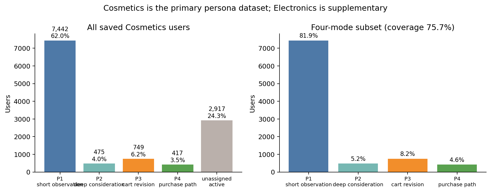
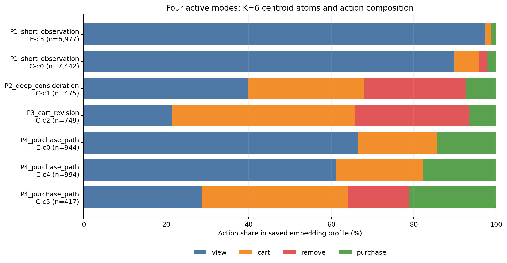
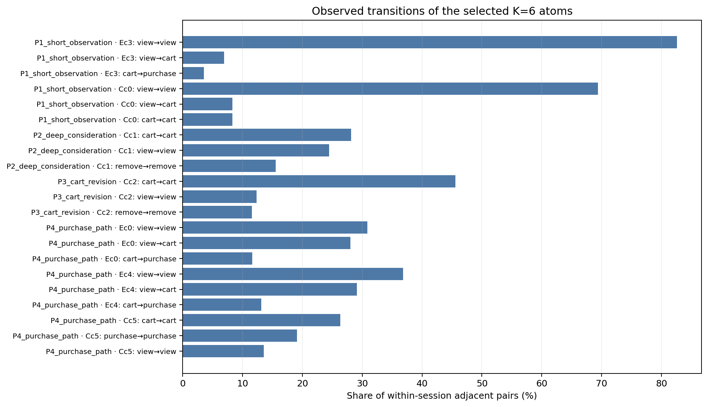
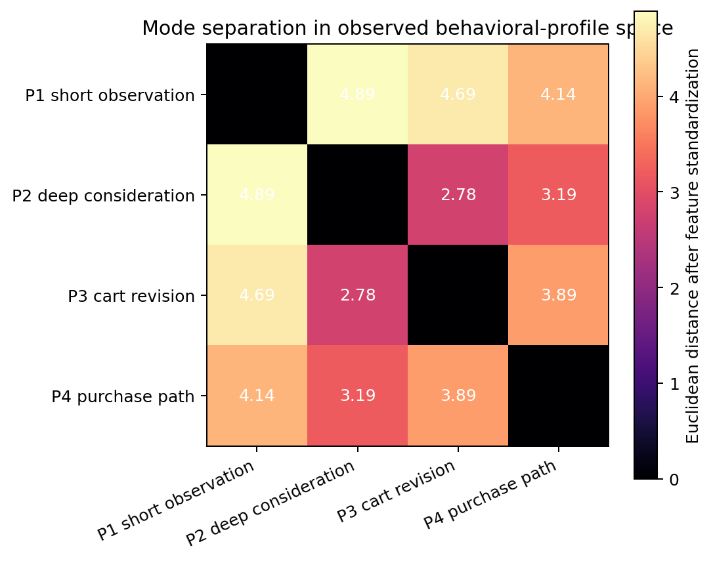

# Four Behaviorally Heterogeneous Active Modes

## 목적

이 문서는 **Cosmetics를 주 분석 데이터셋**으로 사용해, 충분한 표본을 가지면서 행동 자체로 구별되는 네 개의 활성 사용자 모드를 고정한다. Electronics는 `remove_from_cart`가 미관측이므로, 공통적인 조회·장바구니·구매 경향이 보이는지 확인하는 보조 데이터셋으로만 사용한다. 이름은 사람에 대한 임의의 의미론이 아니라 관측된 행동 조성·세션 내 전이·활동 깊이를 압축한 표식이다.

모든 사용자를 억지로 네 집단에 넣지 않는다. 이후 별도 상태로 넣을 `churn_progression`과 `new_entrant`를 남겨 두고, 현재는 안정적으로 관측되는 활성 행동 모드만 정의한다.

## Cosmetics의 네 모드 분포

Cosmetics 저장 임베딩 사용자 12,000명 가운데, 네 핵심 모드에 높은 신뢰도로 배정된 사용자는 9,083명(75.7%)이다. 나머지 2,917명(24.3%)은 네 대표 모드 중 하나로 강제하지 않은 `unassigned_active`다. 이 보류 집단에는 이후 별도로 정의할 신규·이탈 상태와 약하게 혼합된 활성 이력이 포함될 수 있으므로, 현재 단계에서는 분포를 부풀리지 않는 것이 맞다.

| Cosmetics 모드 | 전체 12,000명 기준 | 네 모드 배정자 9,083명 기준 |
|---|---:|---:|
| P1 short observation | 7,442 (62.0%) | 81.9% |
| P2 deep consideration | 475 (4.0%) | 5.2% |
| P3 cart revision | 749 (6.2%) | 8.2% |
| P4 purchase path | 417 (3.5%) | 4.6% |
| unassigned active | 2,917 (24.3%) | — |



분포 원자료는 [cosmetics_distribution.json](artifacts/four-behavior-modes/cosmetics_distribution.json)에 저장했다. 시뮬레이터의 기본 페르소나 혼합비는 네 모드만 조건으로 둘 경우 오른쪽 열을, 모집단 전체를 발생시킬 경우 `unassigned_active`를 별도 상태로 포함한 왼쪽 열을 사용한다.

## 고정 중심 강제 배정

`unassigned_active`를 포함한 모든 12,000명을 네 페르소나 중 하나로 반드시 배정해야 하는 경우, 단순한 축별 표준화 후 SVD/PCA 좌표에서의 유클리드 거리는 쓰지 않았다. 이 방식은 임베딩 축의 상관을 무시하고, SVD 차원 선택에 따라 결과가 임의로 바뀔 수 있기 때문이다.

대신 네 핵심 원자군(9,083명)의 중심을 고정하고, 같은 원자군의 중심 잔차로 공유 공분산을 추정했다. 공분산은 48차원에서 수치적으로 안정적이도록 Ledoit–Wolf shrinkage를 적용했다. 모든 사용자 \(z\)는 다음 거리로 네 중심 중 가장 가까운 하나에 배정했다.

\[
\hat g(z)=\arg\min_{g\in\{1,\ldots,4\}}(z-\mu_g)^\top\widehat\Sigma^{-1}(z-\mu_g).
\]

이는 균등 사전확률을 둔 공유 공분산 Gaussian/LDA의 최근접 중심 규칙이다. 즉, 축별 표준화만 한 유클리드 거리보다 축의 분산과 상관을 함께 보정한다. [Ledoit–Wolf shrinkage covariance](https://scikit-learn.org/stable/modules/generated/sklearn.covariance.LedoitWolf.html)와 공유 공분산 하의 [Mahalanobis nearest-centroid/LDA 관계](https://www.jmlr.org/papers/volume6/ye05a/ye05a.pdf)를 근거로 사용했다.

강제 배정 결과는 다음과 같다.

| 강제 배정 페르소나 | 사용자 수 | 전체 비율 | 기존 미배정 2,917명에서 새로 유입 |
|---|---:|---:|---:|
| P1 short observation | 9,228 | 76.9% | 1,787 |
| P2 deep consideration | 516 | 4.3% | 14 |
| P3 cart revision | 1,824 | 15.2% | 1,102 |
| P4 purchase path | 432 | 3.6% | 14 |

핵심 원자군 자체의 재배정 일치율은 99.67%다. 이는 중심을 같은 원자군에서 추정한 **in-sample 진단**일 뿐 일반화 성능은 아니다. 특히 기존 미배정 사용자의 99.1%가 P1 또는 P3로 흡수되므로, 시뮬레이터에서 강제 배정 분포를 사용할 때는 이 두 집단의 비중이 커진다는 점을 명시해야 한다.

강제 배정별 사용자 ID, 네 개의 제곱 Mahalanobis 거리, margin은 [assignment parquet](artifacts/four-behavior-modes/cosmetics_fixed_persona_assignment.parquet)에, 설정·분포는 [assignment metadata](artifacts/four-behavior-modes/cosmetics_fixed_persona_assignment.json)에 저장했다.

## 재현 가능한 입력과 K-sweep

인코더를 다시 학습하지 않았다. 저장된 48차원 임베딩의 `user_id` 매핑을 그대로 사용하며, 아래 산출물에 원본 사용자, 세션 수, 기존 K=6 원자군, 새 K=2..8 할당을 모두 저장했다.

- [Cosmetics mapping](artifacts/four-behavior-modes/cosmetics_embedding_memberships.parquet)
- [Electronics mapping (supplementary)](artifacts/four-behavior-modes/electronics_embedding_memberships.parquet)
- [selection metadata](artifacts/four-behavior-modes/selection.json)

K=2..8 K-means를 저장 임베딩 위에서 다시 수행했다. 두 초기화의 ARI는 Electronics에서 0.998 이상, Cosmetics에서 K=5를 제외하고 0.999 이상이었다. Cosmetics K=5는 ARI 0.604로 불안정하여 선택 근거로 쓰지 않았다. K=6 자체를 최적 K라고 주장하지 않는다. K-sweep으로 작은 분할의 불안정성을 확인한 뒤, **기존 K=6 원자군 중 지원 수가 400명 이상인 것만** 후보로 두고 아래 네 모드를 구성했다.

선정 조건은 다음 세 가지다.

1. 각 원자군의 사용자 수가 400명 이상일 것.
2. 행동 조성, 구매 경험/구매 비율, 장바구니 제거, 또는 활동 깊이 중 적어도 하나가 다른 모드와 명확히 다를 것.
3. 구매 모드는 구매 이벤트뿐 아니라 구매에 연결되는 전이도 실제로 관측될 것.



## 선택된 네 모드

| ID | 구성 원자군 (저장 K=6) | 지원 수 | 관측 근거 | 행동적 구분 |
|---|---|---:|---|---|
| P1 short observation | Electronics c3 + Cosmetics c0 | 14,419 | view 93.4%, 구매 이벤트 1.7%, 구매 경험 1.2%, 중앙 행동 수 1–2 | 거의 전부 짧은 조회로 끝난다. `view→view`가 Electronics 82.6%, Cosmetics 69.4%로 지배적이다. |
| P2 deep consideration | Cosmetics c1 | 475 | view 39.9%, cart 28.2%, remove 24.5%, 구매 7.5%, 중앙 행동 수 112 | P1과 달리 긴 다세션 이력에서 조회·장바구니·제거가 모두 나타난다. 짧은 장바구니 수정(P3)과도 활동 깊이가 명확히 다르다. |
| P3 cart revision | Cosmetics c2 | 749 | cart 44.3%, remove 27.8%, 구매 6.5%, 중앙 행동 수 9 | 조회 중심이 아니라 장바구니·제거가 이력의 72.1%다. `cart→cart` 45.6%, `remove→remove` 11.6%로 장바구니 내 수정 행동이 지배적이다. |
| P4 purchase path | Electronics c0 + c4 + Cosmetics c5 | 2,355 | 구매 17.1%, 구매 경험 70.8%, 중앙 행동 수 6–22 | 구매가 대표 행동으로 실제 포함된다. Electronics c0/c4에서 `cart→purchase`는 각각 11.6%, 13.1%이고, Cosmetics c5는 구매 이벤트 21.3%, 구매 경험 100%, `purchase→purchase` 19.1%다. |

P1은 짧은 조회, P2는 장기 다세션 고려, P3는 짧지만 장바구니·제거가 강한 수정, P4는 실제 구매 경로다. 따라서 단순한 행동 빈도 차이가 아니라 행동 조성·전이·활동 깊이가 서로 다른 네 개의 축을 갖는다.



아래 거리는 네 모드의 가중 행동 요약 벡터 `(view, cart, remove, purchase, buyer share, log(1+median events))`를 표준화한 뒤 계산한 유클리드 거리다. 임베딩 공간을 데이터셋 간에 직접 비교한 값이 아니라, 관측 행동 프로파일이 충분히 다른지 확인하는 보조 진단이다. 최단 쌍(P2–P3)도 2.78이고, P2의 긴 이력과 P3의 장바구니·제거 조성 차이가 별도 모드 선택을 뒷받침한다.



## 사용 범위와 제한

- Electronics에는 `remove_from_cart`가 없으므로, 그 데이터셋에서의 remove=0은 부재의 증거가 아니라 **미관측**이다. 따라서 페르소나 혼합비·장바구니 수정·구매 경로의 주 결과는 Cosmetics만으로 산출한다. 데이터셋 간 원자군 번호와 임베딩 좌표를 동일시하지 않는다.
- 프로파일과 임베딩은 같은 행동 prefix에서 유도된 기술 통계다. 이는 독립적인 미래 예측 평가·인과 효과·선호 또는 uplift type의 증거가 아니다.
- 원자군에 속하지 않은 활성 사용자는 `unassigned_active`로 남겼다. 네 개 모드의 분포를 강제하는 것이 아니라 시뮬레이터의 기본 활성 상태 후보로만 쓴다.
- `churn_progression`과 `new_entrant`는 이후 시간축 분석으로 따로 정의한다. 이 문서의 네 모드에 사후적으로 흡수하지 않는다.

## 재생성

```bash
ECOMMERCE_CAPSTONE_ROOT=/Users/kimdaewon/Desktop/캡스톤디자인 \
PYTHONPATH=src MPLBACKEND=Agg python -c 'from analysis.persona.cluster import build_four_modes; build_four_modes()'
```

이 명령은 저장된 임베딩을 읽고 군집 할당·프로파일·그림을 다시 만든다. 분포·강제 배정까지 다시 만들려면 아래처럼 실행한다. GRU 인코더 또는 임베딩은 재학습하지 않는다.

```bash
ECOMMERCE_CAPSTONE_ROOT=/Users/kimdaewon/Desktop/캡스톤디자인 \
PYTHONPATH=src MPLBACKEND=Agg python -c 'from analysis.persona.cluster import render_cosmetics_mode_distribution, assign_all_cosmetics_to_fixed_personas; render_cosmetics_mode_distribution(); assign_all_cosmetics_to_fixed_personas()'
```
