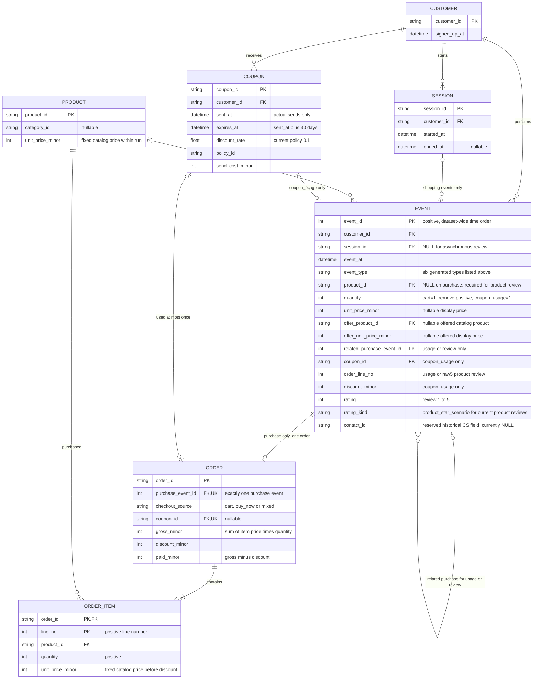

# V4 고객 행동 시뮬레이터 ERD

현재 구현은 [`raw_store.py`](../src/simulate/v4/simulator/raw_store.py)의 raw schema 5와 [`engine.py`](../src/simulate/v4/simulator/engine.py)를 따른다. 원시 업무 관계는 일곱 개이고 현재 생성 이벤트는 `view`, `cart`, `remove_from_cart`, `purchase`, `coupon_usage`, `review` 여섯 종이다. 과거 raw4/5 파일의 검색·CS 읽기 호환은 현재 생성 범위를 늘리지 않는다.

## 식별자·시간·금액

- `event_id`·행 번호·수량·금액은 정수이고 고객·세션·상품·주문·쿠폰 ID는 SQLite `TEXT`다. 동시각 이벤트 순서는 `event_id`로 보존한다.
- 시각은 timezone-aware UTC로 저장한다. 주간 집계만 Asia/Seoul 월요일 기준이며 원시 시각을 덮어쓰지 않는다.
- `currency`, `amount_unit`, `raw_schema_version`, 관측 범위와 데이터셋 ID는 테이블 열이 아니라 manifest 메타데이터다. `*_minor`는 선언된 통화의 최소 단위 정수이며 실제 자료의 `SOURCE_UNSPECIFIED`를 KRW로 간주하거나 환전하지 않는다.

## 연결·회계 제약

- purchase Event 1건 = Order 1건, Order 1건에는 OrderItem이 한 행 이상 있다. 구매의 상품·수량·단가는 Event에 중복하지 않고 OrderItem에 저장한다. 고객·세션·구매시각은 `purchase_event_id`로 얻는다.
- shopping 이벤트와 `coupon_usage`는 같은 고객의 실제 Session 안에 있다. Review는 비동기이므로 `session_id=NULL`이며 별도 쇼핑 세션이나 방문으로 세지 않는다.
- Raw5 product review는 같은 고객의 이전 purchase와 실제 구매한 SKU·`order_line_no`를 가리킨다. `(related_purchase_event_id, product_id)`가 유일하다. 주문 행 연결은 purchase→Order→OrderItem 경로와 검증 코드로 확인하며 `order_line_no` 단독 FK는 아니다. 예약된 CS 열과 과거 rating 종류는 읽기 호환 용도다.
- 쿠폰당 주문은 최대 하나다. 사용된 쿠폰마다 `coupon_usage`가 정확히 하나 존재하고 같은 구매·세션·시각·쿠폰을 참조한다. 그 이벤트는 주문 내 최고 단가 상품 한 개를 가리키며 단가 동률은 작은 행 번호를 선택한다. 할인은 그 한 개 단가의 10%를 half-up으로 반올림한다.
- `gross_minor=Σ(unit_price_minor×quantity)`, `paid_minor=gross_minor−discount_minor`다. `coupon_usage`를 별도 주문이나 추가 할인액으로 합산하지 않는다. 쿠폰 발송비는 할인과 별개다.
- 장바구니는 과거 cart/remove/purchase 기록에서 재생한다. `cart`는 보유 수량, `buy_now`는 장바구니를 유지하고 `mixed`는 보유 수량과 직접 구매를 함께 처리한다. 음수 장바구니는 허용하지 않는다.
- 배정·결과는 `treatments`·`labels`, latent 진단은 `diagnostics` sidecar다. 이들은 일곱 업무 테이블이나 과거 예측 입력에 합치지 않는다. 현재 28일 결과와 30일 생성·쿠폰·적격성 구분은 [Uplift 연결 계약](../uplift/readme.md)을 따른다.

이 문서는 main의 [V3 ERD 원문](https://github.com/HansDavidKim/CSE4187/blob/f5f8d6f0c06e863eed03e14762be2315ecc2100e/docs/simulator_ERD.md)을 현재 V4 코드에 맞게 갱신했다. [통합 기록](main_integration.md)에 보존·변경 범위가 있다. 별도 이미지·PDF 없이 이 Markdown에서 관계를 확인한다.
