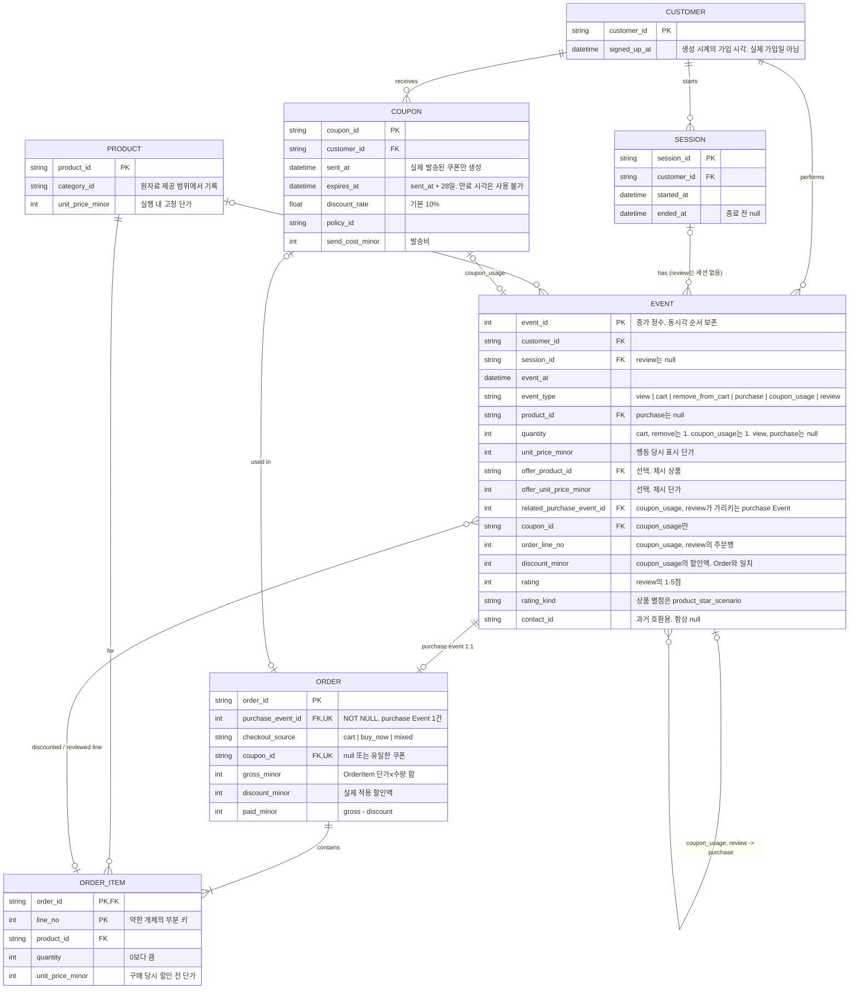

# 고객 행동 시뮬레이터 ERD

출처: `docs/KIT_feature_simulator_design_v5_daewon.pdf` 1–3장(여섯 이벤트, 일곱 업무 관계, 가격·장바구니·주문 회계), 11장(쿠폰 사용·별점), 15장(실험 로그). 컬럼 이름은 `simulator/src/simulate/v4/simulator/raw_store.py`의 raw5 스키마 기준.

버전: `raw_schema_version=5`, `event_scope_version=shopping_coupon_review_v1`.

## 표기와 제약

- 업무 테이블은 7개이고 Event는 17컬럼이다. 시각은 UTC로 저장하고, 주차·표시 시각은 Asia/Seoul이다.
- `*_minor`는 원천 가격 단위의 0.01인 정수다. 통화는 `SOURCE_UNSPECIFIED`이며 원화가 아니다.
- `ORDER_ITEM`은 `(order_id, line_no)`로 식별되는 약한 개체다.
- purchase Event 1건 = Order 1건 = OrderItem 1행 이상. 구매한 상품·수량은 Event가 아니라 OrderItem에서 읽는다. Order의 고객·세션·구매 시각은 `purchase_event_id`로 연결된 Event에서 얻는다.
- 금액은 Order에서 한 번만 계산한다(`paid = gross − discount`). 같은 주문의 Event·OrderItem·coupon_usage를 각각 매출로 더하지 않는다.

### 이벤트별 규칙

| event_type | 의미 | 연결 |
| --- | --- | --- |
| `view` | 상품 조회와 표시 가격 | 같은 상품의 반복 조회도 기록 |
| `cart` | 장바구니에 1개 담기 | 잔량은 다음 세션에도 유지 |
| `remove_from_cart` | 실제 보유분 1개 제거 | 잔량이 음수가 될 수 없음 |
| `purchase` | 구매 결정 1건 | Order 1개와 OrderItem 여러 행 |
| `coupon_usage` | 구매에 적용된 할인 | 같은 고객·세션·시각의 purchase. 최고 단가 품목 1개(동률이면 낮은 `line_no`)의 10%, half-up 반올림 |
| `review` | 구매 상품의 1–5점 별점 | 구매 × 상품마다 최대 1건, 구매 후 따로 도착, `session_id` null |

### 장바구니

- 장바구니는 개체가 아니다. 고객·상품별로 과거 Event를 `(event_at, event_id)` 순서로 재생해 얻는다. 빈 장바구니에서 시작한다.
- 구매 시 차감은 `checkout_source`에 따른다.

| checkout_source | 장바구니 변화 |
| --- | --- |
| `cart` | 구매한 수량만큼 차감 (구매량은 보유량 이내) |
| `buy_now` | 차감 없음. 기존 장바구니 보존 |
| `mixed` | 상품마다 `min(보유량, 구매량)` 차감 |

### 쿠폰

- 주문당 최대 1개, 쿠폰당 최대 1회 사용. 사용 여부는 `ORDER.coupon_id`로 판단한다. `coupon_usage` Event는 같은 사실을 가리키는 로그다.
- Treatment 고객만 `t0`에 1회 발송받는다. 유효기간은 `[t0, t0 + 28일)`.

### 개체가 아닌 것 (별도 파일)

실행 디렉터리에 업무 테이블과 따로 저장되며, 업무 기록에는 넣지 않는다.

| 파일 | 내용 | 용도 |
| --- | --- | --- |
| `treatments.parquet` | 고객별 고정 배정: `customer_id`, `as_of_at`(= `t0`), `treatment`, `assignment_probability` | 학습의 T |
| `labels.parquet` | 기본 이탈 정답(28일 미방문) | Retention |
| `experiment_log.parquet`, `no_purchase_labels.parquet`, `weekly_panel.parquet` | 실험 로그(결정·발송·사용), 28일 미구매 정답, 고객 × 달력 주 합계 | 대조·검증 |
| `evaluation_only/` | 발송·미발송 쌍대 rollout, 잠재 진단 | 평가 전용. 모델 입력 금지 |
| `diagnostics.parquet` | 잠재 성분, 고객별 추출값 | 비공개 |

- life-cycle(ENTRY·HOME·EXIT)은 저장된 개체가 아니라 세션에서 계산하는 상태다.
- persona·잠재 성분·반응 타입은 생성기 내부 변수이며 ER에 포함하지 않는다.
