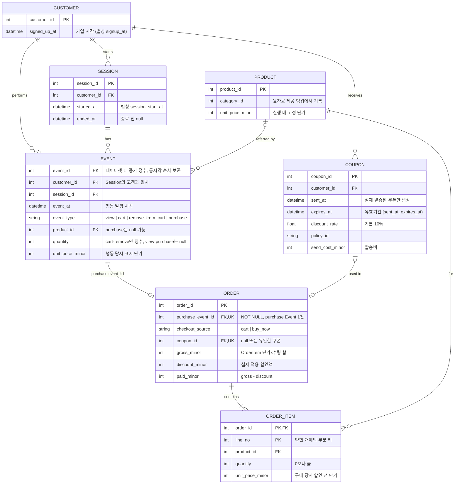

# 고객 행동 시뮬레이터 ERD

출처: `docs/KIT_feature_simulator_design_v3.pdf` 3장(그림 1, 3.1 필드 표, 3.2 Event 로그).

## 표기와 제약

- 속성 타입은 설계서에 명시되지 않아 추정한 값이다. `*_minor`는 통화 최소 단위(기본 KRW 1원) 정수, 시각은 UTC 저장.
- `ORDER_ITEM`은 `(order_id, line_no)`로 식별되는 약한 개체다.
- 설계서 그림 1의 Session–Order 관계(`has`)는 물리 FK가 아니다. Order의 고객·세션·구매시각은 `purchase_event_id`로 연결된 Event에서 얻으므로 위 그림에서는 Event–Order 1:1로 표현했다.
- purchase Event 1건 = Order 1건, Order 1건 = OrderItem 1행 이상.
- 쿠폰은 주문당 최대 1개, 쿠폰당 최대 1회 사용. 사용 여부는 `ORDER.coupon_id`로 판단하며 별도 Redemption 테이블은 없다.
- 장바구니, 실험 배정(`experiment_id`, `group` 등), 예측 결과는 개체가 아니다. 장바구니는 Event·OrderItem 조회로 복원하고, 실험·예측은 별도 결과 파일로 둔다.
- persona·반응 타입·life cycle은 생성기 내부 변수이며 ER에 포함하지 않는다.
