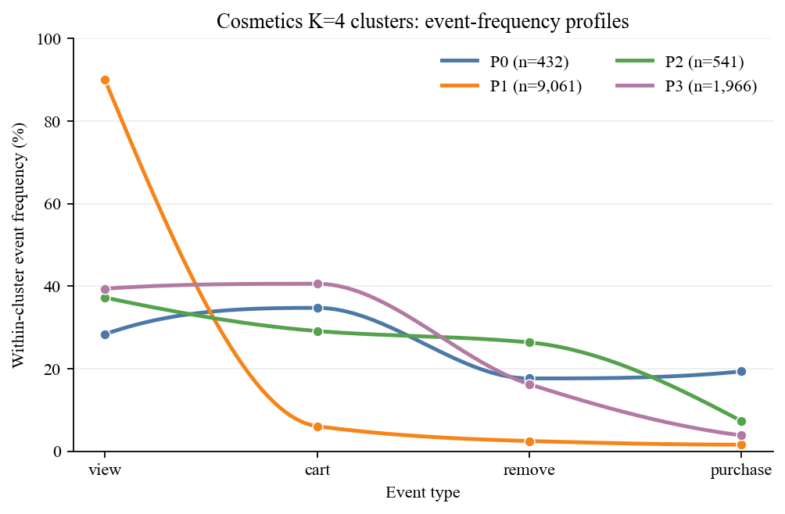

# 관측 행동 페르소나와 가정 기반 Uplift를 결합한 전자상거래 쿠폰 정책 시뮬레이터

> **KSC 논문 초안**  
> 저자: 홍길동, 홍길동  
> 소속: ○○대학교 ○○학과  
> 교신저자: author@example.com

## 초록

전자상거래의 쿠폰 정책은 즉시 구매뿐 아니라 재방문, 반복 노출 및 이탈 상태를 변화시킬 수 있어 단일 시점의 구매예측만으로 평가하기 어렵다. 그러나 실제 서비스에서 여러 정책을 장기간 온라인 탐색하면 직접적인 쿠폰비용과 사용자 피로가 발생하며, 공개 행동 로그에서는 동일 사용자의 처치·비처치 잠재결과를 동시에 관측할 수 없다. 쿠폰 로그가 있더라도 수령과 타기팅이 비무작위이면 관측 차이를 정책의 순수 효과로 해석할 수 없다. 따라서 관측된 사용자 이질성과 시간적 행동을 보존하면서도, 식별할 수 없는 개입효과를 명시적인 가정으로 통제하여 정책을 안전하고 반복 가능하게 비교할 시뮬레이터가 필요하다. 본 연구는 REES46 Cosmetics Shop의 20,692,840개 행동 이벤트에서 고정 약 1% 표본을 추출하고, 행동 및 세션 경계 토큰을 복원하는 masked bidirectional-GRU로 48차원 사용자 표현을 학습하였다. 군집의 행동 조성과 전이를 바탕으로 세 성숙 페르소나와 신규·이탈 lifecycle을 구성하고, 2차 상태특징을 사용하는 maximum-entropy 선택모형과 이산 세션 간격 모형을 결합하여 무쿠폰 사용자 생성기를 구축하였다. 생성기의 행동비율 RMSE는 0.0540이었으며 구매 세션률은 관측 4.23% 대비 생성 3.94%였다. 쿠폰 반응은 비무작위 Tianchi O2O 로그의 14일 구매율 차이를 인과효과가 아닌 합성환경의 보정 모멘트로만 사용하였다. 네 canonical response type은 관측 주변확률을 보존하는 최대엔트로피 결합으로 생성하고, 개별 수령효과에는 유한기간 단조감쇠와 반복 수령의 한계효과 감소를 적용하였다. 독립 합성 표본의 가중 14일 구매율 차이는 목표 12.62%p와 생성 12.55%p로 대응하였다. 주 1회 쿠폰 환경에서 1,000명·13주 학습 후 별도 5,000명·52주를 평가한 결과, discrete SAC는 사용자당 평균 20.90회의 쿠폰으로 순이익 30,893.46을 기록하여 매주 발송 정책의 27,692.00보다 높았다. 이 결과는 단일 seed와 가정 기반 uplift에 조건부이며 실제 인과효과의 증거가 아니다. 본 연구는 행동근거, 개입가정 및 정책평가를 분리하고 0효과 환원성을 보장하는 재현 가능한 전자상거래 정책 실험 기반을 제시한다.

**주제어:** 사용자 시뮬레이션, 순차 추천, 행동 페르소나, Maximum Entropy IRL, Uplift Modeling, Contextual Bandit, 강화학습

## Abstract

Coupon policies can affect not only immediate purchases but also return visits, repeated exposure, and churn, making one-step purchase prediction insufficient for long-term evaluation. Exploring multiple policies online is costly and may fatigue users, whereas observational logs cannot reveal both treated and untreated potential outcomes for the same user. Even when coupon records are available, non-random receipt and targeting prevent observed differences from being interpreted as pure policy effects. A simulator is therefore needed to preserve observed behavioral heterogeneity and temporal dynamics while exposing unidentified intervention effects as controllable assumptions. We train a masked bidirectional-GRU on action and session-boundary tokens from a fixed sample of 20,692,840 REES46 Cosmetics Shop events and obtain 48-dimensional user representations. Three mature personas and new/churning lifecycle states are modeled by a maximum-entropy choice model with quadratic state features and a discrete session-gap model. The no-coupon generator achieves an action-mixture RMSE of 0.0540 and reproduces a purchase-session rate of 3.94% against the observed 4.23%. Coupon response is not causally estimated from the non-random Tianchi O2O log; its observed 14-day purchase contrasts are used only as synthetic calibration moments. Four canonical response types are sampled from a maximum-entropy coupling that preserves observed marginals, with finite monotone carry-over and diminishing returns to repeated receipts. The weighted simulated 14-day contrast is 12.55 percentage points against a 12.62-point target. After online training on 1,000 users for 13 weeks and frozen-policy evaluation on 5,000 independent users for 52 weeks, discrete SAC obtains a per-user net profit of 30,893.46 using 20.90 coupons, compared with 27,692.00 for weekly issuance. These results are conditional on one global seed and assumption-based uplift and are not evidence of real-world causal effects. The proposed pipeline provides a reproducible testbed that separates behavioral evidence, intervention assumptions, and policy evaluation while guaranteeing recovery of the no-treatment baseline.

**Keywords:** User Simulation, Sequential Recommendation, Behavioral Persona, Maximum Entropy IRL, Uplift Modeling, Contextual Bandit, Reinforcement Learning

---

## 1. 서론

쿠폰·메시지·추천 노출 정책은 현재 구매뿐 아니라 재방문, 반복 구매, 이탈에도 영향을 줄 수 있다. 실제 서비스에서 정책을 평가하려면 사용자별 상태를 관측하면서 처치를 반복해야 하지만, 무분별한 탐색은 직접적인 마케팅 비용과 피로도를 발생시킨다. 반대로 공개 전자상거래 로그는 행동 다양성과 장기 시퀀스를 제공하더라도 무작위 처치 정보를 포함하지 않는 경우가 많다. 쿠폰 로그가 존재하더라도 발송 여부, 수령 여부, 사용자의 자발적 수령 행동과 타기팅 정책이 혼합되어 반사실적 효과를 식별하기 어렵다.

기존 추천 시뮬레이터의 핵심 과제는 세 가지다. 첫째, 사용자를 단순 평균 행동확률이 아닌 이질적인 순차 행동으로 생성해야 한다. 둘째, 관측된 행동 선호와 처치에 대한 반응 유형을 구분해야 한다. 셋째, 장기 효과를 평가하려면 행동 발생과 다음 방문 시점이 함께 모델링되어야 한다. 본 연구는 서로 다른 공개 로그의 장점을 모듈식으로 결합하되, 데이터셋 간 사용자를 동일 인물로 연결하거나 관측 연관성을 인과효과로 승격하지 않는다.

본 연구의 주요 기여는 다음과 같다.

1. 행동·세션 경계만으로 학습한 masked bidirectional-GRU 표현과 K-sweep을 이용해 전자상거래 사용자의 활성 행동 모드를 구성한다.
2. 상태조건부 maximum-entropy 선택모형, 사용자별 보상계수 GMM, lifecycle 상태 및 이산 세션 간격 모형을 결합한 무쿠폰 사용자 생성기를 제안한다.
3. Tianchi의 비무작위 쿠폰 수령 로그에 존재하는 교란을 명시하고, 이를 CATE 추정값이 아닌 합성 uplift 시나리오의 보정 모멘트로 사용하는 절차를 제안한다. 이는 관측 근거와 비식별 개입가정을 모델 내부에서 분리한다.
4. 일반적인 단일 시점 uplift 평가를 세션 복귀, 반복 노출 및 lifecycle을 포함하는 순차 환경으로 확장하고, 주간 지연 피드백 아래 bandit과 deep RL의 학습비용과 장기 순이익을 함께 비교한다.

## 2. 관련 연구

### 2.1 순차 사용자 표현

BERT4Rec은 사용자 행동 시퀀스의 일부를 마스킹하고 양방향 문맥에서 복원하는 Cloze 목적을 순차 추천에 도입하였다[3]. 본 연구는 Transformer 대신 계산량이 작은 GRU[4]를 양방향으로 사용하지만, 무작위 마스킹 토큰을 복원한다는 점에서 BERT-like 자기지도 목적을 따른다. 본 연구의 임베딩은 다음 상품 추천 점수를 직접 출력하는 대신, 사용자의 관측 행동 모드를 찾는 표현으로 사용된다.

### 2.2 Maximum-entropy 행동모형

Maximum Entropy IRL은 동일하거나 유사한 보상을 설명하는 여러 행동경로 중 특정 경로에 불필요하게 확신하지 않도록 최대엔트로피 원리를 사용한다[5]. 본 연구의 세션 내 모형은 장기 occupancy measure를 일치시키는 완전한 trajectory IRL이 아니라, 상태와 행동 특징에 조건부인 maximum-entropy 다항 선택모형이다. 즉, 보상계수는 관측 행동을 확률적으로 설명하기 위한 잠재 효용 파라미터이며 인과적 선호로 해석하지 않는다.

### 2.3 Uplift와 canonical response type

Uplift modeling은 처치가 결과확률에 미치는 증분 변화를 모델링하며, 이진 잠재결과에 따라 sure thing, persuadable, sleeping dog, lost cause의 네 유형을 정의할 수 있다[6]. 그러나 한 사용자에게서 $Y(0)$과 $Y(1)$을 동시에 관측할 수 없으므로 개별 canonical type은 식별되지 않는다. 특히 처치가 무작위가 아닌 경우 처치군과 대조군의 결과 차이는 uplift가 아니라 선택편향을 포함한 관측 연관성이다. 본 연구는 이 구분을 시뮬레이터 구조에 직접 반영한다.

### 2.4 쿠폰 정책 최적화

LinUCB는 문맥과 기대보상의 선형 관계를 가정하여 불확실성 상한으로 탐색한다[7]. Linear Thompson Sampling은 선형 파라미터의 사후분포에서 표본을 뽑아 탐색과 활용을 조절한다[8]. PPO는 clipped surrogate objective를 이용하는 on-policy 방법이며[9], SAC는 기대보상과 정책 엔트로피를 함께 최적화하는 off-policy actor-critic 방법이다[10]. 본 연구에서는 비문맥 UCB·TS, 문맥형 LinUCB·LinTS, PPO 및 이산 SAC를 동일한 합성 사용자 환경에서 비교한다.

### 2.5 기존 사용자 시뮬레이터 및 uplift 연구와의 차이

RecSim은 사용자 선호, 친숙도, 잠재상태와 선택모형을 조합할 수 있는 범용 순차 추천 시뮬레이션 플랫폼을 제시하였다[11]. RecoGym은 전자상거래의 자연 탐색과 광고 반응을 결합한 강화학습 환경을 제공한다[12]. Virtual-Taobao는 대규모 실제 Taobao 로그에서 가상 고객 분포와 행동정책을 학습하고 실제 온라인 실험으로 정책을 검증하였다[13]. 이 연구들은 실제 사용자에게 반복 탐색하는 비용을 줄이기 위해 시뮬레이터가 필요하다는 본 연구의 동기와 일치한다.

본 연구는 공개 데이터에서 행동 시퀀스와 신뢰할 수 있는 무작위 처치가 한 자료에 함께 존재하기 어렵다는 제약을 출발점으로 삼는다. 행동 생성과 쿠폰 반응을 서로 다른 모듈과 증거 수준으로 분리하고, 쿠폰 모듈을 제거하면 관측 기반 무처치 모형으로 정확히 환원되도록 설계한다.

| 연구 흐름 | 주된 목적 | 개입정보 처리 | 본 연구와의 차이 |
|---|---|---|---|
| BERT4Rec 등 순차 추천[3] | 다음 아이템·행동 예측 | 일반적으로 처치 반사실을 직접 모델링하지 않음 | 행동 표현을 페르소나와 생성 상태로 사용하고 정책비용·지연효과를 추가함 |
| 전통적 uplift modeling[6] | 처치에 따른 증분 반응 추정 | 무작위화 또는 무교란성에 의존하는 단일 결과 중심 | 인과효과를 주장하지 않고 canonical type과 지속효과를 공개된 시나리오 가정으로 둠 |
| RecSim[11] | 구성 가능한 순차 추천환경 | 사용자가 정의한 잠재상태와 반응모형 | 공개 로그에서 관측된 부분과 가정한 부분의 증거 경계를 보정 절차에 포함함 |
| RecoGym[12] | 자연 탐색과 추천·광고 정책 평가 | 노출에 대한 합성 반응 | 쿠폰 비용, 반복 수령, 감쇠 및 세션 복귀를 명시적으로 모델링함 |
| Virtual-Taobao[13] | 실제 Taobao의 학습 기반 가상환경 | 대규모 독점 로그와 온라인 검증 | 본 연구는 공개 데이터 재현성을 우선하지만 실제 온라인 검증이 없다는 한계를 명시함 |

본 연구는 **행동 시퀀스의 현실성**, **순차적 쿠폰 반응**, **정책평가**를 각 요소의 서로 다른 식별 수준을 보존하며 연결한다. 이 구조는 합성환경의 가정을 실제 데이터에서 확인된 인과효과와 구분하고, 0효과·감쇠율·canonical 결합을 바꾼 민감도 실험을 가능하게 한다.

## 3. 데이터와 문제 정의

### 3.1 데이터

| 데이터 | 역할 | 주요 변수 | 본 연구의 사용 범위 |
|---|---|---|---|
| REES46 Cosmetics Shop[1] | 주 행동 데이터 | 시각, 사용자, 세션, 상품, `view/cart/remove_from_cart/purchase` | 페르소나, 행동 효용, 세션 간격, lifecycle |
| REES46 Electronics[1] | 보조 행동 데이터 | 시각, 사용자, 세션, 상품, `view/cart/purchase` | 조회·장바구니·구매 패턴의 외부 기술적 확인 |
| Tianchi O2O Coupon[2] | 쿠폰 반응 참고 데이터 | 쿠폰 수령·구매·클릭 기록 | 관측 차이, placebo audit, 합성 uplift 보정 모멘트 |

Cosmetics는 2019년 10월부터 2020년 2월까지의 5개 CSV, 총 20,692,840행을 사용하였다. 재현 가능한 계산을 위해 `user_id mod 100 = 0`인 고정 약 1% 표본 216,093행을 읽고 최대 12,000명의 사용자 시퀀스를 구성하였다. Electronics는 `remove_from_cart`가 제공되지 않으므로 해당 행동을 0으로 간주하지 않고 보조 검증에만 사용하였다. 원본 데이터는 저장소에 재배포하지 않으며 공식 제공처에서 내려받는 절차와 파생 집계만 제공한다.

Tianchi 분석의 기준일은 2016년 5월 15일이다. 처치는 기준일의 쿠폰 수령 기록, 주 결과는 기준일 다음 날부터 14일 이내 구매 기록 여부다. 처치 이전 14일의 클릭·구매만으로 P1–P4 대리군을 만들었으며 기준일과 미래 정보는 대리군 정의에서 제외하였다.

### 3.2 문제 정의

사용자 $u$는 고정된 home persona $g_u$, 행동 효용계수 $\theta_u$, 합성 canonical type $c_u$를 가진다. 시간에 따라 변하는 상태 $s_t$에는 lifecycle, 최근 행동, 세션 간격, engagement, friction, satiation 및 쿠폰 노출이 포함된다. 세션 내부 행동은

$$
a_t\in\{\text{view},\text{cart},\text{remove},\text{purchase},\text{end}\}
$$

이며, 쿠폰 정책의 주간 행동은 $A_w\in\{0,1\}$이다. 정책 목적은 구매 1회당 1,000, 실제 쿠폰 발송 1회당 100의 비용을 가정한 장기 순이익

$$
R=1000N_{\mathrm{purchase}}-100N_{\mathrm{coupon}}
$$

을 최대화하는 것이다. 금액은 특정 기업의 실제 마진이 아니라 알고리즘 비교를 위한 효용 단위다.

## 4. 제안 방법

### 4.1 Masked bidirectional-GRU 사용자 표현

행동 토큰과 세션 경계 토큰으로 각 사용자의 앞 64개 토큰을 구성한다. 상품 ID, 가격, 쿠폰 및 세션 간 휴식시간은 인코더에 넣지 않는다. 전체 토큰의 15%를 무작위 마스킹하고 원래 행동을 복원하도록 학습한다.

$$
\mathcal{L}_{\mathrm{mask}}
=-\sum_{i\in\mathcal{M}}\log p_\psi(x_i\mid x_{\setminus\mathcal{M}}).
$$

16차원 토큰 임베딩을 hidden size 24인 양방향 GRU에 입력하고 양방향 마지막 hidden state를 연결하여 48차원 사용자 표현 $z_u$를 얻는다. 사용자 단위로 80:20 학습·보류 분할을 적용하고 K-means의 $K=2,\ldots,8$을 탐색하였다. 군집 수는 silhouette만으로 자동 결정하지 않고 최소 군집 크기, 초기화 간 ARI, 행동 조성, 구매 경험 및 세션 내 전이의 해석 가능성을 함께 사용하였다.

**Algorithm 1. Masked bidirectional-GRU를 이용한 사용자 임베딩 추출**

```text
Input : 시간순 행동 로그 D, 최대 사용자 수 U=12,000, 최대 길이 L=64,
        masking 비율 q=0.15, epoch E=8, random seed 42
Output: 사용자별 표준화 임베딩 z_u ∈ R^48와 user_id 매핑

1: D를 사용자와 event_time 순으로 정렬한다.
2: 사용자별 세션 수를 1개, 2개, 3개 이상으로 나누어 최대 U명을 층화 표본화한다.
3: 각 사용자 u에 대해 행동 토큰을 시간순으로 추가하고,
   세션이 바뀔 때 SESSION 토큰을 삽입한 뒤 마지막에도 SESSION을 추가한다.
4: 앞 L개 토큰을 유지하고 PAD를 적용한 뒤 사용자를 80:20으로 분할한다.
5: token embedding 16차원, 양방향 GRU hidden 24의 복원모형을 초기화한다.
6: for epoch = 1,...,E do
7:     각 시퀀스의 유효 토큰 중 q를 MASK로 바꾸되 최소 한 토큰은 선택한다.
8:     선택된 위치의 원래 토큰에 대한 cross-entropy로 모형을 갱신한다.
9: end for
10: 마스킹하지 않은 시퀀스를 인코더에 통과시킨다.
11: 정방향·역방향 마지막 hidden state를 연결하여 z_u=[h_u^→;h_u^←]를 얻는다.
12: 학습 사용자 평균·표준편차로 모든 z_u를 표준화하고 user_id와 함께 저장한다.
13: return {(user_id, z_u)}
```

저장된 임베딩에서 $K=4$를 운영 군집 수로 사용하였다. 선택에는 군집 크기와 안정성뿐 아니라 실제 구매군의 분리, 장바구니 제거 행동 및 활동 깊이의 차이를 함께 반영하였다. 그림 1은 각 집단에서 관측된 전체 이벤트를 분모로 계산한 행동 구성비다. 따라서 막대는 집단의 크기가 아니라 해당 집단 내부에서 사용자가 어떤 행동을 선택했는지를 나타낸다.



| Persona | 사용자 | view | cart | remove | purchase | 행동 수 중앙값 | 구매 경험 사용자 |
|---|---:|---:|---:|---:|---:|---:|---:|
| P0 구매 혼합형 | 432 | 28.34% | 34.72% | 17.62% | **19.32%** | 22 | **100.00%** |
| P1 짧은 조회형 | 9,061 | **89.93%** | 6.05% | 2.46% | 1.57% | 2 | 0.76% |
| P2 장기 장바구니 수정형 | 541 | 37.21% | 29.11% | **26.35%** | 7.33% | **118** | 68.58% |
| P3 장바구니 중심형 | 1,966 | 39.35% | **40.56%** | 16.24% | 3.84% | 7 | 10.12% |

P0는 네 행동이 모두 나타나면서 구매 비율과 구매 경험률이 가장 높다. P2는 장바구니 제거 비율과 행동 깊이가 가장 크고, P3는 전체 이벤트의 40.56%가 장바구니 추가인 짧은 수정 경로를 보인다. P1은 조회 비율 89.93%와 중앙 행동 수 2회의 얕은 이력으로, 신규 진입·미성숙 행동·이탈 진행 및 단일 방문이 혼합된 관측군으로 처리하였다. 이에 최종 생성기의 고정 home persona는 P0·P2·P3으로 두고, `NEW`와 `CHURNING`을 변화 가능한 lifecycle 상태로 분리하였다. 이벤트 구성비는 군집에 사용된 시퀀스에서 계산한 기술통계이므로 독립적인 미래 행동 예측 성능으로 해석하지 않는다.

### 4.2 상태조건부 maximum-entropy 효용

행동 직전 상태 특징은 세션 위치, 세션 경과시간, 직전 이벤트 간격, 세션 내 네 행동의 과거 횟수, 직전 행동 one-hot으로 구성한다. 연속형 변수는 학습 사용자에서 표준화한다. 선형항만으로 설명하기 어려운 포화와 상호작용을 허용하기 위해 11개 비절편 특징에 제곱항과 모든 2변수 교차항을 추가하였다. 3변수 이상의 곱은 사용하지 않았다.

$$
\phi^{(2)}(s)
=\left[1,x_1,\ldots,x_{11},x_1^2,\ldots,x_{11}^2,
x_1x_2,\ldots,x_{10}x_{11}\right].
$$

사용자 $u$의 즉시 보상과 행동확률은 다음과 같다.

$$
r_u(s_t,a)=\theta_{u,a}^{\top}\phi^{(2)}(s_t),\qquad
\pi_u(a\mid s_t)=
\frac{\exp(r_u(s_t,a))}{\sum_{a'}\exp(r_u(s_t,a'))}.
$$

temperature는 1로 고정한다. softmax의 위치 불변성을 제거하기 위해 각 특징에서 다섯 행동 계수의 합을 0으로 제약한다. 사용자별 계수는 persona prior에 대한 MAP으로 추정하고, 대표 사용자 60명의 계수 벡터에는 대각 GMM을 적합한다. BIC와 최소 성분 크기 제약으로 3개 성분을 선택했으며, 성분은 P0·P2·P3과 대응하였다. 모집단 혼합비는 대표 표본의 균등 추출비가 아니라 전체 성숙 사용자 비율인 14.70%, 18.41%, 66.89%로 보정하였다.

상태가 시간에 따라 변하도록 사용자별 기본 계수 $\theta_u$는 고정하되, 여섯 내부상태 $h_t$가 행동별 offset을 변경하도록 한다.

$$
r_u(a_t)=\theta_{u,a_t}^{\top}\phi_t
+\beta_{g_u,a_t}^{\top}h_t
+\nu_{g_u,a_t}\mathbf{1}(L_t=\mathrm{NEW}).
$$

$h_t$는 engagement, friction, satiation, inactivity momentum, gap acceleration, habit strength로 구성되며 과거 세션만으로 재귀 갱신된다. 이 모형은 미래 결과를 이용하는 Q-function이 아니라 현재 상태의 즉시 보상에 기반한 확률적 선택모형이다.

### 4.3 세션 종료와 lifecycle 전이

`end`가 선택되면 다음 세션 간격을 `0–1h`, `1–6h`, `6–24h`, `1–3d`, `3–7d`, `7–14d`, `14–30d`, `NO_RETURN_30D`의 여덟 토큰으로 샘플링한다. 먼저 30일 내 복귀 여부를 선택하고, 복귀한 경우에만 일곱 간격 중 하나를 선택하는 nested MNL 구조를 사용한다. 첫 세션에서 이전 간격이 없는 문제는 학습 표본의 평균 관측 간격 51.33시간으로 초기화하되 `has_previous_gap=0`을 별도로 유지한다.

Lifecycle 상태집합은

$$
\mathcal{L}=\{\mathrm{NEW},P0,P2,P3,\mathrm{CHURNING},
\mathrm{MISSION\_EXIT},\mathrm{EXIT}\}
$$

이다. `NEW` 사용자는 출생 시 home persona를 갖고 성숙 상태로 이동한다. 구매 없는 30일 미복귀는 `CHURNING`, 구매 후 미복귀는 목적 달성 후 이탈의 대리상태인 `MISSION_EXIT`로 이동한다. `CHURNING` 사용자가 복귀하면 원래 home persona로 돌아가며 다시 미복귀하면 `EXIT`로 이동한다. `MISSION_EXIT`은 실제 만족도를 관측한 라벨이 아니라 구매 후 30일 미복귀를 설명하기 위한 시뮬레이션 상태다.


### 4.4 Tianchi 기반 합성 uplift 보정

#### 4.4.1 인과효과로 사용하지 않는 이유

Tianchi의 기준일 수령군은 모든 대리군에서 높은 14일 구매율을 보였다. 그러나 다섯 기준일에 대한 audit에서 처치 이전 placebo 구매율 차이가 6.85–8.87%p였고, 수령군의 후속 쿠폰 수령률도 대조군보다 12.11–31.31%p 높았다. 이는 관측 이력으로 조정한 후에도 활동성·타기팅·자격요건이 다름을 뜻한다. 따라서 수령군과 비수령군의 차이를 CATE 또는 개별 uplift로 해석하지 않는다.


그럼에도 쿠폰 반응 시나리오를 전혀 두지 않으면 정책의 장기 비용·효익을 시험할 수 없다. 이에 본 연구는 Tianchi 차이를 실제 효과 추정치가 아니라 다음 세 조건을 만족하는 **simulated-moment calibration target**으로만 사용한다.

1. 쿠폰 항을 0으로 두면 무쿠폰 생성기가 정확히 복원된다.
2. 관측 차이는 대리군 평균 모멘트만 제약하고 개별 canonical type을 확정하지 않는다.
3. 지속기간과 반복 수령 함수는 식별값이 아니라 공개된 민감도 파라미터로 둔다.

#### 4.4.2 Canonical type의 합성 결합

대리군의 대조 구매율을 $p_0$, 수령 구매율을 $p_1$이라고 하자. 두 잠재결과의 주변분포를 보존하면서 추가 상관을 주입하지 않는 최대엔트로피 독립 결합을 사용한다.

$$
\pi_{ST}=p_0p_1,\quad
\pi_{P}=(1-p_0)p_1,\quad
\pi_{SD}=p_0(1-p_1),\quad
\pi_{LC}=(1-p_0)(1-p_1).
$$

이는 Fréchet 가능영역 안의 하나의 합성 분포일 뿐 실제 결합분포의 추정치가 아니다. 표준화된 48차원 GRU latent에 절편을 붙여 $49\times4$ 행렬 $W$를 학습하고,

$$
P(c_u=k\mid z_u)=\operatorname{softmax}([1;z_u]^\top W)_k
$$

로 canonical type을 사용자 출생 시 한 번 샘플링한다. $W$의 열 합을 0으로 제약하고 $L_1=0.001$, $L_2=0.01$을 적용하였다. 사용자 분리 보류 집합에서 persona별 목표 분포 RMSE는 0.0096이었다. 이 weak supervision은 동일 persona 내부에 잠재 반응 이질성을 만드는 장치이며 개인의 실제 반사실 유형을 복원하지 않는다.

#### 4.4.3 감소 및 반복 수령

단일 수령자 230명과 무수령자 179,654명을 사전 이력층으로 표준화했을 때 주별 구매율 차이는 1주차 +3.97%p, 2주차 +1.59%p, 3주차 +1.86%p, 4주차 +0.16%p였고 2주차 이후 신뢰구간은 0을 포함했다. 따라서 정확한 감쇠율을 추정하지 않고, 각 수령의 영향이 6주 안에 단조 감소하여 35일째 0이 되는 커널을 가정한다.

$$
d(k)=\left[\max\left(0,1-rac{\lfloor k/7\rfloor}{5}\right)\right]^2,
\qquad
E_t=\sqrt{\sum_{r<t}d(t-r)}.
$$

제곱근은 반복 수령의 한계기여를 감소시키면서 임의의 hard ceiling을 피한다. Persuadable에는 $+\beta_gE_t$, sleeping dog에는 $-\beta_gE_t$, sure thing과 lost cause에는 0의 purchase/return logit offset을 준다. 별도 6,000명 calibration 표본에서 persona별 strength를 simulated method of moments로 학습하고, 독립 10,000명 표본에서 검증하였다.


### 4.5 주간 쿠폰 정책 환경

쿠폰 발송을 매시간 허용하면 현재의 강한 합성 uplift를 악용한 스팸 정책이 쉽게 발생한다. 따라서 정책은 사용자별 주 1회만 $A_w$를 결정한다. 선택 이후 7일 동안 환경을 진행하고 그 기간의 구매·세션·쿠폰비를 합산하여 직전 결정의 feedback으로 반환한다. Agent가 관측하는 19개 특징은 다음과 같다.

- persona one-hot과 `NEW/MATURE/CHURNING` lifecycle,
- episode 진행률과 요일의 sine/cosine,
- 마지막 세션·구매 이후 경과일,
- 최근 7일·30일 세션, 구매 및 쿠폰 빈도,
- 감쇠된 쿠폰 노출량과 현재 발송 가능 여부.

Canonical type, canonical 확률 및 미래 결과는 agent에서 숨긴다. 공정한 비교를 위해 모든 정책은 같은 학습·평가 사용자 seed와 사용자별 common random numbers를 사용한다. 알고리즘 내부 탐색 난수는 독립적인 `seed + algorithm index`를 사용한다.

## 5. 실험

### 5.1 사용자 생성기 검증

무쿠폰 baseline에서는 사용자별 기본 효용계수를 home-persona 조건부 GMM에서 한 번 샘플링한 뒤 lifecycle 선택모형과 gap-token 모형을 연결하여 10,000명, 45,522개 세션을 생성하였다.

| 지표 | 관측/보류 집계 | 생성 | 차이 |
|---|---:|---:|---:|
| view 비율 | 44.21% | 36.65% | −7.56%p |
| cart 비율 | 28.33% | 35.48% | +7.15%p |
| remove 비율 | 20.57% | 18.73% | −1.84%p |
| purchase 비율 | 6.89% | 9.13% | +2.24%p |
| 구매 세션률 | 4.23% | 3.94% | −0.29%p |
| 30일 비복귀율 | 26.24% | 21.91% | −4.33%p |

행동비율 RMSE는 0.0540이었다. 최대 100행동에서 강제 종료된 세션은 0.057%, 최대 50세션에서 절단된 사용자는 0.26%였다. 이는 집계 행동을 허용오차 안에서 재현한다는 의미이며 개인 trajectory나 인과적 효용의 복원을 뜻하지 않는다.

### 5.2 보상함수와 lifecycle ablation

| 모형 | 평균 NLL | 평균 정확도 | 비고 |
|---|---:|---:|---|
| 선형 persona reward | 0.648 | 0.732 | 12개 특징 |
| 2차 persona reward | **0.600** | **0.745** | 78개 특징 |
| 기본 즉시 reward | 0.840 | 0.650 | P0·P2·P3 평균 |
| Lifecycle-conditioned reward | **0.808** | **0.672** | 6개 누적 내부상태 포함 |

2차 reward는 모든 persona에서 선형식보다 낮은 보류 NLL을 보였다. 개인별 평균 delay를 oracle latent로 제공한 세션 간격 ablation에서는 7일 이내 복귀 Brier가 공통 magnitude 0.21156에서 0.20033으로 5.31% 감소하였다. 이 oracle은 개인 지연규모의 정보가치를 측정하는 상한이며 배포 시점에 미래 평균을 사용할 수 있다는 뜻이 아니다.

### 5.3 Uplift calibration

| Persona | Tianchi 대리군 목표 | 생성 차이 | 절대오차 |
|---|---:|---:|---:|
| P0 구매 혼합형 | +11.95%p | +10.98%p | 0.97%p |
| P2 장기 수정형 | +29.60%p | +29.66%p | 0.06%p |
| P3 장바구니 중심형 | +8.10%p | +8.19%p | 0.09%p |
| 모집단 가중 | +12.62%p | +12.55%p | 0.07%p |

쿠폰 이력이 없거나 strength를 0으로 두었을 때 offset은 정확히 0이 되어 무쿠폰 baseline을 복원하였다. 쿠폰 시나리오에서 구매 세션률은 3.94%에서 15.55%, 30일 비복귀율은 21.91%에서 18.65%로 변했다. 이 값은 Tianchi 효과의 외부 검증이 아니라 주어진 관측 모멘트를 합성환경이 재현하는지 확인한 결과다.

### 5.4 정책 비교 설정

각 정책은 1,000명의 합성 사용자를 13주 동안 순차 처리하며 온라인 학습하였다. 학습 후 파라미터를 고정하고 별도 5,000명을 52주 동안 평가하였다. 쿠폰은 주 1회까지 허용하였다. PPO와 discrete SAC의 신경망은 19–64–64–2 구조이며 Apple MPS에서 학습하고 단일 상태 추론은 CPU actor 복제본으로 수행하였다. PPO는 4 epoch clipped update, SAC는 replay buffer 50,000, batch 512, 8 transition마다 갱신하였다. 두 방법의 discount factor는 주간 transition 기준 $\gamma=0.99$다.

비교 정책은 UCB, TS, LinUCB, LinTS, PPO, discrete SAC와 쿠폰 미발송·매주 발송 규칙이다. `learning cost`는 canonical type을 아는 비현실적 oracle의 학습기간 누적 순이익에서 실제 정책의 누적 순이익을 뺀 값이다. 쿠폰비는 이미 순이익에 포함되므로 learning cost에 다시 더하지 않는다.

## 6. 결과

### 6.1 장기 정책 성능

| 정책 | 3개월 학습 순이익/명 | Oracle 대비 학습비용 | 1년 순이익/명 | 구매/명 | 쿠폰/명 |
|---|---:|---:|---:|---:|---:|
| UCB | 7,187.50 | 1,098,500 | 27,692.00 | 32.892 | 52.000 |
| TS | 7,109.80 | 1,176,200 | 27,692.00 | 32.892 | 52.000 |
| LinUCB | 6,733.90 | 1,552,100 | 28,959.04 | 30.760 | 18.006 |
| LinTS | 6,729.40 | 1,556,600 | 29,398.14 | 31.361 | 19.633 |
| PPO | 6,021.50 | 2,264,500 | 27,692.00 | 32.892 | 52.000 |
| **Discrete SAC** | **7,470.30** | **815,700** | **30,893.46** | **32.984** | **20.901** |
| 쿠폰 미발송 | — | — | 3,353.40 | 3.353 | 0.000 |
| 매주 발송 | — | — | 27,692.00 | 32.892 | 52.000 |


SAC의 사용자당 순이익은 매주 발송보다 11.56% 높았고, 쿠폰 사용량은 59.81% 적었다. 구매 수는 32.984회로 매주 발송의 32.892회와 유사하였다. LinUCB와 LinTS도 발송량을 줄이며 매주 발송보다 높은 순이익을 얻었지만 구매 수가 감소하였다. UCB, TS, PPO는 평가 시 매주 발송 정책으로 수렴하였다.

### 6.2 온라인 학습비용


SAC는 1,000명 학습 시점에서 가장 높은 누적 순이익과 가장 낮은 oracle 대비 학습비용을 기록하였다. PPO의 최종 평가 정책은 매주 발송과 같았으나 학습 중 비용은 2,264,500으로 가장 컸다. 현재 문제는 주 1회 이진 행동이고 총 학습 transition이 약 13,000개에 불과하여 on-policy PPO에 불리하다. 반면 SAC는 replay buffer로 과거 transition을 재사용한다. 따라서 본 결과는 PPO의 일반적 열등성이 아니라 현재 표본규모와 환경구조에서의 표본효율 차이로 해석해야 한다.

TS는 일별 즉시 reward만 귀속하던 이전 실험에서 미발송으로 붕괴했으나, 7일의 구매·세션 결과를 직전 쿠폰 결정에 합산한 뒤 UCB와 같은 최대발송 정책으로 수렴하였다. 이는 쿠폰 정책에서 알고리즘 선택 이전에 지연효과의 credit assignment가 중요함을 보여준다.

## 7. 논의

### 7.1 관측 행동과 반사실 가정의 분리

본 연구의 핵심 설계는 서로 다른 데이터셋을 직접 결합 학습하지 않는 것이다. Cosmetics는 사용자가 실제로 어떻게 탐색·장바구니 수정·구매·종료하는지를 제공하지만 쿠폰 처치가 없다. Tianchi는 쿠폰 관련 기록을 제공하지만 Cosmetics와 같은 상품행동 시퀀스와 무작위 할당이 없다. 따라서 Cosmetics의 행동 페르소나와 Tianchi의 canonical type은 서로 다른 잠재변수로 유지한다. 이러한 분리는 행동 군집을 곧바로 persuadable 또는 sleeping dog로 해석하는 오류를 방지한다.

Tianchi를 완전히 제외하지 않은 이유는 무처치 행동만으로는 쿠폰 정책 사이의 차이를 생성할 수 없기 때문이다. 대신 관측 차이를 평균 모멘트로만 사용하고, 최대엔트로피 결합·감쇠 커널·반복 수령 함수를 명시적 가정으로 노출하였다. 따라서 후속 연구자는 0효과, 약한 효과, 빠른 감쇠, sleeping-dog 증가 등의 대안을 같은 baseline 위에서 비교할 수 있다.

### 7.2 PPO와 SAC의 차이

PPO는 완료된 사용자 trajectory 32개를 모아 on-policy 갱신하므로, 1,000명 규모에서 탐색 중 손실을 회복할 데이터가 부족했다. 또한 최종적으로 최대발송 정책에 도달하여 표현력 부족보다 학습효율 문제가 크게 나타났다. SAC는 off-policy replay와 엔트로피 정규화를 통해 더 적은 쿠폰을 사용하는 상태의 가치를 반복 학습할 수 있었다. 다만 현재 SAC 우위가 네트워크 구조, update frequency 또는 강한 합성 쿠폰효과에 의한 것인지 분리되지 않았으므로 다중 seed와 hyperparameter 통제가 필요하다.

### 7.3 한계

첫째, 사용자 로그는 관측창의 좌·우 절단을 포함하며 기록이 없다는 사실을 실제 비활동이나 영구 이탈로 확정할 수 없다. 둘째, 페르소나는 행동 prefix를 압축한 기술적 군집이며 심리적 성향이나 미래 구매력의 원인이 아니다. 셋째, 세션 종료는 직접 기록되지 않아 30분 관측 규칙으로 추론하였다. 넷째, Tianchi의 수령은 무작위 처치가 아니며 placebo 차이와 반복 타기팅이 남아 있다. 따라서 canonical type 분포와 coupon offset은 인과 추정치가 아니다. 다섯째, 정책 결과는 전역 seed 42의 단일 실행이다. 모든 정책에 동일한 사용자 seed와 common random numbers를 사용했지만, seed 간 알고리즘 변동은 평가하지 않았다. 여섯째, 구매가치 1,000과 쿠폰비용 100은 임의의 효용 단위이므로 비용비율에 대한 민감도 분석이 필요하다. 마지막으로 정책 벤치마크는 일별 Bernoulli session·purchase로 집계한 축약 환경이며, 세션 내부의 모든 MaxEnt 행동을 매번 rollout하는 완전 통합환경은 아니다.

## 8. 결론

본 연구는 공개 전자상거래 행동 로그와 비무작위 쿠폰 로그를 이용해 정책 평가용 사용자 시뮬레이터를 구성하였다. Masked bidirectional-GRU로 행동 페르소나를 추출하고, 2차 maximum-entropy 효용과 lifecycle·세션 간격 모형으로 무쿠폰 행동을 생성하였다. 쿠폰 반응은 Tianchi의 관측 차이를 인과효과로 주장하지 않고 최대엔트로피 canonical coupling과 단조 감쇠 커널을 갖는 합성 시나리오로 보정하였다. 주간 쿠폰 정책 비교에서는 SAC가 가장 높은 순이익과 낮은 쿠폰 사용량을 보였으나, 이 결과는 현재 가정과 단일 seed에 조건부다.

향후 연구에서는 첫째, 5개 이상의 전역 seed와 bootstrap 사용자 표본으로 정책 순위의 불확실성을 평가하고, 둘째, 구매가치·쿠폰비용·감쇠율·sleeping-dog 비율에 대한 민감도 분석을 수행하며, 셋째, 무작위 또는 propensity가 알려진 처치 로그에서 uplift 모듈을 외부 검증해야 한다. 또한 축약된 주간 환경과 세션 단위 MaxEnt 생성기를 완전히 연결하여 행동분포 적합성과 정책수익 적합성을 동시에 평가할 필요가 있다.

## 참고문헌

[1] REES46, “Free datasets with eCommerce behavior data,” [Online]. Available: <https://rees46.com/en/datasets>.

[2] Alibaba Cloud Tianchi, “O2O Coupon Usage Prediction Dataset,” [Online]. Available: <https://tianchi.aliyun.com/dataset/5903>.

[3] F. Sun, J. Liu, J. Wu, C. Pei, X. Lin, W. Ou, and P. Jiang, “BERT4Rec: Sequential Recommendation with Bidirectional Encoder Representations from Transformer,” in *Proc. ACM CIKM*, 2019. <https://arxiv.org/abs/1904.06690>

[4] K. Cho, B. van Merriënboer, C. Gulcehre, D. Bahdanau, F. Bougares, H. Schwenk, and Y. Bengio, “Learning Phrase Representations using RNN Encoder–Decoder for Statistical Machine Translation,” in *Proc. EMNLP*, pp. 1724–1734, 2014. <https://aclanthology.org/D14-1179/>

[5] B. D. Ziebart, A. Maas, J. A. Bagnell, and A. K. Dey, “Maximum Entropy Inverse Reinforcement Learning,” in *Proc. AAAI*, pp. 1433–1438, 2008. <https://www.cs.cmu.edu/~bziebart/publications/maximum-entropy-inverse-reinforcement-learning.html>

[6] F. Devriendt, D. Moldovan, and W. Verbeke, “A Literature Survey and Experimental Evaluation of the State-of-the-Art in Uplift Modeling: A Stepping Stone Toward the Development of Prescriptive Analytics,” *Big Data*, vol. 6, no. 1, pp. 13–41, 2018. <https://doi.org/10.1089/big.2017.0104>

[7] L. Li, W. Chu, J. Langford, and R. E. Schapire, “A Contextual-Bandit Approach to Personalized News Article Recommendation,” in *Proc. WWW*, pp. 661–670, 2010. <https://arxiv.org/abs/1003.0146>

[8] S. Agrawal and N. Goyal, “Thompson Sampling for Contextual Bandits with Linear Payoffs,” in *Proc. ICML*, PMLR 28(3), pp. 127–135, 2013. <https://proceedings.mlr.press/v28/agrawal13.html>

[9] J. Schulman, F. Wolski, P. Dhariwal, A. Radford, and O. Klimov, “Proximal Policy Optimization Algorithms,” arXiv:1707.06347, 2017. <https://arxiv.org/abs/1707.06347>

[10] T. Haarnoja, A. Zhou, P. Abbeel, and S. Levine, “Soft Actor-Critic: Off-Policy Maximum Entropy Deep Reinforcement Learning with a Stochastic Actor,” in *Proc. ICML*, PMLR 80, pp. 1861–1870, 2018. <https://proceedings.mlr.press/v80/haarnoja18b.html>

[11] E. Ie, C.-W. Hsu, M. Mladenov, V. Jain, S. Narvekar, J. Wang, R. Wu, and C. Boutilier, “RecSim: A Configurable Simulation Platform for Recommender Systems,” arXiv:1909.04847, 2019. <https://arxiv.org/abs/1909.04847>

[12] D. Rohde, S. Bonner, T. Dunlop, F. Vasile, and A. Karatzoglou, “RecoGym: A Reinforcement Learning Environment for the Problem of Product Recommendation in Online Advertising,” arXiv:1808.00720, 2018. <https://arxiv.org/abs/1808.00720>

[13] J.-C. Shi, Y. Yu, Q. Da, S.-Y. Chen, and A.-X. Zeng, “Virtual-Taobao: Virtualizing Real-World Online Retail Environment for Reinforcement Learning,” in *Proc. AAAI*, vol. 33, pp. 4902–4909, 2019. <https://doi.org/10.1609/aaai.v33i01.33014902>

## 부록 A. 재현 설정

### A.1 주요 산출물

- 행동 페르소나: `artifacts/four-behavior-modes/`
- MaxEnt 효용과 gap 모형: `artifacts/cosmetics-shop-persona-quadratic-irl/`
- Tianchi 관측 분석: `artifacts/tianchi-persona-uplift/`, `artifacts/tianchi-uplift-audit/`
- 합성 uplift 모형: `artifacts/tianchi-uplift-model/`
- 정책 비교: `artifacts/agent-benchmark/summary.json`

### A.2 정책 실험 재현

```bash
PYTHONPATH=src PYTORCH_ENABLE_MPS_FALLBACK=1 \
python -m scripts.run_agent_benchmark \
  --train-users 1000 --test-users 5000 \
  --train-weeks 13 --test-weeks 52 --seed 42
```

그림은 다음 명령으로 기존 집계 산출물에서 재생성한다.

```bash
PYTHONPATH=src MPLBACKEND=Agg python -m scripts.plot_analysis_summary
```

### A.3 식별 및 해석 체크리스트

| 항목 | 본 연구의 처리 |
|---|---|
| 행동 페르소나 | 관측 행동의 기술적 군집; 인과 유형 아님 |
| Canonical type | 관측 주변율과 최대엔트로피 결합에 따른 합성 잠재변수 |
| Tianchi 수령 차이 | CATE가 아닌 calibration target |
| 쿠폰 감쇠·반복효과 | 단조성과 diminishing return을 부여한 모델링 가정 |
| `MISSION_EXIT` | 구매 후 30일 미복귀의 대리상태; 만족도 관측값 아님 |
| RL 성능 | 합성환경 내부 성능; 실제 서비스의 예상 효과 아님 |
| 정책 비교 seed | 환경 사용자 seed와 잠재 난수는 공통, 알고리즘 탐색 난수는 분리 |

