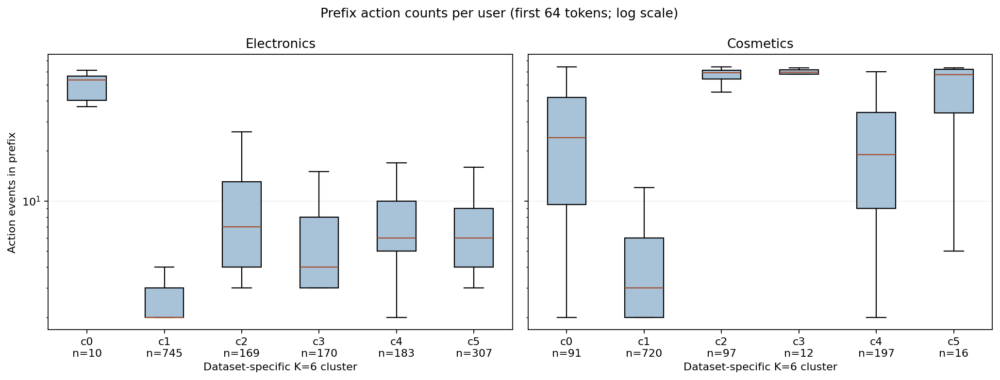
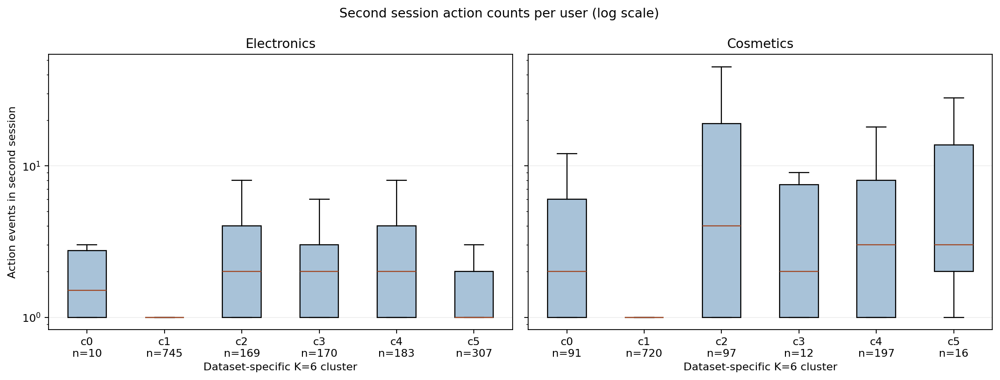

# 페르소나 내부 이질성: 행동·세션·재관측 간격

## 요약

Electronics와 Cosmetics의 기존 행동 군집 내부에는 **관측된 행동량, 장바구니·구매 행동 비중, 세션 길이, 다음 세션까지의 간격**이 서로 다른 사용자가 섞여 있다. 따라서 시뮬레이터에서 군집마다 하나의 고정 행동률이나 고정 세션 간격만 주는 것은 관측된 다양성을 표현하기에 부족할 수 있다.

다만 이것은 관측 가능한 차원의 탐색적 기술 결과다. 사용자 성향의 안정적인 개인차와 관측 기간·세션 분리·64토큰 절단·표본 선정 효과를 분리한 것은 아니다. 특히 재관측 간격 분석은 기존 페르소나 분류에 결과 이후 행동이 들어갈 수 있으므로 **미래정보 누출이 있는 사후 분석**이다. 페르소나별 방문 확률을 검증한 결과나 인과 효과로 사용하지 않는다.

## 1. 데이터와 단위

- 기존 데이터셋별 양방향 masked-GRU 임베딩과 K-means K=6을 재구성했다. K=6은 이질성을 조사하기 위한 기존 분할이며 최적 K라는 뜻은 아니다. Electronics와 Cosmetics의 같은 c 번호는 대응하지 않는다.
- 기존 보류 사용자 중 전체 이력에 2세션 이상인 사람: Electronics **1,584명**, Cosmetics **1,133명**. 후자는 `user_id % 100 == 0` 선행 표본이다. 두 표본 모두 전체 사용자 대표 표본이 아니다.
- prefix는 사용자별 앞 최대 64개 토큰이며 행동 토큰과 세션 경계 토큰을 포함한다. 아래 행동량·행동 비중은 경계 토큰을 제외한 행동 이벤트를 사용한다. 인코더 입력과 프로필 계산에 같은 prefix를 사용하므로 독립 검증이 아니다.
- 두 번째 세션 통계는 관측 세션 전체를 쓰며 prefix와 별개다. 세션은 사용자별 원본 session ID가 바뀌거나 이전 이벤트와 30분 초과 공백이 생기면 분리한다. 세션 종료는 마지막 기록 이벤트이며 실제 로그아웃이 아니다.
- 30일 간격 통계는 두 번째 세션 뒤 30일의 관찰 범위가 확보된 Electronics **1,299명**, Cosmetics **915명**이다. 추적 가능한 인원만 분모로 사용하며 나머지는 관찰 종료 시점 때문에 제외했다. 기록이 없다는 것은 실제 미방문이나 영구 이탈의 증명이 아니다.
- 기존 그룹별 인원과 prefix 내 각 행동 경험률을 재계산해 원래 K=6 결과와 일치하는지 확인했다. 단순 집계이며 재표본 신뢰구간이나 유의성 검정을 수행하지 않았다.

## 2. 전체 페르소나별 요약

prefix 행동량의 세 숫자는 사용자별 25·50·75백분위수다. 구매·장바구니 경험은 prefix에서 해당 이벤트가 한 번 이상 기록된 사용자 비율이다. 30일 재관측률은 30일 추적 가능 사용자만의 비율이다.

| 데이터·군집 | prefix 사용자 수 | prefix 행동량 Q1 / 중앙값 / Q3 | 장바구니 경험 | 구매 경험 | 30일 추적 가능 인원 | 30일 내 재관측 |
|---|---:|---:|---:|---:|---:|---:|
| Electronics c0 | 10 | 40.25 / 53.5 / 56.25 | 90.0% | 70.0% | 8 | 100.0% |
| Electronics c1 | 745 | 2 / 2 / 3 | 4.6% | 3.1% | 626 | 39.9% |
| Electronics c2 | 169 | 4 / 7 / 13 | 98.2% | 68.0% | 132 | 53.0% |
| Electronics c3 | 170 | 3 / 4 / 8 | 21.8% | 12.9% | 139 | 56.1% |
| Electronics c4 | 183 | 5 / 6 / 10 | 96.7% | 59.6% | 138 | 61.6% |
| Electronics c5 | 307 | 4 / 6 / 9 | 18.9% | 8.8% | 256 | 55.5% |
| Cosmetics c0 | 91 | 9.5 / 24 / 42 | 100.0% | 28.6% | 75 | 64.0% |
| Cosmetics c1 | 720 | 2 / 3 / 6 | 7.4% | 0.8% | 564 | 43.6% |
| Cosmetics c2 | 97 | 54 / 59 / 61 | 96.9% | 20.6% | 90 | 94.4% |
| Cosmetics c3 | 12 | 58 / 59.5 / 61.25 | 100.0% | 100.0% | 8 | 75.0% |
| Cosmetics c4 | 197 | 9 / 19 / 34 | 99.5% | 29.9% | 163 | 62.6% |
| Cosmetics c5 | 16 | 33.75 / 57.5 / 62 | 81.2% | 25.0% | 15 | 80.0% |

Electronics c0과 Cosmetics c3·c5는 매우 작아 비율이 불안정하다. Cosmetics c2의 97명 전원, Electronics c0의 10명 전원은 prefix가 64토큰 한도에 도달했다. 따라서 행동량의 실제 상단 분포가 그 범위 밖까지 얼마나 이어지는지 알 수 없다. 표의 군집 특성은 기존 [페르소나 요약](../artifacts/two-dataset-gru-clusters/PERSONA_SUMMARY.md)을 참고한다.

## 3. 행동량과 세션 길이





상자는 Q1~Q3, 선은 중앙값, 수염은 matplotlib 기본 1.5 IQR 규칙이다. 극단값 점은 가독성을 위해 표시하지 않았으며, 축은 로그 스케일이다. 분포 폭은 개인차에 더해 관측량 및 절단의 영향을 받는다. 세션 행동량은 해당 세션에서 관측된 이벤트 건수이지 체류 시간이나 만족도가 아니다.

예를 들어 Electronics c2의 prefix 행동량은 Q1 4개, 중앙값 7개, Q3 13개다. Cosmetics c0은 각각 9.5개, 24개, 42개다. 같은 Cosmetics c0의 두 번째 세션 행동량도 Q1 1개, 중앙값 2개, Q3 6개였다. 군집 단일 중앙값만으로 사용자의 모든 시퀀스 길이를 설명할 수 없다.

두 번째 세션의 기록된 첫 이벤트부터 마지막 이벤트까지의 시간 분포도 JSON에 별도 기록했다. 이벤트가 하나뿐인 세션은 0분이므로 실제 사용 시간이 0이라는 뜻이 아니고 로그 기반 체류 시간의 하한에 가깝다. 전체 데이터에 이 단일 세션 시점의 시간 길이를 일반화하지 않는다.

## 4. 사용자별 행동 구성

각 사용자의 prefix에서 장바구니 또는 구매 이벤트 수를 그 사용자의 prefix **전체 행동 이벤트 수**로 나누어 구간화했다. 막대는 각 구간에 속한 사용자의 비율이다. 이벤트 자체의 비율과 사용자별 비율은 분모가 다르다. 장바구니와 구매 그림은 별도로 계산했으므로 두 막대의 구간을 서로 더하면 안 된다.


Cosmetics c0의 경우 91명 모두 장바구니 행동이 적어도 하나 있었지만, 장바구니가 행동의 25% 이하는 16명, 25% 초과~50% 이하는 44명, 50% 초과는 31명으로 나뉜다. 같은 c0에서 구매가 기록되지 않은 사람은 65명, 기록된 사람은 26명이다. 즉 `장바구니 중심`이라는 요약은 같은 군집의 구매 경험이 같다는 뜻이 아니다.

Electronics c2에서는 169명 중 구매 미기록 54명, 구매 비율 0% 초과~25% 이하 70명, 25% 초과~50% 이하 39명, 50% 초과 6명이다. 이 비율은 prefix 내 행동 구성이지 다음 구매 확률이나 상품별 전환율이 아니다. 삭제 이벤트는 Cosmetics에서만 측정됐으므로 Electronics에 대해 0%라고 가정하지 않는다. 사용자별 삭제 존재 건수는 JSON에 기록했다.

## 5. 다음 세션까지의 간격


두 번째 세션의 마지막 기록 이후 다음 세션 첫 기록까지를 재고 `≤30분`, `30분 초과~1일`, `1~7일`, `7~30일`, `30일 내 미관측`으로 나눴다. 경계는 앞 구간의 오른쪽 끝을 포함한다. 각 막대의 분모는 **30일을 관찰할 수 있는 해당 군집 사용자**이고, 미관측을 한 범주로 명시했다. 30일이 지난 다음 세션 또는 기록 종료 뒤 실제 행동은 알 수 없다.

Electronics c5에서는 256명 중 24명이 30분 내, 68명이 그 이후 1일 내, 31명이 1~7일, 19명이 7~30일에 재관측됐고, 114명은 30일 내 미관측이었다. Cosmetics c4에서도 163명 중 32·33·23·14·61명으로 각 범주가 모두 나타났다.

동일 군집에서도 빠른 기록과 긴 공백이 함께 존재하지만 30분 내 재관측은 원본 세션 ID 변경에 따른 인위적 분할일 수 있다. 또한 기존 페르소나가 이후 행동을 포함할 수 있으므로 이 그림을 사전 페르소나별 재방문 예측이나 세션 분포의 검증 결과로 쓰지 않는다. 같은 조건에서 시나리오별 상세 비교는 [세션 간격 분석](PERSONA_SESSION_DELAYS.md)에 있다.

## 6. 시뮬레이터의 해석과 아직 알 수 없는 것

현재 결과를 근거로 설정할 수 있는 것은 **군집 내부에도 분포를 둔다는 설계 가설**까지다. 예를 들어 행동량·행동 선택·다음 세션 간격의 파라미터에 사용자 단위 차이를 추가할 수 있다. 그러나 각 분포는 서로 독립이라고 확인되지 않았고, 분포 모양·공분산·GMM 컴포넌트 수·개인별 파라미터를 위 그림만으로 식별한 것은 아니다. 관측 기간과 64토큰 한도를 반영하지 않은 채 이 수치를 바로 샘플러에 넣지 않는다.

여기서 다루지 못한 이질성에는 상품 및 가격 선호, 실제 휴식·오프라인 활동, 만족도, 쿠폰 노출과 개입에 대한 반사실적 반응이 포함된다. 두 데이터셋 간 사용자 ID도 연결되지 않는다. 따라서 '모든 잠재적 이질성'을 측정했다는 의미가 아니라, **현 보류 표본과 행동 로그에서 재현 가능한 주요 이질성**을 정리한 것이다.

후속 검증에서는 기준 시점 이전 prefix로만 페르소나를 만들고 시간·사용자 분리된 미래 행동을 측정해야 한다. 세션 ID 기반과 30분 timeout 기반 세션화를 비교하고, 관찰 종료를 처리하는 생존 분석을 검증해야 한다. 쿠폰이나 다른 충격의 개인차는 처치와 노출 시점이 확인되는 별도 데이터와 식별 가정이 필요하다.

## 7. 재현

```
PYTHONPATH='.:src:/Users/kimdaewon/Desktop/캡스톤디자인' \
OPENBLAS_NUM_THREADS=1 OMP_NUM_THREADS=1 \
/opt/anaconda3/bin/python scripts/analyze_persona_heterogeneity.py
```

재현에는 로컬 원본과 저장된 임베딩, 기존 K=6 결과 및 직전 간격 분석 JSON이 필요하다. 데이터셋별 집계는 `artifacts/persona-heterogeneity/{electronics,cosmetics}.json`, 그래프는 `research/figures/heterogeneity/`에 있다. 결과 JSON에는 개인 ID를 저장하지 않는다. 원본 및 파생 데이터의 논문 이용·재배포 조건은 별도 확인이 필요하다.
