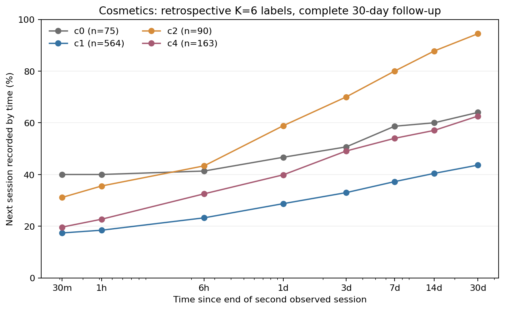

# 페르소나별 세션 간격과 세션 내 행동의 관측적 분석

## 결론 및 핵심 경고

기존 K=6 행동 군집을 사후적으로 붙여 두 번째 관측 세션 이후의 간격을 살펴보면, 30분 이내의 매우 짧은 간격부터 수일 이상에 걸친 간격까지 함께 관찰된다. 30일 내 다음 세션이 기록되지 않는 사용자도 상당하다. 다만 이 값들을 **시뮬레이터의 페르소나별 다음 방문 분포로 그대로 사용해서는 안 된다.**

기존 군집은 처음 최대 64개 토큰을 보고 결정되므로 두 번째 세션 뒤 행동이 군집 입력에 포함될 수 있다. 전체 기록에서 2세션 이상인 사용자를 사후 선별한 점도 있다. 따라서 시간적 미래정보 누출과 선택 편향이 있으며, 군집별 차이는 예측·인과 효과로 사용할 수 없다. 여기서는 분포 형태를 점검하기 위한 사후 기술 통계로만 제시한다.

## 분석 정의

- Electronics와 Cosmetics별 기존 masked-GRU 임베딩, 사용자 분할, K-means K=6을 재구성했다. 보류 사용자별 각 군집 인원은 기존 집계와 일치한다.
- 사용자의 두 번째 관측 세션 마지막 이벤트부터 세 번째 관측 세션의 첫 이벤트까지가 간격이다. 한 사용자당 한 번 측정한다. 첫 세션→두 번째 세션 간격도 같은 방식으로 측정한다.
- 두 번째 세션 이후 30일 전체를 기록 가능한 사용자만 분석한다. Electronics 1,584명 중 1,299명, Cosmetics 1,133명 중 915명이다. 나머지 285명과 218명은 관찰기간 부족으로 제외했다. 마지막 이벤트 시각을 데이터 관찰 종료로 근사하며 실제 로깅 완전성은 미확인이다.
- 세션은 이전 이벤트와 30분 초과 공백이 있거나 원본 session ID가 바뀌면 분리한다. 따라서 **30분 미만 간격도 존재하며**, 특히 ID 변경으로 나뉜 세션이 독립적인 실제 방문인지는 알 수 없다. 종료 시각은 마지막 이벤트이며, 별도 로그아웃이나 30분 timeout 종료 시점이 아니다. 기존 `session-return-evaluation`의 시간 정의와 다르다.
- 30일 재관측률의 분모는 해당 군의 30일 추적 가능 사용자 전체다. 간격 사분위수는 **30일 안에 재관측된 사용자만**의 값이다. 재관측되지 않은 사람을 30일이나 무한대 간격으로 넣지 않았다.

## 데이터셋별 페르소나 분포




곡선은 30분, 1시간, 6시간, 1·3·7·14·30일의 누적 재관측 비율을 연결한 것이다. 중간 시점의 정확한 분포, 이탈률 또는 쿠폰 효과를 나타내지 않는다. 군집당 관측 가능 인원이 30명 미만이면 그래프에서는 제외하되 아래 표에 남겼다. 축은 로그 시간 축이다.

| 데이터·군집 | 기존 기술적 특징 | 30일 추적 가능 인원 | 30분 내 다음 세션 | 7일 내 | 30일 내 | 30일 내 재관측자의 간격 중앙값 |
|---|---|---:|---:|---:|---:|---:|
| Electronics c0 | 소수의 긴 이력 | 8 | 0.0% | 100.0% | 100.0% | 18.3시간 |
| Electronics c1 | 짧은 조회 중심 | 626 | 14.4% | 36.4% | 39.9% | 3.4시간 |
| Electronics c2 | 장바구니·구매 혼합 | 132 | 19.7% | 44.7% | 53.0% | 1.7시간 |
| Electronics c3 | 조회 중심 혼합 | 139 | 18.7% | 51.1% | 56.1% | 1.8시간 |
| Electronics c4 | 장바구니·구매 혼합 | 138 | 24.6% | 56.5% | 61.6% | 1.6시간 |
| Electronics c5 | 반복 조회 중심 | 256 | 9.4% | 48.0% | 55.5% | 7.6시간 |
| Cosmetics c0 | 반복 장바구니 | 75 | 40.0% | 58.7% | 64.0% | 0.08시간 |
| Cosmetics c1 | 짧은 조회 중심 | 564 | 17.4% | 37.2% | 43.6% | 3.7시간 |
| Cosmetics c2 | 긴 조회·장바구니·삭제 | 90 | 31.1% | 80.0% | 94.4% | 11.5시간 |
| Cosmetics c3 | 소수의 구매 관측 | 8 | 25.0% | 62.5% | 75.0% | 2.1시간 |
| Cosmetics c4 | 조회·장바구니 혼합 | 163 | 19.6% | 54.0% | 62.6% | 3.9시간 |
| Cosmetics c5 | 소수의 혼합 이력 | 15 | 26.7% | 73.3% | 80.0% | 1.2시간 |

예를 들어 Electronics c5의 30일 내 재관측자 142명에서 간격의 25·50·75백분위수는 각각 0.87·7.61·72.76시간이다. 하지만 256명 중 114명은 30일 내 재관측되지 않았다. 반환자 중앙값만으로 전체 사용자의 방문 간격을 대표하면 안 된다. Cosmetics c0의 짧은 0.08시간 중앙값은 별도 실제 방문이라기보다 세션 ID 경계에 민감할 수 있다. 서로 다른 데이터셋의 c 번호는 동일 유형이 아니며 표본 구성도 달라 수치를 직접 정렬하면 안 된다.

## 세션 행동별 시나리오: 충격이 아니라 관측적 조건

두 번째 세션에 구매가 있으면 `purchase`, 구매 없이 장바구니 추가 또는 삭제가 있으면 `cart_or_remove_no_purchase`, 나머지 조회만 있으면 `view_only`로 분리했다. 시나리오별 30일 재관측 비율은 다음과 같다. 점 옆 숫자는 각 조건의 사용자 수이고, 군집·조건별 인원이 20명 미만인 점은 표시하지 않았다.


| 데이터·군집 | 조회만 | 장바구니/삭제, 구매 없음 | 구매 기록 |
|---|---:|---:|---:|
| Electronics c2 | 39/41 (95.1%) | 12/33 (36.4%) | 19/58 (32.8%) |
| Electronics c4 | 28/59 (47.5%) | 19/31 (61.3%) | 38/48 (79.2%) |
| Cosmetics c0 | 28/39 (71.8%) | 18/29 (62.1%) | 표본 20명 미만 |
| Cosmetics c2 | 41/43 (95.3%) | 39/42 (92.9%) | 표본 20명 미만 |
| Cosmetics c4 | 56/76 (73.7%) | 43/70 (61.4%) | 표본 20명 미만 |

다른 군집·시나리오의 전체 건수와 분위수는 JSON에 남겼다. 이 수치들은 가령 구매가 방문을 늦추거나 당긴다는 **충격의 효과가 아니다**. 군집에 이후 행동이 반영되고, 각 세션 행동을 선택한 사용자 집단이 서로 다르며, 표본이 작고 조건부 선택이 있다. 특히 Electronics c2의 큰 차이를 효과 방향으로 해석하거나 그대로 시뮬레이터에 주입하지 않는다.

참고로 동일 사용자의 첫→두 번째 간격과 두 번째→세 번째 간격을 비교하는 계산도 저장했다. 예를 들어 Electronics c5·조회만에서 30일 내 다음 세션이 기록된 125명은 첫 간격 중앙값 6.9시간, 다음 간격 중앙값 11.1시간이었다. 두 번째 간격이 더 긴 사람은 65/125명이다. **다음 세션이 기록된 사람만 선택한 값**이므로 전체 c5의 간격 증가율은 아니며, 중앙값 차이는 사용자별 변화량의 중앙값도 아니다.

## 쿠폰 충격에 관하여

Electronics·Cosmetics에는 이 분석에 사용할 쿠폰 배정·수령 기록이 없어, 이들 페르소나에서 쿠폰 전후의 세션 간격 변화는 측정할 수 없다. 별도 Tianchi 분석은 조용한 14일 후 쿠폰 수령 기록 유무와 7·28일 내 클릭/구매 기록을 비교하지만, 여기의 GRU 페르소나나 동일한 세션 경계와 연결되지 않는다. 자발적 수령 가능성·추가 쿠폰·기록 누락도 남는다. [쿠폰·재활동 분석](COUPON_REACTIVATION_AND_LATE_PATTERNS.md)의 차이는 쿠폰 개입이 간격을 단축했다는 증거가 아니다.

## 시뮬레이터 설계에 적용할 수 있는 것과 없는 것

- **가능한 가설:** 짧은 공백과 긴 공백, 30일 관측 창을 넘어가는 사례를 표현하는 유연한 간격 분포를 시험한다. 세션 ID 변경만으로 생긴 짧은 간격은 별도 세션화 민감도 분석에서 확인한다.
- **아직 불가:** 위 군집별 곡선을 미래 행동 예측 분포로 그대로 사용하거나, 구매·쿠폰의 간격 변화 계수와 페르소나별 인과효과로 확정하는 것.
- **필요한 검증:** 세션 기준 시점까지의 prefix만으로 페르소나를 만들고 이후에 할당된 holdout 사용자·시간에서 평가한다. 30분 timeout 단독과 session ID 혼합 규칙을 비교하고, 30일을 넘어가는 우측 검열을 다루는 생존/위험 모형 및 장기 예측을 검증한다. 개입 충격에는 시점·발송·노출·대조군이 있는 데이터가 별도로 필요하다.

## 재현

```
PYTHONPATH='.:src:/Users/kimdaewon/Desktop/캡스톤디자인' \
OPENBLAS_NUM_THREADS=1 OMP_NUM_THREADS=1 \
/opt/anaconda3/bin/python scripts/analyze_persona_delays.py electronics cosmetics
```

집계: `artifacts/persona-delays/electronics.json`, `artifacts/persona-delays/cosmetics.json`. 집계에는 사용자 ID를 저장하지 않는다. 로컬 원본·기존 임베딩이 필요하고 데이터 공개·재배포 권리는 별도 확인해야 한다.
