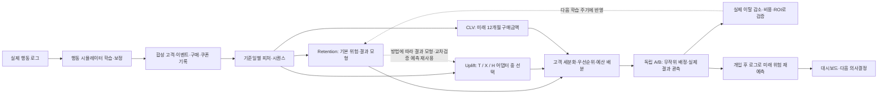

# 코드베이스 분석 및 Retention Model 구현 방향

작성일: 2026-11-04

개정 내용: 팀원 PDF 대조, 18개 설계 질문 검토와 YAGNI 검토를 반영했다. 먼저 §0의 요구사항/미확정 제안/보류 범위를 읽는다. §11의 상세 스키마는 확장 시의 참조 계약이며 전부를 즉시 구현하라는 요구가 아니다. 단일 source of truth와 CLV의 D 직접 예측은 유지한다. 문서에 제안한 retention 학습·평가는 아직 구현·실험 완료 상태가 아니다.

## 0. 현재 적용할 최소 범위와 설계 상태

### 0.1 과제 필수사항과 미확정 제안을 구분한다

| 구분 | 내용 | 현재 판단 |
| --- | --- | --- |
| 과제 요구 | 피처 30개 이상 정의·산출, 변화율 5개 이상, RFM·구매 주기·세션 품질·시간대·여정·시퀀스 피처 | 구현하되 모든 후보를 최종 모델에 강제로 넣지 않음 |
| 과제 요구 | 트리 모델 2종 이상, 불균형 처리, 5-fold·튜닝, AUC≥0.78, SHAP | 누출 없는 동일 평가 조건에서 충족 |
| 과제 요구 | LSTM 또는 Transformer, 동일 테스트 비교, 앙상블 실험 | 둘 다 구현할 필요 없음; 개선 없는 앙상블은 배포하지 않아도 됨 |
| 미확정 제안 | 30일 미방문, 90일 관측·누적 이력, 모든 7/14/30/90일 집계 | 실험으로 확정된 값이 아님. 타깃·대상·정책을 먼저 합의 |
| 미확정 제안 | 고객 단위 CV만을 기본 평가로 사용 | 기존 고객 미래 예측의 시간 평가와 보지 못한 고객 평가를 구분해야 함 |
| 미확정 제안 | 신규 고객 통합 모델, 별도 확률 보정, 결과 모형/OOF 공유 | 단순안부터 평가하고 필요할 때 추가 |
| 팀 비교 계획 | T/X/H 비교 후 선택 | 공통 입력·출력만 우선 합의. H 정의 미확정 상태에서 구현을 지어내지 않음 |

과제에서 이탈 정의는 설정 가능해야 하며 30일 미방문으로 고정되어 있지 않다. 기존 생성기의 NO_RETURN_30D와 연결하기 쉽다는 이유로 제안했지만, 매출 목적에 더 적절하다는 근거는 없다. 미구매 타깃도 비교하되 처음부터 둘을 모두 운영하지 않는다. 최근 활동 고객의 유지와 장기 휴면 고객의 재활성화를 구분하고, 적격 조건을 과거 정보로 사전 고정한다.

### 0.2 지금 필요한 단순 구현과 확장 참조의 경계

| 지금 유지 | 필요할 때 추가 | 지금 하지 않을 것 |
| --- | --- | --- |
| 원천 사실·정책·실험 기록과 공통 시간 경계 | 상세 registry·여러 context 테이블 | 파트별 입력과 검증 기록을 서로 다른 생성 과정으로 만듦 |
| 불변 데이터 릴리스·고객·기준일·설정/모델 버전 | 독립 feature_view/prediction UUID 서비스 | 모든 버전·ID를 예측 피처로 사용 |
| 관측 종료·생성 절단과 미확정 라벨 구분 | 지연 도착·수정 원장의 revision 조회 | 존재하지 않는 업무 지연·환불 흐름을 인위적으로 구현 |
| 재현 가능한 작은 학습·평가 파이프라인 | 신규 전용 모델·많은 시간 창·별도 보정기 | 성능 확인 없이 후보 피처 전부 유지 |
| T/X/H별 작은 fit/predict 계약 | 공통 학습 모형·OOF 캐시 | 범용 모델 공유 플랫폼을 먼저 구축 |

복원할 수 없는 이벤트 순서·발생 시각·실제 쿠폰 결정은 저장한다. 원천에서 다시 계산할 수 있는 90일 집계·임베딩·분류표는 필요성이 생길 때 만든다. 물리 파일 수·서비스 수는 논리 테이블 수와 같을 필요가 없다.

최소 릴리스는 `dataset_id + customer_id + as_of`와 실행 설정·고정 분할로 관리할 수 있다. snapshot_id가 팀 조인에 편하면 결정적으로 생성한다. 데이터셋 자체가 불변이면 별도 source_data_version은 같은 manifest에 묶을 수 있다. 독립 prediction/feature/context ID는 복수 실행을 관리해야 할 때 도입한다. 의미·기간·통화·정책을 재현할 정보는 생략하지 않는다.

지연·수정이 없다면 available_at=발생 시각, 즉시 확정이면 confirmed_at=주문 시각으로 선언할 수 있다. 불변 확정 행으로 시작하고 revision 처리는 실제 수정 기능 도입 시 추가한다. 세션 종료 전 최종 길이를 사용하지 않는 규칙은 그대로 지킨다.

### 0.3 피처·평가를 단순화하되 정확성을 낮추지 않는다

초기 후보는 최근성·최근 30일 수준·최근 14일 대 이전 14일 변화·이력 충분성이다. 이 기간도 검증용 시작안이다. 90일/누적은 구매 주기·희소성 또는 같은 평가 표본에서의 개선이 확인되면 추가한다. 누적은 as_of 이전의 실제 관측 이력이며 미래를 포함한 사용자 평균이 아니다.

완전 관측 무행동은 0, 기록 누락은 null/coverage 불완전, 구매 1회로 간격 계산 불가는 null/has_gap=0, 짧은 이력은 실제 관측 길이로 구분한다. 변화율은 분모 0 상태와 원래 횟수를 보존하고, 작은 분모의 폭증은 검증한 최소 표본·평활화·절단으로 다룬다. 현재 gross 매출은 고정 판매가치×구매 세션 수이므로 독립 정보가 아니며 평균 주문금액·정확한 구매 주기는 주문 원장 보강 후 의미를 확인한다.

최근성 단독·상수 확률·작은 로지스틱 기준선을 먼저 비교한다. AUC 0.78은 과제 기준이며 실제 서비스 일반화·확률 보정·쿠폰 인과효과의 증명이 아니다. 다른 seed와 도메인/정책 변화 평가는 서로 다른 강도의 검증이다. 생성 난이도를 점수에 맞춰 바꾸지 않는다.

기존 고객 미래 예측은 시간 분리를 주 평가로 제안하고, 고객 분리 평가는 미관측 고객 일반화로 별도 보고한다. 같은 고객의 과거 이력이 입력에 있는 것 자체가 누출은 아니다. 평가 기준시각 전에 확정되지 않은 학습 라벨과 경계를 넘는 학습 결과 창은 제외한다. 평가 행끼리 결과 구간이 겹치면 고객 의존성을 고려하며 독립 표본처럼 불확실성을 계산하지 않는다.

최종 테스트를 먼저 고정한다. 개발 데이터 내부에서 제한된 5-fold/시간 검증으로 피처·모델·Early Stopping·튜닝을 선택한다. 고정 평균 앙상블부터 실험하고, 보정 상태가 나쁠 때 보정기를 추가한다. 개발 검증을 여러 선택에 쓰면 선택 지표는 낙관적일 수 있으므로 검색 범위를 제한하고 최종 테스트를 선택에 쓰지 않는다. 모든 선택마다 별도 데이터베이스·서비스를 만들 필요는 없다.

별도 보정기는 기본 모델 학습과 분리된 예측·라벨로 적합한다. 튜닝·보정 방식·결합 가중치·임계값 선택도 모두 학습 절차에 포함된다. 엄격한 downstream OOF가 필요하면 바깥 행을 제외한 안쪽 데이터에서 이 선택을 수행한다. 단순 전처리 fold 분리만으로 전체 절차가 OOF가 되는 것은 아니다. OOF를 쓰지 않는 경로에 미리 생성하지 않는다.

시퀀스는 최근 N개·시간 간격·세션 경계·mask와 마지막 활동 이후 시간을 사용한다. N과 표현은 검증 후보다. 기존 masked-GRU는 행동 복원/군집화용이며 retention DL 완성본이 아니다. 같은 고객 테스트의 ML/DL 비교는 시스템 비교이고, 순서의 추가 가치는 순서 제거/섞기 등 보조 비교로 확인한다. 임베딩과 군집의 동시 사용을 자동 필수로 보지 않는다.

### 0.4 정책·가치 결합에서 남겨야 할 제한

목표 미발송 위험은 '이번 한 번 미발송'이 아니라 합의한 미래 구간의 추가 미발송 조건이다. 과거 유효 쿠폰과 이후 사용은 남길 수 있으며 과거 노출 상태를 기록한다. 현재 주별 무작위 패널은 이후에도 쿠폰이 올 수 있어 이 조건과 같지 않다. 첫 구현은 동일 모집단의 고객 단위 정책 무작위 배정과 명시적인 후속 발송 규칙이 단순하다. 주별 무작위도 유효한 설계지만 다른 효과·정책을 추정한다.

공통 데이터/라벨/분할 공유가 우선이며 학습된 모델 공유는 선택이다. T는 두 결과 모형의 차이, X는 추가 효과 회귀의 결과를 사용한다. H의 내부 확률 해석은 정확한 정의 확인 후 결정한다. Y=1 이탈이면 외부 uplift 부호는 Y(0)−Y(1)로 통일한다.

CLV는 D에서 미래 구매금액을 직접 예측하며 retention 점수를 필수 입력으로 추가하지 않는다. 기본 위험은 세분화·층화용이며 uplift×CLV에 다시 곱할 필수 항이 아니다. 과제의 uplift×CLV는 서로 다른 기간·무조건부 기대금액을 연결하는 근사 점수다. 유지 조건부 가치가 필요한 정확한 가치식과 동일하다고 주장하지 않는다. 실제 증분 이익은 실험의 매출·비용으로 별도 검증하고 할인 후 매출에서 할인액을 재차 차감하지 않는다.

SHAP은 '예측 점수 기여 요인'이며 실제 이탈 원인·쿠폰 악영향의 증거가 아니다. 사후 위험 점수 변화 역시 원래 A/B의 실제 효과를 대신하지 않는다.

### 0.5 구현 전 합의할 다섯 가지

1. 주 타깃·기간·적격 고객: 미방문/미구매와 신규/유지/휴면의 범위.
2. 쿠폰 비교 조건: 과거 유효 쿠폰, 이후 추가 발송, 무작위 정책 배정과 실제 실행.
3. 원천의 시간·구매 단위: 관측 종료·절단, 구매 세션/주문·금액, 공통 고객 키.
4. 평가·선택 경계: 기존 고객 미래/미관측 고객, 라벨 성숙, 튜닝·보정·OOF·최종 테스트.
5. 파트 간 출력·단계별 완료 기준: 확률·효과·CLV의 조건/단위와 근사 목적함수 해석.

복잡한 기능의 도입 조건은 과제 필수사항, 실제 오류 해결, 또는 같은 독립 평가에서의 의미 있는 성능·보정·집단별 안정성 개선 중 하나다. 해당하지 않으면 보류한다.

## 1. 핵심 결론

이 프로젝트의 목표는 **이탈할 고객을 예측하고, 쿠폰을 보내면 실제로 유지될 고객을 찾아, 제한된 예산으로 고객의 미래 가치를 최대한 확보하는 시스템**을 구축하는 것이다.

현재 저장소는 **고객 행동을 생성하는 연구용 시뮬레이터가 중심**이다. 과제용 retention 예측, CLV, 예산 최적화, 대시보드는 앞으로 연결해야 한다.

Retention model은 **시뮬레이터가 생성한 과거 로그를 받아 미래 이탈 확률을 예측하는 모듈**로 구현한다. Uplift와는 같은 결과 정의·기간을 공유하며, 방법에 따라 무쿠폰·쿠폰 조건의 결과 모형을 연결하거나 재사용한다. 최종 uplift가 반드시 두 retention 확률의 단순 차이로 계산되는 것은 아니므로, **기본 이탈 위험과 최종 효과 추정치를 구분해 제공**한다. 생성기 내부의 lifecycle이나 쿠폰 반응 유형을 그대로 입력하거나 맞히는 모델로 구현하면 안 된다.

**A/B 테스트에서는 실제 유지·이탈 결과로 예측 uplift와 발송 전략을 검증해야 한다.** 쿠폰 이후 retention 모델로 위험 점수를 다시 계산하는 것도 유용하지만, 그 점수의 감소 자체가 쿠폰의 인과효과를 입증하지는 않는다.

> 검토 범위: 파일 목록 전체와 소스·테스트 구조, 요구사항, 연구 문서, DOCX 원고를 조사하고 주요 실행 경로를 확인했다. PDF 원문 전체와 이미지·압축본 내부를 모두 개별 판독한 것은 아니다. 아래 내용은 코드와 문서의 정적 분석이며, 학습·실험 결과를 직접 재현한 것은 아니다. 기존 수치는 문서에 기록된 실험 결과와 현재 실행 가능 상태를 구분하여 해석해야 한다.

## 2. 전체 시스템의 목적과 구조



각 모듈이 답하는 질문은 다르다.

| 모듈 | 질문 |
| --- | --- |
| Retention / churn | 지정된 쿠폰 정책 아래에서 이 고객이 앞으로 이탈할 확률은 얼마인가? |
| Uplift | 같은 개입 전 고객 상태에서 쿠폰 유무에 따라 이탈 확률이 얼마나 달라지는가? |
| CLV | 이 고객의 향후 구매금액은 얼마나 되는가? |

이탈 위험이 높더라도 쿠폰에 반응하지 않으면 좋은 발송 대상이 아니다. 이탈 위험이 낮은 고객에게 보내면 원래 발생할 구매에 할인비만 지출할 수 있다. 따라서 **이탈 예측 성능과 마케팅 전략의 수익성은 별도로 평가**해야 한다.

기능별 디렉터리는 분리할 수 있지만 학습 문제까지 완전히 독립적인 것은 아니다. T-learner는 결과 모형의 예측 차이, X-learner는 결과 모형과 효과 회귀, H-learner는 확정할 정의에 따른 효과 추정을 담당한다. 세 방법은 공통 입력·출력을 사용하고 내부 학습 과정은 각 어댑터가 소유한다. 개입 전 retention 점수는 별도로 실험 층화·세분화에 사용한다.

위 도식은 제안하는 연결 구조다. 점선은 선택적 재사용을 뜻한다. Uplift는 학습 시 같은 개입 전 X₀와 배정 A·실제 결과 Y·배정 확률을 받으며, 추론 시에는 개입 전 X₀만으로 효과를 반환한다. 결과 모형을 내부적으로 학습해도 된다. 별도 retention 예측값을 모든 learner의 필수 입력으로 요구하지 않는다. **D → G의 CLV 직접 예측은 유지하며 E → G 연결은 추가하지 않는다.**

근거 문서:

- [상세 요구사항](docs/request.md)
- [요약 명세](docs/request_specification.md)
- [모델별 최소 입력 정리](simulator_etc/Additional.md)

## 3. 현재 구현 상태

| 위치 | 역할·상태 |
| --- | --- |
| `simulator_etc/src/analysis/persona/` | 행동 시퀀스 표현 학습, 군집화, 행동 변화·세션 간격 분석 |
| `simulator_etc/src/analysis/irl/persona.py` | 페르소나별·사용자별 행동 효용과 재방문 모형 학습 |
| `simulator_etc/src/simulate/` | 고객 생성, 세션 행동, 재방문 간격, 쿠폰 반응, 정책 평가 환경 |
| `simulator_etc/src/analysis/uplift/` | 관측 쿠폰 로그 분석 및 생성기용 쿠폰 반응 보정 |
| `simulator_etc/src/models/agents.py` | UCB·TS·LinUCB·LinTS·PPO·SAC 정책 |
| 최상위 `retention/`, `clv/`, `uplift/` | 작업 공간은 있으나 후속 시스템 구현은 대부분 비어 있음 |
| `features/`, `final_strategy/`, `dashboard/` | 역할 설명 중심 |
| `config/*.yaml` | 현재 비어 있음 |

이미 완성된 이탈 예측 시스템을 수정하는 상황이라기보다, **연구용 생성기를 기반으로 과제 시스템을 구축하는 상황**이다.

### 실행·재현 관점에서 확인한 차이

- README에 나오는 `src/preprocessing/`이 현재 소스 경로에는 없다.
- 일부 테스트·과거 분석은 현재 소스에 없는 모듈을 import한다. 해당 구현 일부는 `build/lib/`에만 남아 있다.
- 실행에 필요한 원자료·학습 JSON·체크포인트가 현재 체크아웃에는 없다.
- 요구사항의 통합 실행 진입점과 Docker 구성도 아직 마련되지 않았다.

따라서 문서의 실험 완료 기록과 이 체크아웃에서 즉시 실행 가능한 상태를 구분해야 한다. `build/lib/`를 현재 소스의 기준으로 간주해서도 안 된다.

## 4. 시뮬레이터의 작동 원리

### 4.1 기본 행동 성향: home persona

Cosmetics 로그에서 masked 양방향 GRU로 48차원 행동 표현을 만들고 군집화한다. 현재 생성기의 기본 home persona는 다음 세 종류다.

| Persona | 의미 |
| --- | --- |
| P0 | 구매와 장바구니 행동이 섞인 구매 혼합형 |
| P2 | 여러 세션에 걸쳐 장바구니 수정이 반복되는 장기 검토형 |
| P3 | 장바구니 행동이 많고 구매 전환이 낮은 유형 |

짧은 조회형 군집은 신규·이탈 진행 등이 섞여 있다고 보고, 고정 persona 대신 lifecycle로 다룬다. 기본 persona와 시간에 따라 변하는 활동 상태를 분리하는 구조다.

### 4.2 세션 내부 행동 선택

선택지는 `view`, `cart`, `remove`, `purchase`, `end`다.

과거 행동으로 상태를 만들고 사용자별 효용을 계산한 뒤 softmax로 다음 행동을 샘플링한다.

```text
P(a | s, u) = softmax_a(θ[u,a]ᵀ φ(s) + 상태·쿠폰 보정항)
```

이때 IRL은 고객의 행동 선택을 설명하는 **생성기 내부 모형**이다. 미래 고객 이탈을 예측하는 retention classifier와 역할이 다르다.

### 4.3 세션 종료 후 상태·방문 간격 갱신

내부 상태에는 다음 값이 포함된다.

- engagement
- friction
- satiation
- inactivity momentum
- gap acceleration
- habit strength

다음 방문은 다음 구간 또는 `NO_RETURN_30D`로 샘플링한다.

```text
0–1시간 / 1–6시간 / 6–24시간 / 1–3일 / 3–7일 / 7–14일 / 14–30일
NO_RETURN_30D
```

`NO_RETURN_30D`의 의미는 30일 이내 미복귀다. 이 관측 정의 자체가 영구 이탈을 뜻하는 것은 아니다. 다만 현재 생성기의 일부 lifecycle 종료상태는 흡수상태로 처리되므로, 장기 데이터에서의 해석은 생성 로직과 함께 확인해야 한다.

관련 구현: [latent_session_model.py](simulator_etc/src/simulate/latent_session_model.py)

### 4.4 쿠폰 반응

고객 생성 시 쿠폰 반응 유형을 샘플링하고 수령 이력에 따라 구매·복귀 효용을 바꾼다.

| 유형 | 현재 쿠폰 보정 |
| --- | --- |
| Persuadable | 양의 보정 |
| Sleeping dog | 음의 보정 |
| Sure thing | 0 |
| Lost cause | 0 |

시간이 지나면 효과가 감소하고, 반복 노출의 추가 효과는 감소한다. 쿠폰 효과를 0으로 두면 기본 행동 모형으로 환원된다.

이를 [SessionCouponEnv](simulator_etc/src/simulate/campaign.py)에 연결하여 장기 쿠폰 정책을 비교한다.

실제 로그의 역할도 구분되어 있다.

- Cosmetics: 세션 행동과 무쿠폰 행동 구조의 학습
- Electronics: 공통 행동 패턴 확인과 도메인 보정
- Tianchi: 쿠폰 반응의 관측적 보정 목표

Tianchi의 수령·비수령 차이는 무작위 실험으로 식별한 인과효과가 아니다. 생성기의 쿠폰 반응은 관측 결과를 참고한 합성 가정과 보정을 포함한다.

## 5. Retention 설계에 직접 영향을 주는 문제

### 5.1 생성기 내부 정보와 관측 가능한 피처를 분리해야 한다

`EXIT`, `next_lifecycle_state`, `gap_token`, 다음 방문 시각은 미래 결과에 해당할 수 있다. 이를 입력에 넣으면 미래를 미리 알려주는 문제가 생긴다.

Home persona, canonical type, 사용자 효용계수도 생성기가 알고 있는 값이다. 실제 서비스에서 과거 로그만으로 알아낼 수 있는 정보와 같지 않다.

기본 원칙은 다음과 같다.

> 운영 시점에 과거 로그로 계산할 수 있는 정보만 입력한다.

행동 군집이 필요하다면 생성 시 부여한 persona를 가져오는 대신 기준일까지의 로그로 추정한다. 생성기 내부 변수는 별도 진단이나 oracle 비교에만 사용하고, 운영용 기본 모델과 구분한다.

### 5.2 네 쿠폰 유형은 엄밀한 개인별 잠재결과 정답과 다르다

코드에서 ST와 LC는 모두 쿠폰 offset이 0이다. 따라서 이름만으로 항상 구매와 절대 미구매가 보장되는 구조는 아니다.

Canonical type용 latent와 행동 효용계수도 별도로 샘플링한다. 따라서 **같은 persona 안에서 개입 전 행동만으로 쿠폰 반응 차이를 얼마나 구별할 수 있는지** 확인해야 한다.

Downstream uplift의 성공 여부를 생성기 유형 맞히기 정확도로 평가하면 안 된다. 무작위 실험 결과를 이용한 증분 효과 평가가 중심이어야 한다.

### 5.3 현재 출력은 후속 학습에 충분하지 않다

[합성 데이터 생성 함수](simulator_etc/scripts/run_agent_benchmark.py)의 출력은 현재 주 단위 구매·세션·쿠폰 집계 중심이다.

- DL에 필요한 이벤트 순서·시각·세션 경계가 보존되지 않는다.
- 상품 catalog와 실제 주문금액 연결이 아직 없다.
- 쿠폰은 고객별 고정 Treatment/Control이 아니라 매주 확률적으로 선택된다.

따라서 현재 출력만으로 요구사항의 DL·CLV·고객 단위 A/B 실험을 모두 충족하기 어렵다.

이는 모든 후속 개발을 중단해야 한다는 뜻은 아니다. CLV의 주간 집계 기준선은 현재 데이터로 시작할 수 있다. 상세 원천을 사용하는 최종 정확 날짜 평가와의 차이는 §11.13에 정리한다.

### 5.4 미복귀율과 고객 이탈률은 구분해야 한다

다음 값은 분모와 시간 기준이 서로 다르다.

- 세션 종료 후 30일 미복귀율
- 특정 기준일의 고객 이탈 비율
- 연간 이탈 고객 비율

연구 문서의 미복귀율이 15~25% 범위에 들어오더라도 과제의 고객 이탈률 조건을 충족했다고 단정할 수 없다. 평가 모집단·기준일·기간을 먼저 고정해야 한다.

## 6. Retention 예측 문제의 권장 정의

아래는 기존 연결을 설명하는 **미확정 시작안**이다. 30일 미방문·90일 관측이 최적이라는 실험 근거는 없다. §0에 따라 주 타깃·적격 고객·정책을 먼저 합의하고, 처음부터 미방문/미구매 두 모델을 모두 운영하지 않는다.

| 항목 | 제안 |
| --- | --- |
| 예측 단위 | 고객 × 기준일 |
| 실행 주기 | 주 1회 |
| 관측 구간 | 단순 후보는 최근 30일 수준+최근/이전 14일 변화. 90일·관측 누적은 개선 확인 시 추가 |
| 기본 예측 기간 | 기준일 이후 30일 |
| 기본 정답 | 이후 30일 동안 방문이 없으면 이탈 1 |
| 기본 위험의 조건 | 공통 과거 이력 이후, 결과 구간에 추가 쿠폰을 발송하지 않는 조건 |
| 쿠폰 조건의 비교 | 기준일에 10% 쿠폰 1회 발송 후, 같은 결과 구간에 추가 발송하지 않는 조건 |
| 설정 가능한 대안 | 향후 N일 미구매, 향후 N일 미방문 |
| 대상 고객 | 과거 정보로 적격 조건 사전 고정. 최근 활동 고객 유지와 장기 휴면 재활성화 구분 |
| 신규 고객 | 통합 모델+이력 길이/결측 지시자로 시작해 집단별 검증. 별도 모델은 필요 시 추가 |

```text
Y[u,t] = 1  if 고객 u가 [t, t+30일)에 방문하지 않음
         0  otherwise

입력: 기준일 t까지 확인 가능한 기록
정답: 기준일 t 이후의 지정된 결과 구간
```

필드 계약의 시간 경계는 §11.3에 따라 입력 `[t−관측기간,t)`, 결과 `[t,t+예측기간)`으로 고정한다. 정확히 t의 새 행동은 이번 예측의 입력에서 제외하고 결과 구간에 포함한다. 기존 `inactivity_label`은 종료 경계가 이 정의와 다를 수 있으므로 원칙만 재사용하고 경계 처리를 계약에 맞춰 조정해야 한다.

**현재 이미 30일 동안 방문하지 않은 상태**와 **앞으로 30일 동안 방문하지 않을 결과**를 구분해야 한다. 전자는 현재 상태 판정이고 후자가 예측 문제다.

관측 종료 때문에 이후 30일을 확인할 수 없는 행은 정답 미확정으로 처리한다. 기존 [inactivity_label](simulator_etc/src/analysis/eda.py)의 검열 처리 원칙을 재사용할 수 있다.

방문을 기본 타깃으로 제안하는 이유는 현재 생성기의 재방문 구조와 직접 연결되기 때문이다. 구매 이탈은 별도 타깃으로 지원하되 방문 이탈과 성능을 섞어 보고하지 않는다.

위 쿠폰 조건은 첫 실험을 단순하게 만드는 제안이다. 미발송 조건이 과거에도 쿠폰을 전혀 받지 않은 고객을 뜻하는 것은 아니다. 과거 노출과 잔존효과는 기준일 이력에 기록하고, 두 조건은 기준일 이후의 발송만 다르게 한다. 반복 발송을 평가할 때는 한 번의 쿠폰 효과 대신 사전에 정의한 발송 정책 전체의 효과로 예측·평가 대상을 확장한다.

과거·현재 정책을 명시하지 않고 처리군과 대조군을 합쳐 학습하면, 해당 데이터의 정책 혼합 아래에서의 위험을 예측할 수 있다. 이를 무쿠폰 위험이라고 해석하면 안 된다.

## 7. 피처 설계

피처는 **활동 수준과 활동 변화**를 함께 표현해야 한다. 최근 방문 수만으로는 원래 방문이 드문 고객과 갑자기 방문을 줄인 고객을 구분하기 어렵다.

아래는 후보군이며 모든 기간·산식을 의무 채택하는 목록이 아니다. 과제의 피처 정의·산출 최소 개수와 종류는 충족하되, 최종 모델에는 단순 기준선 대비 추가 가치가 확인된 피처를 선택한다. 원천은 보존하고 파생 창·복잡한 표현은 필요 시 추가한다.

| 피처군 | 대표 피처 |
| --- | --- |
| Recency | 마지막 방문·구매·장바구니 이후 일수 |
| Frequency | 최근 7·14·30·90일 세션·주문·활동일 수 |
| Monetary | 할인 전후 구매금액, 평균 주문금액 |
| 변화율 | 최근 14일 / 이전 14일 방문·구매·금액 비율 |
| 방문 주기 | 과거 평균·중앙 방문 간격, 최근 간격 변화 |
| 구매 주기 | 현재 미구매 일수 / 과거 평균 구매 간격 |
| 세션 품질 | 세션당 조회 수, 세션 길이, 구매 전환율 |
| 장바구니 | 추가·제거 수, 미전환 장바구니 지표 |
| 쿠폰 이력 | 과거 발송·사용 수, 사용률, 마지막 발송 이후 시간 |
| 시간대 | 주말 활동 비중, 활동 시간대 |
| 고객 여정 | 가입 후 일수, 첫구매 여부, 반복 구매 단계 |
| 시퀀스 | 최근 이벤트 표현, 과거 로그로 추정한 행동 군집 |

시퀀스에는 **마지막 이벤트부터 기준일까지의 경과시간**도 제공해야 한다. 같은 `view → cart`라도 마지막 활동이 어제인지 한 달 전인지에 따라 위험도가 달라진다.

구매가 없거나 세션이 하나뿐인 고객의 평균 주기는 0으로 채우기보다 결측 처리와 다음 지시자를 함께 제공한다.

```text
has_purchase_history
has_gap_history
history_length_days
```

변화율의 분모가 0인 경우와 관측 이력 자체가 부족한 경우도 구분해야 한다. 최종 피처는 요구사항에 따라 30개 이상을 정의하고 피처 딕셔너리에 산식·관측 기간·결측 처리·의미를 기록한다.

### 개입 전 피처와 개입 후 피처의 용도

- Uplift 학습과 이번 실험의 대상 선정에는 **개입 전 스냅샷 X₀**만 사용한다. 과거 쿠폰 이력은 포함할 수 있지만 이번 개입 이후 방문·구매·쿠폰 사용 결과는 넣지 않는다.
- 개입 후 새로운 기준일의 retention 재예측에는 그 시점까지 확인된 행동과 쿠폰 이력을 사용할 수 있다. 이 예측은 새로운 미래 구간의 위험이며, 원래 실험의 개입 전 예측과 구분하여 저장한다.
- 개입 후 위험 점수가 낮아진 고객만 골라 원래 A/B 효과를 계산하면 개입으로 달라진 변수를 기준으로 집단을 다시 고르는 문제가 생긴다. 실험의 주 분석은 최초 배정 집단을 유지한다.

## 8. ML·DL 구현 방향

### 8.1 ML: LightGBM + CatBoost

트리 모델 2종을 비교하여 요구사항을 충족하고 집계 피처의 기준 성능을 마련한다.

필수 작업:

- 클래스 가중치 적용
- 5-fold 검증과 하이퍼파라미터 튜닝
- 최종 테스트 ROC-AUC ≥ 0.78 확인
- PR-AUC, Precision, Recall, F1 병행 보고
- SHAP 전역 중요도·고객별 설명
- 확률 보정 상태 확인·필요 시 보정기 적용, 임계값 분석

AUC는 순위 성능이다. 최종 의사결정에 확률을 사용할 것이므로, 예측 확률 0.8인 고객이 실제로 어느 정도 이탈하는지 등 **확률의 신뢰도**도 평가해야 한다.

### 8.2 DL: 이벤트 시퀀스 LSTM

```text
최근 이벤트 종류 임베딩
+ 이벤트 간 시간 간격
+ 세션 경계
        ↓
      LSTM
        ↓
마지막 활동 이후 경과시간 + 집계 피처
        ↓
      분류기
        ↓
   미래 이탈 확률
```

가변 길이 시퀀스의 패딩을 처리하고 활동 이력이 없는 고객도 지원한다. Early Stopping을 적용하고 학습 로그와 체크포인트를 저장한다.

기존 `MaskedGRU`는 **가린 행동 복원과 군집화용**이다. 구조를 참고할 수 있지만 현재 그대로는 미래 이탈을 학습한 모델이 아니다. 과제에서 요구하는 LSTM 또는 Transformer도 별도로 충족해야 한다.

가변 길이 시퀀스 처리 참고: [PyTorch pack_padded_sequence](https://docs.pytorch.org/docs/main/generated/torch.nn.utils.rnn.pack_padded_sequence.html)

### 8.3 앙상블

같은 검증셋에서 ML·DL 예측의 가중 평균 앙상블을 실험한다. 가중치는 검증 데이터로 선택하고, 개선이 없으면 단일 모델을 선택한다. ML·DL은 반드시 동일한 테스트 고객·기준일·정답에서 비교한다.

### 8.4 Retention 결과 모형을 uplift에 연결

최종 알고리즘을 지금 선택하지 않는다. 팀원이 T-learner·X-learner·H-learner를 동일 조건에서 비교하고, 검증 결과에 따라 선택할 수 있도록 입력·출력과 학습 부품을 먼저 합의한다. 아래는 구현 예정 구조이며 현재 코드에 어댑터를 추가했다는 뜻은 아니다.

#### 8.4.1 공통 결과·부호와 역할

```text
X₀: 개입 전 고객 피처
A: 고객 단위 무작위 배정, 0=Control, 1=Treatment
Y: 결과 구간의 실제 이탈 여부, 1=이탈
e(X₀): Treatment 배정 확률

mu0(X₀) = E[Y(0) | X₀]
mu1(X₀) = E[Y(1) | X₀]
uplift(X₀) = E[Y(0) - Y(1) | X₀]  # 양수면 이탈 감소
```

문헌·라이브러리가 통상적인 Y(1)−Y(0)를 반환하면 어댑터 경계에서 한 번만 부호를 뒤집는다. 모델 학습과 Qini·정책 평가까지 같은 부호를 유지한다. 배정 A는 모델 입력용 일반 행동 피처와 구분한다.

| 부품 | 책임 |
| --- | --- |
| Features | 같은 스냅샷·피처 버전·고객 분할 제공 |
| Retention / outcome provider | 기본 이탈 위험, 선택적으로 mu0·mu1 모형과 확률 예측 제공 |
| Uplift adapter | T/X/H별 학습 단계 실행, 공통 부호의 최종 uplift 제공 |
| Evaluator | 같은 데이터·예산·추정 대상에서 후보 비교 |
| Final strategy | 기본 위험·최종 uplift·CLV를 계약으로 받아 세분화·예산 배분 |

분류기는 `fit`·`predict_proba`를, 효과 회귀기는 `fit`·`predict`를 지원하도록 역할을 나눈다. 모델 종류나 공유 가중치는 고정하지 않는다. 전처리와 신경망 표현도 fold 안에서 학습하고 추론 아티팩트에 포함한다.

#### 8.4.2 T-learner와 호환되는 구조

```text
Control의 (X₀,Y)   → outcome model 0 → mu0
Treatment의 (X₀,Y) → outcome model 1 → mu1
같은 X₀에 대한 uplift = mu0 - mu1
```

서로 독립적인 모델 인스턴스를 사용한다. Retention 결과 모형을 재사용할 때는 학습 고객·기간·발송 조건·피처·fold가 일치하는지 확인한다. 한 군에서 성능이 좋은 모델이 다른 군에서도 최적이라는 보장은 없다. 두 결과 모형의 오류가 차이에서 누적될 수 있으므로 이탈 AUC만으로 T-learner를 선택하지 않는다.

#### 8.4.3 X-learner와 호환되는 구조

초기 결과 모형 두 개 외에 **연속 효과를 예측하는 회귀기 두 개와 결합 가중치**를 수용한다. 프로젝트의 이탈 감소 부호로 정의하면 다음과 같다.

```text
1단계: Control/Treatment에서 mu0, mu1 학습
2단계: 처리군 의사효과 d1 = mu0(X₀) - Y
       대조군 의사효과 d0 = Y - mu1(X₀)
3단계: 처리군 (X₀,d1) → effect regressor 1 → t1(X₀)
       대조군 (X₀,d0) → effect regressor 0 → t0(X₀)
4단계: uplift = g(X₀) * t0(X₀) + (1-g(X₀)) * t1(X₀)
```

표준 결합 선택지로 g=e를 지원하고 실제 적용 규칙을 설정에 기록한다. 무작위 실험에서는 실험 설계의 배정 확률을 사용한다. 전체 1:1이면 e=0.5이고 층별 배정률이 다르면 해당 확률을 사용한다. 관측 자료의 propensity 추정은 별도 확장이며 기존 Tianchi 관측 자료를 후속 모델의 직접 학습 자료로 바꾸지 않는다.

의사효과는 실제 개인 효과 정답이 아니고 0/1 라벨도 아니다. 효과 단계에 이진 분류·SMOTE·이탈 클래스 가중치를 그대로 적용하지 않는다. 초기 결과 모형의 mu0−mu1은 진단값일 뿐 **X-learner 최종 uplift와 동일하다고 강제하지 않는다.**

결과 모형·효과 회귀·가중치·전처리와 의사효과 생성 설정을 보존해야 재현 가능한 추론이 된다. 학습 예측은 아래 공통 분할 규칙과 실제 재사용 경로에 맞춰 만들며 필요 시 OOF를 사용한다. 모든 중간 행을 상시 캐시할 필요는 없다.

T/X의 정의 근거: [Künzel 등의 원 논문](https://arxiv.org/abs/1706.03461). 이 문서의 부호·인터페이스·검증 방식은 프로젝트 계약이다.

#### 8.4.4 H-learner와 호환되는 구조와 정의 확인

**팀원이 뜻한 H의 논문·구현은 아직 확인되지 않았다.** 조사에서 확인한 후보는 Liang 등의 [Hybrid Meta-learners](https://arxiv.org/html/2506.13680v1)다. 아래는 그 Hybrid 정의에 대한 호환안이며 팀의 알고리즘을 확정한 것이 아니다. 다른 정의라면 공통 계약은 유지하고 H 어댑터 내부를 조정한다.

해당 Hybrid는 초기 결과 모형으로 의사결과를 만들고, 두 함수 f0·f1을 결과 적합과 효과 적합을 함께 고려해 학습한다. 문헌의 이탈 증가 부호를 쓰면 다음 형태다.

```text
z: Y(1)-Y(0) 방향의 의사결과
loss = (1-lambda) * factual_loss(Y, fA(X₀))
       + lambda * ((f1(X₀)-f0(X₀))-z)^2
최종 프로젝트 uplift = f0(X₀)-f1(X₀)
```

f0·f1은 효과 추정을 위한 중간 함수이며 **보정된 이탈 확률이라고 가정하지 않는다.** 이 구분과 두 목적의 결합이 원 논문에서 확인한 핵심이다.

호환을 위한 프로젝트 설계는 다음과 같다.

- 초기 결과·의사결과 제공부와 최종 공동학습부를 분리한다.
- 공동 손실을 지원하는 학습기 자리를 둔다. 트리 두 개를 독립 학습하는 T 구조만으로 H가 구현됐다고 표시하지 않는다.
- 정확한 H 정의 확인 후 `algorithm_reference`, 의사결과 방식, lambda 범위·선택 기준, 손실·출력 제약을 설정에 고정한다.
- 이진 이탈 문제에 쓸 손실과 확률 해석의 적합성을 확인한다. 연속 결과 연구의 성능을 그대로 보장한다고 가정하지 않는다.
- 정의 확인 전에는 H를 미구현/정의 확인 상태로 표시한다. 선택된 실행에서 지원하지 않는 H를 요청하면 명시적으로 실패시키며 T나 X로 몰래 대체하지 않는다.

#### 8.4.5 같은 외부 인터페이스, 서로 다른 내부 출력

```python
# 제안 계약이며 현재 존재하는 API가 아니다.
fit(batch, split_plan, outcome_provider=None)
predict_uplift(X_pre) -> effect_predictions
save(path)
load(path)

# 결과 확률을 지원하고 검증한 구현에만 제공
predict_outcomes(X_pre) -> outcome_predictions
```

`batch`에는 X₀·A·Y·배정 확률과 고객·실험·스냅샷 식별자가 들어간다. `outcome_provider`는 fold별 결과 모형/예측을 선택적으로 재사용하는 통로다. 최종 효과를 만들기 위해 내부에서 결과 모형을 학습해도 된다.

필수 효과 출력은 `uplift_score`이고, 기준일·기간·부호·방법·버전·적격 모집단을 함께 저장한다. 확률 출력은 별도 기능으로 선언한다.

| 방법 | 최종 효과 | 확률 출력의 취급 |
| --- | --- | --- |
| T | mu0−mu1 | 확률 모형이면 mu0·mu1을 제공하고 군별 보정 확인 |
| X | 효과 회귀 두 개의 가중 결합 | 초기 mu0·mu1은 별도 결과 모형의 확률이며 최종 효과와 구분 |
| H: Hybrid 후보 | f0−f1 | 중간 f를 위험 확률로 노출하지 않음; 별도 결과 모형 사용 |

세분화가 요구하는 `baseline_churn_probability`는 공통으로 지정한 retention 결과 모형에서 받는다. 최종 uplift 모델이 위험 확률을 제공하지 않아도 동작해야 한다. 비교 중에는 같은 기본 위험 모형을 사용해 learner 교체 효과를 확인한다.

`p1 = p0 - uplift_score`로 가상의 처리 확률을 만들지 않는다. 서로 다른 추정기의 값은 범위·보정·일관성이 보장되지 않는다. 최종 효과가 mu0−mu1과 다른 X/H를 이 식에 맞추려고 변형하지 않는다. `predict_outcomes`를 지원하지 않는 경우 확률은 누락 상태와 출처를 명시한다.

#### 8.4.6 분할·재사용·아티팩트 규칙

학습/검증/테스트와 고객·시간 경계를 먼저 고정한다. 의사결과나 학습 모형을 공유할 때 실제로 필요한 경로에 고객 분리 OOF 또는 명시적인 표본 분할을 적용한다. 표준 X는 반대 군의 결과 모형으로 의사효과를 만들므로 대상 행이 초기 반대 군 모형의 직접 학습 표본이 아닌 특성이 있다. 추가 교차 적합은 선택·보정·재사용 경계를 통제하는 설계이며 모든 X 단계의 동일한 필수조건으로 주장하지 않는다. Hybrid는 정확한 정의에 따라 표본 분할을 정한다. 전처리·모형은 해당 학습 부분에서 적합하고 미래 미확정 정답을 제외하며 필요한 군·클래스의 지지 표본을 확인한다.

이 OOF 규칙은 프로젝트에서 채택할 누출 방지 방식이다. T-learner 자체가 반드시 교차 적합을 요구한다는 뜻은 아니다. T/X 초기 모형을 재사용할 때도 split ID·학습 고객·정답 관측 시점이 일치해야 한다.

최종 재학습은 선택된 다단계 학습 절차를 보존한다. OOF 예측과 전체 학습 모형을 섞어 추론할 경우 모델 조합·평균 규칙을 기록한다. 기본 확률과 달리 효과 예측에는 무조건 sigmoid를 적용하지 않는다. 확률의 클래스 가중치·재표집을 썼다면 원래 실험 분포에서 별도 보정하며, 효과 단계와 평가 데이터에는 같은 처리를 자동 전파하지 않는다.

모델별 저장 항목은 피처·정답·분할 버전, 학습 설정, 결과 모형, 효과 모형, 공동학습 가중치, 전처리, 결합 규칙, 검증 결과 및 난수 seed다. 모든 learner에 필요 없는 부품을 강제로 만들지 않는다.

#### 8.4.7 후보 비교와 선택을 설정으로 분리

`config/uplift.yaml`에 다음 항목을 둘 수 있도록 계약만 정한다. 현재 파일에 설정이나 구현을 추가하는 작업은 별도다.

```yaml
candidate_learners: [t, x, h]
selected_learner: null  # 비교 전에는 미정
effect_definition: churn_reduction
outcome_model_provider: retention_or_internal
split_plan_id: null
t: {}  # 두 결과 모형 설정
x: {}  # 결과 모형, 효과 회귀기, 결합 규칙 설정
h:
  definition_status: pending_confirmation
  algorithm_reference: null
```

어댑터는 공통 계약에 맞춰 하나씩 구현하고, 실제 준비 상태를 기록한다. H 정의가 미확정이면 그 사유를 보고하며 비교 완료로 처리하지 않는다. S-learner는 설명 가능한 기존 방식이지만 이번 합의의 필수 비교 후보에는 자동 추가하지 않는다.

## 9. 데이터 분할과 평가

고객별로 여러 주의 스냅샷을 만들 때 행 단위 무작위 분할을 하면 같은 고객의 유사한 이력이 학습·테스트에 함께 들어갈 수 있다.

| 평가 단계 | 원칙 |
| --- | --- |
| 5-fold 모델 선택 | 과제 요구. 반복 고객의 의존성을 고려하고 운영 목적에 맞는 그룹/시간 검증 선택 |
| 기존 고객 미래 평가 | 이후 시점 스냅샷 평가. 학습 시점에 미확정인 라벨·경계를 넘는 학습 결과 창 제거 |
| 미관측 고객 평가 | 고객/잠재 고객 그룹을 분리한 일반화 성능을 별도 보고 |
| 독립 생성 평가 | 다른 seed로 생성한 고객에서도 확인 |
| ML·DL 비교 | 동일한 고객·기준일·정답 목록 사용 |

전처리·피처 선택·임베딩 학습도 학습 데이터 경계 안에서 수행해야 한다. 예측 기간에 맞춰 학습 정답의 관측 완료 시점과 평가 기준일 사이의 경계를 관리한다.

고객 그룹과 시계열 자료에 일반 무작위 검증을 적용할 때의 문제는 [scikit-learn 교차검증 문서](https://scikit-learn.org/stable/modules/cross_validation.html)를 참고한다.

성능은 전체 평균 외에도 다음 집단별로 확인한다.

- 신규 / 기존 고객
- 이력 길이
- 구매 경험 여부
- 시간 구간

**AUC 목표를 맞추기 위해 생성기에 단순한 이탈 규칙을 추가하면 안 된다.** 생성 규칙을 쉽게 복원하는 모델이 만들어질 수 있다.

### 9.1 예측 조건과 관측 조건을 맞춘다

무쿠폰 위험 p0를 예측한 고객에게 쿠폰을 보내 이탈하지 않았다면 이를 곧바로 p0의 오예측으로 세면 안 된다. 예측한 조건과 실제 적용한 조건이 다르다.

- p0의 예측 성능은 동일한 미발송 조건의 Control에서 평가한다.
- p1의 예측 성능은 동일한 발송 조건의 Treatment에서 평가한다.
- 처치 여부를 입력받는 결과 모형은 실제 배정 조건에 대응하는 예측으로 관측 라벨과 비교한다.
- 고객별로는 두 잠재결과를 동시에 관측할 수 없으므로 실제 라벨 하나로 개인 uplift의 정답을 만들지 않는다.

### 9.2 세 가지 평가와 운영 재예측을 구분한다

| 구분 | 질문 | 평가 기준 |
| --- | --- | --- |
| Retention 예측 평가 | 지정된 조건 아래 미래 이탈을 잘 예측했는가? | 실제 이탈 라벨 대비 AUC·PR-AUC·확률 보정 |
| Uplift 평가 | 효과가 큰 고객을 찾고 효과 크기를 잘 예측했는가? | 독립 무작위 데이터의 Qini/AUUC, 개입 전 점수 구간별 예측·관측 효과 비교 |
| 발송 정책 A/B 평가 | 모델을 이용한 대상 선정·발송 전략이 유리한가? | 실제 유지율·매출·비용·ROI의 배정 집단 간 차이 |
| 개입 후 retention 재예측 | 현재 상태에서 다음 기간의 위험은 얼마인가? | 새로운 기준일의 위험 점수, 이후 결과가 확정되면 별도 예측 성능 평가 |

모델 학습·튜닝에 사용한 실험 자료에서 관측 차이를 맞췄다는 이유만으로 최종 효과 검증을 완료하지 않는다. 개발용 무작위 데이터와 최종 독립 실험 또는 평가 표본을 구분한다.

### 9.3 T/X/H 비교에서 같은 조건을 유지한다

| 항목 | 공통 규칙 |
| --- | --- |
| 학습·검증 표본 | 같은 고객·기준일·X₀·배정 A·결과 Y·배정 확률, 같은 분할 계획 |
| 모델 선택 | 검증 데이터의 uplift·정책 지표로 선택하고 최종 테스트는 선택 후 사용 |
| 기본 위험·CLV | 같은 기본 위험 모형과 같은 CLV 예측을 고정하여 비교 |
| 지표·부호 | 양수=이탈 감소; Qini/AUUC 구현과 정규화·동점 처리 규칙 고정 |
| 비용·예산 | 같은 10% 쿠폰·발송 제한·비용 모델·예산 시나리오 |
| 계산 자원 | 튜닝 횟수·시간·seed·학습/추론 비용을 보고 |
| 불확실성 | 같은 seed 묶음과 고객 단위 재표집으로 차이의 안정성 확인 |

이탈 Y를 사용하는데 평가 라이브러리가 양의 반응을 높이는 효과를 전제한다면 R=1−Y로 변환해 평가한다. R에 대한 처리군−대조군 효과는 프로젝트의 이탈 감소 부호와 일치한다. 결과 정의와 효과를 함께 변환하고 부호를 두 번 뒤집지 않는다. 배정률이 1:1이 아니거나 층별로 다르면 알려진 배정 확률을 반영하는 평가를 사용한다.

Qini/AUUC와 함께 사전에 정한 상위 k%의 실제 이탈 감소, 점수 구간별 효과 보정, 예산별 정책 가치를 확인한다. 관측된 효과는 해당 구간 안의 무작위 군 비교로 추정하고 표본 수·신뢰구간을 보고한다. 모델이 선택한 처리군 고객의 결과 평균만으로 후보를 비교하지 않는다. 오프라인 정책 가치는 배정 확률을 활용하는 IPW 등 공통 추정기로 비교할 수 있으며, 최종 확증은 독립 정책 A/B에서 수행한다.

우승 기준은 테스트를 보기 전에 정한다. 예를 들어 합의한 예산에서의 검증 정책 가치를 주 기준으로, Qini/AUUC·보정·계산 비용을 보조 기준으로 사용한다. 불확실성이 커서 우열이 명확하지 않으면 동률 또는 판단 보류로 기록하고 단순성·비용 기준을 적용한다. **결과 모형 AUC가 가장 높은 방법을 uplift 우승 모델로 자동 선택하지 않는다.**

현재 생성기의 canonical type이나 단일 반사실 샘플을 실제 CATE 정답으로 간주하지 않는다. PEHE 등 참효과 지표는 별도로 정의·추정한 시뮬레이터 참조건부 효과가 확보된 경우의 보조 분석으로만 사용한다.

## 10. Retention·Uplift·CLV 연결

### 10.1 같은 결과 정의에서 이탈 위험과 증분 효과를 연결한다

쿠폰이 섞인 전체 로그로 이탈 모델을 학습하면 대체로 **해당 데이터에 적용된 쿠폰 정책 아래의 위험**을 예측한다.

고객 선정에는 보통 다음 값을 구분해야 한다.

```text
p0(x) = P(Y(0)=1 | X₀=x): 지정된 미발송 조건의 이탈 확률
p1(x) = P(Y(1)=1 | X₀=x): 지정된 발송 조건의 이탈 확률

Retention uplift(x) = p0(x) - p1(x)
Retention probability under A=a = 1 - pa(x)
```

Y=1은 이탈이며, X₀는 동일한 개입 전 고객 상태다. 두 조건의 모집단·기준일·결과 정의·기간을 맞춘다. 무작위 실험에서는 배정과 실제 개입의 관계, 집단 간 간섭 부재 등 실험 조건을 확인한 뒤 관측 결과로 이 효과를 추정한다.

양의 uplift는 이탈 감소이자 유지율 증가를 의미한다. 결과를 유지 여부 R=1−Y로 정의하면 E[R(1)−R(0)|X₀=x]와 같다. 따라서 이탈 위험 모형과 유지율 uplift는 같은 결과를 서로 다른 관점에서 다루는 연결된 학습 문제다.

위 식은 추정 대상의 관계다. T는 예측 p0−p1을 최종 효과로 사용하지만 X/H의 최종 효과를 별도 retention 예측의 차이와 같게 강제하지 않는다. 실제 전략 입력은 `baseline_churn_probability`와 `uplift_score`로 분리하고 각 출처를 기록한다.

| 가상 고객 | 무쿠폰 이탈 확률 p0 | 쿠폰 이탈 확률 p1 | 예상 이탈 감소 |
| --- | --- | --- | --- |
| A | 70% | 45% | +25%p |
| B | 70% | 68% | +2%p |
| C | 20% | 30% | −10%p |

위 수치는 관계를 설명하는 예시다. A와 B는 기본 이탈 위험이 같지만 예상 쿠폰 효과가 다르다. Retention 점수만으로 발송 여부를 결정할 수 없으며 uplift는 이 차이를 구분한다.

반복 쿠폰에는 잔존 효과가 있으므로 Control의 과거 쿠폰 노출도 관리해야 한다. 매주 무작위 쿠폰을 보내는 정책 패널과 한 번의 개입 효과를 추정하는 실험은 서로 다른 데이터 설계다.

**14일 구매 uplift를 30일 유지 효과처럼 사용하면 안 된다.** 최적화에 사용할 결과 정의와 기간을 맞춰야 한다.

### 10.2 개입 전 retention 점수로 대상 선정·실험을 설계한다

개입 전 retention 점수는 위험도 파악, 위험도별 무작위 층화 배정, 위험도별 효과 분석, uplift·CLV와의 우선순위 결정에 사용한다.

고위험 고객에게 쿠폰을 보내고 저위험 고객을 Control로 삼으면 원래 위험이 달라 직접 비교할 수 없다. 고위험 고객이 대상이라면 같은 고위험 모집단 안에서 무작위 배정한다. 그 실험 결과의 적용 범위도 우선 해당 모집단으로 한정한다.

기본 위험도가 높아야만 발송하도록 강하게 제한하면 중간 위험이지만 쿠폰 효과가 큰 고객을 놓칠 수 있다. 위험도 조건은 명시적인 정책 선택으로 기록하고, 독립 실험으로 그 정책의 가치를 확인한다.

### 10.3 A/B에서는 실제 retention 결과로 예측 uplift를 검증한다

첫 효과 검증 실험은 다음 순서로 구성한다.

1. 이탈 정의·기준일·대상 모집단·쿠폰 조건·결과 기간을 사전 고정한다.
2. 개발 데이터로 학습한 retention·uplift 모델과 대상 선정 규칙을 고정한다.
3. 독립 실험 고객의 개입 전 X₀, 기본 이탈 위험과 출처, 최종 uplift와 learner 버전을 저장한다. p0·p1은 확률을 제공하는 결과 모형이 있을 때 별도 출처와 함께 저장한다.
4. 동일 모집단 안에서 고객 단위로 Treatment/Control을 무작위 배정한다. 필요하면 개입 전 위험도 구간으로 층화한다.
5. 실제 발송·사용 기록을 남기고 두 군을 동일한 30일 구간 동안 추적한다.
6. 실제 방문·구매 로그로 확정된 이탈 라벨을 만들고 최초 배정 집단 기준으로 비교한다.
7. 실제 이탈 감소·95% 신뢰구간·p-value·비용을 보고하고 예측 효과와 비교한다.

예를 들어 Control 이탈률이 30%, Treatment 이탈률이 20%라면 실험에서 추정한 이탈 감소는 **10%p**, 유지율 증가는 **10%p**다. 이는 실제 결과의 차이이며 모델 점수 차이로 대체하지 않는다.

전체 평균과 함께 개입 전 uplift 점수의 상위 구간·위험도 구간 등 사전에 정한 집단에서 예측 평균 효과와 실제 배정군 간 효과를 비교한다. 집단별 표본 수와 불확실성도 제시한다. 결과를 본 뒤 유리한 집단만 고르는 분석은 탐색 결과로 구분한다.

필요 표본 수는 목표 최소 효과, 기초 이탈률, 유의수준 0.05와 목표 power 0.8 이상을 기준으로 사전에 산정한다. 고객 수가 요구사항의 최소 규모를 충족한다는 이유만으로 모든 세부 집단의 검정력이 확보되는 것은 아니다.

쿠폰 사용 고객만 Treatment로 남기지 않는다. 발송 배정과 사용은 다르므로 최초 무작위 배정 기준의 효과(ITT)를 주 분석으로 두고, 실제 발송·사용률을 별도 보고한다. 미발송·오염이 있으면 p0·p1의 계약이 배정 효과인지 실제 수령 효과인지 구분해야 하며, 단순 배정군 비교로 사용 효과까지 식별했다고 주장하지 않는다.

### 10.4 쿠폰 효과 실험과 최종 발송 정책 실험을 구분한다

| 실험 | 두 군의 차이 | 확인할 내용 |
| --- | --- | --- |
| 쿠폰 효과 검증 | 같은 대상 집단에서 쿠폰 발송 배정 vs 미발송 배정 | 예상 retention uplift가 실제 효과와 일치하는가? |
| 발송 정책 검증 | 모델 기반 대상 선정·발송 정책 vs 미발송 또는 기존 정책 | 전체 정책이 유지율·비용·ROI를 개선하는가? |

정책 검증에서는 공통 적격 모집단을 먼저 무작위로 나눈다. 모델 정책군 안에서 선택된 고객에게만 발송하더라도, 주 분석은 두 정책에 배정된 전체 고객을 기준으로 한다. 정책군의 발송자만 다른 군 전체와 비교하면 선택 편향이 생긴다. 비교 정책·예산 조건을 명시하고 실제 지출도 보고한다.

### 10.5 개입 후 retention 재예측은 새로운 미래 위험을 추적한다

쿠폰 이후 방문이 늘어 모델 점수가 70%에서 40%로 바뀌어도 쿠폰의 인과효과가 30%p라는 뜻은 아니다.

- 쿠폰이 없어도 고객이 돌아왔을 수 있다.
- 최근 방문이 피처에 반영되면서 점수가 낮아질 수 있다.
- 일시적인 방문이 장기 유지로 이어지지 않을 수 있다.
- 기준일이 바뀌면 예측하는 미래 30일 구간도 달라진다.

```text
개입 전후 예측 점수 차이 ≠ 같은 기간의 잠재결과 간 쿠폰 인과효과
```

개입 후 점수는 상태 추적과 다음 의사결정에 사용한다. 이때 새 기준일까지의 쿠폰 이력과 이후 발송 정책을 반영할 수 있는 모델을 사용하고, 원래 A/B의 확정 이탈 라벨과 구분한다. 무쿠폰 학습 모형을 개입 후 이력에 적용하는 경우에도 그 조건에서 예측이 보정되어 있는지 별도 검증해야 한다.

실험 중 모델·대상 선정 규칙을 결과에 맞춰 변경하지 않는다. 반복 발송과 재예측으로 다음 행동을 정하고 싶다면 해당 갱신 규칙을 포함한 정책을 미리 정해 실험한다. 결과가 확정된 뒤 다음 모델 버전의 재학습·보정에 반영한다.

참고: [Causal Inference and Uplift Modelling](https://proceedings.mlr.press/v67/gutierrez17a.html), [Online Experimentation with Surrogate Metrics](https://arxiv.org/abs/2106.01421). 모델 위험 점수는 실제 retention을 대신하는 대리 지표로 자동 인정하지 않는다.

### 10.6 예산 최적화

요구사항의 다음 목적함수에서 시작할 수 있다.

```text
Maximize Σ uplift[i] × CLV[i] × action[i]

Subject to:
Σ cost[i] × action[i] ≤ budget
action[i] ∈ {0, 1}
```

`uplift × CLV`는 증분 가치를 근사하는 가정이다. CLV에 이미 이탈 위험이 반영되었다면 이탈 확률을 다시 곱해 중복 반영하지 않도록 해야 한다.

비용도 구분한다.

- 발송 비용
- 실제 쿠폰 사용 시 발생하는 할인 비용

기존 정책 환경은 두 비용 조건을 별도 실험으로 다룬다. 최종 시스템에서는 요구사항에 맞춰 두 비용의 기록·계산 계약을 명확히 해야 한다.

## 11. 공통 데이터와 API 계약

**시뮬레이터는 원천 사실과 생성·개입 메타데이터를 제공하고, 공통 데이터/feature 파트가 기준일별 입력·정답을 구성한다.** Retention이 원천 데이터의 중간 전달자가 되는 구조는 피한다. Retention·uplift·CLV는 같은 데이터 릴리스를 직접 사용하고 필요한 피처만 각자 선택·확장한다.

다음 기록을 별도 논리 테이블로 관리한다. 상세 타입·키·필수 여부는 §11.2 이하를 기준으로 한다.

- 고객
- 이벤트
- 세션
- 주문
- 쿠폰 발송·사용·만료
- 실험 배정
- 고객 × 기준일 스냅샷

고객 ID, 기준 시각, 시간대, 예측 기간, 금액 단위, 데이터·피처·모델 버전이 파트 간에 일치해야 한다. 생성기 내부 진단 정보는 학습 입력과 구분한다.

Retention 출력은 최소한 다음 정보를 포함한다.

```text
customer_id
as_of
target_definition
horizon_days
prediction_policy
churn_probability
model_version
feature_version
```

`prediction_policy`는 무쿠폰 위험인지 특정 운영 정책 아래의 위험인지 구분하는 값이다.

Uplift와 A/B 연결을 위해 추가로 다음 계약을 정의한다.

| 기록 | 필수 정보 |
| --- | --- |
| 개입 전 예측 | 고객·기준일·X₀ 스냅샷 ID·기본 위험·최종 uplift·각 출처/버전·결과 정의·기간·개입 조건; p0·p1은 제공 시에만 기록 |
| 실험 배정 | experiment_id·최초 배정군·배정 시각·배정 확률·층화 구간·정책 버전 |
| 실행 기록 | 실제 발송·사용 시각, 추가 쿠폰 노출, 발송비·할인액 |
| 실제 결과 | 결과 구간 시작·종료, 실제 이탈 여부, 라벨 확정 여부·정의 버전 |
| 사후 재예측 | 새로운 기준일·예측 기간·관측 쿠폰 이력·미래 정책 조건·점수·모델 버전 |

고객별 실제 이탈 라벨은 그 고객에게 적용된 조건의 결과다. 이를 개인의 두 잠재결과나 개인별 실제 uplift로 저장하지 않는다. 관측 uplift는 비교 가능한 무작위 집단에서 추정한 효과로 보고한다.

### 11.1 Learner를 교체해도 유지할 외부 계약

| 공통 효과 출력 필드 | 의미 |
| --- | --- |
| `customer_id`, `as_of`, `snapshot_id` | 같은 고객·기준일·개입 전 스냅샷 식별 |
| `uplift_score` | 선택 learner의 최종 이탈 감소 추정치 |
| `effect_definition` | `churn_reduction`; 양수는 이탈 감소 |
| `target_definition`, `horizon_days`, `treatment_spec_id` | 동일한 결과·기간·쿠폰 조건 |
| `learner_name`, `algorithm_reference`, `model_version` | T/X/H 구현의 정체성과 학습 버전 |
| `feature_version`, `split_plan_id`, `experiment_id` | 재현·검증 경계 식별 |

기본 위험은 별도 retention 출력 계약으로 제공하고 `baseline_risk_model_version`을 명시해 조인한다. p0·p1과 신뢰구간은 선택 기능이며 제공 여부·방법·출처를 메타데이터에 기록한다. 모든 후보에 개인별 신뢰구간이나 결과 확률이 있다고 가정하지 않는다. H의 내부 f0·f1은 진단 아티팩트로만 저장하고 확률 필드와 구분한다.

```text
features/       → 공통 X₀·A·Y·배정 확률·분할 메타데이터
retention/      → 기본 위험 API, 재사용 가능한 결과 모형 팩토리
uplift/         → T/X/H 어댑터, 의사결과·공동학습·공통 평가
common/         → 스키마·버전·계약 검증 등 합의한 공통 코드
final_strategy/ → 기본 위험·uplift·CLV 조인 후 세분화·예산 배분
```

위 경로는 역할 배치 제안이다. 이번 문서 수정으로 새 모듈을 생성한 것은 아니다. 각 모형이 같은 이탈 라벨과 개입 계약을 사용한다면 팀원은 uplift 내부에서 결과 모형을 학습할 수도 있다. Retention 담당자의 완성 모델이나 추가 이탈 점수만을 기다려야 하는 강한 의존성을 만들지 않는다.

### 11.2 원천 데이터 계약 v1의 범위

이하 명세는 확장 시 참고할 논리 계약이다. **§0의 최소 구현이 우선이며, 모든 테이블·ID·revision·registry를 즉시 만들 필요는 없다.** 단순 파일과 실행 manifest로 같은 의미를 표현할 수 있다. 원천 데이터의 소유자는 시뮬레이터·공통 데이터 파트이며 모델별 피처는 이 기록에서 재구성한다. 모델 코드는 공통 집계·라벨 함수를 재사용한다.

**Source of truth는 동일 생성 실행의 버전된 원천 기록 하나로 유지한다.** 모델 입력, 미래 정답, 검증 집계는 서로 다른 원천이 아니라 같은 기록을 각 시간 경계와 정의로 조회한 뷰다. 집계 파일은 재생성 가능한 캐시일 뿐 별도 권위를 갖지 않는다. 입력용 매출과 검증용 매출을 다른 난수·생성 과정으로 따로 만들지 않는다.

원천 기록 → 공통 집계·스냅샷/라벨 함수 → 파트별 입력 뷰로 연결한다. 파트별 최소 입력에 모든 원장 ID를 노출할 필요는 없지만 원천 추적은 가능해야 한다. 문서의 전체 원천 계약이 완성되어야만 모든 파트의 기준선 개발을 시작할 수 있다는 뜻은 아니다. 현재 주간 릴리스로 가능한 개발은 §11.13에서 구분한다.

표에서 `?`는 nullable, 그 외는 **해당 확장 계약을 구현할 때의 필수 정보**다. 별도 컬럼·테이블이 항상 필요하다는 뜻은 아니며 릴리스 공통값은 manifest로 제공해도 된다. `id`는 의미를 추론하지 않는 문자열, `ts`는 UTC 시각, 원천 금액은 최소 통화 단위 int64다. 복합 키·결정적 키도 허용하며 고객·실행 간 충돌을 방지한다.

### 11.3 시간·금액·관측의 공통 규칙

- 원천 사실에는 `occurred_at: ts`와 `available_at: ts`를 구분한다. 전자는 발생 시각, 후자는 모델이 기록을 알 수 있게 된 시각이다. 기본적으로 후자가 전자보다 빠를 수 없다.
- 기준일 t의 피처는 `occurred_at < t AND available_at < t`인 기록만 사용한다. 관측 창은 `[t−W,t)`, 결과 창은 `[t,t+H)`다. 정확히 경계에 발생한 기록을 중복 계산하지 않는다.
- 세션 종료나 주문 확정 전에는 최종 길이·확정 금액을 미리 알 수 없다. 수정 가능한 엔터티는 아래 버전 행을 추가하고, 기준일까지 알려진 최신 버전만 선택한다. 과거 행을 최종 상태로 덮어쓰지 않는다.
- 30일은 UTC 기준 30×24시간, 12개월은 기준 UTC 날짜에서 달력 월 12개를 더한 기간이다. 존재하지 않는 월말 날짜는 그 달 말일로 맞춘다. 코호트·요일·시간대 피처는 manifest의 `business_timezone`으로 계산한다.
- 데이터 릴리스는 단일 통화를 기본으로 한다. `currency`와 `currency_exponent`를 명시한다. 예: KRW exponent=0, USD exponent=2. 실제 환산 없이 외화 숫자에 KRW 이름을 붙이지 않는다.
- 주문 할인 전 금액 − 할인액 = 할인 후 금액이다. 발송비는 주문금액에서 빼지 않는다. 기본 10% 할인액은 최소 통화 단위로 half-up 반올림한다. 반올림 규칙은 쿠폰 정의에 저장한다.
- 누락·미관측은 0이 아니다. 무활동 라벨은 해당 결과 구간의 관측 완전성이 확인된 고객에게만 부여한다. 관측 종료·생성 한도·장애는 이탈 이벤트가 아니다.

### 11.4 데이터셋·고객·관측 범위

| 논리 데이터 | 필드와 타입 | 의미·제약 |
| --- | --- | --- |
| `manifest` | `dataset_id:id`, `schema_version:string`, `data_version:string`, `generated_at:ts`, `generator_version:string`, `generator_config_hash:string`, `seed:int64` | 릴리스·생성 재현 정보. seed는 입력 피처가 아님 |
| `manifest` | `simulation_start_at:ts`, `simulation_end_at:ts`, `business_timezone:string`, `currency:string`, `currency_exponent:int`, `catalog_version:string?` | 종료는 배타적. 실제 일자와 상대 시각의 변환을 고정 |
| `manifest` | `domain_capabilities:object`, `table_files:object`, `row_counts:object`, `checksums:object` | 도메인별 지원 행동·기록과 파일 완전성. 미지원 행동을 실제 발생 0으로 해석하지 않음 |
| `customers` | `customer_id:id`, `domain:string`, `signup_at:ts`, `available_at:ts`, `split_group_id:id` | signup_at은 생성 고객의 실제 가입 시각이며 파일 생성 시각·최초 관측일과 다름. 같은 잠재 고객을 재사용한 표본은 같은 split group에 배치 |
| `observation_intervals` | `observation_id:id`, `customer_id:id`, `stream:string`, `start_at:ts`, `end_at:ts`, `coverage_status:enum`, `end_reason:enum` | stream은 events/sessions/orders/coupons/decisions. 구간은 `[start,end)`, 상태는 complete/incomplete; 종료 사유는 horizon/generation_limit/failure |

모든 행에는 `dataset_id`가 포함된다. 관측 구간은 stream별로 관리하며 중간 누락도 표현한다. 해당 구간 이후에 더 이상 고객 활동이 없더라도 완전 관측은 지속될 수 있다. 관측 종료 등 사후 메타데이터는 라벨 검증용이며 모델 피처로 넣지 않는다.

### 11.5 행동 이벤트·세션

| 테이블 | 필드와 타입 | 의미·제약 |
| --- | --- | --- |
| `events` | `event_id:id`, `customer_id:id`, `session_id:id`, `event_type:enum`, `occurred_at:ts`, `available_at:ts`, `event_seq:int64` | 기본 행동은 page_view/add_to_cart/remove_from_cart/purchase. event_seq는 고객 내 동시각 순서를 보존하는 유일 순번 |
| `events` | `product_id:id?`, `order_id:id?`, `quantity:int?` | purchase는 주문 ID 필수. 품목 상세는 order_items에서 제공. 상품 미연결 행동은 null이며 가상 상품 ID로 채우지 않음 |
| `session_versions` | `session_id:id`, `customer_id:id`, `revision:int`, `started_at:ts`, `ended_at:ts?`, `status:enum`, `available_at:ts` | status=open/completed/truncated. 시작 시 open 행, 종료 후 completed 행 추가. 최신 알려진 revision 선택 |

세션 ID가 같아도 버전 행을 방문 여러 번으로 세지 않는다. 세션 시간·행동 횟수·전환율은 원천 기록으로 계산한다. 진행 중 세션의 미래 종료 정보를 입력하지 않는다. 세션 간격은 이전 세션 종료→다음 세션 시작으로 정의하고 비음수인지 검증한다. 동시각 순번은 생성기가 실제 선택한 순서이며 임의로 정렬해 만든 사실이 아니다.

### 11.6 상품·주문·금액

| 테이블 | 필드와 타입 | 의미·제약 |
| --- | --- | --- |
| `catalog_items` | `product_id:id`, `catalog_version:string`, `category_id:id?`, `brand_id:id?`, `source_reference:string` | 사용한 상품 catalog의 불변 스냅샷. 실제 거래가격은 주문 품목에 보존 |
| `order_versions` | `order_id:id`, `customer_id:id`, `session_id:id`, `revision:int`, `placed_at:ts`, `confirmed_at:ts?`, `status:enum`, `available_at:ts` | 기본 v1은 placed/confirmed. cancelled는 구현 시 명시적으로 활성화하는 확장 상태. 금액 피처·CLV 기본값은 confirmed만 사용 |
| `order_versions` | `gross_amount_minor:int64`, `discount_amount_minor:int64`, `net_amount_minor:int64` | 할인 전후 금액, 모두 비음수. net=gross−discount |
| `order_items` | `order_item_id:id`, `order_id:id`, `order_revision:int`, `product_id:id`, `quantity:int`, `unit_price_minor:int64` | 각 주문 revision의 완전한 품목 목록. 수량>0, 품목 금액 합=주문 gross |

CLV 정답은 결과 구간에 `confirmed_at`이 있는 확정 주문의 net 합이다. 입력에는 기준일까지 확정·가용한 주문만 포함한다. 주문 수·구매 세션 수·구매 이벤트 수·품목 수는 별도 지표다. 기존 구매 세션 수를 주문 수라고 이름만 바꾸지 않는다.

v1에서는 주문 취소·환불과 쿠폰 중복 적용을 구현 요구에 포함하지 않는다. 향후 해당 기능을 지원하면 상태·원장을 확장하고 라벨 버전을 바꾼다. 취소 기록을 지원하게 된 경우 미확정 취소 주문은 실현 구매금액에서 제외한다. 장바구니 제거는 주문 취소가 아니다. 과거 주문가격을 현재 catalog 가격으로 재계산하지 않는다.

### 11.7 쿠폰 조건·정책 정의·고객별 적용 구간

정책 ID는 문자열, 종류는 등록된 enum으로 관리한다. **ID와 버전의 조합은 불변**이며 동작 변경 시 새 버전을 만든다. 정의 레지스트리의 `registered_at:ts`와 설정 해시를 보존한다.

| 레지스트리/테이블 | 필드와 타입 | 의미 |
| --- | --- | --- |
| `coupon_specs` | `coupon_spec_id:id`, `version:string`, `discount_type:enum`, `discount_bps:int`, `validity_seconds:int64`, `rounding_rule:enum` | v1은 percent, 1000bps=10%, half_up. 발송 조건과 분리 |
| `policies` | `policy_id:id`, `version:string`, `policy_type:enum`, `config:object`, `config_hash:string`, `implementation_version:string` | type=no_send/randomized/rule_based/model_based |
| `policies` | `coupon_spec_id:id?`, `coupon_spec_version:string?`, `model_version:string?` | no_send는 쿠폰 정의 생략 가능. model_based는 사용 모델 버전 필수 |
| `policy_assignments` | `policy_assignment_id:id`, `customer_id:id`, `policy_id:id`, `policy_version:string`, `effective_from:ts`, `effective_to:ts`, `available_at:ts`, `experiment_id:id?` | 고객별 실제 정책 적용 구간. 쿠폰을 보내지 않은 기간도 기록 |

정책 config에는 결정 주기·시작 기준, 적격 조건, 발송 상한/쿨다운, 무작위 발송 확률 또는 대상 선정 규칙, 미발송 이유 규칙을 명시한다. 같은 쿠폰 결정 채널에서 고객별 적용 구간은 겹치지 않으며 정책 전환 시 구간을 나눈다. unknown 정책은 미발송으로 대체하지 않는다.

### 11.8 쿠폰 결정·실제 발송·사용

| 테이블 | 필드와 타입 | 의미·제약 |
| --- | --- | --- |
| `coupon_decisions` | `decision_id:id`, `customer_id:id`, `policy_assignment_id:id`, `decision_at:ts`, `available_at:ts`, `eligible:bool`, `requested_action:enum`, `executed_action:enum` | action=send/no_send. 미발송 결정도 행으로 기록 |
| `coupon_decisions` | `execution_status:enum`, `reason_code:string`, `executed_at:ts?`, `send_probability:float?`, `experiment_id:id?`, `snapshot_id:id?`, `send_cost_minor:int64` | status=executed/skipped/failed. 확률은 요청 행동을 뽑을 때의 send 확률; 불명은 null, 임의로 0.5를 채우지 않음 |
| `coupons` | `coupon_id:id`, `customer_id:id`, `decision_id:id`, `coupon_spec_id:id`, `coupon_spec_version:string`, `sent_at:ts`, `valid_from:ts`, `expires_at:ts`, `available_at:ts` | 성공 발송한 쿠폰만 발급 행 생성. 유효구간 `[valid_from,expires_at)` |
| `coupon_redemptions` | `redemption_id:id`, `coupon_id:id`, `order_id:id`, `applied_at:ts`, `discount_amount_minor:int64`, `available_at:ts` | 확정 주문에 실제 적용한 할인. 할인 사용과 발송을 구분 |

결정 시점과 실행 결과의 가용 시점은 다를 수 있다. 실행 결과는 available_at 이후에만 알려진다. coupon_decisions는 완료된 결정 결과 원장이며, 사전 결정 스냅샷은 별도 저장한다. 실패한 발송을 성공 쿠폰으로 세지 않는다. 발송비는 실제 발생 비용을 기록한다.

v1은 한 주문에 최대 한 쿠폰, 한 쿠폰은 최대 한 주문에 사용한다. 쿠폰과 주문 고객이 같아야 하며 적용 시각이 유효구간 안에 있어야 한다. 주문 할인액과 redemption 할인액을 대조한다. 미사용 만료는 expires_at과 사용 원장으로 판단할 수 있으므로 가상의 구매/사용 이벤트를 만들지 않는다. 발송·사용·만료를 기본 행동 events에 섞지 않는다.

`send_probability`와 실험의 `p_treatment`는 다르다. 전자는 정책의 각 요청 행동 확률이고 후자는 최초 실험 배정 확률이다. 쿨다운으로 실행이 제한되면 요청과 실행이 달라질 수 있다. 실제 실험 추정 대상에 맞는 배정 변수를 사용한다.

### 11.9 결과·개입 조건과 무작위 실험

다음 정의는 메타데이터 레지스트리에 저장하며 버전과 `registered_at`을 가진다. 설정 object는 무형식 메모가 아니라 해당 버전의 검증 가능한 JSON 스키마로 관리한다.

| 정의/테이블 | 필드와 타입 | 의미 |
| --- | --- | --- |
| `target_specs` | `target_spec_id:id`, `version:string`, `target_type:enum`, `horizon_value:int`, `horizon_unit:enum`, `event_basis:enum`, `definition:object` | type=churn/clv; unit=day/calendar_month. 방문 이탈은 session_started, 구매 이탈·CLV는 order_confirmed를 기본으로 명시 |
| `treatment_specs` | `treatment_spec_id:id`, `version:string`, `control_policy_id:id`, `control_policy_version:string`, `treatment_policy_id:id`, `treatment_policy_version:string`, `history_rule:object` | 비교할 미래 발송 규칙 두 개와 과거 노출 허용/세척 조건. 단순 현재 정책명으로 대체하지 않음 |
| `experiments` | `experiment_id:id`, `version:string`, `target_spec_id:id`, `target_spec_version:string`, `treatment_spec_id:id`, `treatment_spec_version:string`, `randomization_unit:enum`, `eligibility_rule:object`, `allocation_rule:object`, `anchor_rule:object` | v1은 customer 단위 2군 실험. 모집단·층화·배정률·개입 기준일 규칙 사전 고정 |
| `experiment_assignments` | `assignment_id:id`, `experiment_id:id`, `customer_id:id`, `assigned_at:ts`, `available_at:ts`, `arm:enum`, `p_treatment:float`, `stratum_id:string?`, `anchor_at:ts`, `outcome_end_at:ts` | arm=control/treatment. 고객별 최초 배정 유지, 층별 설계 확률 기록 |

실험 정의는 단일 예측 기간을 명확히 한다. 30일 이탈과 12개월 CLV는 서로 다른 target spec이며 같은 창이라고 취급하지 않는다. 정책은 첫 쿠폰뿐 아니라 이후 추가 발송·중단 규칙까지 정의한다. 실제 실행은 §11.7–11.8로 추적하고 계획 위반도 보존한다.

미래 정책을 조건으로 예측할 때는 기준일에 이미 정해진 scenario 정의를 사용한다. 이후 실제 정책 이력을 피처로 미리 읽지 않는다. 고객별 정책 배정 이력은 관측 데이터이고, treatment spec은 비교하려는 개입 조건이다.

### 11.10 공통 스냅샷·라벨·분할: 동일 원천의 파생 뷰

이 계층은 시뮬레이터가 직접 RFM을 출력하는 부분이 아니다. 공통 데이터/feature 파트가 원천 데이터로 생성하고, 각 모델이 같은 표본·시간 경계를 사용하도록 제공한다.

| 테이블 | 필드와 타입 | 의미·제약 |
| --- | --- | --- |
| `snapshots` | `snapshot_id:id`, `customer_id:id`, `as_of:ts`, `decision_context_id:id` | 동일 고객·기준일·의사결정 맥락을 모델 간 공유. dataset_id를 함께 사용 |
| `feature_views` | `feature_view_id:id`, `snapshot_id:id`, `history_start_at:ts`, `feature_spec_id:id`, `feature_version:string`, `source_data_version:string`, `transform_version:string` | 모델별 피처 표현·계산 규칙을 식별. 실제 tabular/sequence 파일과 연결 |
| `prediction_contexts` | `prediction_context_id:id`, `snapshot_id:id`, `target_spec_id:id`, `target_spec_version:string`, `prediction_policy_id:id`, `prediction_policy_version:string`, `assignment_id:id?`, `eligible:bool`, `eligibility_reason:string` | 결과 정의·미래 정책별 조건. 공통 snapshot 자체와 분리 |
| `labels` | `label_id:id`, `snapshot_id:id`, `target_spec_id:id`, `target_spec_version:string`, `outcome_start_at:ts`, `outcome_end_at:ts`, `label_status:enum`, `churn_label:int?`, `clv_amount_minor:int64?`, `label_available_at:ts?`, `label_version:string` | status=observed/pending/censored. 해당 task의 값 하나만 사용, 나머지는 null |
| `splits` | `split_plan_id:id`, `snapshot_id:id`, `split_group_id:id`, `partition:enum`, `fold_id:int?` | partition=train/validation/test. 원천 데이터는 재사용하고 분할 계획을 별도 버전 관리 |

스냅샷 원장과 함께 모델용 tabular 피처 또는 이벤트 시퀀스를 별도 파일로 저장한다. `feature_spec_id` 정의에는 각 피처의 원천·시간창·산식·결측/이상치 처리와 시퀀스 자르기·padding/mask 규칙을 포함한다. labels·split·배정 A·가용성 검증 메타데이터를 일반 X 피처로 자동 포함하지 않는다.

고객은 여러 target과 기준일을 가질 수 있다. **같은 의사결정 시점은 snapshot_id를 공유하며 feature version·모델·예측 기간이 달라도 snapshot_id를 바꾸지 않는다.** 다른 피처는 feature_view_id, 다른 결과/미래 정책 조건은 prediction_context_id로 구분한다. 같은 기준일에 서로 다른 실험·의사결정 맥락이면 decision_context_id로 구분한다. 기존 문서의 feature version별 snapshot 발급 제안은 이 정의로 대체한다.

모델 비교 시에는 동일한 적격 표본과 label 정의를 확인한다. 전략용 조인은 snapshot_id에 더해 데이터 버전·결과 의미·정책 조건도 검증한다. 단순 ID 일치만으로 다른 예측 조건의 결과를 합치지 않는다. 과거 피처는 원천 사실의 두 시각 조건과 최신 알려진 버전을 사용한다.

라벨 값이 0인 것과 정답이 미확정인 것을 구분한다. v1의 확정 이탈 라벨은 전체 결과 구간의 해당 stream이 complete일 때만 생성한다. 활동을 이미 관측해 부분 판정이 가능하더라도 동일한 라벨 성숙 기준을 유지한다. CLV는 미래 12개월 전체 주문 관측과 확정 기록이 필요하다. labels의 생성 시간은 입력 피처의 as_of와 다르다.

기본 이탈/CLV와 별개로 uplift 학습 뷰는 동일 snapshot의 `X_pre`, 최초 `A`, 확정 `Y`, `p_treatment`를 결합한다. 개입 후 행동은 Y 생성에 사용하고 X_pre에는 포함하지 않는다. OOF fold·전처리·결과 모형의 학습 경계는 split_plan_id로 추적한다.

### 11.11 각 모델에 제공할 데이터와 현재 출력의 차이

| 소비자 | 공통 기반 데이터 | 모델별 구성 |
| --- | --- | --- |
| Retention ML | 고객·관측·이벤트·세션·주문·과거 쿠폰, snapshots/labels/splits | RFM·변화율·세션 품질 등 집계 피처 |
| Retention DL | 같은 표본의 이벤트 순서·시각·세션 경계 | 이벤트 임베딩·시간 간격·mask·무활동 경과시간 |
| T/X/H uplift | 개입 전 공통 입력, assignment·정책 정의, 확정 결과·배정률 | 후보별 결과/효과 모형, OOF 의사결과 등 |
| CLV | 고객·확정 주문·과거 행동과 12개월 금액 라벨 | D에서 직접 예측; retention 예측값을 필수 입력으로 추가하지 않음 |
| A/B·최적화 | 배정·실행·주문·쿠폰 비용과 예측 버전 | 실제 효과·비용 검증, 예산별 전략 비교 |

공통 RFM·시간 집계 함수와 라벨 정의는 재사용하고 모델별 피처 선택·추가 표현은 허용한다. 각 파트가 원천에서 서로 다른 이탈 라벨·분할을 임의로 다시 만들지 않는다.

현재 시뮬레이터가 보완해야 할 부분:

- 주간 패널만으로 정확한 일 단위 recency나 30일 경계를 복원하지 못한다. 이미 생성하는 이벤트 순서·시각과 세션 기록을 보존해야 한다.
- 현재 구매 수는 구매 세션 수이며 실제 주문·품목과 같은 개념이 아니다. catalog 연결과 주문 생성 규칙을 정하고 원장을 내보내야 한다.
- 고정 판매가치×구매 수를 실제 가격 이질성이 있는 Monetary로 해석하지 않는다. 상품·주문금액 연결이 끝나기 전에는 금액 기능을 준비 중으로 표시한다.
- 매주 무작위 쿠폰 선택과 고객 단위 고정 실험 배정은 다르다. 실험 배정과 이후 발송 정책을 별도 기록해야 한다.
- 생성기 내부 canonical type·lifecycle·계수·다음 gap은 `diagnostics/` 등 별도 산출물로 격리한다. 기본 모델 데이터 자동 조인 대상에서 제외한다.
- 로깅 추가가 행동 선택·난수 추출을 바꾸지 않도록 하고 동일 seed에서 생성 결과의 보존을 확인한다.

### 11.12 검증·확장·배포 규칙

데이터를 소비하기 전에 다음을 검증하며 실패하면 임의 보정하지 않고 원인과 영향 표본을 보고한다.

1. 기본 키·revision·이벤트 순번의 유일성, 고객·세션·주문·쿠폰·정책 외래 키 일치.
2. 시각의 UTC·단위, 시작≤종료, 순서·가용 시각, 중간 관측 누락, 미래 정보 유입 여부.
3. 주문 상태·확정 시각 일관성, 품목 합=gross, gross−discount=net, redemption 합=주문 할인액, 통화 일치.
4. 성공 발송과 쿠폰 발급의 대응, 사용 유효기간·고객·주문 연결, 쿠폰 1회 사용, 정책 적용 구간 비중첩.
5. 실험 고객별 최초 배정 유지, 배정률 범위와 층화 규칙, 정책 준수·추가 노출, 라벨 성숙도.
6. 고객/분할 그룹 누출과 시간 경계, learner별 동일 평가 표본, 원천에서 피처·라벨을 재현할 수 있는지.

각 table의 schema와 enum은 `common/`에서 버전 관리하는 것을 제안한다. 임의 새 enum·미지원 기능·필수 필드 null을 조용히 허용하지 않는다. 선택 필드 추가는 minor, 기존 필드 의미·단위·타입·시간 경계·금액 정의 변경은 major schema 변경으로 관리한다. 피처·정답 의미가 바뀌면 schema 변경 여부와 별개로 feature/label/target 버전을 갱신한다.

불변 데이터 릴리스에 파일 checksum·설정 버전·검증 결과를 함께 보존한다. 정책 config 변경은 정책 새 버전으로 처리하고 과거 정의를 덮어쓰지 않는다. 임의 `extra` 필드에 핵심 정보를 숨기지 않는다. 이번 계약은 최소 기능의 확장 지점을 정한 것이며 실시간 메시징·개인정보·환불 엔진 같은 추가 시스템 구축을 요구하지 않는다.

### 11.13 CLV 최소 입력 뷰와 단계별 개발

근거: [승묵 필요 Feature PDF](승묵_필요_Feature%28작성_완료_협의_예정%29.pdf), 1–4쪽. 이 문서는 모델 입력 협의안이며 시뮬레이터 구현 전체를 지정하지 않는다. 상세 원장은 전체 시스템의 재현·검증 기반이지 CLV 기준선 개발의 선행 필수조건이 아니다.

| CLV 주간 뷰 필드 | 타입·정의 |
| --- | --- |
| `dataset_id`, `source_data_version`, `aggregation_version` | 원천 릴리스·집계 규칙 식별 |
| `customer_id`, `domain`, `week` | 공통 고객 매핑과 상대 주차. 담당자가 독립적으로 ID를 다시 만들지 않음 |
| `week_start_at`, `week_end_at` | 날짜가 있는 릴리스의 `[start,end)` 경계. 기존 상대 주차 파일의 실제 날짜를 추측해 채우지 않음 |
| `sessions` | 해당 주에 시작한 방문 세션 수 |
| `purchases`, `purchase_count_basis` | 기존 파일은 구매 세션 수이며 basis=`converted_session`; 실제 주문 뷰는 basis=`confirmed_order`로 별도 버전 관리 |
| `gross_revenue`, `redemption_discount_cost`, `net_revenue` | 주간 할인 전 금액·실제 할인액·차액. 주문 기반 뷰에서는 같은 확정 주문 집합을 합산 |
| `coupons` | 실제 발송 수. 요청 행동 coupon_action과 구분 |
| `coupon_action` | 기존 파일의 주간 요청 행동; 여러 결정이 있는 확장 뷰에서는 결정 원장 참조 또는 명시적 집계 사용 |
| `currency`, `currency_exponent`, `amount_unit` | 숫자 해석. v1의 정규화 금액 단위는 `minor` |
| `coverage_status` | 해당 주의 필요한 기록이 완전한지. 완전 관측된 무활동 주는 0, 미관측은 null/상태로 구분 |

상세 기록 릴리스에서는 같은 원천을 공통 함수로 집계해 위 뷰를 만든다. 구매 수·매출·할인액은 같은 모집단·시각 기준을 사용한다. 집계 뷰별로 임의 재생성한 고객이나 구매를 쓰지 않는다. 현재 주간 파일만 있는 릴리스에서는 그 집계를 가용 원천으로 인정하되, 존재하지 않는 주문 ID·일별 기록을 역으로 만들어 검증 근거로 삼지 않는다. 향후 상세 기록이 생기면 새 릴리스에서 원천→집계 일치 여부를 검증한다.

CLV 담당자가 우선 만들 피처:

- 최근 4주·13주 구매/세션 수와 할인 후 지출 합계.
- 마지막 구매·방문 이후 경과 주 수, 연속 무구매 주 수, 구매·방문 활성 주 수.
- 최근 4주의 주당 구매/매출 평균과 이전 9주의 주당 평균 비교. 기간 길이가 다르므로 합계끼리 비교하지 않는다.
- 구매 세션 비율, 평균 실결제액, 과거 쿠폰 발송량. 분모 0·이력 부족은 별도 처리한다.
- 관측 창에 구매가 없다는 것과 평생 구매가 없었다는 것을 구분한다. 창 밖의 마지막 구매를 모르면 정확한 recency 대신 미확인/하한 상태를 남긴다.

가입일·개별 주문/상품/쿠폰 ID는 이 CLV 입력의 필수 피처가 아니다. 고객 코호트·신규 세그먼트·쿠폰 비용 등 다른 기능을 위해 공통 원천에 존재하는 것과 구분한다. 조회·장바구니·가격·수량은 제공 후 추가 비교하는 피처이며 도메인 미지원 행동은 0으로 채우지 않는다. 고정 판매단가에서는 평균 결제금액의 정보량이 제한된다.

같은 고객을 장기간 연속 실행하는 기존 환경을 활용할 수 있다. 예를 들어 66주 생성 후 앞 13주를 입력으로 쓰면 향후 약 1년을 관측할 여유가 있지만, 생성 중단·관측 완전성도 확인해야 한다. **장기 생성 가능 여부와 현재 저장된 파일의 길이는 별개**이며 CLV 때문에 새 행동 생성기를 만들 필요는 없다.

개발용 `predicted_spend_52w`와 최종 `predicted_clv_12m`을 구분한다. 52주는 364일이며 정확한 12개월이 아니다. 달력 12개월 끝에 걸친 일부 주 금액은 주간 합계만으로 정확히 나눌 수 없다. 최종 정답은 같은 원천의 날짜/확정 주문으로 계산하고, 학습 입력과 검증용 구매금액을 별도로 생성하지 않는다.

평가는 과거 평균 주당 구매금액을 해당 예측 기간으로 환산한 단순 기준선과 트리 회귀를 비교한다. MAE·RMSE와 함께 실제 상위 20% 고객 집합의 포착률 및 예측 상위 20%가 포착한 실제 매출 비율을 구분해 보고한다. 두 지표는 서로 다르다. 전체 미래 기록이 없는 고객의 CLV를 0으로 채우지 않는다.

### 11.14 모델 예측 결과를 전략 파트에 전달하는 계약

근거: [진 필요 Feature PDF](진_필요_Feature%28작성_완료_협의_예정%29.pdf), 1–4쪽. 전략 파트는 원천 기록 외에 같은 의사결정 시점의 모델 결과를 받는다. CLV는 기존 D 직접 예측을 유지하고 retention을 필수 입력으로 추가하지 않는다.

| 구분 | 필수 정보·정의 |
| --- | --- |
| 공통 식별 | `dataset_id`, `source_data_version`, `customer_id`, `snapshot_id`, `as_of`, `prediction_id` |
| 재현 정보 | `model_version`, `feature_view_id`, `target_spec_id`, `target_spec_version`, `prediction_context_id`, `generated_at` |
| Retention | `churn_probability`: 지정된 조건에서의 이탈 확률. 전략이 요구하는 기본값은 미발송 조건임을 prediction context로 확인 |
| Uplift | `uplift_score`, `effect_definition`, `treatment_spec_id`, 버전·기간. 기본 부호는 양수=이탈 감소 |
| CLV | `predicted_clv_12m:float64`, `currency`, `currency_exponent`, `amount_unit=minor`, 정확한 예측 구간·미래 정책 조건 |

예측 기대금액은 소수일 수 있으므로 원천 금액 int64와 달리 float64를 허용한다. 금액 단위를 추측해 원/천 원/최소 단위 사이를 변환하지 않는다. 분리된 CSV를 제공할 경우 통화·단위는 행 또는 반드시 함께 전달하는 불변 메타데이터로 식별되어야 한다.

같은 snapshot에서 같은 모델의 새 버전을 실행하면 prediction_id는 달라진다. 전략 실행이 사용한 prediction_id들을 고정하여 기록한다. as_of가 같은 것만으로 잘못된 정책·기간의 예측을 합치지 않는다. 30일 retention uplift와 12개월 CLV의 곱은 근사 목적함수라는 기존 해석을 유지한다.

| 팀원 표현 | 공통 계약 표현·매핑 |
| --- | --- |
| `churn_probability` / `baseline_churn_probability` | 전자는 출력명으로 사용할 수 있지만 미발송 baseline인지 조건을 명시 |
| `signup_at` / 기존 문서 `created_at` | 고객 가입은 signup_at으로 통일. 파일 생성 generated_at과 분리 |
| `ordered_at`, `finalized_at` | 각각 placed_at, confirmed_at에 의미 확인 후 매핑 |
| `group`, `observation_status`, `definition_id` | 각각 arm, label_status, target_spec_id와 버전에 대응 |
| `redeemed_at`, `coupon_status` | applied_at 및 기준일별 쿠폰 원장 파생 상태로 제공 |
| `assignment_probability` | p_treatment와 동일한 P(A=1\|층)인지 확인 후 매핑. 실제 배정받은 군의 확률과 혼동하지 않음 |

coupon_status는 사용·만료 기록을 as_of 기준으로 계산한다. 미래 사용 여부로 과거 상태를 덮어쓰지 않는다. 반면 발송 때 알려진 expires_at이 미래라는 이유만으로 누출은 아니다. 사실이 언제 알려졌는지가 기준이다.

### 11.15 예상 비용·발송 계획과 실제 실행의 연결

`send_cost_minor`는 실제 발생 비용이다. 아직 실행하지 않은 전략의 expected_cost는 과거 원장과 합의한 비용 가정으로 전략 파트가 계산한다. 세그먼트·priority_score·eligible_for_coupon·제외 사유·예정 발송 시각도 전략 파트의 산출물이지 시뮬레이터에서 받을 입력 피처가 아니다.

| 추가 논리 기록 | 필드와 의미 |
| --- | --- |
| `cost_models` | `cost_model_id`, `version`, `effective_from`, `effective_to`, `currency`, `currency_exponent`, `amount_unit`, `send_unit_cost_minor`, `discount_cost_rule`, `assumptions`, `registered_at` |
| `strategy_runs` | `strategy_run_id`, 데이터·모델 prediction ID 참조, `as_of`, `budget_minor`, 통화·단위, `cost_model_id`와 버전, `segment_rule_version`, `optimizer_version`, `created_at` |
| `recommendations` | `recommendation_id`, `strategy_run_id`, `snapshot_id`, `customer_id`, `segment`, `priority_score`, `eligible_for_coupon`, `exclusion_reason`, `planned_send_at`, `expected_send_cost_minor`, `expected_discount_cost_minor`, `expected_cost_minor`, `expected_incremental_value_minor` |

위 기록도 dataset_id로 범위를 식별한다. 실행 coupon_decisions에 nullable recommendation_id를 추가해 추천→실제 결정→성공/실패→비용을 연결한다. 전략 계획의 발송 시각과 실제 decision_at·sent_at을 덮어쓰지 않는다. 원시 predicted 값은 보존하며 계획 금액의 반올림 규칙도 명시한다.

쿠폰 할인 예상 비용은 적용 가능한 구매금액·사용 가능성·유효기간·사용 횟수를 고려한다. 모든 연간 구매에 적용되는 정책이 아닌데 `10% × 연간 CLV`로 계산하지 않는다. 발송비 자료가 없으면 합의한 가정과 버전을 기록한다. 정책은 상한/쿨다운을 제공하고 비용 모형은 그 조건의 금액 산정 규칙을 제공한다.

실현 할인 후 매출을 사용할 때 할인액을 다시 차감하지 않는다. 예측 uplift×CLV, 실제 증분 매출, 순이익은 다른 값이며 각각 계산식과 비교 기준을 명시한다. 예산 50%·100%·200% 시나리오는 같은 예측·비용 버전으로 비교한다.

### 11.16 신규·고가치·A/B 설정의 재현 가능한 정의

- 신규 고객은 signup_at과 신규 기간 규칙으로 판정한다. 최초 관측을 실제 가입으로 간주하지 않는다. 가입일이 없는 기존 파일에서 신규 판정을 지어내지 않는다.
- CLV 상위 20%는 기준일·적격 모집단·예측 버전·동점 처리 규칙을 명시한다. 실제 미래 정답으로 발송 시점의 고가치 대상을 고르지 않는다.
- 세그먼트 규칙에는 이탈 위험 임계값·uplift 양/음/무효 구간·고가치 기준·신규 우선순위와 버전을 포함한다. 데이터에서 추정할 기준은 개발 데이터에서 선택하고 최종 검증 전에 고정한다.
- A/B 실험 정의에는 alpha=0.05, 목표 power≥0.8, 기초 이탈률과 산정 근거, MDE의 절대/상대 단위, 배정 비율·층화, 표본수 산정 방법·버전을 추가한다. 전체 최소 표본 수가 세부 집단별 검정력을 보장하지 않는다.
- 최초 모집단→적격→배정→실행→결과 관측 단계별 고객 수·제외 사유를 군별로 보고한다. ITT는 최초 배정을 유지하며 사용 고객만 남기지 않는다.
- 관측 미완료를 유지 0으로 바꾸지 않는다. 군별 미완료율·이유·결과 성숙 시점을 보고하고, 차등 누락이 크면 완전 사례 비교만으로 전체 효과를 확정하지 않는다. 관측 완료를 기다리거나 별도 분석 가정·제한을 명시한다.

### 11.17 단일 source of truth의 검증과 팀별 책임

```text
동일 생성 실행의 원천 기록·정책/실험 정의 (source of truth)
                  ↓ 공통 정의·시각 경계·집계 함수
    ┌─────────────┼─────────────┐
모델별 입력 뷰 X    미래 정답 뷰 Y    실험·비용 평가 집계
    └──────── 같은 원천·버전에서 재현 ────────┘
```

원천을 하나로 둔다는 것은 학습과 평가에서 같은 고객·미래 정보를 섞는다는 뜻이 아니다. 입력은 과거 가용 기록, 정답은 이후 결과, 최종 평가는 독립 분할을 사용하되 모두 같은 권위 있는 기록에서 계산한다. 파트별 뷰는 계산 표현의 차이이며 서로 독립적인 검증 원천을 만들지 않는다.

| 담당 | 책임 |
| --- | --- |
| 시뮬레이터·공통 데이터 | 실제 발생 기록, 생성/정책 버전, 관측 범위, 공통 고객 키 발급 |
| 공통 feature/label 계층 | 공통 snapshot·시간 경계·RFM·주간 집계·확정 라벨·분할과 원천 추적 |
| Retention·uplift·CLV | 공통 정의 재사용, 모델별 추가 피처·학습·평가와 결과 계약 준수 |
| 전략·예산·A/B | 같은 시점 예측 결합, 세그먼트·계획·예상 비용, 실제 실행·결과 비교 |

파생 파일마다 source_data_version·transform/aggregation_version·기간·대상 조건·checksum을 남긴다. 원천 합계와 주간 뷰 합계, CLV 라벨과 같은 구간 net 합계, 쿠폰 비용과 원장 합계의 일치를 확인한다. 충돌 시 원천과 합의한 규칙에서 재계산하며 파생 CSV를 수작업 수정해 맞추지 않는다. 같은 원천을 공유하는 계산끼리의 일치는 정합성 검증이며, 독립적인 모델 일반화 성능을 입증하는 검증과는 구분한다.

두 PDF의 최소 입력 요구와 이 문서의 전체 스키마는 적용 범위가 다르다. 완성된 원천의 모델별 뷰를 제공하되 모든 원장 필드를 모든 담당자의 필수 피처로 강제하지 않는다. 세부 원장이 없는 현재 릴리스는 가용 범위와 제한을 표시하여 기준선 개발에 사용한다.

## 12. 구현 순서와 첫 완료 기준

다음은 최종 요구사항까지의 작업 목록이며 모든 상세 스키마를 선행 완성하라는 뜻은 아니다. 최소 경로는 주간 데이터 정합성·최근성 기준선 → 정확한 세션/쿠폰 시각·합의 타깃 → 주문/금액 → 이벤트 DL → 실험/전략 연결이다. 4주 기준선과 30일 모델은 다른 타깃이므로 경계·양성률·보정을 재검증한다. 상세/주간 기록은 같은 원천에서 각각의 세션·주문·금액·쿠폰 정의에 맞게 대조한다.

| 순서 | 구현할 내용 |
| --- | --- |
| 1 | 단일 원천·공통 고객/snapshot 키·이탈 정의·기간·정책·T/X/H/CLV 결과 계약 합의, H 정의 확인 |
| 2 | 시뮬레이터의 이벤트 순서·시각 보존, 주문금액·catalog 연결 |
| 2a | 상세 원천 보완과 병행해 현재 주간 릴리스의 제한을 표시한 CLV 개발 뷰·단순 기준선 준비 |
| 3 | 기준일별 스냅샷·미래 정답, 개발용 무작위 실험·독립 평가 데이터 생성 |
| 4 | 집계 피처·DL 시퀀스를 동일 표본에서 생성 |
| 5 | 무쿠폰 위험 기준선과 트리 모델 2종 학습·검증·SHAP |
| 6 | LSTM과 앙상블 비교 |
| 7 | 공통 위험/효과 출력·설정·분할 보존. 결과 모형 공유·OOF는 실제 사용 경로에만 추가 |
| 8 | T/X/H 어댑터를 준비 상태에 따라 구현하고 같은 검증 계획으로 비교; 최종 learner는 검증 후 결정 |
| 8a | 선택한 효과 출력·공통 기본 위험·D 입력 CLV를 같은 snapshot으로 연결; 비용 가정·세그먼트·발송 계획 버전 고정 |
| 9 | 모델·정책 고정 후 독립 A/B에서 실제 이탈 감소·예측 효과·비용 평가 |
| 10 | 개입 후 재예측·대시보드·모니터링, 결과 확정 후 다음 학습 주기 반영 |

CLV는 기준일 이후 12개월 정답이 필요하다. 과거 입력 이력까지 확보하려면 생성 기간을 최소 요구인 12개월보다 길게 잡아야 한다. 가입월별 M12 리텐션도 충분히 성숙한 코호트만 평가해야 한다.

Retention 파트의 첫 완료 기준은 다음과 같다.

> 누출 없이 만든 동일한 고객·기준일 데이터에서 트리 모델 2종과 LSTM을 비교하고, 어떤 발송 조건 아래의 위험인지 명시한 보정 이탈 확률 및 SHAP 설명을 공통 API로 반환한다. Uplift와는 같은 결과 정의·기간·스냅샷 계약을 공유한다.

통합 시스템의 완료 기준에는 **독립 A/B의 실제 retention 결과로 예측 uplift와 발송 전략을 검증하는 것**을 추가한다. 개입 후 위험 점수 감소는 보조 진단으로 보고하며, 실험의 실제 효과와 구분한다.

Learner 호환 구조의 완료 기준은 같은 입력을 T/X/H 어댑터에 전달하고 같은 효과 계약으로 전략·평가 모듈에 연결할 수 있는 것이다. 미확정·미구현 후보는 그 상태를 명확히 보고한다. X를 선택했다는 이유로 효과를 초기 p0−p1로 바꾸거나, H를 선택했다는 이유로 중간 함수를 이탈 확률로 사용하는 일이 없어야 한다. CLV의 입력 구조는 이번 변경 범위에서 유지한다.

## 13. 주요 참조 파일

- [상세 요구사항](docs/request.md)
- [요약 명세](docs/request_specification.md)
- [모델별 최소 입력](simulator_etc/Additional.md)
- [승묵 CLV 필요 Feature — 협의안](승묵_필요_Feature%28작성_완료_협의_예정%29.pdf)
- [진 전략·예산·A/B 필요 Feature — 협의안](진_필요_Feature%28작성_완료_협의_예정%29.pdf)
- [시뮬레이터 README](simulator_etc/README.md)
- [분석 기록 및 가정](simulator_etc/analysis.md)
- [논문 읽기용 초안](simulator_etc/paper.md)
- [행동 표현 학습](simulator_etc/src/analysis/persona/sequence.py)
- [페르소나 IRL](simulator_etc/src/analysis/irl/persona.py)
- [세션·재방문·쿠폰 모형](simulator_etc/src/simulate/latent_session_model.py)
- [쿠폰 정책 환경](simulator_etc/src/simulate/campaign.py)
- [정책 평가·합성 패널 출력](simulator_etc/scripts/run_agent_benchmark.py)
- [검열을 고려한 비활동 라벨](simulator_etc/src/analysis/eda.py)
