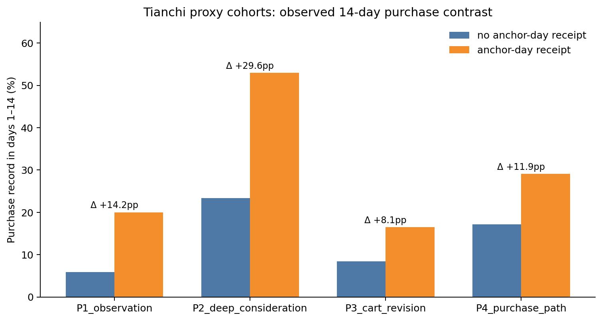
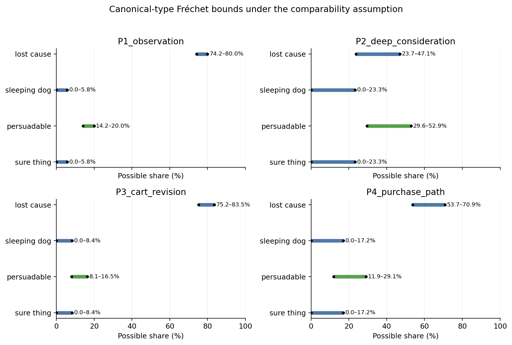
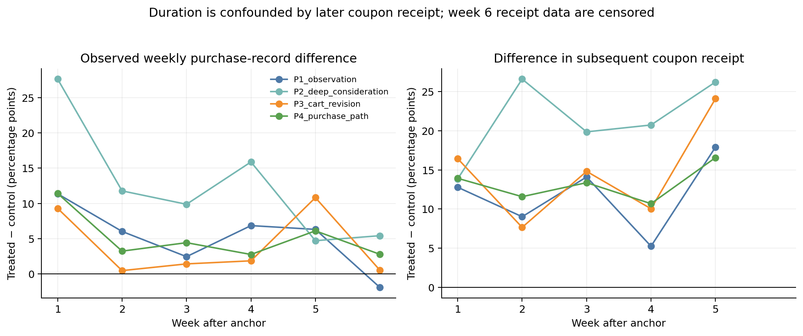
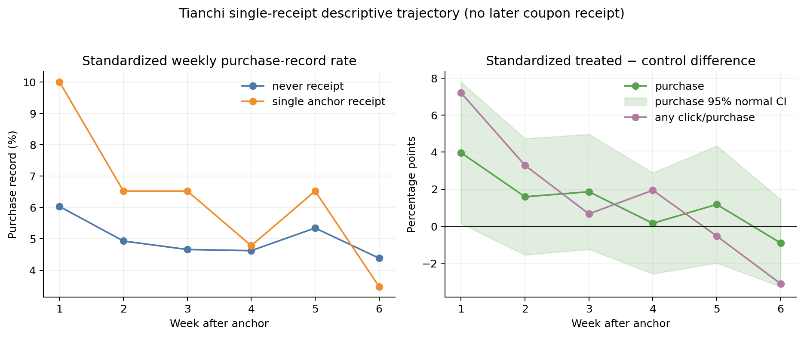
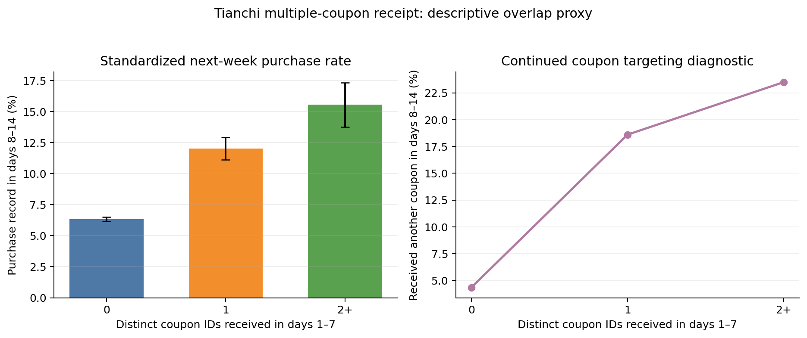
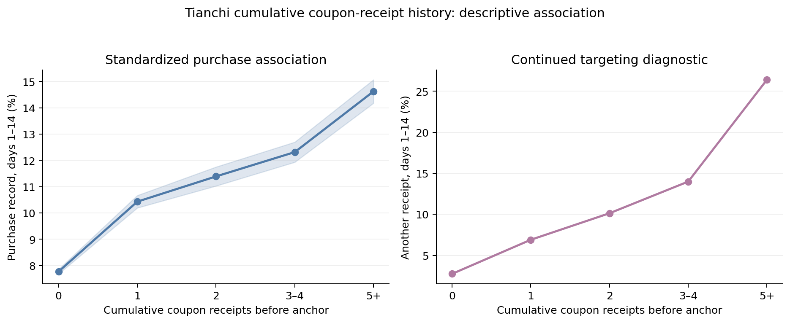
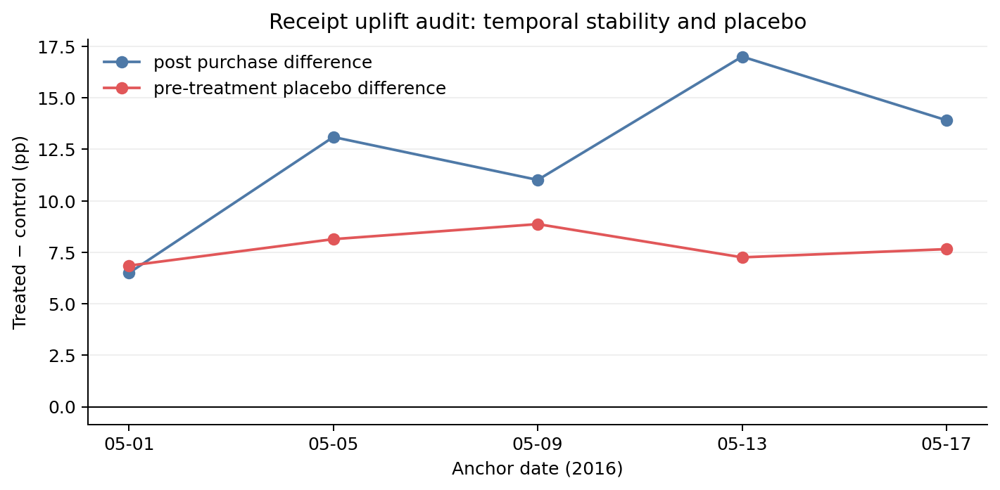

# Tianchi Coupon Receipt: Persona-Proxy Uplift Analysis

## Scope

Cosmetics defines the four behavioral reference personas. Tianchi O2O supplies a separate, observational coupon-receipt log. Since Tianchi has no cart, `remove_from_cart`, product sequence, or session boundary, it cannot recover the Cosmetics personas directly. It supplies only proxy cohorts based on pre-coupon click and purchase depth.

The analysis fixes the anchor date at 2016-05-15.

- Treatment: coupon-receipt record (`Action=2`) on the anchor date.
- Control: no coupon-receipt record on the anchor date.
- Primary outcome: at least one purchase record in days 1–14 after the anchor.
- Proxy definition: only click and purchase records in days −14 through −1; the anchor and future periods are excluded.
- Duration diagnostic: observed treated-minus-control rates for weeks 1–6, with later receipt rates reported as a post-treatment confounder.

The proxy thresholds are pre-period total actions of 1 (25th percentile), 4 (75th), and 14 (95th). P1 is low-depth/no-purchase; P2 is purchase plus very high depth; P3 is click-heavy/no-purchase; P4 is purchase below P2 depth. These are disjoint Tianchi cohorts, not individual Cosmetics labels.

## Observed 14-day purchase contrast

| Proxy cohort | Control n | Receipt n | Control purchase | Receipt purchase | Observed difference |
|---|---:|---:|---:|---:|---:|
| P1 short-observation proxy | 60,577 | 110 | 5.85% | 20.00% | +14.15pp |
| P2 deep-consideration proxy | 4,902 | 34 | 23.34% | 52.94% | +29.60pp |
| P3 cart-revision proxy | 42,321 | 170 | 8.37% | 16.47% | +8.10pp |
| P4 purchase-path proxy | 58,447 | 371 | 17.16% | 29.11% | +11.95pp |

These are **observed conditional differences**, not CATEs. Receipt is not randomized; receipt may be an active user action; treatment/control composition, earlier offers, and unobserved exposure can differ.



## Canonical response types: partial-identification bounds

For binary 14-day purchase potential outcomes \(Y(0),Y(1)\), canonical types are:

| Type | Definition |
|---|---|
| Sure thing | \(Y(0)=1,Y(1)=1\) |
| Persuadable | \(Y(0)=0,Y(1)=1\) |
| Sleeping dog | \(Y(0)=1,Y(1)=0\) |
| Lost cause | \(Y(0)=0,Y(1)=0\) |

No Tianchi user is assigned to one of these types. If—and only if—the treated/control observed purchase rates are treated as comparable potential-outcome marginals, Fréchet bounds yield the following possible population shares.

| Proxy cohort | Sure thing | Persuadable | Sleeping dog | Lost cause |
|---|---:|---:|---:|---:|
| P1 | 0–5.85% | 14.15–20.00% | 0–5.85% | 74.15–80.00% |
| P2 | 0–23.34% | 29.60–52.94% | 0–23.34% | 23.72–47.06% |
| P3 | 0–8.37% | 8.10–16.47% | 0–8.37% | 75.16–83.53% |
| P4 | 0–17.16% | 11.95–29.11% | 0–17.16% | 53.73–70.89% |

The positive observed difference forces the *lower bound* of persuadables to equal that difference under the comparability assumption. It does not show that a particular user is persuadable, and sleeping-dog mass can remain nonzero within its stated range.



## Observed duration pattern

Weekly purchase-record differences (treated minus control, percentage points) are:

| Proxy | Week 1 | Week 2 | Week 3 | Week 4 | Week 5 | Week 6 |
|---|---:|---:|---:|---:|---:|---:|
| P1 | +11.37 | +6.03 | +2.45 | +6.86 | +6.32 | −1.90 |
| P2 | +27.63 | +11.78 | +9.88 | +15.88 | +4.71 | +5.42 |
| P3 | +9.30 | +0.47 | +1.43 | +1.86 | +10.82 | +0.54 |
| P4 | +11.42 | +3.24 | +4.43 | +2.76 | +6.11 | +2.79 |

This is not a monotone decay pattern and is not evidence of a six-week coupon effect. Subsequent coupon-receipt rates are much higher among initially treated users: for example, P4 treated users have later receipts of 18.9%, 16.2%, 18.6%, 15.4%, and 19.1% in weeks 1–5, versus 4.9%, 4.6%, 5.2%, 4.7%, and 2.6% for controls. P2 has only 34 treated users. Tianchi receipt dates are also right-censored after mid-June, so later-receipt fields in weeks 5–6 are incomplete.

The appropriate simulator use is therefore a **hypothesis**: proxy-specific coupon terms may initially shift the purchase utility upward, with a decaying latent effect. Its magnitude and persistence must be calibrated as a sensitivity range, not identified from these differences. Any such term must still reproduce the no-coupon behavior when set to zero.



## Single-receipt duration check without personas

To reduce repeated-coupon contamination, a separate analysis drops persona proxies entirely. Treated users have exactly one recorded receipt in days −14 through 42, it occurs on the anchor date, and no other receipt occurs in that window. Controls have no receipt in the same window. Both arms require at least one pre-anchor click or purchase and are standardized over five pre-history strata: click count `0`, `1`, or `2+` crossed with purchase history `0` or `1+`.

This leaves 230 single-receipt users and 179,654 never-receipt controls. The standardized weekly purchase-record difference is +3.97pp in week 1 (normal 95% interval +0.14 to +7.79pp), +1.59pp in week 2, +1.86pp in week 3, and +0.16pp in week 4. The week-2 through week-6 intervals include zero. Thus this restricted descriptive cohort is consistent with a short initial elevation that is no longer distinguishable from zero after week 1; it does **not** establish a monotone or causal decay law.



The restriction uses future receipt history, which is itself post-treatment selection. It is appropriate as a contamination-reduced trajectory diagnostic, not as an intervention estimand. For the simulator, an initial one-week coupon component with a weak, uncertainty-bounded tail is more defensible than a confidently estimated multi-week decay curve.

## Multiple-coupon receipt: overlap proxy

Tianchi does not record coupon expiry, the user's active coupon inventory, or whether two coupons can be redeemed together. Therefore it cannot identify literal concurrent coupon availability or a causal stacking effect. We use a deliberately weaker **overlap proxy**: the number of distinct `Coupon_id` values recorded as received in days 1–7 after the fixed 2016-05-15 anchor. The outcome is any purchase record in the subsequent, non-overlapping days 8–14.

Users must have a pre-anchor click or purchase record. The three exposure groups are standardized to the one-coupon group's pre-history distribution over click count (`0`, `1`, `2+`), purchase history (`0`, `1+`), and prior coupon-receipt history (`0`, `1+`). Only strata represented in all three groups are retained.

| Distinct coupon IDs received, days 1–7 | Users | Standardized purchase, days 8–14 | Change from previous dose | Another receipt, days 8–14 |
|---|---:|---:|---:|---:|
| 0 | 206,180 | 6.35% (95% normal CI 6.18–6.51) | — | 4.34% |
| 1 | 4,989 | 12.03% (11.13–12.93) | +5.68pp vs. 0 (4.76–6.59) | 18.60% |
| 2+ | 1,601 | 15.55% (13.77–17.34) | +3.53pp vs. 1 (1.53–5.53) | 23.50% |

The `2+` group receives 2.49 distinct coupon IDs on average (3.13 receipt events). Its purchase association is higher than the one-coupon group, so the raw pattern is compatible with a positive additional-exposure association. It is **not** a coupon-stacking estimate: the sharp rise in another receipt during the outcome week (4.34% → 18.60% → 23.50%) shows continued targeting/exposure is strongly entangled with the apparent dose response. Unobserved demand, offer eligibility, and merchant rules remain uncontrolled.

For the simulator, this supports only a sensitivity design: if a contemporaneous multi-coupon term is enabled, make its marginal increment non-increasing, for example \(g(m)=\delta(1-e^{-\kappa m})\), and sweep \(\kappa\) rather than fitting it as an identified causal coefficient from Tianchi. The default simulator should still permit \(g(m)=0\); the observed association alone does not license an overlap intervention claim.



## Cumulative coupon-receipt history

As a simpler state diagnostic, we counted every coupon-receipt event (`Action=2`) from the start of the observed log through the day before the anchor. This is **not an active coupon balance**: Tianchi lacks expiry, an inventory ledger, and complete receipt-to-redemption linkage. It is an observed exposure/targeting-history variable. Users have at least one pre-anchor click or purchase, and purchase rates are standardized over pre-anchor click and purchase-history strata.

| Cumulative receipt events before anchor | Users | Mean receipt events | Standardized purchase, days 1–14 | Another receipt, days 1–14 |
|---|---:|---:|---:|---:|
| 0 | 508,446 | 0.00 | 7.77% | 2.74% |
| 1 | 63,372 | 1.00 | 10.43% | 6.90% |
| 2 | 28,819 | 2.00 | 11.39% | 10.13% |
| 3–4 | 27,492 | 3.41 | 12.32% | 13.99% |
| 5+ | 23,928 | 8.55 | 14.62% | 26.41% |

The association is increasing and concave over the first few receipts. On these five binned standardized rates, a weighted two-parameter square-root curve has 0.09 percentage-point RMSE, compared with 0.16pp for `log1p` and 0.69pp for a linear curve. The `5+` group is broad and has sharply higher future receipt probability, so this is only a compact descriptive approximation—not evidence that repeated coupons causally raise purchase utility.

Accordingly, the recommended simulator state has **no hard coupon-count ceiling**:

\[
Z_t=\sum_{r<t} A_r K(t-r),\qquad
K(\ell)=\exp(-\ell/\tau),\qquad
U_{\mathrm{purchase},t}=U_{\mathrm{base},t}+\beta_g\sqrt{Z_t}.
\]

Here \(A_r\) is the number of coupon receipts, \(K\) supplies recency decay, and \(\sqrt{Z_t}\) gives diminishing marginal contribution without a discrete ceiling. Estimate or sensitivity-sweep the decay \(\tau\); do not infer it from the cumulative-history curve. The persona-specific \(\beta_g\) is an exposure-history association parameter unless separately calibrated with an intervention-valid source. If the simulator later requires a specific coupon to be redeemed, model that as a separate conditional coupon-choice module rather than imposing FIFO; Tianchi cannot support a credible global oldest-first rule.



## Uplift identification audit

Finally, we repeated the receipt-versus-no-receipt comparison at five May anchors. Each anchor uses a 14-day pre-period for click/purchase stratification, an earlier 14-day purchase window as a placebo outcome, and a 14-day post-anchor purchase outcome. If receipt were conditionally as-good-as-random under the observed history, the placebo difference should be near zero.

| Anchor | Receipt users | Observed post purchase difference | Pre-treatment placebo difference | Difference in subsequent receipt |
|---|---:|---:|---:|---:|
| May 1 | 1,410 | +6.50pp | +6.85pp | +12.11pp |
| May 5 | 1,071 | +13.10pp | +8.14pp | +27.31pp |
| May 9 | 1,460 | +11.02pp | +8.87pp | +24.07pp |
| May 13 | 776 | +17.00pp | +7.26pp | +31.31pp |
| May 17 | 1,317 | +13.91pp | +7.65pp | +28.90pp |

All anchors have a sizeable positive placebo difference before the indexed receipt, and all show much greater subsequent receipt for the receipt arm. The observed pre-purchase standardized mean difference also remains 0.16–0.28 after coarse strata adjustment. Thus the fixed-anchor contrasts are temporally present but not credibly conditionally randomized; more elaborate outcome/propensity modeling cannot remove unobserved targeting without a new identifying design. Tianchi should calibrate descriptive simulator scenarios only, not validate a causal uplift policy.



## Post-redemption trajectory diagnostic

Receipt and redemption are different events. As a separate descriptive check, we indexed each user's first unambiguous purchase between May 1 and May 17: treatment is a purchase with a non-null coupon ID, while control is a purchase without a coupon ID. Users with both purchase types on the anchor day are excluded, as are users with a coupon redemption in the preceding 14 days. We standardize over coarse pre-anchor purchase and click strata. This leaves 8,129 coupon-redemption anchors and 60,327 non-coupon-purchase anchors.

| Week after indexed purchase | Coupon redemption | Non-coupon purchase | Observed difference |
|---|---:|---:|---:|
| 1 | 26.31% | 9.87% | +16.45pp |
| 2 | 28.88% | 7.88% | +21.00pp |
| 3 | 10.16% | 7.45% | +2.72pp |
| 4 | 8.76% | 7.20% | +1.56pp |

The trajectory has a large elevation for roughly two weeks and then converges sharply toward the non-coupon-purchase comparison. It is useful as a **naturalistic simulator shape**: a coupon-redemption episode can coincide with temporarily heightened purchasing, with a weak tail after two weeks. It is not a redemption causal effect. Choosing a coupon purchase rather than a non-coupon purchase is endogenous, and the receipt audit above shows persistent targeting imbalance. The simulator should therefore make the post-redemption carry-over optional and report its magnitude/duration as a sensitivity setting.

## Simulator decay assumption

For the synthetic simulator, we adopt a **monotone, finite-horizon coupon carry-over assumption**: the initial coupon contribution is positive, never increases with elapsed week, and is set to zero after week 6. This is a modeling choice motivated by the single-receipt diagnostic—not a claim that Tianchi identifies an exactly zero causal effect at week 6.

For a coupon received at week \(t\), use the truncated monotone kernel

\[
d(k)=\delta_0\left[\max\left(0,1-\frac{k-1}{5}\right)\right]^{\rho},\qquad k=1,\ldots,6,
\]

and \(d(k)=0\) for \(k>6\). Here \(\delta_0\ge0\) is the immediate utility increment and \(\rho\ge0\) controls decay speed. The purchase/action utility can include \(A_t d(k)\), while the no-coupon simulator is recovered exactly by setting \(A_t=0\) or \(\delta_0=0\).

The observed standardized week-1 difference (+3.97pp) supplies only an initial calibration target. Weeks 2–6 do not identify \(\rho\), so the simulator should report a sensitivity sweep, for example `rho ∈ {1, 2, 4}`, rather than fit a precise persistence coefficient from 230 treated users. This preserves the intended pattern—short-lived and monotone—without claiming unsupported precision.

## Simulator integration

Tianchi를 인과적 정답으로 사용하지 않고, 명시적인 합성환경 파라미터를 정하는
calibration source로 사용했다. Cosmetics의 성숙 persona는 공통 행동 의미에 따라
`P0 → P4 purchase-path proxy`, `P2 → P2 deep-consideration proxy`,
`P3 → P3 cart-revision proxy`로 연결했다.

각 proxy의 14일 구매율 `p0`, `p1`에 대해 주변분포를 보존하면서 결합 엔트로피가
최대인 독립 coupling을 선택했다.

\[
\pi_{ST}=p_0p_1,\quad \pi_P=(1-p_0)p_1,\quad
\pi_{SD}=p_0(1-p_1),\quad \pi_{LC}=(1-p_0)(1-p_1).
\]

이는 canonical type을 식별했다는 뜻이 아니라, Fréchet 구간 안에서 재현 가능한
하나의 합성 joint distribution을 고른 것이다. Persuadable은 쿠폰 purchase/return
logit offset의 부호가 양수, sleeping dog는 음수이며 sure thing과 lost cause는 0이다.
반복 수령은 hard ceiling 없이 다음처럼 diminishing return을 적용한다.

\[
E_t=\sqrt{\sum_{r<t}d(t-r)},\qquad
d(k)=\left[\max\left(0,1-\frac{\lfloor k/7\rfloor}{5}\right)\right]^2.
\]

35일 이후 개별 수령 효과는 0이다. persona별 초기 offset은 Tianchi의 purchase 및
7일 복귀 odds 차이로 정한다. 공통 strength `4`를 초기값으로만 사용하고, 별도 seed
2026의 6,000명 calibration rollout에서 persona별 14일 구매 차이를 moment target으로
삼아 multiplicative update를 최대 4회 수행했다. 가장 작은 calibration RMSE를 보인
iteration을 early stopping으로 선택한 결과 strength는 P0 `8.536`, P2 `3.811`,
P3 `3.508`이 되었다. seed 42의 10,000명은 이 학습에 사용하지 않았다.

독립 validation 10,000명에서 모집단 가중 14일 구매 차이는 Tianchi proxy 목표
`+12.62%p` 대비 생성 `+12.55%p`로 절대오차 `0.07%p`였다. 구매 세션률은
`3.94% → 15.55%`, 30일 비복귀율은 `21.91% → 18.65%`였다. persona별 목표/생성
차이는 P0 `+11.95/+10.98%p`, P2 `+29.60/+29.66%p`, P3
`+8.10/+8.19%p`로 최대 오차가 `0.98%p`였다. `strength=0` 또는 수령 이력
없음에서는 모든 offset이
정확히 0이므로 무쿠폰 정책으로 환원된다.

Canonical type은 전역 비율로 바로 뽑지 않는다. 기존 GRU의 48차원 사용자 latent를
전체 성숙 사용자에서 표준화하고 intercept를 붙인 뒤, 하나의 `49×4` 행렬로 canonical
logit을 만든다. 행렬은 persona별 평균 softmax가 위 maximum-entropy target을 맞추는
weak supervision으로 학습했다. 행렬 열의 합을 0으로 제약하고, 사용자 분리 held-out
분포 RMSE가 0.01 이하인 조합 중 가장 강한 `L1=0.001`, `L2=0.01`을 선택했다.
Held-out RMSE는 0.0096, 전체 fit RMSE는 0.0019다.

Synthetic user는 home persona별 48차원 full-covariance Gaussian에서 latent를 뽑고,
이 행렬의 softmax 확률로 canonical type을 출생 시 한 번 샘플링해 고정한다. 10,000명
표본에서 persuadable·sleeping dog 비율은 persona별로 별도 산출물에 저장한다.
학습된 strength를 적용한 persuadable의 첫 주 purchase-logit offset은
P0/P2/P3에서 각각 `+5.84/+4.98/+2.70`이며 sleeping dog에는 부호를 반대로 적용한다.
따라서 모집단 평균 상승폭을 모든 사용자에게 균일하게 더하는 구조가 아니다.

실행 모델과 검증 결과는 `artifacts/tianchi-uplift-model/model.json`,
`rollout_summary.json`, `single_receipt_rollout.parquet`,
`sampled_canonical_type_distribution.csv`, `sampled_user_uplift_profiles.parquet`에 저장한다.

## Outputs and reproduction

- [Cohort table](artifacts/tianchi-persona-uplift/tianchi_persona_uplift_cohort.parquet): per-user pre-period counts, treatment, and weekly observed outcomes.
- [Summary](artifacts/tianchi-persona-uplift/summary.json): arm sizes, canonical-type bounds, weekly rates, and later-receipt diagnostics.
- [Single-receipt cohort](artifacts/tianchi-single-receipt-duration/cohort.parquet) and [summary](artifacts/tianchi-single-receipt-duration/summary.json): contamination-reduced, non-persona duration diagnostic.
- [Multiple-coupon overlap cohort](artifacts/tianchi-coupon-overlap/cohort.parquet) and [summary](artifacts/tianchi-coupon-overlap/summary.json): standardized descriptive dose-response proxy; not active-coupon overlap or a causal stacking estimate.
- [Cumulative receipt-history cohort](artifacts/tianchi-cumulative-coupon-history/cohort.parquet) and [summary](artifacts/tianchi-cumulative-coupon-history/summary.json): historical exposure/targeting diagnostic, not a coupon inventory.
- [Multi-anchor uplift audit](artifacts/tianchi-uplift-audit/summary.json): placebo, balance, and repeated-anchor diagnostics showing residual targeting confounding.

```bash
PYTHONPATH=src python -m analysis.uplift.observed persona-uplift
PYTHONPATH=src python -m analysis.uplift.observed single-receipt-duration
PYTHONPATH=src python -m analysis.uplift.observed coupon-overlap
PYTHONPATH=src python -m analysis.uplift.observed cumulative-coupons
PYTHONPATH=src python -m analysis.uplift.observed uplift-audit
PYTHONPATH=src python -m analysis.uplift.model --rollout-users 10000
```

The command is descriptive only. It does not estimate causal uplift, identify a canonical type for any user, or justify intervention-policy evaluation.
